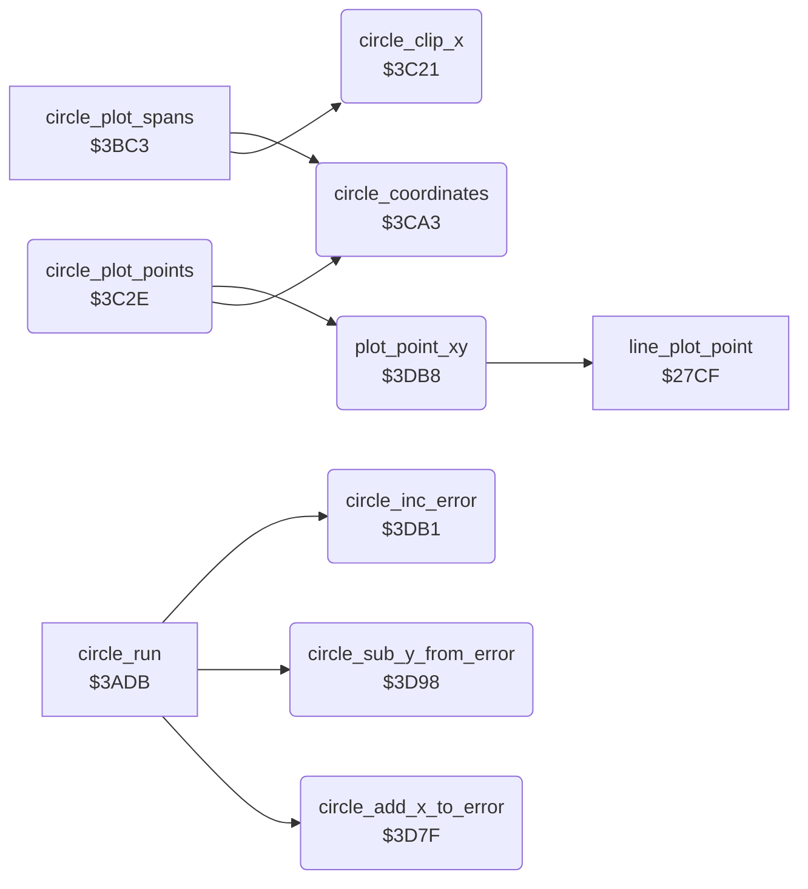

<!-- Generated by c64-docs from knowledge revision 20261024T063910.298-7zz1bw and .c64-re-tools/local/generated/src/source-map.json. Do not edit: change the knowledge, generate the source again, then run docs.ts generate. -->
# graphics/circle_plot_3c21.asm

Range `$3C21-$3DCB`. Source: [graphics/circle_plot_3c21.asm](../../../../src/graphics/circle_plot_3c21.asm). Index: [the reference](../../index.md).

## Call graph

A solid arrow is a call, a thick arrow a table entry, a dotted arrow a jump. Rounded nodes are in this file.

## Names

### [`circle_clip_x`](../../../../src/graphics/circle_plot_3c21.asm#L6) `$3C21`

*routine*

Clips a circle X coordinate. Input A: X, $fe (below 0) or $ff (above draw_max_x). Output A: 0 for $fe, draw_max_x for $ff, else X.

- **Called from:** [`circle_plot_spans`](circle_plot.md#circle_plot_spans) [`$3BD1`](../../../../src/graphics/circle_plot.asm#L15), [`circle_plot_spans`](circle_plot.md#circle_plot_spans) [`$3BE4`](../../../../src/graphics/circle_plot.asm#L24), [`circle_plot_spans`](circle_plot.md#circle_plot_spans) [`$3BFA`](../../../../src/graphics/circle_plot.asm#L35), [`circle_plot_spans`](circle_plot.md#circle_plot_spans) [`$3C01`](../../../../src/graphics/circle_plot.asm#L38)
- **Reads:** [`max_x`](../../memory-map.md#max_x)

### [`circle_clip_x_high`](../../../../src/graphics/circle_plot_3c21.asm#L10) `$3C27`

*label*

- **Jumped to from:** [`circle_clip_x`](circle_plot_3c21.md#circle_clip_x) [`$3C23`](../../../../src/graphics/circle_plot_3c21.asm#L8)

### [`circle_clip_x_done`](../../../../src/graphics/circle_plot_3c21.asm#L15) `$3C2D`

*label*

- **Jumped to from:** [`circle_clip_x`](circle_plot_3c21.md#circle_clip_x) [`$3C29`](../../../../src/graphics/circle_plot_3c21.asm#L12)

### [`circle_plot_points`](../../../../src/graphics/circle_plot_3c21.asm#L18) `$3C2E`

*routine*

Plot routine of the circle outline: plots the four points (circle_x_right, circle_y_down), (circle_x_right, circle_y_up), (circle_x_left, circle_y_down) and (circle_x_left, circle_y_up) with plot_point_xy. It skips a point outside the drawing area. When circle_y_offset is 0, it returns from the caller of circle_plot.

- **Calls:** [`circle_coordinates`](circle_plot_3c21.md#circle_coordinates), [`plot_point_xy`](circle_plot_3c21.md#plot_point_xy)
- **Reads:** [`delta_x`](../../memory-map.md#delta_x), [`max_x`](../../memory-map.md#max_x), [`delta_y`](../../memory-map.md#delta_y), [`max_y`](../../memory-map.md#max_y), [`circle_upper_y`](../../memory-map.md#circle_upper_y), [`circle_left_x`](../../memory-map.md#circle_left_x), [`line_dy`](../../memory-map.md#line_dy), [`line_dx`](../../memory-map.md#line_dx)
- **Writes:** [`max_x`](../../memory-map.md#max_x), [`max_y`](../../memory-map.md#max_y)

### [`circle_point_right_up`](../../../../src/graphics/circle_plot_3c21.asm#L33) `$3C4A`

*label*

- **Jumped to from:** [`circle_plot_points`](circle_plot_3c21.md#circle_plot_points) [`$3C39`](../../../../src/graphics/circle_plot_3c21.asm#L24), [`circle_plot_points`](circle_plot_3c21.md#circle_plot_points) [`$3C44`](../../../../src/graphics/circle_plot_3c21.asm#L30)

### [`circle_point_left_down`](../../../../src/graphics/circle_plot_3c21.asm#L47) `$3C63`

*label*

- **Jumped to from:** [`circle_plot_points`](circle_plot_3c21.md#circle_plot_points) [`$3C52`](../../../../src/graphics/circle_plot_3c21.asm#L38), [`circle_plot_points`](circle_plot_3c21.md#circle_plot_points) [`$3C5D`](../../../../src/graphics/circle_plot_3c21.asm#L44)

### [`circle_point_left_up`](../../../../src/graphics/circle_plot_3c21.asm#L61) `$3C7C`

*label*

- **Jumped to from:** [`circle_plot_points`](circle_plot_3c21.md#circle_plot_points) [`$3C6B`](../../../../src/graphics/circle_plot_3c21.asm#L52), [`circle_plot_points`](circle_plot_3c21.md#circle_plot_points) [`$3C76`](../../../../src/graphics/circle_plot_3c21.asm#L58)

### [`circle_points_test_end`](../../../../src/graphics/circle_plot_3c21.asm#L75) `$3C95`

*label*

- **Jumped to from:** [`circle_plot_points`](circle_plot_3c21.md#circle_plot_points) [`$3C84`](../../../../src/graphics/circle_plot_3c21.asm#L66), [`circle_plot_points`](circle_plot_3c21.md#circle_plot_points) [`$3C8F`](../../../../src/graphics/circle_plot_3c21.asm#L72)

### [`circle_points_return`](../../../../src/graphics/circle_plot_3c21.asm#L81) `$3C9F`

*label*

- **Jumped to from:** [`circle_plot_points`](circle_plot_3c21.md#circle_plot_points) [`$3C97`](../../../../src/graphics/circle_plot_3c21.asm#L77)

### [`circle_points_end`](../../../../src/graphics/circle_plot_3c21.asm#L83) `$3CA0`

*label*

Drop the return address of circle_plot: the circle is complete.

- **Jumped to from:** [`circle_plot_points`](circle_plot_3c21.md#circle_plot_points) [`$3C9D`](../../../../src/graphics/circle_plot_3c21.asm#L80)

### [`circle_coordinates`](../../../../src/graphics/circle_plot_3c21.asm#L88) `$3CA3`

*routine*

Calculates the four circle coordinates from the centre (shape_x0, shape_y0), circle_x_offset and circle_y_offset: circle_x_right/left = shape_x0 +/- 3/4 * circle_x_offset, circle_y_down/up = shape_y0 +/- circle_y_offset. A coordinate below 0 becomes $fe, a coordinate above draw_max_x or draw_max_y becomes $ff.
temp_word = 3 * circle_x_offset.

- **Called from:** [`circle_plot_spans`](circle_plot.md#circle_plot_spans) [`$3BCC`](../../../../src/graphics/circle_plot.asm#L13), [`circle_plot_points`](circle_plot_3c21.md#circle_plot_points) [`$3C2E`](../../../../src/graphics/circle_plot_3c21.asm#L19)
- **Reads:** [`line_x_negative`](../../memory-map.md#line_x_negative), [`line_y_negative`](../../memory-map.md#line_y_negative), [`temp_word`](../../memory-map.md#temp_word), [`temp_word_hi`](../../memory-map.md#temp_word_hi), [`shape_x0`](../../memory-map.md#shape_x0), [`max_x`](../../memory-map.md#max_x), [`circle_left_x`](../../memory-map.md#circle_left_x), [`shape_y0`](../../memory-map.md#shape_y0), [`line_dx`](../../memory-map.md#line_dx), [`line_dy`](../../memory-map.md#line_dy), [`max_y`](../../memory-map.md#max_y), [`circle_upper_y`](../../memory-map.md#circle_upper_y)
- **Writes:** [`temp_word`](../../memory-map.md#temp_word), [`temp_word_hi`](../../memory-map.md#temp_word_hi), [`delta_x`](../../memory-map.md#delta_x), [`max_x`](../../memory-map.md#max_x), [`circle_left_x`](../../memory-map.md#circle_left_x), [`delta_y`](../../memory-map.md#delta_y), [`max_y`](../../memory-map.md#max_y), [`circle_upper_y`](../../memory-map.md#circle_upper_y)

### [`circle_coord_right_neg`](../../../../src/graphics/circle_plot_3c21.asm#L122) `$3CDA`

*label*

- **Jumped to from:** [`circle_coordinates`](circle_plot_3c21.md#circle_coordinates) [`$3CD4`](../../../../src/graphics/circle_plot_3c21.asm#L118)

### [`circle_coord_right_max`](../../../../src/graphics/circle_plot_3c21.asm#L130) `$3CE7`

*label*

- **Jumped to from:** [`circle_coordinates`](circle_plot_3c21.md#circle_coordinates) [`$3CDE`](../../../../src/graphics/circle_plot_3c21.asm#L125)

### [`circle_coord_left`](../../../../src/graphics/circle_plot_3c21.asm#L138) `$3CF3`

*label*

- **Jumped to from:** [`circle_coordinates`](circle_plot_3c21.md#circle_coordinates) [`$3CE4`](../../../../src/graphics/circle_plot_3c21.asm#L129), [`circle_coordinates`](circle_plot_3c21.md#circle_coordinates) [`$3CED`](../../../../src/graphics/circle_plot_3c21.asm#L134)

### [`circle_coord_left_hi`](../../../../src/graphics/circle_plot_3c21.asm#L149) `$3D07`

*label*

- **Jumped to from:** [`circle_coordinates`](circle_plot_3c21.md#circle_coordinates) [`$3CFE`](../../../../src/graphics/circle_plot_3c21.asm#L145)

### [`circle_coord_left_max`](../../../../src/graphics/circle_plot_3c21.asm#L155) `$3D10`

*label*

- **Jumped to from:** [`circle_coordinates`](circle_plot_3c21.md#circle_coordinates) [`$3D07`](../../../../src/graphics/circle_plot_3c21.asm#L150)

### [`circle_coord_down`](../../../../src/graphics/circle_plot_3c21.asm#L164) `$3D1E`

*label*

- **Jumped to from:** [`circle_coordinates`](circle_plot_3c21.md#circle_coordinates) [`$3D04`](../../../../src/graphics/circle_plot_3c21.asm#L148), [`circle_coordinates`](circle_plot_3c21.md#circle_coordinates) [`$3D0D`](../../../../src/graphics/circle_plot_3c21.asm#L154), [`circle_coordinates`](circle_plot_3c21.md#circle_coordinates) [`$3D18`](../../../../src/graphics/circle_plot_3c21.asm#L160)

### [`circle_coord_down_hi`](../../../../src/graphics/circle_plot_3c21.asm#L177) `$3D34`

*label*

- **Jumped to from:** [`circle_coordinates`](circle_plot_3c21.md#circle_coordinates) [`$3D2B`](../../../../src/graphics/circle_plot_3c21.asm#L172)

### [`circle_coord_down_max`](../../../../src/graphics/circle_plot_3c21.asm#L183) `$3D3D`

*label*

- **Jumped to from:** [`circle_coordinates`](circle_plot_3c21.md#circle_coordinates) [`$3D34`](../../../../src/graphics/circle_plot_3c21.asm#L178)

### [`circle_coord_down_store`](../../../../src/graphics/circle_plot_3c21.asm#L192) `$3D4E`

*label*

- **Jumped to from:** [`circle_coordinates`](circle_plot_3c21.md#circle_coordinates) [`$3D45`](../../../../src/graphics/circle_plot_3c21.asm#L188)

### [`circle_coord_up`](../../../../src/graphics/circle_plot_3c21.asm#L194) `$3D50`

*label*

- **Jumped to from:** [`circle_coordinates`](circle_plot_3c21.md#circle_coordinates) [`$3D31`](../../../../src/graphics/circle_plot_3c21.asm#L176), [`circle_coordinates`](circle_plot_3c21.md#circle_coordinates) [`$3D3A`](../../../../src/graphics/circle_plot_3c21.asm#L182), [`circle_coordinates`](circle_plot_3c21.md#circle_coordinates) [`$3D4B`](../../../../src/graphics/circle_plot_3c21.asm#L191)

### [`circle_coord_up_hi`](../../../../src/graphics/circle_plot_3c21.asm#L206) `$3D64`

*label*

- **Jumped to from:** [`circle_coordinates`](circle_plot_3c21.md#circle_coordinates) [`$3D5B`](../../../../src/graphics/circle_plot_3c21.asm#L201)

### [`circle_coord_up_max`](../../../../src/graphics/circle_plot_3c21.asm#L212) `$3D6D`

*label*

- **Jumped to from:** [`circle_coordinates`](circle_plot_3c21.md#circle_coordinates) [`$3D64`](../../../../src/graphics/circle_plot_3c21.asm#L207)

### [`circle_coord_done`](../../../../src/graphics/circle_plot_3c21.asm#L222) `$3D7E`

*label*

- **Jumped to from:** [`circle_coordinates`](circle_plot_3c21.md#circle_coordinates) [`$3D61`](../../../../src/graphics/circle_plot_3c21.asm#L205), [`circle_coordinates`](circle_plot_3c21.md#circle_coordinates) [`$3D6A`](../../../../src/graphics/circle_plot_3c21.asm#L211), [`circle_coordinates`](circle_plot_3c21.md#circle_coordinates) [`$3D75`](../../../../src/graphics/circle_plot_3c21.asm#L217), [`circle_coordinates`](circle_plot_3c21.md#circle_coordinates) [`$3D7B`](../../../../src/graphics/circle_plot_3c21.asm#L221)

### [`circle_add_x_to_error`](../../../../src/graphics/circle_plot_3c21.asm#L225) `$3D7F`

*routine*

circle_error = circle_error + 2 * circle_x_offset.

- **Called from:** [`circle_run`](circle.md#circle_run) [`$3B40`](../../../../src/graphics/circle.asm#L186), [`circle_run`](circle.md#circle_run) [`$3B5A`](../../../../src/graphics/circle.asm#L203)
- **Reads:** [`line_x_negative`](../../memory-map.md#line_x_negative), [`line_y_negative`](../../memory-map.md#line_y_negative), [`point_x1`](../../memory-map.md#point_x1), [`temp_word`](../../memory-map.md#temp_word), [`point_y1`](../../memory-map.md#point_y1), [`temp_word_hi`](../../memory-map.md#temp_word_hi)
- **Writes:** [`temp_word`](../../memory-map.md#temp_word), [`temp_word_hi`](../../memory-map.md#temp_word_hi), [`point_x1`](../../memory-map.md#point_x1), [`point_y1`](../../memory-map.md#point_y1)

### [`circle_sub_y_from_error`](../../../../src/graphics/circle_plot_3c21.asm#L242) `$3D98`

*routine*

circle_error = circle_error - 2 * circle_y_offset.

- **Called from:** [`circle_run`](circle.md#circle_run) [`$3B5D`](../../../../src/graphics/circle.asm#L204), [`circle_run`](circle.md#circle_run) [`$3B74`](../../../../src/graphics/circle.asm#L217)
- **Reads:** [`line_dx`](../../memory-map.md#line_dx), [`line_dy`](../../memory-map.md#line_dy), [`point_x1`](../../memory-map.md#point_x1), [`temp_word`](../../memory-map.md#temp_word), [`point_y1`](../../memory-map.md#point_y1), [`temp_word_hi`](../../memory-map.md#temp_word_hi)
- **Writes:** [`temp_word`](../../memory-map.md#temp_word), [`temp_word_hi`](../../memory-map.md#temp_word_hi), [`point_x1`](../../memory-map.md#point_x1), [`point_y1`](../../memory-map.md#point_y1)

### [`circle_inc_error`](../../../../src/graphics/circle_plot_3c21.asm#L259) `$3DB1`

*routine*

circle_error = circle_error + 1.

- **Called from:** [`circle_run`](circle.md#circle_run) [`$3B43`](../../../../src/graphics/circle.asm#L187), [`circle_run`](circle.md#circle_run) [`$3B60`](../../../../src/graphics/circle.asm#L205), [`circle_run`](circle.md#circle_run) [`$3B63`](../../../../src/graphics/circle.asm#L206), [`circle_run`](circle.md#circle_run) [`$3B77`](../../../../src/graphics/circle.asm#L218)
- **Reads:** [`point_x1`](../../memory-map.md#point_x1), [`point_y1`](../../memory-map.md#point_y1)
- **Writes:** [`point_x1`](../../memory-map.md#point_x1), [`point_y1`](../../memory-map.md#point_y1)

### [`circle_inc_error_done`](../../../../src/graphics/circle_plot_3c21.asm#L263) `$3DB7`

*label*

- **Jumped to from:** [`circle_inc_error`](circle_plot_3c21.md#circle_inc_error) [`$3DB3`](../../../../src/graphics/circle_plot_3c21.asm#L261)

### [`plot_point_xy`](../../../../src/graphics/circle_plot_3c21.asm#L266) `$3DB8`

*routine*

Plots the current brush at X = X register, Y = Y register with the plot routine at $27cf. cursor_x and cursor_y do not change.

- **Called from:** [`circle_plot_points`](circle_plot_3c21.md#circle_plot_points) [`$3C47`](../../../../src/graphics/circle_plot_3c21.asm#L32), [`circle_plot_points`](circle_plot_3c21.md#circle_plot_points) [`$3C60`](../../../../src/graphics/circle_plot_3c21.asm#L46), [`circle_plot_points`](circle_plot_3c21.md#circle_plot_points) [`$3C79`](../../../../src/graphics/circle_plot_3c21.asm#L60), [`circle_plot_points`](circle_plot_3c21.md#circle_plot_points) [`$3C92`](../../../../src/graphics/circle_plot_3c21.asm#L74)
- **Calls:** [`line_plot_point`](bresenham_line.md#line_plot_point)
- **Reads:** [`cursor_x`](../../memory-map.md#cursor_x), [`cursor_y`](../../memory-map.md#cursor_y)
- **Writes:** [`cursor_x`](../../memory-map.md#cursor_x), [`cursor_y`](../../memory-map.md#cursor_y)
