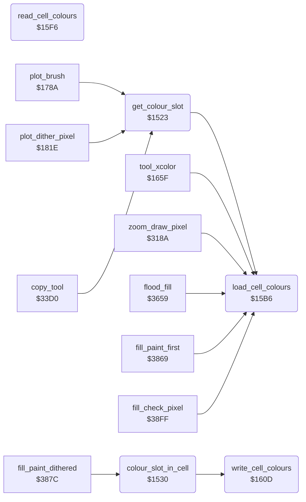

<!-- Generated by c64-docs from knowledge revision 20261025T214623.268-6ar633 and .c64-re-tools/local/generated/src/source-map.json. Do not edit: change the knowledge, generate the source again, then run docs.ts generate. -->
# graphics/colour_slots.asm: Colours of a picture cell

Range `$1523-$161D`. Source: [graphics/colour_slots.asm](../../../../src/graphics/colour_slots.asm). Index: [the reference](../../index.md).

## Routines

| Routine | Address | Reached from | Summary |
|---|---|---|---|
| [`get_colour_slot`](colour_slots.md#get_colour_slot) | `$1523` | [`plot_brush`](plot_brush.md#plot_brush), [`plot_dither_pixel`](brush_plot.md#plot_dither_pixel), [`copy_tool`](../tools/copy.md#copy_tool), [`jt_sample_pad`](../init/entry.md#jt_sample_pad) | Gives in A the pixel value (0-3) for current_colour in the cell of pixel_ptr. |
| [`colour_slot_in_cell`](colour_slots.md#colour_slot_in_cell) | `$1530` | [`fill_paint_dithered`](../tools/fill_37d7.md#fill_paint_dithered) | Gives in A the pixel value (1-3) of the cell colour (cell_colour_1-3) that is current_colour. |
| [`load_cell_colours`](colour_slots.md#load_cell_colours) | `$15B6` | [`get_colour_slot`](colour_slots.md#get_colour_slot), [`tool_xcolor`](../tools/xcolor_tool.md#tool_xcolor), [`zoom_draw_pixel`](../zoom/zoom_view.md#zoom_draw_pixel), [`flood_fill`](../tools/fill.md#flood_fill), [`fill_paint_first`](../tools/fill_37d7.md#fill_paint_first), [`fill_check_pixel`](../tools/fill_37d7.md#fill_check_pixel) | Sets cell_screen_ptr and cell_colour_ptr for the cell of the selected pixel (bitmap_row_base, pixel_x) and reads the cell colours into cell_colour_1-3 (read_cell_colours). |
| [`read_cell_colours`](colour_slots.md#read_cell_colours) | `$15F6` |  | Reads the colours of the cell at cell_screen_ptr and cell_colour_ptr: cell_colour_1 = high nybble of the screen byte, cell_colour_2 = low nybble, cell_colour_3 = colour RAM. |
| [`write_cell_colours`](colour_slots.md#write_cell_colours) | `$160D` | [`colour_slot_in_cell`](colour_slots.md#colour_slot_in_cell) | Writes cell_colour_1 (high nybble) and cell_colour_2 (low nybble) to the screen byte at cell_screen_ptr, and cell_colour_3 to the colour RAM at cell_colour_ptr. |

## Call graph

A solid arrow is a call, a thick arrow a table entry. Rounded nodes are in this file.

## Details

### [`get_colour_slot`](../../../../src/graphics/colour_slots.asm#L6) `$1523`

*routine*

Gives in A the pixel value (0-3) for current_colour in the cell of pixel_ptr. 0 = the background colour (background_colour, $5bff). Loads the cell colours (load_cell_colours), then continues at colour_slot_in_cell. Also an entry of the JMP table at $0900 ($0912).

- **Called from:** [`plot_brush`](plot_brush.md#plot_brush), [`plot_dither_pixel`](brush_plot.md#plot_dither_pixel), [`copy_tool`](../tools/copy.md#copy_tool)
- **Jumped to from:** [`jt_sample_pad`](../init/entry.md#jt_sample_pad)
- **Entry of:** [`entry_jump_table`](../../tables.md#entry_jump_table)
- **Calls:** [`load_cell_colours`](colour_slots.md#load_cell_colours)
- **Reads:** [`current_colour`](../../memory-map.md#current_colour), [`background_colour`](../data/title_picture_5bff.md#background_colour)

| Label | Address | Comment |
|---|---|---|
| [`colour_slot_load_cell`](../../../../src/graphics/colour_slots.asm#L12) | `$152D` |  |

### [`colour_slot_in_cell`](../../../../src/graphics/colour_slots.asm#L15) `$1530`

*routine*

Gives in A the pixel value (1-3) of the cell colour (cell_colour_1-3) that is current_colour. When no cell colour is current_colour, counts the pixels of each value in the 8 bytes of the cell. The value with the fewest pixels (the higher value when equal) gets current_colour in the screen or colour RAM (write_cell_colours), and A gives this value.

- **Called from:** [`fill_paint_dithered`](../tools/fill_37d7.md#fill_paint_dithered)
- **Calls:** [`write_cell_colours`](colour_slots.md#write_cell_colours)
- **Reads:** [`current_colour`](../../memory-map.md#current_colour), [`cell_colour_1`](../../memory-map.md#cell_colour_1), [`cell_colour_2`](../../memory-map.md#cell_colour_2), [`cell_colour_3`](../../memory-map.md#cell_colour_3), [`pixel_ptr`](../../memory-map.md#pixel_ptr), [`temp_word`](../../memory-map.md#temp_word), [`count_pixels_1`](../../memory-map.md#count_pixels_1), [`count_pixels_2`](../../memory-map.md#count_pixels_2), [`count_pixels_3`](../../memory-map.md#count_pixels_3)
- **Writes:** [`count_pixels_1`](../../memory-map.md#count_pixels_1), [`count_pixels_2`](../../memory-map.md#count_pixels_2), [`count_pixels_3`](../../memory-map.md#count_pixels_3), [`temp_word`](../../memory-map.md#temp_word), [`temp_word_hi`](../../memory-map.md#temp_word_hi), [`cell_colour_3`](../../memory-map.md#cell_colour_3), [`cell_colour_1`](../../memory-map.md#cell_colour_1), [`cell_colour_2`](../../memory-map.md#cell_colour_2)

| Label | Address | Comment |
|---|---|---|
| [`colour_slot_check_2`](../../../../src/graphics/colour_slots.asm#L21) | `$1539` |  |
| [`colour_slot_check_3`](../../../../src/graphics/colour_slots.asm#L26) | `$1540` |  |
| [`colour_slot_new`](../../../../src/graphics/colour_slots.asm#L31) | `$1547` |  |
| [`colour_slot_count_byte`](../../../../src/graphics/colour_slots.asm#L42) | `$155B` |  |
| [`colour_slot_count_pixel`](../../../../src/graphics/colour_slots.asm#L46) | `$1560` |  |
| [`colour_slot_not_1`](../../../../src/graphics/colour_slots.asm#L54) | `$156F` |  |
| [`colour_slot_count_3`](../../../../src/graphics/colour_slots.asm#L59) | `$1578` |  |
| [`colour_slot_next_pixel`](../../../../src/graphics/colour_slots.asm#L61) | `$157A` |  |
| [`colour_slot_use_3`](../../../../src/graphics/colour_slots.asm#L77) | `$1591` |  |
| [`colour_slot_cmp_1_3`](../../../../src/graphics/colour_slots.asm#L83) | `$159B` |  |
| [`colour_slot_use_1`](../../../../src/graphics/colour_slots.asm#L87) | `$15A2` |  |
| [`colour_slot_use_2`](../../../../src/graphics/colour_slots.asm#L93) | `$15AC` |  |

### [`load_cell_colours`](../../../../src/graphics/colour_slots.asm#L100) `$15B6`

*routine*

Sets cell_screen_ptr and cell_colour_ptr for the cell of the selected pixel (bitmap_row_base, pixel_x) and reads the cell colours into cell_colour_1-3 (read_cell_colours). Does nothing when pixel_x is cached_pixel_x and pixel_y is cached_pixel_y. No code writes these two bytes after the start-up value $06, so the routine reads the colours at each call, except at the pixel (6, 6).

- **Called from:** [`get_colour_slot`](colour_slots.md#get_colour_slot), [`tool_xcolor`](../tools/xcolor_tool.md#tool_xcolor), [`zoom_draw_pixel`](../zoom/zoom_view.md#zoom_draw_pixel), [`flood_fill`](../tools/fill.md#flood_fill), [`fill_paint_first`](../tools/fill_37d7.md#fill_paint_first), [`fill_check_pixel`](../tools/fill_37d7.md#fill_check_pixel)
- **Reads:** [`pixel_x`](../../memory-map.md#pixel_x), [`cached_pixel_x`](../../memory-map.md#cached_pixel_x), [`pixel_y`](../../memory-map.md#pixel_y), [`cached_pixel_y`](../../memory-map.md#cached_pixel_y), [`bitmap_row_base`](../../memory-map.md#bitmap_row_base), [`cell_screen_ptr`](../../memory-map.md#cell_screen_ptr)
- **Writes:** [`cell_screen_ptr`](../../memory-map.md#cell_screen_ptr), [`cell_colour_ptr`](../../memory-map.md#cell_colour_ptr)

| Label | Address | Comment |
|---|---|---|
| [`load_cell_colours_new`](../../../../src/graphics/colour_slots.asm#L109) | `$15C5` | (bitmap_row_base - $6000) / 8 = row * 40. |
| [`load_cell_colours_page`](../../../../src/graphics/colour_slots.asm#L131) | `$15EA` | Screen at $5c00. |

### [`read_cell_colours`](../../../../src/graphics/colour_slots.asm#L140) `$15F6`

*routine*

Reads the colours of the cell at cell_screen_ptr and cell_colour_ptr: cell_colour_1 = high nybble of the screen byte, cell_colour_2 = low nybble, cell_colour_3 = colour RAM. It does not write cached_pixel_x or cached_pixel_y.

- **Reads:** [`cell_screen_ptr`](../../memory-map.md#cell_screen_ptr), [`cell_colour_ptr`](../../memory-map.md#cell_colour_ptr)
- **Writes:** [`cell_colour_2`](../../memory-map.md#cell_colour_2), [`cell_colour_1`](../../memory-map.md#cell_colour_1), [`cell_colour_3`](../../memory-map.md#cell_colour_3)

### [`write_cell_colours`](../../../../src/graphics/colour_slots.asm#L156) `$160D`

*routine*

Writes cell_colour_1 (high nybble) and cell_colour_2 (low nybble) to the screen byte at cell_screen_ptr, and cell_colour_3 to the colour RAM at cell_colour_ptr.

- **Called from:** [`colour_slot_in_cell`](colour_slots.md#colour_slot_in_cell)
- **Reads:** [`cell_colour_1`](../../memory-map.md#cell_colour_1), [`cell_colour_2`](../../memory-map.md#cell_colour_2), [`cell_screen_ptr`](../../memory-map.md#cell_screen_ptr), [`cell_colour_3`](../../memory-map.md#cell_colour_3), [`cell_colour_ptr`](../../memory-map.md#cell_colour_ptr)
