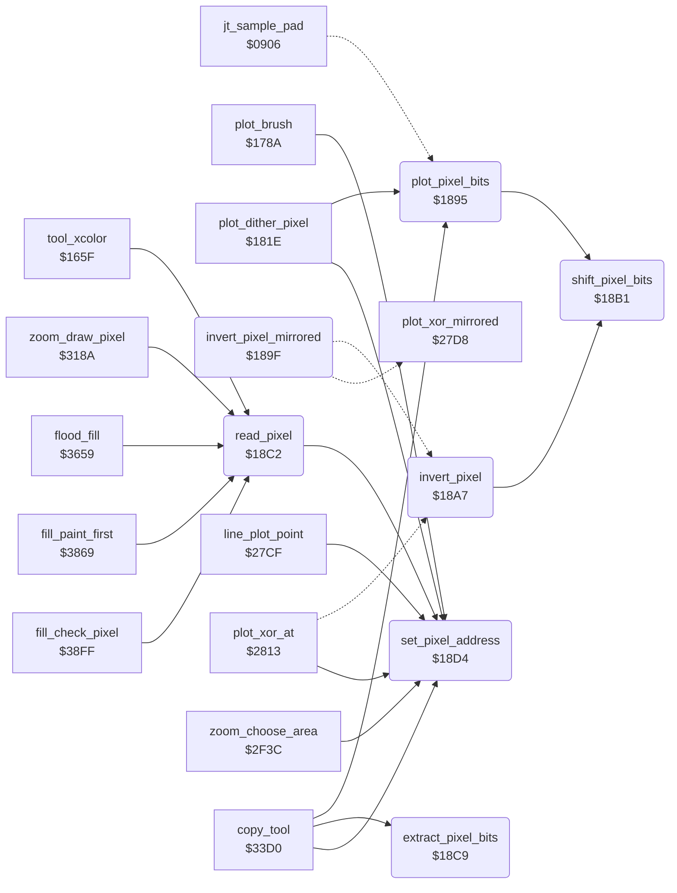

<!-- Generated by c64-docs from knowledge revision 20261024T063910.298-7zz1bw and .c64-re-tools/local/generated/src/source-map.json. Do not edit: change the knowledge, generate the source again, then run docs.ts generate. -->
# graphics/pixel.asm: Pixel Address, Plot, Invert and Read

Range `$1895-$1987`. Source: [graphics/pixel.asm](../../../../src/graphics/pixel.asm). Index: [the reference](../../index.md).

## Call graph

A solid arrow is a call, a thick arrow a table entry, a dotted arrow a jump. Rounded nodes are in this file.

## Data

| Range | Type | Name | Read by | Written by |
|---|---|---|---|---|
| [`$1952`](../../../../src/graphics/pixel.asm#L134)-`$1955` | bytes | [`pixel_clear_masks`](../../../../src/graphics/pixel.asm#L133) | [`set_pixel_address`](pixel.md#set_pixel_address) |  |
| [`$1956`](../../../../src/graphics/pixel.asm#L137)-`$1987` | words | [`bitmap_row_addr`](../../../../src/graphics/pixel.asm#L136) | [`set_pixel_address`](pixel.md#set_pixel_address), [`zoom_choose_area`](../zoom/zoom_choose_area.md#zoom_choose_area), [`read_source_pixel`](../tools/copy_3568.md#read_source_pixel) |  |

## Names

### [`plot_pixel_bits`](../../../../src/graphics/pixel.asm#L6) `$1895`

*routine*

Writes the 2-bit value in A into the pixel at pixel_ptr. Call set_pixel_address first. Jump table entry $0915.

- **Called from:** [`plot_dither_pixel`](brush_plot.md#plot_dither_pixel) [`$1841`](../../../../src/graphics/brush_plot.asm#L60), [`copy_tool`](../tools/copy.md#copy_tool) [`$352A`](../../../../src/tools/copy.asm#L189)
- **Jumped to from:** [`jt_sample_pad`](../init/entry.md#jt_sample_pad) [`$0915`](../../../../src/init/entry.asm#L19)
- **Entry of:** [`entry_jump_table`](../../tables.md#entry_jump_table)
- **Calls:** [`shift_pixel_bits`](pixel.md#shift_pixel_bits)
- **Reads:** [`pixel_mask`](../../memory-map.md#pixel_mask), [`temp_byte_3`](../../memory-map.md#temp_byte_3), [`pixel_ptr`](../../memory-map.md#pixel_ptr)

### [`invert_pixel_mirrored`](../../../../src/graphics/pixel.asm#L13) `$189F`

*routine*

Plot vector of the line routine $275c ($2751 puts it in $52/$53). In Mirror mode it inverts the pixel at 4 mirrored points ($27d8), else at one point (invert_pixel).

- **Jumps to:** [`invert_pixel`](pixel.md#invert_pixel), [`plot_xor_mirrored`](bresenham_line.md#plot_xor_mirrored)
- **Reads:** [`mirror_mode`](../data/workspace.md#mirror_mode)

### [`invert_pixel`](../../../../src/graphics/pixel.asm#L18) `$18A7`

*routine*

Inverts both bits of the pixel at pixel_ptr (EOR %11). Call set_pixel_address first.

- **Jumped to from:** [`invert_pixel_mirrored`](pixel.md#invert_pixel_mirrored) [`$18A2`](../../../../src/graphics/pixel.asm#L15), [`plot_xor_at`](bresenham_line.md#plot_xor_at) [`$2816`](../../../../src/graphics/bresenham_line.asm#L135)
- **Calls:** [`shift_pixel_bits`](pixel.md#shift_pixel_bits)
- **Reads:** [`temp_byte_3`](../../memory-map.md#temp_byte_3), [`pixel_ptr`](../../memory-map.md#pixel_ptr)

### [`shift_pixel_bits`](../../../../src/graphics/pixel.asm#L25) `$18B1`

*routine*

Shifts the 2-bit value in A to the position of the pixel (pixel_shift) and puts it in pixel_bits. Returns A = the byte at pixel_ptr, Y = 0.

- **Called from:** [`plot_pixel_bits`](pixel.md#plot_pixel_bits) [`$1895`](../../../../src/graphics/pixel.asm#L7), [`invert_pixel`](pixel.md#invert_pixel) [`$18A9`](../../../../src/graphics/pixel.asm#L20)
- **Reads:** [`pixel_pair_index`](../../memory-map.md#pixel_pair_index), [`pixel_ptr`](../../memory-map.md#pixel_ptr)
- **Writes:** [`temp_byte_3`](../../memory-map.md#temp_byte_3)

### [`shift_pixel_bits_loop`](../../../../src/graphics/pixel.asm#L29) `$18B6`

*label*

- **Jumped to from:** [`shift_pixel_bits`](pixel.md#shift_pixel_bits) [`$18B9`](../../../../src/graphics/pixel.asm#L33)

### [`shift_pixel_bits_done`](../../../../src/graphics/pixel.asm#L34) `$18BB`

*label*

- **Jumped to from:** [`shift_pixel_bits`](pixel.md#shift_pixel_bits) [`$18B4`](../../../../src/graphics/pixel.asm#L28)

### [`read_pixel`](../../../../src/graphics/pixel.asm#L40) `$18C2`

*routine*

Reads the pixel at X = x (0-159), Y = y (0-199). Returns A = its 2-bit value (0-3).

- **Called from:** [`tool_xcolor`](../tools/xcolor_tool.md#tool_xcolor) [`$168C`](../../../../src/tools/xcolor_tool.asm#L30), [`zoom_draw_pixel`](../zoom/zoom_view.md#zoom_draw_pixel) [`$3190`](../../../../src/zoom/zoom_view.asm#L81), [`flood_fill`](../tools/fill.md#flood_fill) [`$366C`](../../../../src/tools/fill.asm#L18), [`fill_paint_first`](../tools/fill_37d7.md#fill_paint_first) [`$386D`](../../../../src/tools/fill_37d7.asm#L102), [`fill_check_pixel`](../tools/fill_37d7.md#fill_check_pixel) [`$3903`](../../../../src/tools/fill_37d7.asm#L196)
- **Calls:** [`set_pixel_address`](pixel.md#set_pixel_address)
- **Reads:** [`pixel_ptr`](../../memory-map.md#pixel_ptr)

### [`extract_pixel_bits`](../../../../src/graphics/pixel.asm#L45) `$18C9`

*routine*

Returns A = the 2 bits of the pixel at position X (4 = left, 1 = right) of the byte in A.

- **Called from:** [`copy_tool`](../tools/copy.md#copy_tool) [`$34BF`](../../../../src/tools/copy.asm#L137)

### [`extract_pixel_bits_loop`](../../../../src/graphics/pixel.asm#L48) `$18CC`

*label*

- **Jumped to from:** [`extract_pixel_bits`](pixel.md#extract_pixel_bits) [`$18CF`](../../../../src/graphics/pixel.asm#L52)

### [`extract_pixel_bits_done`](../../../../src/graphics/pixel.asm#L53) `$18D1`

*label*

- **Jumped to from:** [`extract_pixel_bits`](pixel.md#extract_pixel_bits) [`$18CA`](../../../../src/graphics/pixel.asm#L47)

### [`set_pixel_address`](../../../../src/graphics/pixel.asm#L57) `$18D4`

*routine*

Sets pixel_ptr, pixel_mask and pixel_shift for the pixel at X = x (0-159), Y = y (0-199) of the bitmap at $6000. It keeps the line address when Y is the same as before, and does nothing when X and Y are both the same. Returns X = pixel_shift.

- **Called from:** [`plot_brush`](plot_brush.md#plot_brush) [`$17DE`](../../../../src/graphics/plot_brush.asm#L58), [`plot_dither_pixel`](brush_plot.md#plot_dither_pixel) [`$181E`](../../../../src/graphics/brush_plot.asm#L42), [`read_pixel`](pixel.md#read_pixel) [`$18C2`](../../../../src/graphics/pixel.asm#L41), [`line_plot_point`](bresenham_line.md#line_plot_point) [`$27D2`](../../../../src/graphics/bresenham_line.asm#L96), [`plot_xor_at`](bresenham_line.md#plot_xor_at) [`$2813`](../../../../src/graphics/bresenham_line.asm#L134), [`zoom_choose_area`](../zoom/zoom_choose_area.md#zoom_choose_area) [`$30AC`](../../../../src/zoom/zoom_choose_area.asm#L209), [`copy_tool`](../tools/copy.md#copy_tool) [`$3524`](../../../../src/tools/copy.asm#L187)
- **Reads:** [`pixel_y`](../../memory-map.md#pixel_y), [`pixel_x`](../../memory-map.md#pixel_x), [`pixel_pair_index`](../../memory-map.md#pixel_pair_index), [`pixel_ptr`](../../memory-map.md#pixel_ptr), [`pixel_ptr+1`](../../memory-map.md#pixel_ptr), [`temp_byte_2`](../../memory-map.md#temp_byte_2), [`pixel_line_ptr`](../../memory-map.md#pixel_line_ptr), [`pixel_line_ptr+1`](../../memory-map.md#pixel_line_ptr), [`temp_byte_3`](../../memory-map.md#temp_byte_3)
- **Writes:** [`pixel_x`](../../memory-map.md#pixel_x), [`last_cell_ptr`](../../memory-map.md#last_cell_ptr), [`last_cell_ptr+1`](../../memory-map.md#last_cell_ptr), [`pixel_y`](../../memory-map.md#pixel_y), [`bitmap_row_base`](../../memory-map.md#bitmap_row_base), [`pixel_line_ptr`](../../memory-map.md#pixel_line_ptr), [`bitmap_row_base+1`](../../memory-map.md#bitmap_row_base), [`pixel_line_ptr+1`](../../memory-map.md#pixel_line_ptr), [`temp_byte_2`](../../memory-map.md#temp_byte_2), [`pixel_ptr+1`](../../memory-map.md#pixel_ptr), [`pixel_ptr`](../../memory-map.md#pixel_ptr), [`temp_byte_3`](../../memory-map.md#temp_byte_3), [`pixel_mask`](../../memory-map.md#pixel_mask), [`pixel_pair_index`](../../memory-map.md#pixel_pair_index)

### [`set_pixel_address_new_x`](../../../../src/graphics/pixel.asm#L66) `$18E1`

*label*

- **Jumped to from:** [`set_pixel_address`](pixel.md#set_pixel_address) [`$18DC`](../../../../src/graphics/pixel.asm#L63)

### [`set_pixel_address_new_y`](../../../../src/graphics/pixel.asm#L74) `$18F0`

*label*

- **Jumped to from:** [`set_pixel_address`](pixel.md#set_pixel_address) [`$18D7`](../../../../src/graphics/pixel.asm#L60)

### [`set_pixel_address_column`](../../../../src/graphics/pixel.asm#L105) `$1928`

*label*

- **Jumped to from:** [`set_pixel_address`](pixel.md#set_pixel_address) [`$18ED`](../../../../src/graphics/pixel.asm#L73), [`set_pixel_address`](pixel.md#set_pixel_address) [`$1924`](../../../../src/graphics/pixel.asm#L102)

### [`set_pixel_address_add_column`](../../../../src/graphics/pixel.asm#L113) `$1934`

*label*

- **Jumped to from:** [`set_pixel_address`](pixel.md#set_pixel_address) [`$1930`](../../../../src/graphics/pixel.asm#L111)

### [`set_pixel_address_mask`](../../../../src/graphics/pixel.asm#L119) `$193D`

*label*

- **Jumped to from:** [`set_pixel_address`](pixel.md#set_pixel_address) [`$1939`](../../../../src/graphics/pixel.asm#L117)

### [`pixel_clear_masks`](../../../../src/graphics/pixel.asm#L133) `$1952-$1955`

*data*

AND masks that clear pixel 0-3 of a multicolour byte.

- **Read by:** [`set_pixel_address`](pixel.md#set_pixel_address) [`$1944`](../../../../src/graphics/pixel.asm#L124)

### [`bitmap_row_addr`](../../../../src/graphics/pixel.asm#L136) `$1956`

*data*

Start address of each of the 25 character rows of the bitmap at $6000 ($140 bytes for each row).

- **Read by:** [`set_pixel_address`](pixel.md#set_pixel_address) [`$1904`](../../../../src/graphics/pixel.asm#L87), [`zoom_choose_area`](../zoom/zoom_choose_area.md#zoom_choose_area) [`$2FA9`](../../../../src/zoom/zoom_choose_area.asm#L67), [`read_source_pixel`](../tools/copy_3568.md#read_source_pixel) [`$3579`](../../../../src/tools/copy_3568.asm#L17)

### [`bitmap_row_addr_hi`](../../../../src/graphics/pixel.asm#L138) `$1957-$1987`

*data*

- **Read by:** [`set_pixel_address`](pixel.md#set_pixel_address) [`$190C`](../../../../src/graphics/pixel.asm#L90), [`zoom_choose_area`](../zoom/zoom_choose_area.md#zoom_choose_area) [`$2FA2`](../../../../src/zoom/zoom_choose_area.asm#L64), [`read_source_pixel`](../tools/copy_3568.md#read_source_pixel) [`$3582`](../../../../src/tools/copy_3568.asm#L20)
