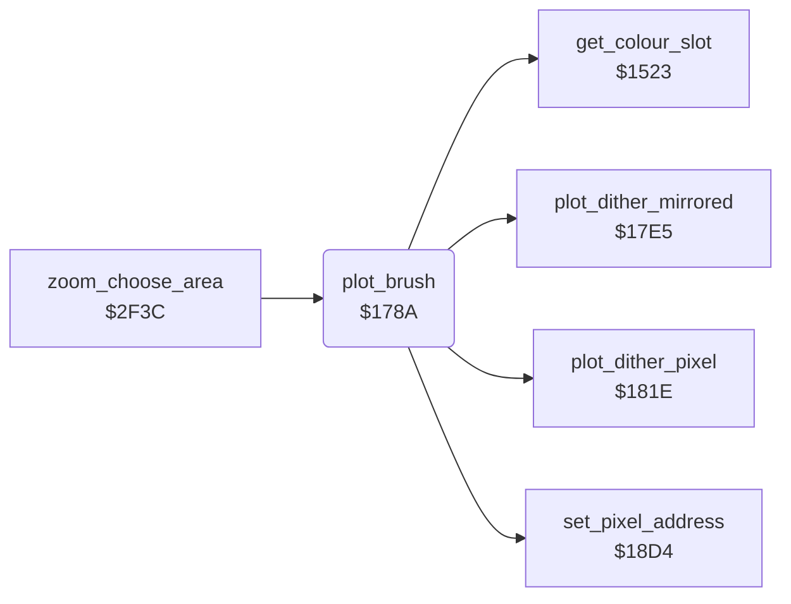

<!-- Generated by c64-docs from knowledge revision 20261024T063910.298-7zz1bw and .c64-re-tools/local/generated/src/source-map.json. Do not edit: change the knowledge, generate the source again, then run docs.ts generate. -->
# graphics/plot_brush.asm: Brush plot

Range `$178A-$17E4`. Source: [graphics/plot_brush.asm](../../../../src/graphics/plot_brush.asm). Index: [the reference](../../index.md).

## Call graph

A solid arrow is a call, a thick arrow a table entry, a dotted arrow a jump. Rounded nodes are in this file.

## Names

### [`plot_brush`](../../../../src/graphics/plot_brush.asm#L6) `$178A`

*routine*

Plots the brush (brush_ptr) in current_colour around the selected pixel (pixel_x, pixel_y). The brush is a list of (dx, dy) byte pairs; $80 ends it. A point outside 0-max_x or 0-max_y is not plotted. In mirror mode each point is plotted 4 times (plot_dither_mirrored), else one time (plot_dither_pixel, $181e). At the end selects the centre pixel again (set_pixel_address, $18d4) and gets its pixel value (get_colour_slot). It is a plot_vector routine of the line routines.

- **Called from:** [`zoom_choose_area`](../zoom/zoom_choose_area.md#zoom_choose_area) [`$30AF`](../../../../src/zoom/zoom_choose_area.asm#L210)
- **Calls:** [`plot_dither_pixel`](brush_plot.md#plot_dither_pixel), [`plot_dither_mirrored`](brush_plot.md#plot_dither_mirrored), [`set_pixel_address`](pixel.md#set_pixel_address), [`get_colour_slot`](colour_slots.md#get_colour_slot)
- **Reads:** [`pixel_x`](../../memory-map.md#pixel_x), [`pixel_y`](../../memory-map.md#pixel_y), [`brush_ptr`](../../memory-map.md#brush_ptr), [`brush_centre_x`](../../memory-map.md#brush_centre_x), [`max_x`](../../memory-map.md#max_x), [`brush_centre_y`](../../memory-map.md#brush_centre_y), [`max_y`](../../memory-map.md#max_y), [`mirror_mode`](../data/workspace.md#mirror_mode), [`brush_point_index`](../../memory-map.md#brush_point_index)
- **Writes:** [`brush_centre_x`](../../memory-map.md#brush_centre_x), [`brush_centre_y`](../../memory-map.md#brush_centre_y), [`brush_point_index`](../../memory-map.md#brush_point_index), [`max_x`](../../memory-map.md#max_x), [`max_y`](../../memory-map.md#max_y)

### [`plot_brush_loop`](../../../../src/graphics/plot_brush.asm#L15) `$1798`

*label*

- **Jumped to from:** [`plot_brush`](plot_brush.md#plot_brush) [`$17CE`](../../../../src/graphics/plot_brush.asm#L46), [`plot_brush`](plot_brush.md#plot_brush) [`$17D7`](../../../../src/graphics/plot_brush.asm#L52)

### [`plot_brush_mirror`](../../../../src/graphics/plot_brush.asm#L40) `$17C6`

*label*

- **Jumped to from:** [`plot_brush`](plot_brush.md#plot_brush) [`$17BE`](../../../../src/graphics/plot_brush.asm#L37)

### [`plot_brush_next`](../../../../src/graphics/plot_brush.asm#L42) `$17C9`

*label*

- **Jumped to from:** [`plot_brush`](plot_brush.md#plot_brush) [`$17B8`](../../../../src/graphics/plot_brush.asm#L34), [`plot_brush`](plot_brush.md#plot_brush) [`$17C3`](../../../../src/graphics/plot_brush.asm#L39)

### [`plot_brush_skip`](../../../../src/graphics/plot_brush.asm#L47) `$17D1`

*label*

Skips dy of a point that is not plotted.

- **Jumped to from:** [`plot_brush`](plot_brush.md#plot_brush) [`$17A7`](../../../../src/graphics/plot_brush.asm#L24)

### [`plot_brush_done`](../../../../src/graphics/plot_brush.asm#L53) `$17DA`

*label*

- **Jumped to from:** [`plot_brush`](plot_brush.md#plot_brush) [`$179C`](../../../../src/graphics/plot_brush.asm#L18)
