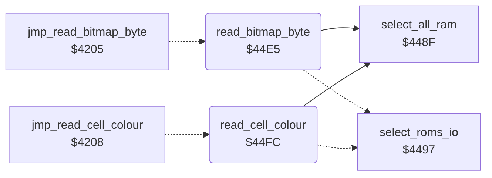

<!-- Generated by c64-docs from knowledge revision 20261024T063910.298-7zz1bw and .c64-re-tools/local/generated/src/source-map.json. Do not edit: change the knowledge, generate the source again, then run docs.ts generate. -->
# graphics/read_pixel.asm: Bitmap and Colour Reads in All RAM

Range `$44E5-$4524`. Source: [graphics/read_pixel.asm](../../../../src/graphics/read_pixel.asm). Index: [the reference](../../index.md).

## Call graph

A solid arrow is a call, a thick arrow a table entry, a dotted arrow a jump. Rounded nodes are in this file.

## Names

### [`read_bitmap_byte`](../../../../src/graphics/read_pixel.asm#L6) `$44E5`

*routine*

Reads the byte at source_byte_ptr with all RAM (no ROM, no I/O) into source_byte. The code at $3568 calls it through jmp_read_bitmap_byte.

- **Jumped to from:** [`jmp_read_bitmap_byte`](../script/interpreter.md#jmp_read_bitmap_byte) [`$4205`](../../../../src/script/interpreter.asm#L10)
- **Entry of:** [`run_script`](../../tables.md#run_script)
- **Calls:** [`select_all_ram`](../script/opcodes.md#select_all_ram)
- **Jumps to:** [`select_roms_io`](../script/opcodes.md#select_roms_io)
- **Reads:** [`source_byte_ptr`](../../memory-map.md#source_byte_ptr), [`source_byte_ptr+1`](../../memory-map.md#source_byte_ptr), [`plot_vector`](../../memory-map.md#plot_vector)
- **Writes:** [`plot_vector`](../../memory-map.md#plot_vector), [`plot_vector+1`](../../memory-map.md#plot_vector), [`source_byte`](../../memory-map.md#source_byte)

### [`read_cell_colour`](../../../../src/graphics/read_pixel.asm#L17) `$44FC`

*routine*

Reads a colour byte of a cell with all RAM (no ROM, no I/O) into current_colour. Input X: pixel value; 3 reads through source_colour_ptr, else through source_screen_ptr. The caller takes the nybble. The code at $350c calls it through jmp_read_cell_colour.

- **Jumped to from:** [`jmp_read_cell_colour`](../script/interpreter.md#jmp_read_cell_colour) [`$4208`](../../../../src/script/interpreter.asm#L14)
- **Entry of:** [`run_script`](../../tables.md#run_script)
- **Calls:** [`select_all_ram`](../script/opcodes.md#select_all_ram)
- **Jumps to:** [`select_roms_io`](../script/opcodes.md#select_roms_io)
- **Reads:** [`source_screen_ptr`](../../memory-map.md#source_screen_ptr), [`source_screen_ptr+1`](../../memory-map.md#source_screen_ptr), [`plot_vector`](../../memory-map.md#plot_vector), [`source_colour_ptr`](../../memory-map.md#source_colour_ptr), [`source_colour_ptr+1`](../../memory-map.md#source_colour_ptr)
- **Writes:** [`plot_vector`](../../memory-map.md#plot_vector), [`plot_vector+1`](../../memory-map.md#plot_vector), [`current_colour`](../../memory-map.md#current_colour)

### [`read_cell_colour_ram`](../../../../src/graphics/read_pixel.asm#L29) `$4514`

*label*

- **Jumped to from:** [`read_cell_colour`](read_pixel.md#read_cell_colour) [`$4503`](../../../../src/graphics/read_pixel.asm#L22)

### [`read_cell_colour_store`](../../../../src/graphics/read_pixel.asm#L35) `$4520`

*label*

- **Jumped to from:** [`read_cell_colour`](read_pixel.md#read_cell_colour) [`$4511`](../../../../src/graphics/read_pixel.asm#L28)
