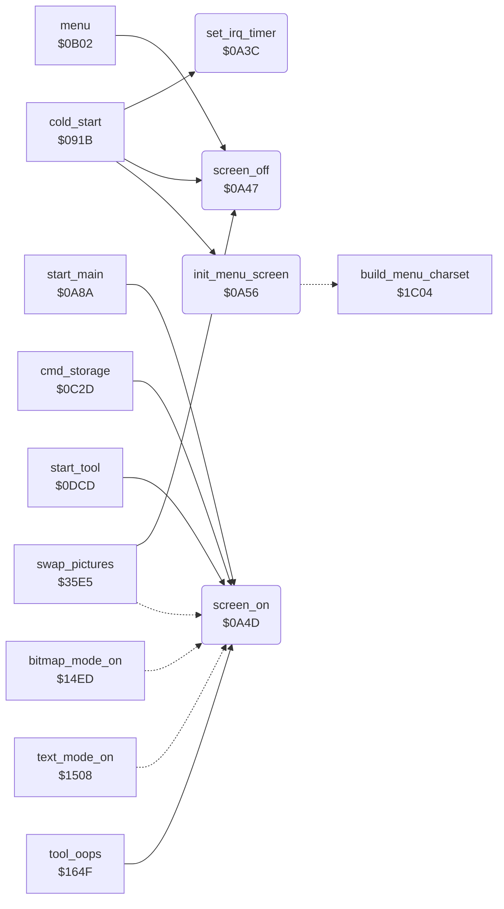

<!-- Generated by c64-docs from knowledge revision 20261024T063910.298-7zz1bw and .c64-re-tools/local/generated/src/source-map.json. Do not edit: change the knowledge, generate the source again, then run docs.ts generate. -->
# init/screen.asm: Timer and Screen Control

Range `$0A3C-$0A67`. Source: [init/screen.asm](../../../../src/init/screen.asm). Index: [the reference](../../index.md).

## Call graph

A solid arrow is a call, a thick arrow a table entry, a dotted arrow a jump. Rounded nodes are in this file.

## Names

### [`set_irq_timer`](../../../../src/init/screen.asm#L6) `$0A3C`

*routine*

Sets the latch of CIA 1 timer A to $4289 cycles, the rate of the timer interrupt.

- **Called from:** [`cold_start`](entry.md#cold_start) [`$0930`](../../../../src/init/entry.asm#L36)
- **Writes:** [`CIATAHI`](../../memory-map.md#CIATAHI), [`CIATALO`](../../memory-map.md#CIATALO)

### [`screen_off`](../../../../src/init/screen.asm#L13) `$0A47`

*routine*

Turns the screen off: $d011 = $0b (display off, 25 rows, Y scroll 3).

- **Called from:** [`cold_start`](entry.md#cold_start) [`$0958`](../../../../src/init/entry.asm#L55), [`menu`](../menu/menu.md#menu) [`$0BBE`](../../../../src/menu/menu.asm#L104), [`swap_pictures`](../tools/swap.md#swap_pictures) [`$35E5`](../../../../src/tools/swap.asm#L7)
- **Writes:** [`SCROLY`](../../memory-map.md#SCROLY)

### [`screen_on`](../../../../src/init/screen.asm#L18) `$0A4D`

*routine*

Turns the screen on: sets bit 4 of $d011.

- **Called from:** [`start_main`](start_0a8a.md#start_main) [`$0A8E`](../../../../src/init/start_0a8a.asm#L9), [`cmd_storage`](../menu/menu.md#cmd_storage) [`$0C2D`](../../../../src/menu/menu.asm#L164), [`start_tool`](../tools/tool_start.md#start_tool) [`$0DD0`](../../../../src/tools/tool_start.asm#L8), [`tool_oops`](../tools/mirror_oops_tool.md#tool_oops) [`$1659`](../../../../src/tools/mirror_oops_tool.asm#L43)
- **Jumped to from:** [`bitmap_mode_on`](../graphics/display_mode.md#bitmap_mode_on) [`$1505`](../../../../src/graphics/display_mode.asm#L16), [`text_mode_on`](../graphics/display_mode.md#text_mode_on) [`$1520`](../../../../src/graphics/display_mode.asm#L28), [`swap_pictures`](../tools/swap.md#swap_pictures) [`$35F5`](../../../../src/tools/swap.asm#L13)
- **Reads:** [`SCROLY`](../../memory-map.md#SCROLY)
- **Writes:** [`SCROLY`](../../memory-map.md#SCROLY)

### [`init_menu_screen`](../../../../src/init/screen.asm#L24) `$0A56`

*routine*

Prepares the menu text screen: cursor_colour_timer = 2, $d018 = $17, clears the button state, then $1c04 (black border, screen off, the script at $1eb6 with the character ROM visible, $d018 = $74 and VIC bank 1: screen $5c00, charset $5000).

- **Called from:** [`cold_start`](entry.md#cold_start) [`$0952`](../../../../src/init/entry.asm#L50)
- **Jumps to:** [`build_menu_charset`](menu_charset.md#build_menu_charset)
- **Writes:** [`cursor_colour_timer`](../../memory-map.md#cursor_colour_timer), [`VMCSB`](../../memory-map.md#VMCSB), [`button_press_edge`](../../memory-map.md#button_press_edge), [`button_held`](../../memory-map.md#button_held)
