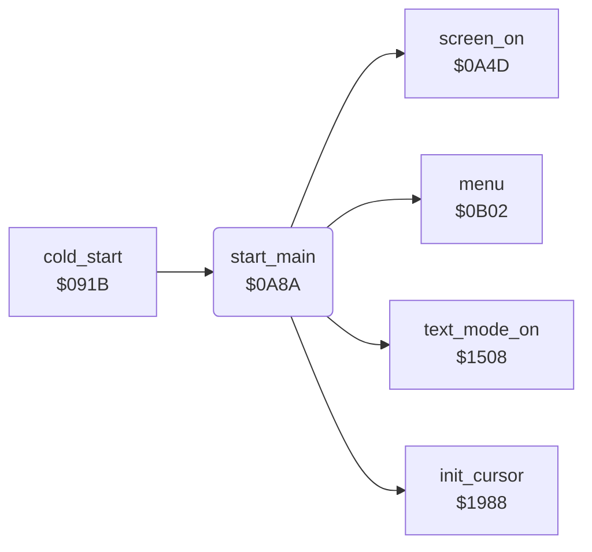

<!-- Generated by c64-docs from knowledge revision 20261024T063910.298-7zz1bw and .c64-re-tools/local/generated/src/source-map.json. Do not edit: change the knowledge, generate the source again, then run docs.ts generate. -->
# init/start_0a8a.asm

Range `$0A8A-$0A97`. Source: [init/start_0a8a.asm](../../../../src/init/start_0a8a.asm). Index: [the reference](../../index.md).

## Call graph

A solid arrow is a call, a thick arrow a table entry, a dotted arrow a jump. Rounded nodes are in this file.

## Names

### [`start_main`](../../../../src/init/start_0a8a.asm#L6) `$0A8A`

*routine*

Start-up after cold_start: interrupts on, text mode ($1508), screen on, the cursor sprites ($1988), then menu.

- **Called from:** [`cold_start`](entry.md#cold_start) [`$0966`](../../../../src/init/entry.asm#L61)
- **Calls:** [`text_mode_on`](../graphics/display_mode.md#text_mode_on), [`screen_on`](screen.md#screen_on), [`init_cursor`](../input/cursor.md#init_cursor), [`menu`](../menu/menu.md#menu)
