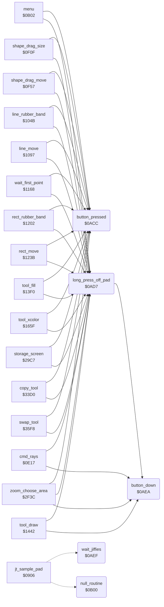

<!-- Generated by c64-docs from knowledge revision 20261024T063910.298-7zz1bw and .c64-re-tools/local/generated/src/source-map.json. Do not edit: change the knowledge, generate the source again, then run docs.ts generate. -->
# input/buttons.asm: Pad Buttons and Waits

Range `$0ACC-$0B00`. Source: [input/buttons.asm](../../../../src/input/buttons.asm). Index: [the reference](../../index.md).

## Call graph

A solid arrow is a call, a thick arrow a table entry, a dotted arrow a jump. Rounded nodes are in this file.

## Names

### [`button_pressed`](../../../../src/input/buttons.asm#L6) `$0ACC`

*routine*

Gives the press of a pad button since the last call (button_press_edge), and clears it. Z is set when there was no press.

- **Called from:** [`menu`](../menu/menu.md#menu) [`$0B9D`](../../../../src/menu/menu.asm#L84), [`shape_drag_size`](../tools/circle.md#shape_drag_size) [`$0F23`](../../../../src/tools/circle.asm#L69), [`shape_drag_move`](../tools/circle.md#shape_drag_move) [`$0FB3`](../../../../src/tools/circle.asm#L148), [`line_rubber_band`](../tools/line_tool.md#line_rubber_band) [`$105F`](../../../../src/tools/line_tool.asm#L34), [`line_move`](../tools/line_tool.md#line_move) [`$10F3`](../../../../src/tools/line_tool.asm#L113), [`wait_first_point`](../tools/line_tool.md#wait_first_point) [`$1189`](../../../../src/tools/line_tool.asm#L200), [`rect_rubber_band`](../tools/box_frame_tool.md#rect_rubber_band) [`$1216`](../../../../src/tools/box_frame_tool.asm#L69), [`rect_move`](../tools/box_frame_tool.md#rect_move) [`$1297`](../../../../src/tools/box_frame_tool.asm#L140), [`tool_fill`](../tools/fill_tool.md#tool_fill) [`$1429`](../../../../src/tools/fill_tool.asm#L38), [`tool_xcolor`](../tools/xcolor_tool.md#tool_xcolor) [`$167F`](../../../../src/tools/xcolor_tool.asm#L24), [`storage_screen`](../storage/storage_screen.md#storage_screen) [`$2AD2`](../../../../src/storage/storage_screen.asm#L148), [`zoom_choose_area`](../zoom/zoom_choose_area.md#zoom_choose_area) [`$2F73`](../../../../src/zoom/zoom_choose_area.asm#L33), [`zoom_choose_area`](../zoom/zoom_choose_area.md#zoom_choose_area) [`$30C6`](../../../../src/zoom/zoom_choose_area.asm#L223), [`copy_tool`](../tools/copy.md#copy_tool) [`$3457`](../../../../src/tools/copy.asm#L78), [`swap_tool`](../tools/swap.md#swap_tool) [`$3614`](../../../../src/tools/swap.asm#L29)
- **Reads:** [`button_press_edge`](../../memory-map.md#button_press_edge)
- **Writes:** [`button_press_edge`](../../memory-map.md#button_press_edge)

### [`long_press_off_pad`](../../../../src/input/buttons.asm#L15) `$0AD7`

*routine*

Z is clear when a button is held and the pad is not touched for 16 samples or more (off_pad_count): the gesture that changes between the menu and the picture. Then A = off_pad_count, and off_pad_count keeps its value. Else A = 0 and Z is set.

- **Called from:** [`menu`](../menu/menu.md#menu) [`$0B92`](../../../../src/menu/menu.asm#L76), [`cmd_rays`](../tools/rays.md#cmd_rays) [`$0E41`](../../../../src/tools/rays.asm#L28), [`shape_drag_size`](../tools/circle.md#shape_drag_size) [`$0F12`](../../../../src/tools/circle.asm#L60), [`shape_drag_move`](../tools/circle.md#shape_drag_move) [`$0FA2`](../../../../src/tools/circle.asm#L139), [`line_rubber_band`](../tools/line_tool.md#line_rubber_band) [`$104E`](../../../../src/tools/line_tool.asm#L25), [`line_move`](../tools/line_tool.md#line_move) [`$10E2`](../../../../src/tools/line_tool.asm#L103), [`wait_first_point`](../tools/line_tool.md#wait_first_point) [`$116B`](../../../../src/tools/line_tool.asm#L184), [`rect_rubber_band`](../tools/box_frame_tool.md#rect_rubber_band) [`$1205`](../../../../src/tools/box_frame_tool.asm#L60), [`rect_move`](../tools/box_frame_tool.md#rect_move) [`$1286`](../../../../src/tools/box_frame_tool.asm#L130), [`tool_fill`](../tools/fill_tool.md#tool_fill) [`$1421`](../../../../src/tools/fill_tool.asm#L34), [`tool_draw`](../tools/draw_tool.md#tool_draw) [`$145C`](../../../../src/tools/draw_tool.asm#L22), [`tool_xcolor`](../tools/xcolor_tool.md#tool_xcolor) [`$1677`](../../../../src/tools/xcolor_tool.asm#L20), [`storage_screen`](../storage/storage_screen.md#storage_screen) [`$2AC9`](../../../../src/storage/storage_screen.asm#L142), [`zoom_choose_area`](../zoom/zoom_choose_area.md#zoom_choose_area) [`$2F5E`](../../../../src/zoom/zoom_choose_area.asm#L22), [`zoom_choose_area`](../zoom/zoom_choose_area.md#zoom_choose_area) [`$3028`](../../../../src/zoom/zoom_choose_area.asm#L135), [`copy_tool`](../tools/copy.md#copy_tool) [`$344E`](../../../../src/tools/copy.asm#L74), [`swap_tool`](../tools/swap.md#swap_tool) [`$3609`](../../../../src/tools/swap.asm#L24)
- **Calls:** [`button_down`](buttons.md#button_down)
- **Reads:** [`off_pad_count`](../../memory-map.md#off_pad_count)

### [`long_press_none`](../../../../src/input/buttons.asm#L23) `$0AE5`

*label*

- **Jumped to from:** [`long_press_off_pad`](buttons.md#long_press_off_pad) [`$0ADA`](../../../../src/input/buttons.asm#L17), [`long_press_off_pad`](buttons.md#long_press_off_pad) [`$0AE0`](../../../../src/input/buttons.asm#L20)

### [`button_down`](../../../../src/input/buttons.asm#L28) `$0AEA`

*routine*

Gives button_held in A: 1 while a pad button is down. Z is set when no button is down.

- **Called from:** [`long_press_off_pad`](buttons.md#long_press_off_pad) [`$0AD7`](../../../../src/input/buttons.asm#L16), [`cmd_rays`](../tools/rays.md#cmd_rays) [`$0E5D`](../../../../src/tools/rays.asm#L42), [`cmd_rays`](../tools/rays.md#cmd_rays) [`$0E98`](../../../../src/tools/rays.asm#L74), [`tool_draw`](../tools/draw_tool.md#tool_draw) [`$1470`](../../../../src/tools/draw_tool.asm#L32), [`zoom_choose_area`](../zoom/zoom_choose_area.md#zoom_choose_area) [`$3054`](../../../../src/zoom/zoom_choose_area.asm#L163), [`zoom_choose_area`](../zoom/zoom_choose_area.md#zoom_choose_area) [`$30A3`](../../../../src/zoom/zoom_choose_area.asm#L205)
- **Reads:** [`button_held`](../../memory-map.md#button_held)

### [`wait_jiffies`](../../../../src/input/buttons.asm#L33) `$0AEF`

*routine*

Waits A + 1 jiffies: sets the low byte of the jiffy clock ($a2) to $ff - A and waits until it wraps to a value below 4. Turns the interrupts on. Only the JMP table entry $090c points here.

- **Jumped to from:** [`jt_sample_pad`](../init/entry.md#jt_sample_pad) [`$090C`](../../../../src/init/entry.asm#L15)
- **Entry of:** [`entry_jump_table`](../../tables.md#entry_jump_table)
- **Reads:** [`temp_word`](../../memory-map.md#temp_word), [`TIME+2`](../../memory-map.md#TIME)
- **Writes:** [`temp_word`](../../memory-map.md#temp_word), [`TIME+2`](../../memory-map.md#TIME)

### [`wait_jiffies_loop`](../../../../src/input/buttons.asm#L41) `$0AF9`

*label*

- **Jumped to from:** [`wait_jiffies`](buttons.md#wait_jiffies) [`$0AFD`](../../../../src/input/buttons.asm#L44)

### [`null_routine`](../../../../src/input/buttons.asm#L47) `$0B00`

*routine*

Only an RTS. The JMP table entry $0909 points here.

- **Jumped to from:** [`jt_sample_pad`](../init/entry.md#jt_sample_pad) [`$0909`](../../../../src/init/entry.asm#L14)
- **Entry of:** [`entry_jump_table`](../../tables.md#entry_jump_table)
