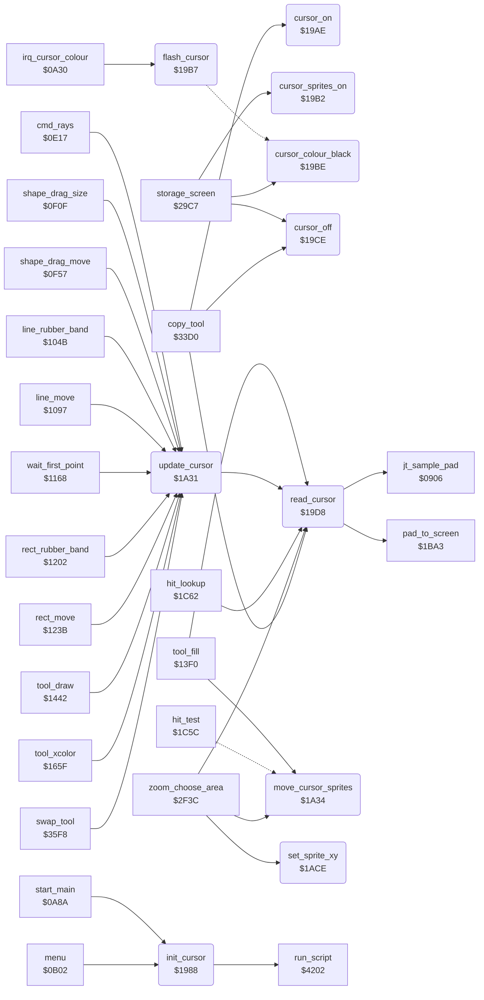

<!-- Generated by c64-docs from knowledge revision 20261024T063910.298-7zz1bw and .c64-re-tools/local/generated/src/source-map.json. Do not edit: change the knowledge, generate the source again, then run docs.ts generate. -->
# input/cursor.asm: Cursor Sprites and Cursor Position

Range `$1988-$1AF7`. Source: [input/cursor.asm](../../../../src/input/cursor.asm). Index: [the reference](../../index.md).

## Call graph

A solid arrow is a call, a thick arrow a table entry, a dotted arrow a jump. Rounded nodes are in this file.

## Names

### [`init_cursor`](../../../../src/input/cursor.asm#L6) `$1988`

*routine*

Sets up the cursor sprites: offsets 18/25, X MSB off, sprites off, in front of the picture, hi-res. Runs cursor_sprites_script and brush_cursor_0 (the arrow), then cursor_on.

- **Called from:** [`start_main`](../init/start_0a8a.md#start_main) [`$0A91`](../../../../src/init/start_0a8a.asm#L10), [`menu`](../menu/menu.md#menu) [`$0B47`](../../../../src/menu/menu.asm#L37)
- **Calls:** [`run_script`](../script/interpreter.md#run_script)
- **Writes:** [`cursor_offset_x`](../../memory-map.md#cursor_offset_x), [`cursor_offset_y`](../../memory-map.md#cursor_offset_y), [`MSIGX`](../../memory-map.md#MSIGX), [`SPENA`](../../memory-map.md#SPENA), [`SPBGPR`](../../memory-map.md#SPBGPR), [`SPMC`](../../memory-map.md#SPMC)

### [`cursor_on`](../../../../src/input/cursor.asm#L24) `$19AE`

*routine*

Lets the IRQ flash the cursor (cursor_colour_enable = 1), then cursor_sprites_on.

- **Called from:** [`copy_tool`](../tools/copy.md#copy_tool) [`$3499`](../../../../src/tools/copy.asm#L118)
- **Writes:** [`cursor_colour_enable`](../../memory-map.md#cursor_colour_enable)

### [`cursor_sprites_on`](../../../../src/input/cursor.asm#L28) `$19B2`

*routine*

Sets cursor_sprite_mask to $cf (sprites 0-3, 6 and 7). read_cursor copies it to $d015 while the pad is touched.

- **Called from:** [`storage_screen`](../storage/storage_screen.md#storage_screen) [`$2AC3`](../../../../src/storage/storage_screen.asm#L140)
- **Writes:** [`cursor_sprite_mask`](../../memory-map.md#cursor_sprite_mask)

### [`flash_cursor`](../../../../src/input/cursor.asm#L33) `$19B7`

*routine*

Changes the colour of all 8 sprites between black and light grey. The IRQ calls it (by $0a30) while cursor_colour_enable is set.

- **Called from:** [`irq_cursor_colour`](../irq/irq.md#irq_cursor_colour) [`$0A34`](../../../../src/irq/irq.asm#L120)
- **Jumps to:** [`flash_cursor_grey`](cursor.md#flash_cursor_grey)
- **Reads:** [`SP0COL`](../../memory-map.md#SP0COL)

### [`cursor_colour_black`](../../../../src/input/cursor.asm#L38) `$19BE`

*routine*

Sets the colour of all 8 sprites to black.

- **Called from:** [`storage_screen`](../storage/storage_screen.md#storage_screen) [`$29D9`](../../../../src/storage/storage_screen.asm#L15)
- **Writes:** [`SPMC1`](../../memory-map.md#SPMC1)

### [`flash_cursor_grey`](../../../../src/input/cursor.asm#L41) `$19C3`

*label*

- **Jumped to from:** [`flash_cursor`](cursor.md#flash_cursor) [`$19BC`](../../../../src/input/cursor.asm#L36)

### [`set_cursor_colour`](../../../../src/input/cursor.asm#L43) `$19C5`

*label*

Sets $d027-$d02e to A.

- **Jumped to from:** [`cursor_colour_black`](cursor.md#cursor_colour_black) [`$19C0`](../../../../src/input/cursor.asm#L40)

### [`set_cursor_colour_loop`](../../../../src/input/cursor.asm#L45) `$19C7`

*label*

- **Jumped to from:** [`cursor_colour_black`](cursor.md#cursor_colour_black) [`$19CB`](../../../../src/input/cursor.asm#L48)

### [`cursor_off`](../../../../src/input/cursor.asm#L51) `$19CE`

*routine*

Hides the cursor: stops the flash, clears cursor_sprite_mask and turns all sprites off.

- **Called from:** [`storage_screen`](../storage/storage_screen.md#storage_screen) [`$29D6`](../../../../src/storage/storage_screen.asm#L14), [`storage_screen`](../storage/storage_screen.md#storage_screen) [`$2AD7`](../../../../src/storage/storage_screen.asm#L150), [`copy_tool`](../tools/copy.md#copy_tool) [`$343A`](../../../../src/tools/copy.asm#L62)
- **Writes:** [`cursor_colour_enable`](../../memory-map.md#cursor_colour_enable), [`cursor_sprite_mask`](../../memory-map.md#cursor_sprite_mask), [`SPENA`](../../memory-map.md#SPENA)

### [`read_cursor`](../../../../src/input/cursor.asm#L58) `$19D8`

*routine*

Reads the pad (sample_pad) and converts it to screen units (pad_to_screen) in cursor_x (0-$9f) and cursor_y (0-$c7). No touch (pad Y $e6 or more, or X and Y both below 10) gives cursor_x = $ff and sprites off; pad Y $e6 or more also counts off_pad_count up to 16. A touch clears off_pad_count and turns on the sprites in cursor_sprite_mask. In Mirror mode it also keeps the position folded into the top left quarter in temp_byte_2 and mirror_cursor_y. Returns X = cursor_x, Y = cursor_y.

- **Called from:** [`tool_fill`](../tools/fill_tool.md#tool_fill) [`$13FB`](../../../../src/tools/fill_tool.asm#L13), [`tool_fill`](../tools/fill_tool.md#tool_fill) [`$141E`](../../../../src/tools/fill_tool.asm#L33), [`update_cursor`](cursor.md#update_cursor) [`$1A31`](../../../../src/input/cursor.asm#L111), [`hit_lookup`](hit_test_1c5a.md#hit_lookup) [`$1C8C`](../../../../src/input/hit_test_1c5a.asm#L41), [`zoom_choose_area`](../zoom/zoom_choose_area.md#zoom_choose_area) [`$2F5B`](../../../../src/zoom/zoom_choose_area.asm#L21), [`copy_tool`](../tools/copy.md#copy_tool) [`$344B`](../../../../src/tools/copy.asm#L73)
- **Calls:** [`jt_sample_pad`](../init/entry.md#jt_sample_pad), [`pad_to_screen`](pad_to_screen.md#pad_to_screen)
- **Reads:** [`cursor_x`](../../memory-map.md#cursor_x), [`cursor_y`](../../memory-map.md#cursor_y), [`off_pad_count`](../../memory-map.md#off_pad_count), [`mirror_mode`](../data/workspace.md#mirror_mode), [`temp_byte_2`](../../memory-map.md#temp_byte_2), [`mirror_cursor_y`](../../memory-map.md#mirror_cursor_y), [`cursor_sprite_mask`](../../memory-map.md#cursor_sprite_mask)
- **Writes:** [`cursor_x`](../../memory-map.md#cursor_x), [`SPENA`](../../memory-map.md#SPENA), [`off_pad_count`](../../memory-map.md#off_pad_count), [`temp_byte_2`](../../memory-map.md#temp_byte_2), [`mirror_cursor_y`](../../memory-map.md#mirror_cursor_y), [`cursor_y`](../../memory-map.md#cursor_y)

### [`read_cursor_none`](../../../../src/input/cursor.asm#L68) `$19EB`

*label*

- **Jumped to from:** [`read_cursor`](cursor.md#read_cursor) [`$19FE`](../../../../src/input/cursor.asm#L81)

### [`read_cursor_off_pad`](../../../../src/input/cursor.asm#L75) `$19F6`

*label*

- **Jumped to from:** [`read_cursor`](cursor.md#read_cursor) [`$19E1`](../../../../src/input/cursor.asm#L63)

### [`read_cursor_counted`](../../../../src/input/cursor.asm#L80) `$19FE`

*label*

- **Jumped to from:** [`read_cursor`](cursor.md#read_cursor) [`$19FA`](../../../../src/input/cursor.asm#L78)

### [`read_cursor_touch`](../../../../src/input/cursor.asm#L82) `$1A01`

*label*

- **Jumped to from:** [`read_cursor`](cursor.md#read_cursor) [`$19E5`](../../../../src/input/cursor.asm#L65), [`read_cursor`](cursor.md#read_cursor) [`$19E9`](../../../../src/input/cursor.asm#L67)

### [`read_cursor_fold_y`](../../../../src/input/cursor.asm#L95) `$1A1A`

*label*

- **Jumped to from:** [`read_cursor`](cursor.md#read_cursor) [`$1A11`](../../../../src/input/cursor.asm#L90)

### [`read_cursor_store`](../../../../src/input/cursor.asm#L103) `$1A27`

*label*

- **Jumped to from:** [`read_cursor`](cursor.md#read_cursor) [`$1A0B`](../../../../src/input/cursor.asm#L87), [`read_cursor`](cursor.md#read_cursor) [`$1A1E`](../../../../src/input/cursor.asm#L98)

### [`update_cursor`](../../../../src/input/cursor.asm#L110) `$1A31`

*routine*

Reads the cursor (read_cursor), then moves the cursor sprites to it (move_cursor_sprites).

- **Called from:** [`cmd_rays`](../tools/rays.md#cmd_rays) [`$0E3E`](../../../../src/tools/rays.asm#L27), [`cmd_rays`](../tools/rays.md#cmd_rays) [`$0E4C`](../../../../src/tools/rays.asm#L34), [`cmd_rays`](../tools/rays.md#cmd_rays) [`$0E6B`](../../../../src/tools/rays.asm#L49), [`shape_drag_size`](../tools/circle.md#shape_drag_size) [`$0F0F`](../../../../src/tools/circle.asm#L59), [`shape_drag_size`](../tools/circle.md#shape_drag_size) [`$0F2C`](../../../../src/tools/circle.asm#L74), [`shape_drag_move`](../tools/circle.md#shape_drag_move) [`$0F9F`](../../../../src/tools/circle.asm#L138), [`shape_drag_move`](../tools/circle.md#shape_drag_move) [`$0FBC`](../../../../src/tools/circle.asm#L153), [`line_rubber_band`](../tools/line_tool.md#line_rubber_band) [`$104B`](../../../../src/tools/line_tool.asm#L24), [`line_rubber_band`](../tools/line_tool.md#line_rubber_band) [`$1065`](../../../../src/tools/line_tool.asm#L38), [`line_move`](../tools/line_tool.md#line_move) [`$10DF`](../../../../src/tools/line_tool.asm#L102), [`line_move`](../tools/line_tool.md#line_move) [`$10FC`](../../../../src/tools/line_tool.asm#L118), [`wait_first_point`](../tools/line_tool.md#wait_first_point) [`$1168`](../../../../src/tools/line_tool.asm#L183), [`wait_first_point`](../tools/line_tool.md#wait_first_point) [`$1179`](../../../../src/tools/line_tool.asm#L192), [`rect_rubber_band`](../tools/box_frame_tool.md#rect_rubber_band) [`$1202`](../../../../src/tools/box_frame_tool.asm#L59), [`rect_rubber_band`](../tools/box_frame_tool.md#rect_rubber_band) [`$121F`](../../../../src/tools/box_frame_tool.asm#L74), [`rect_move`](../tools/box_frame_tool.md#rect_move) [`$1283`](../../../../src/tools/box_frame_tool.asm#L129), [`rect_move`](../tools/box_frame_tool.md#rect_move) [`$12A0`](../../../../src/tools/box_frame_tool.asm#L145), [`tool_draw`](../tools/draw_tool.md#tool_draw) [`$1459`](../../../../src/tools/draw_tool.asm#L21), [`tool_draw`](../tools/draw_tool.md#tool_draw) [`$1467`](../../../../src/tools/draw_tool.asm#L28), [`tool_xcolor`](../tools/xcolor_tool.md#tool_xcolor) [`$1666`](../../../../src/tools/xcolor_tool.asm#L11), [`swap_tool`](../tools/swap.md#swap_tool) [`$3606`](../../../../src/tools/swap.asm#L23)
- **Calls:** [`read_cursor`](cursor.md#read_cursor)

### [`move_cursor_sprites`](../../../../src/input/cursor.asm#L113) `$1A34`

*routine*

Moves the cursor sprites to cursor_x, cursor_y. Sprites 0-5 are a block of 3 columns (24 pixels apart: 0/1, 2/3, 4/5) and 2 rows (21 lines apart); sprites 6 and 7 (the tool label) are 33 lines below sprite 0. Does nothing when cursor_x = $ff. In Mirror mode, cursor_x and cursor_y then get the folded position from read_cursor.

- **Called from:** [`tool_fill`](../tools/fill_tool.md#tool_fill) [`$141B`](../../../../src/tools/fill_tool.asm#L31), [`zoom_choose_area`](../zoom/zoom_choose_area.md#zoom_choose_area) [`$2F66`](../../../../src/zoom/zoom_choose_area.asm#L25), [`zoom_choose_area`](../zoom/zoom_choose_area.md#zoom_choose_area) [`$2FFE`](../../../../src/zoom/zoom_choose_area.asm#L113), [`zoom_choose_area`](../zoom/zoom_choose_area.md#zoom_choose_area) [`$3061`](../../../../src/zoom/zoom_choose_area.asm#L168)
- **Jumped to from:** [`hit_test`](hit_test_1c5a.md#hit_test) [`$1C5F`](../../../../src/input/hit_test_1c5a.asm#L12)
- **Reads:** [`cursor_x`](../../memory-map.md#cursor_x), [`cursor_offset_x`](../../memory-map.md#cursor_offset_x), [`SP0X`](../../memory-map.md#SP0X), [`MSIGX`](../../memory-map.md#MSIGX), [`cursor_y`](../../memory-map.md#cursor_y), [`cursor_offset_y`](../../memory-map.md#cursor_offset_y), [`SP0Y`](../../memory-map.md#SP0Y), [`mirror_mode`](../data/workspace.md#mirror_mode), [`temp_byte_2`](../../memory-map.md#temp_byte_2), [`mirror_cursor_y`](../../memory-map.md#mirror_cursor_y)
- **Writes:** [`SP0X`](../../memory-map.md#SP0X), [`SP1X`](../../memory-map.md#SP1X), [`SP6X`](../../memory-map.md#SP6X), [`MSIGX`](../../memory-map.md#MSIGX), [`SP2X`](../../memory-map.md#SP2X), [`SP3X`](../../memory-map.md#SP3X), [`SP7X`](../../memory-map.md#SP7X), [`SP4X`](../../memory-map.md#SP4X), [`SP5X`](../../memory-map.md#SP5X), [`SP0Y`](../../memory-map.md#SP0Y), [`SP2Y`](../../memory-map.md#SP2Y), [`SP4Y`](../../memory-map.md#SP4Y), [`SP1Y`](../../memory-map.md#SP1Y), [`SP3Y`](../../memory-map.md#SP3Y), [`SP5Y`](../../memory-map.md#SP5Y), [`SP6Y`](../../memory-map.md#SP6Y), [`SP7Y`](../../memory-map.md#SP7Y), [`cursor_x`](../../memory-map.md#cursor_x), [`cursor_y`](../../memory-map.md#cursor_y)

### [`move_cursor_x`](../../../../src/input/cursor.asm#L118) `$1A3B`

*label*

- **Jumped to from:** [`move_cursor_sprites`](cursor.md#move_cursor_sprites) [`$1A38`](../../../../src/input/cursor.asm#L116)

### [`move_cursor_msb_on`](../../../../src/input/cursor.asm#L129) `$1A4D`

*label*

- **Jumped to from:** [`move_cursor_sprites`](cursor.md#move_cursor_sprites) [`$1A56`](../../../../src/input/cursor.asm#L135)

### [`move_cursor_x_low`](../../../../src/input/cursor.asm#L133) `$1A55`

*label*

- **Jumped to from:** [`move_cursor_sprites`](cursor.md#move_cursor_sprites) [`$1A4A`](../../../../src/input/cursor.asm#L127)

### [`move_cursor_column_2`](../../../../src/input/cursor.asm#L138) `$1A5D`

*label*

- **Jumped to from:** [`move_cursor_sprites`](cursor.md#move_cursor_sprites) [`$1A52`](../../../../src/input/cursor.asm#L132)

### [`move_cursor_column_3`](../../../../src/input/cursor.asm#L149) `$1A76`

*label*

- **Jumped to from:** [`move_cursor_sprites`](cursor.md#move_cursor_sprites) [`$1A6C`](../../../../src/input/cursor.asm#L145)

### [`move_cursor_y`](../../../../src/input/cursor.asm#L159) `$1A8C`

*label*

- **Jumped to from:** [`move_cursor_sprites`](cursor.md#move_cursor_sprites) [`$1A82`](../../../../src/input/cursor.asm#L155)

### [`move_cursor_label_off`](../../../../src/input/cursor.asm#L179) `$1AB8`

*label*

The label sprites go off the screen bottom.

- **Jumped to from:** [`move_cursor_sprites`](cursor.md#move_cursor_sprites) [`$1AAD`](../../../../src/input/cursor.asm#L175)

### [`move_cursor_mirror`](../../../../src/input/cursor.asm#L184) `$1AC0`

*label*

- **Jumped to from:** [`move_cursor_sprites`](cursor.md#move_cursor_sprites) [`$1AB5`](../../../../src/input/cursor.asm#L178)

### [`move_cursor_done`](../../../../src/input/cursor.asm#L191) `$1ACD`

*label*

- **Jumped to from:** [`move_cursor_sprites`](cursor.md#move_cursor_sprites) [`$1AC3`](../../../../src/input/cursor.asm#L186)

### [`set_sprite_xy`](../../../../src/input/cursor.asm#L194) `$1ACE`

*routine*

Moves one sprite to screen X = A * 2 + 24 and Y = cursor_y + 50. Input: A = x (0-159), X = 2 * sprite number, Y = the bit of the sprite in $d010.

- **Called from:** [`zoom_choose_area`](../zoom/zoom_choose_area.md#zoom_choose_area) [`$307C`](../../../../src/zoom/zoom_choose_area.asm#L183), [`zoom_choose_area`](../zoom/zoom_choose_area.md#zoom_choose_area) [`$309B`](../../../../src/zoom/zoom_choose_area.asm#L202), [`zoom_choose_area`](../zoom/zoom_choose_area.md#zoom_choose_area) [`$30BE`](../../../../src/zoom/zoom_choose_area.asm#L220)
- **Reads:** [`MSIGX`](../../memory-map.md#MSIGX), [`cursor_y`](../../memory-map.md#cursor_y)
- **Writes:** [`SP0X`](../../memory-map.md#SP0X), [`MSIGX`](../../memory-map.md#MSIGX), [`SP0Y`](../../memory-map.md#SP0Y)

### [`set_sprite_xy_msb_on`](../../../../src/input/cursor.asm#L202) `$1AD9`

*label*

- **Jumped to from:** [`set_sprite_xy`](cursor.md#set_sprite_xy) [`$1AE4`](../../../../src/input/cursor.asm#L209)

### [`set_sprite_xy_low`](../../../../src/input/cursor.asm#L207) `$1AE3`

*label*

- **Jumped to from:** [`set_sprite_xy`](cursor.md#set_sprite_xy) [`$1AD6`](../../../../src/input/cursor.asm#L200)

### [`set_sprite_xy_y`](../../../../src/input/cursor.asm#L214) `$1AEF`

*label*

- **Jumped to from:** [`set_sprite_xy`](cursor.md#set_sprite_xy) [`$1AE0`](../../../../src/input/cursor.asm#L206)
