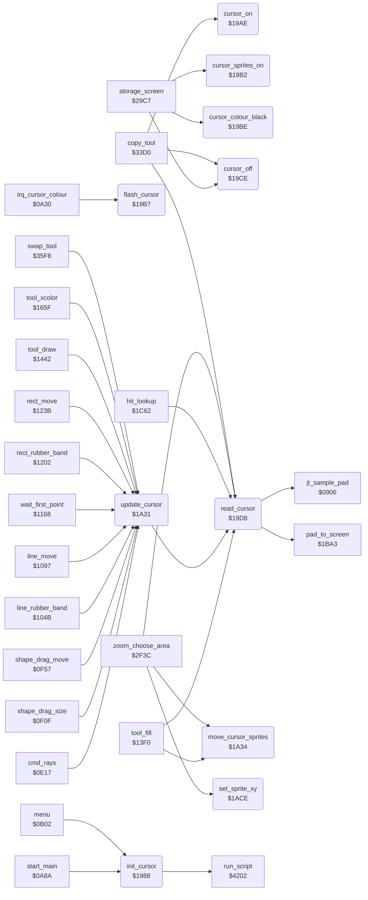

<!-- Generated by c64-docs from knowledge revision 20261025T214623.268-6ar633 and .c64-re-tools/local/generated/src/source-map.json. Do not edit: change the knowledge, generate the source again, then run docs.ts generate. -->
# input/cursor.asm: Cursor Sprites and Cursor Position

Range `$1988-$1AF7`. Source: [input/cursor.asm](../../../../src/input/cursor.asm). Index: [the reference](../../index.md).

## Routines

| Routine | Address | Reached from | Summary |
|---|---|---|---|
| [`init_cursor`](cursor.md#init_cursor) | `$1988` | [`start_main`](../init/start_0a8a.md#start_main), [`menu`](../menu/menu.md#menu) | Sets up the cursor sprites: offsets 18/25, X MSB off, sprites off, in front of the picture, hi-res. |
| [`cursor_on`](cursor.md#cursor_on) | `$19AE` | [`copy_tool`](../tools/copy.md#copy_tool) | Lets the IRQ flash the cursor (cursor_colour_enable = 1), then cursor_sprites_on. |
| [`cursor_sprites_on`](cursor.md#cursor_sprites_on) | `$19B2` | [`storage_screen`](../storage/storage_screen.md#storage_screen) | Sets cursor_sprite_mask to $cf (sprites 0-3, 6 and 7). |
| [`flash_cursor`](cursor.md#flash_cursor) | `$19B7` | [`irq_cursor_colour`](../irq/irq.md#irq_cursor_colour) | Changes the colour of all 8 sprites between black and light grey. |
| [`cursor_colour_black`](cursor.md#cursor_colour_black) | `$19BE` | [`storage_screen`](../storage/storage_screen.md#storage_screen) | Sets the colour of all 8 sprites to black. |
| [`cursor_off`](cursor.md#cursor_off) | `$19CE` | [`storage_screen`](../storage/storage_screen.md#storage_screen), [`copy_tool`](../tools/copy.md#copy_tool) | Hides the cursor: stops the flash, clears cursor_sprite_mask and turns all sprites off. |
| [`read_cursor`](cursor.md#read_cursor) | `$19D8` | [`tool_fill`](../tools/fill_tool.md#tool_fill), [`update_cursor`](cursor.md#update_cursor), [`hit_lookup`](hit_test_1c5a.md#hit_lookup), [`zoom_choose_area`](../zoom/zoom_choose_area.md#zoom_choose_area), [`copy_tool`](../tools/copy.md#copy_tool) | Reads the pad (sample_pad) and converts it to screen units (pad_to_screen) in cursor_x (0-$9f) and cursor_y (0-$c7). |
| [`update_cursor`](cursor.md#update_cursor) | `$1A31` | [`cmd_rays`](../tools/rays.md#cmd_rays), [`shape_drag_size`](../tools/circle.md#shape_drag_size), [`shape_drag_move`](../tools/circle.md#shape_drag_move), [`line_rubber_band`](../tools/line_tool.md#line_rubber_band), [`line_move`](../tools/line_tool.md#line_move), [`wait_first_point`](../tools/line_tool.md#wait_first_point), [`rect_rubber_band`](../tools/box_frame_tool.md#rect_rubber_band), [`rect_move`](../tools/box_frame_tool.md#rect_move), [`tool_draw`](../tools/draw_tool.md#tool_draw), [`tool_xcolor`](../tools/xcolor_tool.md#tool_xcolor), [`swap_tool`](../tools/swap.md#swap_tool) | Reads the cursor (read_cursor), then moves the cursor sprites to it (move_cursor_sprites). |
| [`move_cursor_sprites`](cursor.md#move_cursor_sprites) | `$1A34` | [`tool_fill`](../tools/fill_tool.md#tool_fill), [`zoom_choose_area`](../zoom/zoom_choose_area.md#zoom_choose_area), [`hit_test`](hit_test_1c5a.md#hit_test) | Moves the cursor sprites to cursor_x, cursor_y. |
| [`set_sprite_xy`](cursor.md#set_sprite_xy) | `$1ACE` | [`zoom_choose_area`](../zoom/zoom_choose_area.md#zoom_choose_area) | Moves one sprite to screen X = A * 2 + 24 and Y = cursor_y + 50. |

## Call graph

A solid arrow is a call, a thick arrow a table entry. Rounded nodes are in this file.

## Details

### [`init_cursor`](../../../../src/input/cursor.asm#L6) `$1988`

*routine*

Sets up the cursor sprites: offsets 18/25, X MSB off, sprites off, in front of the picture, hi-res. Runs cursor_sprites_script and brush_cursor_0 (the arrow), then cursor_on.

- **Called from:** [`start_main`](../init/start_0a8a.md#start_main), [`menu`](../menu/menu.md#menu)
- **Calls:** [`run_script`](../script/interpreter.md#run_script)
- **Writes:** [`cursor_offset_x`](../../memory-map.md#cursor_offset_x), [`cursor_offset_y`](../../memory-map.md#cursor_offset_y), [`MSIGX`](../../memory-map.md#MSIGX), [`SPENA`](../../memory-map.md#SPENA), [`SPBGPR`](../../memory-map.md#SPBGPR), [`SPMC`](../../memory-map.md#SPMC)

### [`cursor_on`](../../../../src/input/cursor.asm#L24) `$19AE`

*routine*

Lets the IRQ flash the cursor (cursor_colour_enable = 1), then cursor_sprites_on.

- **Called from:** [`copy_tool`](../tools/copy.md#copy_tool)
- **Writes:** [`cursor_colour_enable`](../../memory-map.md#cursor_colour_enable)

### [`cursor_sprites_on`](../../../../src/input/cursor.asm#L28) `$19B2`

*routine*

Sets cursor_sprite_mask to $cf (sprites 0-3, 6 and 7). read_cursor copies it to $d015 while the pad is touched.

- **Called from:** [`storage_screen`](../storage/storage_screen.md#storage_screen)
- **Writes:** [`cursor_sprite_mask`](../../memory-map.md#cursor_sprite_mask)

### [`flash_cursor`](../../../../src/input/cursor.asm#L33) `$19B7`

*routine*

Changes the colour of all 8 sprites between black and light grey. The IRQ calls it (by $0a30) while cursor_colour_enable is set.

- **Called from:** [`irq_cursor_colour`](../irq/irq.md#irq_cursor_colour)
- **Jumps to:** [`flash_cursor_grey`](cursor.md#flash_cursor_grey)
- **Reads:** [`SP0COL`](../../memory-map.md#SP0COL)

### [`cursor_colour_black`](../../../../src/input/cursor.asm#L38) `$19BE`

*routine*

Sets the colour of all 8 sprites to black.

- **Called from:** [`storage_screen`](../storage/storage_screen.md#storage_screen)
- **Writes:** [`SPMC1`](../../memory-map.md#SPMC1)

| Label | Address | Comment |
|---|---|---|
| [`flash_cursor_grey`](../../../../src/input/cursor.asm#L41) | `$19C3` |  |
| [`set_cursor_colour`](../../../../src/input/cursor.asm#L43) | `$19C5` | Sets $d027-$d02e to A. |
| [`set_cursor_colour_loop`](../../../../src/input/cursor.asm#L45) | `$19C7` |  |

### [`cursor_off`](../../../../src/input/cursor.asm#L51) `$19CE`

*routine*

Hides the cursor: stops the flash, clears cursor_sprite_mask and turns all sprites off.

- **Called from:** [`storage_screen`](../storage/storage_screen.md#storage_screen), [`copy_tool`](../tools/copy.md#copy_tool)
- **Writes:** [`cursor_colour_enable`](../../memory-map.md#cursor_colour_enable), [`cursor_sprite_mask`](../../memory-map.md#cursor_sprite_mask), [`SPENA`](../../memory-map.md#SPENA)

### [`read_cursor`](../../../../src/input/cursor.asm#L58) `$19D8`

*routine*

Reads the pad (sample_pad) and converts it to screen units (pad_to_screen) in cursor_x (0-$9f) and cursor_y (0-$c7). No touch (pad Y $e6 or more, or X and Y both below 10) gives cursor_x = $ff and sprites off; pad Y $e6 or more also counts off_pad_count up to 16. A touch clears off_pad_count and turns on the sprites in cursor_sprite_mask. In Mirror mode it also keeps the position folded into the top left quarter in temp_byte_2 and mirror_cursor_y. Returns X = cursor_x, Y = cursor_y.

- **Called from:** [`tool_fill`](../tools/fill_tool.md#tool_fill), [`update_cursor`](cursor.md#update_cursor), [`hit_lookup`](hit_test_1c5a.md#hit_lookup), [`zoom_choose_area`](../zoom/zoom_choose_area.md#zoom_choose_area), [`copy_tool`](../tools/copy.md#copy_tool)
- **Calls:** [`jt_sample_pad`](../init/entry.md#jt_sample_pad), [`pad_to_screen`](pad_to_screen.md#pad_to_screen)
- **Reads:** [`cursor_x`](../../memory-map.md#cursor_x), [`cursor_y`](../../memory-map.md#cursor_y), [`off_pad_count`](../../memory-map.md#off_pad_count), [`mirror_mode`](../data/workspace.md#mirror_mode), [`temp_byte_2`](../../memory-map.md#temp_byte_2), [`mirror_cursor_y`](../../memory-map.md#mirror_cursor_y), [`cursor_sprite_mask`](../../memory-map.md#cursor_sprite_mask)
- **Writes:** [`cursor_x`](../../memory-map.md#cursor_x), [`SPENA`](../../memory-map.md#SPENA), [`off_pad_count`](../../memory-map.md#off_pad_count), [`temp_byte_2`](../../memory-map.md#temp_byte_2), [`mirror_cursor_y`](../../memory-map.md#mirror_cursor_y), [`cursor_y`](../../memory-map.md#cursor_y)

| Label | Address | Comment |
|---|---|---|
| [`read_cursor_none`](../../../../src/input/cursor.asm#L68) | `$19EB` |  |
| [`read_cursor_off_pad`](../../../../src/input/cursor.asm#L75) | `$19F6` |  |
| [`read_cursor_counted`](../../../../src/input/cursor.asm#L80) | `$19FE` |  |
| [`read_cursor_touch`](../../../../src/input/cursor.asm#L82) | `$1A01` |  |
| [`read_cursor_fold_y`](../../../../src/input/cursor.asm#L95) | `$1A1A` |  |
| [`read_cursor_store`](../../../../src/input/cursor.asm#L103) | `$1A27` |  |

### [`update_cursor`](../../../../src/input/cursor.asm#L110) `$1A31`

*routine*

Reads the cursor (read_cursor), then moves the cursor sprites to it (move_cursor_sprites).

- **Called from:** [`cmd_rays`](../tools/rays.md#cmd_rays), [`shape_drag_size`](../tools/circle.md#shape_drag_size), [`shape_drag_move`](../tools/circle.md#shape_drag_move), [`line_rubber_band`](../tools/line_tool.md#line_rubber_band), [`line_move`](../tools/line_tool.md#line_move), [`wait_first_point`](../tools/line_tool.md#wait_first_point), [`rect_rubber_band`](../tools/box_frame_tool.md#rect_rubber_band), [`rect_move`](../tools/box_frame_tool.md#rect_move), [`tool_draw`](../tools/draw_tool.md#tool_draw), [`tool_xcolor`](../tools/xcolor_tool.md#tool_xcolor), [`swap_tool`](../tools/swap.md#swap_tool)
- **Calls:** [`read_cursor`](cursor.md#read_cursor)

### [`move_cursor_sprites`](../../../../src/input/cursor.asm#L113) `$1A34`

*routine*

Moves the cursor sprites to cursor_x, cursor_y. Sprites 0-5 are a block of 3 columns (24 pixels apart: 0/1, 2/3, 4/5) and 2 rows (21 lines apart); sprites 6 and 7 (the tool label) are 33 lines below sprite 0. Does nothing when cursor_x = $ff. In Mirror mode, cursor_x and cursor_y then get the folded position from read_cursor.

- **Called from:** [`tool_fill`](../tools/fill_tool.md#tool_fill), [`zoom_choose_area`](../zoom/zoom_choose_area.md#zoom_choose_area)
- **Jumped to from:** [`hit_test`](hit_test_1c5a.md#hit_test)
- **Reads:** [`cursor_x`](../../memory-map.md#cursor_x), [`cursor_offset_x`](../../memory-map.md#cursor_offset_x), [`SP0X`](../../memory-map.md#SP0X), [`MSIGX`](../../memory-map.md#MSIGX), [`cursor_y`](../../memory-map.md#cursor_y), [`cursor_offset_y`](../../memory-map.md#cursor_offset_y), [`SP0Y`](../../memory-map.md#SP0Y), [`mirror_mode`](../data/workspace.md#mirror_mode), [`temp_byte_2`](../../memory-map.md#temp_byte_2), [`mirror_cursor_y`](../../memory-map.md#mirror_cursor_y)
- **Writes:** [`SP0X`](../../memory-map.md#SP0X), [`SP1X`](../../memory-map.md#SP1X), [`SP6X`](../../memory-map.md#SP6X), [`MSIGX`](../../memory-map.md#MSIGX), [`SP2X`](../../memory-map.md#SP2X), [`SP3X`](../../memory-map.md#SP3X), [`SP7X`](../../memory-map.md#SP7X), [`SP4X`](../../memory-map.md#SP4X), [`SP5X`](../../memory-map.md#SP5X), [`SP0Y`](../../memory-map.md#SP0Y), [`SP2Y`](../../memory-map.md#SP2Y), [`SP4Y`](../../memory-map.md#SP4Y) and 7 more

| Label | Address | Comment |
|---|---|---|
| [`move_cursor_x`](../../../../src/input/cursor.asm#L118) | `$1A3B` |  |
| [`move_cursor_msb_on`](../../../../src/input/cursor.asm#L129) | `$1A4D` |  |
| [`move_cursor_x_low`](../../../../src/input/cursor.asm#L133) | `$1A55` |  |
| [`move_cursor_column_2`](../../../../src/input/cursor.asm#L138) | `$1A5D` |  |
| [`move_cursor_column_3`](../../../../src/input/cursor.asm#L149) | `$1A76` |  |
| [`move_cursor_y`](../../../../src/input/cursor.asm#L159) | `$1A8C` |  |
| [`move_cursor_label_off`](../../../../src/input/cursor.asm#L179) | `$1AB8` | The label sprites go off the screen bottom. |
| [`move_cursor_mirror`](../../../../src/input/cursor.asm#L184) | `$1AC0` |  |
| [`move_cursor_done`](../../../../src/input/cursor.asm#L191) | `$1ACD` |  |

### [`set_sprite_xy`](../../../../src/input/cursor.asm#L194) `$1ACE`

*routine*

Moves one sprite to screen X = A * 2 + 24 and Y = cursor_y + 50. Input: A = x (0-159), X = 2 * sprite number, Y = the bit of the sprite in $d010.

- **Called from:** [`zoom_choose_area`](../zoom/zoom_choose_area.md#zoom_choose_area)
- **Reads:** [`MSIGX`](../../memory-map.md#MSIGX), [`cursor_y`](../../memory-map.md#cursor_y)
- **Writes:** [`SP0X`](../../memory-map.md#SP0X), [`MSIGX`](../../memory-map.md#MSIGX), [`SP0Y`](../../memory-map.md#SP0Y)

| Label | Address | Comment |
|---|---|---|
| [`set_sprite_xy_msb_on`](../../../../src/input/cursor.asm#L202) | `$1AD9` |  |
| [`set_sprite_xy_low`](../../../../src/input/cursor.asm#L207) | `$1AE3` |  |
| [`set_sprite_xy_y`](../../../../src/input/cursor.asm#L214) | `$1AEF` |  |
