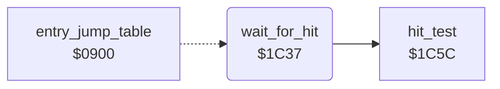

<!-- Generated by c64-docs from knowledge revision 20261024T063910.298-7zz1bw and .c64-re-tools/local/generated/src/source-map.json. Do not edit: change the knowledge, generate the source again, then run docs.ts generate. -->
# input/hit_test.asm: Hit Test of the Cell Tables

Range `$1C37-$1C55`. Source: [input/hit_test.asm](../../../../src/input/hit_test.asm). Index: [the reference](../../index.md).

## Call graph

A solid arrow is a call, a thick arrow a table entry, a dotted arrow a jump. Rounded nodes are in this file.

## Names

### [`wait_for_hit`](../../../../src/input/hit_test.asm#L6) `$1C37`

*routine*

Repeats hit_test until hit_code is not 0. Then it subtracts the table bytes at hit_cell_ptr + Y - 2 and + Y - 4 from cursor_x and cursor_y, and returns A = hit_code. Only the jump table entry $0903 points to it; the runs did not execute it.

- **Jumped to from:** [`entry_jump_table`](../init/entry.md#entry_jump_table) [`$0903`](../../../../src/init/entry.asm#L9)
- **Entry of:** [`entry_jump_table`](../../tables.md#entry_jump_table)
- **Calls:** [`hit_test`](hit_test_1c5a.md#hit_test)
- **Reads:** [`hit_code`](../../memory-map.md#hit_code), [`cursor_x`](../../memory-map.md#cursor_x), [`hit_cell_ptr`](../../memory-map.md#hit_cell_ptr), [`cursor_y`](../../memory-map.md#cursor_y)
- **Writes:** [`cursor_x`](../../memory-map.md#cursor_x), [`cursor_y`](../../memory-map.md#cursor_y)
