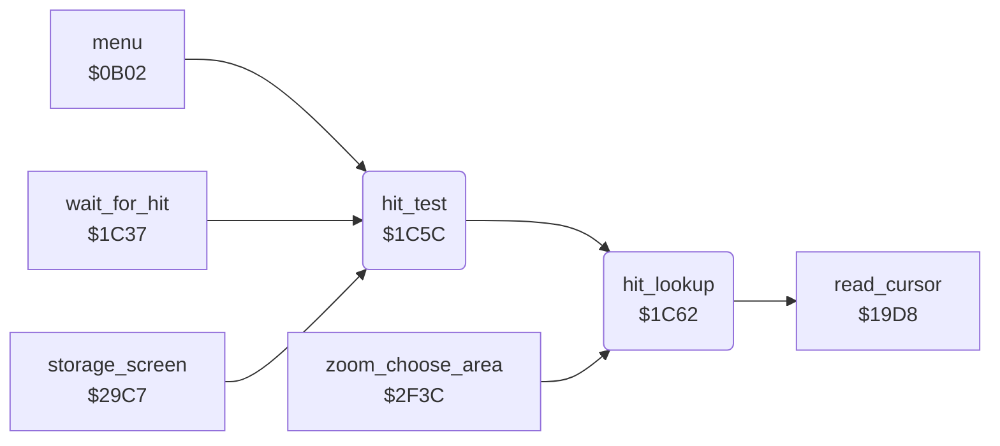

<!-- Generated by c64-docs from knowledge revision 20261025T214623.268-6ar633 and .c64-re-tools/local/generated/src/source-map.json. Do not edit: change the knowledge, generate the source again, then run docs.ts generate. -->
# input/hit_test_1c5a.asm

Range `$1C5A-$1CCB`. Source: [input/hit_test_1c5a.asm](../../../../src/input/hit_test_1c5a.asm). Index: [the reference](../../index.md).

## Routines

| Routine | Address | Reached from | Summary |
|---|---|---|---|
| [`wait_for_hit_exit`](hit_test_1c5a.md#wait_for_hit_exit) | `$1C5A` | [`wait_for_hit`](hit_test.md#wait_for_hit) |  |
| [`hit_test`](hit_test_1c5a.md#hit_test) | `$1C5C` | [`menu`](../menu/menu.md#menu), [`wait_for_hit`](hit_test.md#wait_for_hit), [`storage_screen`](../storage/storage_screen.md#storage_screen), [`jt_sample_pad`](../init/entry.md#jt_sample_pad) | Finds the cell under the cursor (hit_lookup), then moves the cursor sprites (move_cursor_sprites). |
| [`hit_lookup`](hit_test_1c5a.md#hit_lookup) | `$1C62` | [`hit_test`](hit_test_1c5a.md#hit_test), [`zoom_choose_area`](../zoom/zoom_choose_area.md#zoom_choose_area) | Reads the cursor (read_cursor) and looks for the cell that holds cursor_x, cursor_y in the table at hit_table_ptr: count, then 5 bytes for each cell (Y max, Y min, X end, X min, code). |

## Call graph

A solid arrow is a call, a thick arrow a table entry. Rounded nodes are in this file.

## Details

### [`wait_for_hit_exit`](../../../../src/input/hit_test_1c5a.asm#L5) `$1C5A`

*label*

- **Jumped to from:** [`wait_for_hit`](hit_test.md#wait_for_hit)

### [`hit_test`](../../../../src/input/hit_test_1c5a.asm#L10) `$1C5C`

*routine*

Finds the cell under the cursor (hit_lookup), then moves the cursor sprites (move_cursor_sprites). hit_code gets the code of the cell, or 0.

- **Called from:** [`menu`](../menu/menu.md#menu), [`wait_for_hit`](hit_test.md#wait_for_hit), [`storage_screen`](../storage/storage_screen.md#storage_screen)
- **Jumped to from:** [`jt_sample_pad`](../init/entry.md#jt_sample_pad)
- **Entry of:** [`entry_jump_table`](../../tables.md#entry_jump_table)
- **Calls:** [`hit_lookup`](hit_test_1c5a.md#hit_lookup)
- **Jumps to:** [`move_cursor_sprites`](cursor.md#move_cursor_sprites)

### [`hit_lookup`](../../../../src/input/hit_test_1c5a.asm#L14) `$1C62`

*routine*

Reads the cursor (read_cursor) and looks for the cell that holds cursor_x, cursor_y in the table at hit_table_ptr: count, then 5 bytes for each cell (Y max, Y min, X end, X min, code). hit_code gets the code of the first cell that matches, or 0. No table (hit_table_ptr = 0) gives 0.

- **Called from:** [`hit_test`](hit_test_1c5a.md#hit_test), [`zoom_choose_area`](../zoom/zoom_choose_area.md#zoom_choose_area)
- **Calls:** [`read_cursor`](cursor.md#read_cursor)
- **Reads:** [`hit_table_ptr`](../../memory-map.md#hit_table_ptr), [`hit_cell_ptr`](../../memory-map.md#hit_cell_ptr), [`hit_cell_ptr_hi`](../../memory-map.md#hit_cell_ptr_hi), [`cursor_y`](../../memory-map.md#cursor_y), [`hit_cells_left`](../../memory-map.md#hit_cells_left), [`cursor_x`](../../memory-map.md#cursor_x)
- **Writes:** [`hit_code`](../../memory-map.md#hit_code), [`hit_cell_ptr`](../../memory-map.md#hit_cell_ptr), [`hit_cell_ptr_hi`](../../memory-map.md#hit_cell_ptr_hi), [`hit_cells_left`](../../memory-map.md#hit_cells_left), [`hit_lookup_tag`](../../memory-map.md#hit_lookup_tag)

| Label | Address | Comment |
|---|---|---|
| [`hit_lookup_start`](../../../../src/input/hit_test_1c5a.asm#L23) | `$1C6F` |  |
| [`hit_lookup_first_cell`](../../../../src/input/hit_test_1c5a.asm#L37) | `$1C86` |  |
| [`hit_lookup_cell`](../../../../src/input/hit_test_1c5a.asm#L42) | `$1C8F` |  |
| [`hit_lookup_next`](../../../../src/input/hit_test_1c5a.asm#L48) | `$1C99` |  |
| [`hit_lookup_advance`](../../../../src/input/hit_test_1c5a.asm#L52) | `$1C9E` |  |
| [`hit_lookup_store_ptr`](../../../../src/input/hit_test_1c5a.asm#L58) | `$1CA7` |  |
| [`hit_lookup_check_y_min`](../../../../src/input/hit_test_1c5a.asm#L61) | `$1CAC` |  |
| [`hit_lookup_check_x`](../../../../src/input/hit_test_1c5a.asm#L67) | `$1CB7` |  |
| [`hit_lookup_found`](../../../../src/input/hit_test_1c5a.asm#L76) | `$1CC6` |  |
