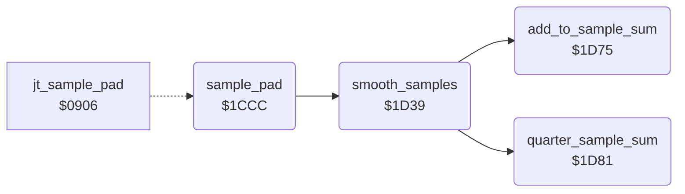

<!-- Generated by c64-docs from knowledge revision 20261024T063910.298-7zz1bw and .c64-re-tools/local/generated/src/source-map.json. Do not edit: change the knowledge, generate the source again, then run docs.ts generate. -->
# input/pad_smoothing.asm: Pad Sample Smoothing

Range `$1CCC-$1D97`. Source: [input/pad_smoothing.asm](../../../../src/input/pad_smoothing.asm). Index: [the reference](../../index.md).

## Call graph

A solid arrow is a call, a thick arrow a table entry, a dotted arrow a jump. Rounded nodes are in this file.

## Names

### [`sample_pad`](../../../../src/input/pad_smoothing.asm#L6) `$1CCC`

*routine*

Smooths the 5 pad samples of each axis (smooth_samples) into cursor_x and cursor_y, in pad units. When a result differs from the raw value (pad_x_raw, pad_y_raw) by 5 or more, pad_spread gets the difference and cursor_x = cursor_y = 1. When both results are below 5, both become 0. Sets pad_read_enable. Jump table entry $0906.

- **Jumped to from:** [`jt_sample_pad`](../init/entry.md#jt_sample_pad) [`$0906`](../../../../src/init/entry.asm#L12)
- **Entry of:** [`entry_jump_table`](../../tables.md#entry_jump_table)
- **Calls:** [`smooth_samples`](pad_smoothing.md#smooth_samples)
- **Reads:** [`pad_x_samples`](../../memory-map.md#pad_x_samples), [`smooth_buffer`](../../memory-map.md#smooth_buffer), [`pad_x_raw`](../../memory-map.md#pad_x_raw), [`pad_y_samples`](../../memory-map.md#pad_y_samples), [`pad_y_raw`](../../memory-map.md#pad_y_raw), [`pad_spread`](../../memory-map.md#pad_spread), [`cursor_x`](../../memory-map.md#cursor_x), [`cursor_y`](../../memory-map.md#cursor_y)
- **Writes:** [`pad_read_enable`](../../memory-map.md#pad_read_enable), [`smooth_buffer`](../../memory-map.md#smooth_buffer), [`cursor_x`](../../memory-map.md#cursor_x), [`cursor_y`](../../memory-map.md#cursor_y), [`pad_spread`](../../memory-map.md#pad_spread)

### [`sample_pad_copy_x`](../../../../src/input/pad_smoothing.asm#L10) `$1CD2`

*label*

- **Jumped to from:** [`sample_pad`](pad_smoothing.md#sample_pad) [`$1CDA`](../../../../src/input/pad_smoothing.asm#L16)

### [`sample_pad_check_x`](../../../../src/input/pad_smoothing.asm#L26) `$1CED`

*label*

- **Jumped to from:** [`sample_pad`](pad_smoothing.md#sample_pad) [`$1CE6`](../../../../src/input/pad_smoothing.asm#L22)

### [`sample_pad_y`](../../../../src/input/pad_smoothing.asm#L30) `$1CF4`

*label*

- **Jumped to from:** [`sample_pad`](pad_smoothing.md#sample_pad) [`$1CEF`](../../../../src/input/pad_smoothing.asm#L28)

### [`sample_pad_copy_y`](../../../../src/input/pad_smoothing.asm#L32) `$1CF6`

*label*

- **Jumped to from:** [`sample_pad`](pad_smoothing.md#sample_pad) [`$1CFE`](../../../../src/input/pad_smoothing.asm#L38)

### [`sample_pad_check_y`](../../../../src/input/pad_smoothing.asm#L48) `$1D11`

*label*

- **Jumped to from:** [`sample_pad`](pad_smoothing.md#sample_pad) [`$1D0A`](../../../../src/input/pad_smoothing.asm#L44)

### [`sample_pad_store_spread`](../../../../src/input/pad_smoothing.asm#L52) `$1D17`

*label*

- **Jumped to from:** [`sample_pad`](pad_smoothing.md#sample_pad) [`$1CF1`](../../../../src/input/pad_smoothing.asm#L29), [`sample_pad`](pad_smoothing.md#sample_pad) [`$1D13`](../../../../src/input/pad_smoothing.asm#L50)

### [`sample_pad_check_low`](../../../../src/input/pad_smoothing.asm#L60) `$1D26`

*label*

- **Jumped to from:** [`sample_pad`](pad_smoothing.md#sample_pad) [`$1D1B`](../../../../src/input/pad_smoothing.asm#L55)

### [`sample_pad_done`](../../../../src/input/pad_smoothing.asm#L70) `$1D38`

*label*

- **Jumped to from:** [`sample_pad`](pad_smoothing.md#sample_pad) [`$1D23`](../../../../src/input/pad_smoothing.asm#L59), [`sample_pad`](pad_smoothing.md#sample_pad) [`$1D2A`](../../../../src/input/pad_smoothing.asm#L63), [`sample_pad`](pad_smoothing.md#sample_pad) [`$1D30`](../../../../src/input/pad_smoothing.asm#L66)

### [`smooth_samples`](../../../../src/input/pad_smoothing.asm#L73) `$1D39`

*routine*

Smooths the 5 samples in smooth_buffer. Each step puts (s[i] + 2 * s[i+1] + s[i+2]) / 4 into s[i]: 3 steps, then 1 step. The result in s[0] is the sum of the samples with the weights 1, 4, 6, 4, 1, divided by 16. It does not sort.

- **Called from:** [`sample_pad`](pad_smoothing.md#sample_pad) [`$1CDC`](../../../../src/input/pad_smoothing.asm#L17), [`sample_pad`](pad_smoothing.md#sample_pad) [`$1D00`](../../../../src/input/pad_smoothing.asm#L39)
- **Calls:** [`add_to_sample_sum`](pad_smoothing.md#add_to_sample_sum), [`quarter_sample_sum`](pad_smoothing.md#quarter_sample_sum)
- **Reads:** [`smooth_limit`](../../memory-map.md#smooth_limit), [`smooth_buffer`](../../memory-map.md#smooth_buffer), [`sample_sum`](../../memory-map.md#sample_sum)
- **Writes:** [`smooth_limit`](../../memory-map.md#smooth_limit), [`sample_sum`](../../memory-map.md#sample_sum), [`sample_sum_hi`](../../memory-map.md#sample_sum_hi), [`smooth_buffer`](../../memory-map.md#smooth_buffer)

### [`sort_samples_pass`](../../../../src/input/pad_smoothing.asm#L76) `$1D3D`

*label*

- **Jumped to from:** [`smooth_samples`](pad_smoothing.md#smooth_samples) [`$1D73`](../../../../src/input/pad_smoothing.asm#L106)

### [`sort_samples_step`](../../../../src/input/pad_smoothing.asm#L84) `$1D49`

*label*

- **Jumped to from:** [`smooth_samples`](pad_smoothing.md#smooth_samples) [`$1D46`](../../../../src/input/pad_smoothing.asm#L82), [`smooth_samples`](pad_smoothing.md#smooth_samples) [`$1D71`](../../../../src/input/pad_smoothing.asm#L105)

### [`add_to_sample_sum`](../../../../src/input/pad_smoothing.asm#L108) `$1D75`

*routine*

Adds A to sample_sum (16 bits).

- **Called from:** [`smooth_samples`](pad_smoothing.md#smooth_samples) [`$1D51`](../../../../src/input/pad_smoothing.asm#L89), [`smooth_samples`](pad_smoothing.md#smooth_samples) [`$1D57`](../../../../src/input/pad_smoothing.asm#L92), [`smooth_samples`](pad_smoothing.md#smooth_samples) [`$1D5C`](../../../../src/input/pad_smoothing.asm#L94), [`smooth_samples`](pad_smoothing.md#smooth_samples) [`$1D62`](../../../../src/input/pad_smoothing.asm#L97)
- **Reads:** [`sample_sum`](../../memory-map.md#sample_sum), [`sample_sum_hi`](../../memory-map.md#sample_sum_hi)
- **Writes:** [`sample_sum`](../../memory-map.md#sample_sum), [`sample_sum_hi`](../../memory-map.md#sample_sum_hi)

### [`quarter_sample_sum`](../../../../src/input/pad_smoothing.asm#L117) `$1D81`

*routine*

Divides sample_sum by 4.

- **Called from:** [`smooth_samples`](pad_smoothing.md#smooth_samples) [`$1D65`](../../../../src/input/pad_smoothing.asm#L98)
- **Reads:** [`sample_sum_hi`](../../memory-map.md#sample_sum_hi), [`sample_sum`](../../memory-map.md#sample_sum)
- **Writes:** [`sample_sum_hi`](../../memory-map.md#sample_sum_hi), [`sample_sum`](../../memory-map.md#sample_sum)
