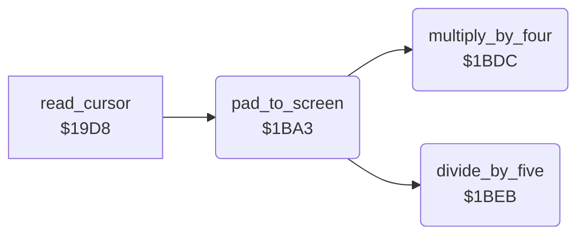

<!-- Generated by c64-docs from knowledge revision 20261025T214623.268-6ar633 and .c64-re-tools/local/generated/src/source-map.json. Do not edit: change the knowledge, generate the source again, then run docs.ts generate. -->
# input/pad_to_screen.asm: Pad Units to Screen Units

Range `$1BA3-$1C03`. Source: [input/pad_to_screen.asm](../../../../src/input/pad_to_screen.asm). Index: [the reference](../../index.md).

## Routines

| Routine | Address | Reached from | Summary |
|---|---|---|---|
| [`pad_to_screen`](pad_to_screen.md#pad_to_screen) | `$1BA3` | [`read_cursor`](cursor.md#read_cursor) | Converts pad units to screen units: X = (pad X - 20) * 4 / 5 (0-$9f), Y = pad Y - 20 (0-$c7). |
| [`multiply_by_four`](pad_to_screen.md#multiply_by_four) | `$1BDC` | [`pad_to_screen`](pad_to_screen.md#pad_to_screen) | Puts A * 4 in temp_word/temp_word_hi (16 bits). |
| [`divide_by_five`](pad_to_screen.md#divide_by_five) | `$1BEB` | [`pad_to_screen`](pad_to_screen.md#pad_to_screen) | Divides the 16-bit value in temp_word/temp_word_hi by 5 (temp_word_hi must be below 5). |

## Call graph

A solid arrow is a call, a thick arrow a table entry. Rounded nodes are in this file.

## Details

### [`pad_to_screen`](../../../../src/input/pad_to_screen.asm#L6) `$1BA3`

*routine*

Converts pad units to screen units: X = (pad X - 20) * 4 / 5 (0-$9f), Y = pad Y - 20 (0-$c7). Values out of range become the limit. Input and output: X, Y.

- **Called from:** [`read_cursor`](cursor.md#read_cursor)
- **Calls:** [`multiply_by_four`](pad_to_screen.md#multiply_by_four), [`divide_by_five`](pad_to_screen.md#divide_by_five)

| Label | Address | Comment |
|---|---|---|
| [`pad_to_screen_x_max`](../../../../src/input/pad_to_screen.asm#L16) | `$1BB0` |  |
| [`pad_to_screen_scale_x`](../../../../src/input/pad_to_screen.asm#L22) | `$1BB9` |  |
| [`pad_to_screen_y`](../../../../src/input/pad_to_screen.asm#L26) | `$1BC0` |  |
| [`pad_to_screen_y_max`](../../../../src/input/pad_to_screen.asm#L38) | `$1BCF` |  |
| [`pad_to_screen_y_ok`](../../../../src/input/pad_to_screen.asm#L44) | `$1BD8` |  |
| [`pad_to_screen_done`](../../../../src/input/pad_to_screen.asm#L46) | `$1BD9` |  |

### [`multiply_by_four`](../../../../src/input/pad_to_screen.asm#L51) `$1BDC`

*routine*

Puts A * 4 in temp_word/temp_word_hi (16 bits).

- **Called from:** [`pad_to_screen`](pad_to_screen.md#pad_to_screen)
- **Reads:** [`temp_word`](../../memory-map.md#temp_word), [`temp_word_hi`](../../memory-map.md#temp_word_hi)
- **Writes:** [`temp_word`](../../memory-map.md#temp_word), [`temp_word_hi`](../../memory-map.md#temp_word_hi)

### [`divide_by_five`](../../../../src/input/pad_to_screen.asm#L61) `$1BEB`

*routine*

Divides the 16-bit value in temp_word/temp_word_hi by 5 (temp_word_hi must be below 5). Returns A = the quotient (8 bits); temp_word_hi keeps the remainder.

- **Called from:** [`pad_to_screen`](pad_to_screen.md#pad_to_screen)
- **Reads:** [`temp_word`](../../memory-map.md#temp_word), [`temp_word_hi`](../../memory-map.md#temp_word_hi), [`temp_byte_2`](../../memory-map.md#temp_byte_2)
- **Writes:** [`temp_byte_2`](../../memory-map.md#temp_byte_2), [`temp_word`](../../memory-map.md#temp_word), [`temp_word_hi`](../../memory-map.md#temp_word_hi)

| Label | Address | Comment |
|---|---|---|
| [`divide_by_five_loop`](../../../../src/input/pad_to_screen.asm#L64) | `$1BEF` |  |
| [`divide_by_five_bit`](../../../../src/input/pad_to_screen.asm#L73) | `$1BFD` |  |
