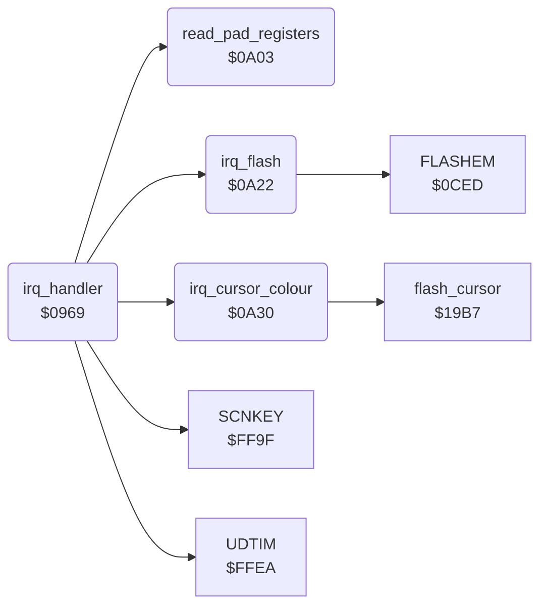

<!-- Generated by c64-docs from knowledge revision 20261025T214623.268-6ar633 and .c64-re-tools/local/generated/src/source-map.json. Do not edit: change the knowledge, generate the source again, then run docs.ts generate. -->
# irq/irq.asm: IRQ Handler

Range `$0969-$0A3B`. Source: [irq/irq.asm](../../../../src/irq/irq.asm). Index: [the reference](../../index.md).

## Routines

| Routine | Address | Reached from | Summary |
|---|---|---|---|
| [`irq_handler`](irq.md#irq_handler) | `$0969` |  | IRQ handler. |
| [`read_pad_registers`](irq.md#read_pad_registers) | `$0A03` | [`irq_handler`](irq.md#irq_handler) | IRQ part: when pad_read_enable is not 0, reads POT X and POT Y into pad_x_raw and pad_y_raw and moves the 5 samples of each axis one place down. |
| [`irq_flash`](irq.md#irq_flash) | `$0A22` | [`irq_handler`](irq.md#irq_handler) | IRQ part: counts flash_timer down. |
| [`irq_cursor_colour`](irq.md#irq_cursor_colour) | `$0A30` | [`irq_handler`](irq.md#irq_handler) | IRQ part: counts cursor_colour_timer down. |

## Call graph

A solid arrow is a call, a thick arrow a table entry. Rounded nodes are in this file.

## Details

### [`irq_handler`](../../../../src/irq/irq.asm#L6) `$0969`

*routine*

IRQ handler. With raster_split_enable set and a raster interrupt, it makes the menu screen splits: from line 0 white background and multicolour, from line $b2 hires, from line $ca mix_colour as background. Else (the CIA 1 timer): UDTIM, the pad read, the button state, the menu flash, the cursor colour and SCNKEY, each when its flag is set.

- **Calls:** [`UDTIM`](../../memory-map.md#UDTIM), [`read_pad_registers`](irq.md#read_pad_registers), [`irq_flash`](irq.md#irq_flash), [`irq_cursor_colour`](irq.md#irq_cursor_colour), [`SCNKEY`](../../memory-map.md#SCNKEY)
- **Reads:** [`raster_split_enable`](../../memory-map.md#raster_split_enable), [`VICIRQ`](../../memory-map.md#VICIRQ), [`RASTER`](../../memory-map.md#RASTER), [`mix_colour`](../../memory-map.md#mix_colour), [`SCROLX`](../../memory-map.md#SCROLX), [`CIAICR`](../../memory-map.md#CIAICR), [`CIAPRB`](../../memory-map.md#CIAPRB), [`button_held`](../../memory-map.md#button_held), [`flash_enable`](../../memory-map.md#flash_enable), [`cursor_colour_enable`](../../memory-map.md#cursor_colour_enable), [`scan_keys_enable`](../../memory-map.md#scan_keys_enable)
- **Writes:** [`BGCOL0`](../../memory-map.md#BGCOL0), [`RASTER`](../../memory-map.md#RASTER), [`SCROLX`](../../memory-map.md#SCROLX), [`button_press_edge`](../../memory-map.md#button_press_edge), [`button_held`](../../memory-map.md#button_held), [`VICIRQ`](../../memory-map.md#VICIRQ)

| Label | Address | Comment |
|---|---|---|
| [`irq_split_mid`](../../../../src/irq/irq.asm#L21) | `$0989` | line $b2 or below: middle part |
| [`irq_split_top`](../../../../src/irq/irq.asm#L30) | `$099D` |  |
| [`irq_timer`](../../../../src/irq/irq.asm#L39) | `$09B2` |  |
| [`irq_button_down`](../../../../src/irq/irq.asm#L49) | `$09C9` | set button_press_edge only on the first interrupt with the button down |
| [`irq_button_up`](../../../../src/irq/irq.asm#L56) | `$09D6` |  |
| [`irq_flash_check`](../../../../src/irq/irq.asm#L59) | `$09DA` |  |
| [`irq_cursor_check`](../../../../src/irq/irq.asm#L63) | `$09E1` |  |
| [`irq_keys_check`](../../../../src/irq/irq.asm#L67) | `$09E8` |  |
| [`irq_timer_end`](../../../../src/irq/irq.asm#L72) | `$09EF` |  |
| [`irq_raster_end`](../../../../src/irq/irq.asm#L77) | `$09F8` | End of a raster interrupt: acknowledges it in $d019. This path does not read $dc0d. |
| [`irq_return`](../../../../src/irq/irq.asm#L80) | `$09FD` | restore Y, X and A that the KERNAL IRQ entry pushed |

### [`read_pad_registers`](../../../../src/irq/irq.asm#L88) `$0A03`

*routine*

IRQ part: when pad_read_enable is not 0, reads POT X and POT Y into pad_x_raw and pad_y_raw and moves the 5 samples of each axis one place down.

- **Called from:** [`irq_handler`](irq.md#irq_handler)
- **Reads:** [`pad_read_enable`](../../memory-map.md#pad_read_enable), [`POTX`](../../memory-map.md#POTX), [`POTY`](../../memory-map.md#POTY), [`pad_x_samples`](../../memory-map.md#pad_x_samples), [`pad_y_samples`](../../memory-map.md#pad_y_samples)
- **Writes:** [`pad_x_raw`](../../memory-map.md#pad_x_raw), [`pad_y_raw`](../../memory-map.md#pad_y_raw), [`pad_x_samples`](../../memory-map.md#pad_x_samples), [`pad_y_samples`](../../memory-map.md#pad_y_samples)

| Label | Address | Comment |
|---|---|---|
| [`pad_shift_samples`](../../../../src/irq/irq.asm#L96) | `$0A13` |  |
| [`pad_read_done`](../../../../src/irq/irq.asm#L105) | `$0A21` |  |

### [`irq_flash`](../../../../src/irq/irq.asm#L108) `$0A22`

*routine*

IRQ part: counts flash_timer down. At 0 it calls FLASHEM and sets flash_timer to 20 again.

- **Called from:** [`irq_handler`](irq.md#irq_handler)
- **Calls:** [`FLASHEM`](../menu/flash.md#FLASHEM)
- **Reads:** [`flash_timer`](../data/workspace.md#flash_timer)
- **Writes:** [`flash_timer`](../data/workspace.md#flash_timer)

| Label | Address | Comment |
|---|---|---|
| [`irq_flash_done`](../../../../src/irq/irq.asm#L114) | `$0A2F` |  |

### [`irq_cursor_colour`](../../../../src/irq/irq.asm#L117) `$0A30`

*routine*

IRQ part: counts cursor_colour_timer down. At 0 it calls $19b7 (the cursor sprite colours from the sprite-background collision) and sets the timer to 2 again.

- **Called from:** [`irq_handler`](irq.md#irq_handler)
- **Calls:** [`flash_cursor`](../input/cursor.md#flash_cursor)
- **Reads:** [`cursor_colour_timer`](../../memory-map.md#cursor_colour_timer)
- **Writes:** [`cursor_colour_timer`](../../memory-map.md#cursor_colour_timer)

| Label | Address | Comment |
|---|---|---|
| [`irq_cursor_colour_done`](../../../../src/irq/irq.asm#L123) | `$0A3B` |  |
