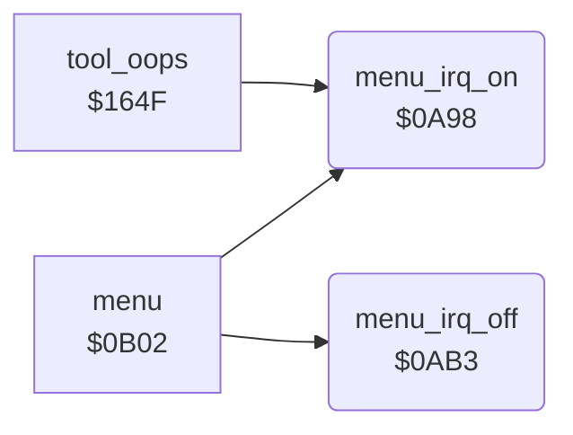

<!-- Generated by c64-docs from knowledge revision 20261025T214623.268-6ar633 and .c64-re-tools/local/generated/src/source-map.json. Do not edit: change the knowledge, generate the source again, then run docs.ts generate. -->
# irq/menu_irq.asm: Menu Raster Interrupt On and Off

Range `$0A98-$0ACB`. Source: [irq/menu_irq.asm](../../../../src/irq/menu_irq.asm). Index: [the reference](../../index.md).

## Routines

| Routine | Address | Reached from | Summary |
|---|---|---|---|
| [`menu_irq_on`](menu_irq.md#menu_irq_on) | `$0A98` | [`menu`](../menu/menu.md#menu), [`tool_oops`](../tools/mirror_oops_tool.md#tool_oops) | Turns on the interrupts of the menu screen: flash_timer = 20, flash_enable on, then at raster line $e6 raster_split_enable on and the VIC-II raster interrupt on. |
| [`menu_irq_off`](menu_irq.md#menu_irq_off) | `$0AB3` | [`menu`](../menu/menu.md#menu) | Turns off the interrupts of the menu screen: white background, raster_split_enable and flash_enable off, the raster interrupt off, multicolour off. |

## Call graph

A solid arrow is a call, a thick arrow a table entry. Rounded nodes are in this file.

## Details

### [`menu_irq_on`](../../../../src/irq/menu_irq.asm#L6) `$0A98`

*routine*

Turns on the interrupts of the menu screen: flash_timer = 20, flash_enable on, then at raster line $e6 raster_split_enable on and the VIC-II raster interrupt on.

- **Called from:** [`menu`](../menu/menu.md#menu), [`tool_oops`](../tools/mirror_oops_tool.md#tool_oops)
- **Reads:** [`RASTER`](../../memory-map.md#RASTER)
- **Writes:** [`flash_timer`](../data/workspace.md#flash_timer), [`flash_enable`](../../memory-map.md#flash_enable), [`raster_split_enable`](../../memory-map.md#raster_split_enable), [`VICIRQ`](../../memory-map.md#VICIRQ), [`IRQMSK`](../../memory-map.md#IRQMSK)

| Label | Address | Comment |
|---|---|---|
| [`menu_irq_wait_line`](../../../../src/irq/menu_irq.asm#L11) | `$0AA0` |  |

### [`menu_irq_off`](../../../../src/irq/menu_irq.asm#L22) `$0AB3`

*routine*

Turns off the interrupts of the menu screen: white background, raster_split_enable and flash_enable off, the raster interrupt off, multicolour off.

- **Called from:** [`menu`](../menu/menu.md#menu)
- **Reads:** [`SCROLX`](../../memory-map.md#SCROLX)
- **Writes:** [`BGCOL0`](../../memory-map.md#BGCOL0), [`raster_split_enable`](../../memory-map.md#raster_split_enable), [`flash_enable`](../../memory-map.md#flash_enable), [`IRQMSK`](../../memory-map.md#IRQMSK), [`SCROLX`](../../memory-map.md#SCROLX)
