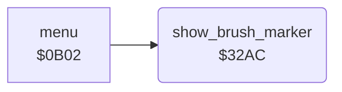

<!-- Generated by c64-docs from knowledge revision 20261025T214623.268-6ar633 and .c64-re-tools/local/generated/src/source-map.json. Do not edit: change the knowledge, generate the source again, then run docs.ts generate. -->
# menu/brush_marker.asm: Brush marker in the menu

Range `$32AC-$32BD`. Source: [menu/brush_marker.asm](../../../../src/menu/brush_marker.asm). Index: [the reference](../../index.md).

## Routines

| Routine | Address | Reached from | Summary |
|---|---|---|---|
| [`show_brush_marker`](brush_marker.md#show_brush_marker) | `$32AC` | [`menu`](menu.md#menu) | Marks the current brush in the menu: runs brush_marker_script with the value brush_marker_columns[current_brush / 2] as its argument. |

## Call graph

A solid arrow is a call, a thick arrow a table entry. Rounded nodes are in this file.

## Details

### [`show_brush_marker`](../../../../src/menu/brush_marker.asm#L6) `$32AC`

*routine*

Marks the current brush in the menu: runs brush_marker_script with the value brush_marker_columns[current_brush / 2] as its argument.

- **Called from:** [`menu`](menu.md#menu)
- **Jumps to:** [`run_script`](../script/interpreter.md#run_script)
- **Reads:** [`brush_index`](../data/workspace.md#brush_index), [`brush_marker_columns`](brush_marker_data.md#brush_marker_columns)
- **Writes:** [`script_arg_first`](../data/workspace.md#script_arg_first)
