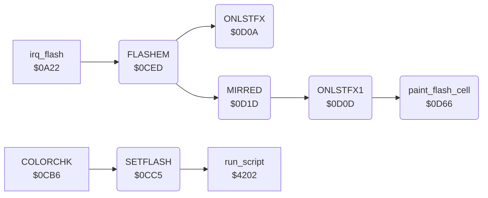

<!-- Generated by c64-docs from knowledge revision 20261025T214623.268-6ar633 and .c64-re-tools/local/generated/src/source-map.json. Do not edit: change the knowledge, generate the source again, then run docs.ts generate. -->
# menu/flash.asm: Menu Flash

Range `$0CC5-$0D70`. Source: [menu/flash.asm](../../../../src/menu/flash.asm). Index: [the reference](../../index.md).

## Routines

| Routine | Address | Reached from | Summary |
|---|---|---|---|
| [`SETFLASH`](flash.md#SETFLASH) | `$0CC5` | [`COLORCHK`](menu_0cb6.md#COLORCHK) | SETFLASH (name from the symbol table leftover): A AND $1f is the chosen command (chosen_command). |
| [`FLASHEM`](flash.md#FLASHEM) | `$0CED` | [`irq_flash`](../irq/irq.md#irq_flash) | FLASHEM (name from the symbol table leftover): changes flash_colour between 0 and 2, then paints the flash cells (DOFLASH). |
| [`ONLSTFX`](flash.md#ONLSTFX) | `$0D0A` | [`FLASHEM`](flash.md#FLASHEM) | ONLSTFX: paints the menu cell of current_command with flash_colour. |
| [`ONLSTFX1`](flash.md#ONLSTFX1) | `$0D0D` | [`MIRRED`](flash.md#MIRRED) | ONLSTFX1: paints the menu cell of the index in A (flash_cell_table) with flash_colour. |
| [`MIRRED`](flash.md#MIRRED) | `$0D1D` | [`FLASHEM`](flash.md#FLASHEM) | MIRRED: paints the Mirror cell (index $13) with flash_colour when mirror_mode is on, else with colour 0. |
| [`paint_flash_cell`](flash.md#paint_flash_cell) | `$0D66` | [`ONLSTFX1`](flash.md#ONLSTFX1) | Writes flash_colour to the 6 bytes of colour RAM at menu_ptr: one menu cell. |

## Call graph

A solid arrow is a call, a thick arrow a table entry. Rounded nodes are in this file.

## Details

### [`SETFLASH`](../../../../src/menu/flash.asm#L6) `$0CC5`

*routine*

SETFLASH (name from the symbol table leftover): A AND $1f is the chosen command (chosen_command). A command with a menu cell in flash_cell_table (1-$0a): erase_mode off, pad_read_enable = 0, the script at $41ea, current_command = chosen_command, flash_enable on. A command without a cell goes to setflash_no_cell.

- **Called from:** [`COLORCHK`](menu_0cb6.md#COLORCHK)
- **Calls:** [`run_script`](../script/interpreter.md#run_script)
- **Jumps to:** [`setflash_no_cell`](flash.md#setflash_no_cell)
- **Reads:** [`flash_cell_table`](../data/menu_tables.md#flash_cell_table), [`flash_cell_table_hi`](../data/menu_tables.md#flash_cell_table_hi), [`chosen_command`](../data/workspace.md#chosen_command)
- **Writes:** [`chosen_command`](../data/workspace.md#chosen_command), [`erase_mode`](../data/workspace.md#erase_mode), [`pad_read_enable`](../../memory-map.md#pad_read_enable), [`current_command`](../data/workspace.md#current_command), [`flash_enable`](../../memory-map.md#flash_enable)

### [`FLASHEM`](../../../../src/menu/flash.asm#L26) `$0CED`

*label*

FLASHEM (name from the symbol table leftover): changes flash_colour between 0 and 2, then paints the flash cells (DOFLASH). irq_flash calls it each 20 interrupts.

- **Called from:** [`irq_flash`](../irq/irq.md#irq_flash)
- **Calls:** [`ONLSTFX`](flash.md#ONLSTFX), [`MIRRED`](flash.md#MIRRED)
- **Jumps to:** [`FLSHERA`](flash.md#FLSHERA)
- **Reads:** [`flash_colour`](../data/workspace.md#flash_colour)
- **Writes:** [`flash_colour`](../data/workspace.md#flash_colour)

| Label | Address | Comment |
|---|---|---|
| [`FLSHTOBL`](../../../../src/menu/flash.asm#L33) | `$0CFC` |  |
| [`DOFLASH`](../../../../src/menu/flash.asm#L37) | `$0D01` | DOFLASH: paints the cell of current_command, the Mirror cell and the Erase cell. |

### [`ONLSTFX`](../../../../src/menu/flash.asm#L42) `$0D0A`

*label*

ONLSTFX: paints the menu cell of current_command with flash_colour.

- **Called from:** [`FLASHEM`](flash.md#FLASHEM)
- **Reads:** [`current_command`](../data/workspace.md#current_command)

### [`ONLSTFX1`](../../../../src/menu/flash.asm#L45) `$0D0D`

*label*

ONLSTFX1: paints the menu cell of the index in A (flash_cell_table) with flash_colour.

- **Called from:** [`MIRRED`](flash.md#MIRRED)
- **Jumped to from:** [`MIRRED`](flash.md#MIRRED)
- **Calls:** [`paint_flash_cell`](flash.md#paint_flash_cell)
- **Reads:** [`flash_cell_table`](../data/menu_tables.md#flash_cell_table), [`flash_cell_table_hi`](../data/menu_tables.md#flash_cell_table_hi)
- **Writes:** [`work_ptr`](../../memory-map.md#work_ptr)

### [`MIRRED`](../../../../src/menu/flash.asm#L55) `$0D1D`

*label*

MIRRED: paints the Mirror cell (index $13) with flash_colour when mirror_mode is on, else with colour 0.

- **Called from:** [`FLASHEM`](flash.md#FLASHEM)
- **Calls:** [`ONLSTFX1`](flash.md#ONLSTFX1)
- **Jumps to:** [`ONLSTFX1`](flash.md#ONLSTFX1), [`run_command`](menu.md#run_command)
- **Reads:** [`mirror_mode`](../data/workspace.md#mirror_mode), [`erase_mode`](../data/workspace.md#erase_mode), [`flash_colour`](../data/workspace.md#flash_colour), [`chosen_command`](../data/workspace.md#chosen_command)
- **Writes:** [`flash_colour`](../data/workspace.md#flash_colour), [`erase_mode`](../data/workspace.md#erase_mode)

| Label | Address | Comment |
|---|---|---|
| [`SETFLDNZ`](../../../../src/menu/flash.asm#L60) | `$0D27` |  |
| [`FLSHERA`](../../../../src/menu/flash.asm#L64) | `$0D2C` | FLSHERA: paints the Erase cell (index $12) with flash_colour when erase_mode is on, else with colour 0. |
| [`flash_erase_off`](../../../../src/menu/flash.asm#L69) | `$0D36` |  |
| [`flash_cell_off`](../../../../src/menu/flash.asm#L72) | `$0D38` | Paints the cell of the index in X with colour 0, and keeps flash_colour. |
| [`setflash_no_cell`](../../../../src/menu/flash.asm#L83) | `$0D4A` | A command without a flash cell. Erase ($11) when erase_mode is not 1: erase_mode = 1, return. Else it removes the return address of the caller and runs the command at once (run_command). |
| [`setflash_run_now`](../../../../src/menu/flash.asm#L93) | `$0D5E` |  |

### [`paint_flash_cell`](../../../../src/menu/flash.asm#L99) `$0D66`

*routine*

Writes flash_colour to the 6 bytes of colour RAM at menu_ptr: one menu cell.

- **Called from:** [`ONLSTFX1`](flash.md#ONLSTFX1)
- **Reads:** [`flash_colour`](../data/workspace.md#flash_colour), [`work_ptr`](../../memory-map.md#work_ptr)

| Label | Address | Comment |
|---|---|---|
| [`paint_flash_loop`](../../../../src/menu/flash.asm#L102) | `$0D6B` |  |
