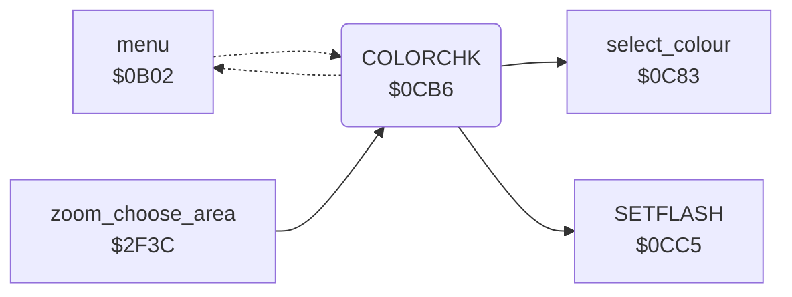

<!-- Generated by c64-docs from knowledge revision 20261024T063910.298-7zz1bw and .c64-re-tools/local/generated/src/source-map.json. Do not edit: change the knowledge, generate the source again, then run docs.ts generate. -->
# menu/menu_0cb6.asm

Range `$0CB6-$0CC4`. Source: [menu/menu_0cb6.asm](../../../../src/menu/menu_0cb6.asm). Index: [the reference](../../index.md).

## Call graph

A solid arrow is a call, a thick arrow a table entry, a dotted arrow a jump. Rounded nodes are in this file.

## Names

### [`COLORCHK`](../../../../src/menu/menu_0cb6.asm#L6) `$0CB6`

*label*

COLORCHK (name from the symbol table leftover): not reached. For an item code in A of $40 or more, it selects that colour with select_colour.

- **Called from:** [`zoom_choose_area`](../zoom/zoom_choose_area.md#zoom_choose_area) [`$30CD`](../../../../src/zoom/zoom_choose_area.asm#L226)
- **Calls:** [`select_colour`](menu.md#select_colour), [`SETFLASH`](flash.md#SETFLASH)
- **Jumps to:** [`menu_hit_loop`](menu.md#menu_hit_loop)

### [`NOTCOLOR`](../../../../src/menu/menu_0cb6.asm#L12) `$0CBE`

*label*

- **Jumped to from:** [`COLORCHK`](menu_0cb6.md#COLORCHK) [`$0CB9`](../../../../src/menu/menu_0cb6.asm#L10)

### [`NEWTOG`](../../../../src/menu/menu_0cb6.asm#L15) `$0CBF`

*label*

NEWTOG (name from the symbol table leftover): a command item. SETFLASH, then back to the hit test (menu_hit_loop).

- **Jumped to from:** [`menu`](menu.md#menu) [`$0BB5`](../../../../src/menu/menu.asm#L98)
