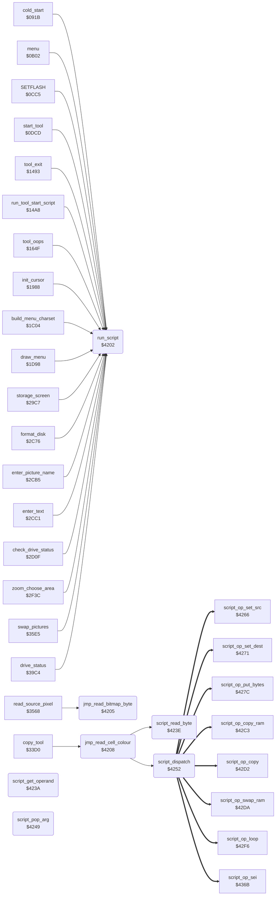

<!-- Generated by c64-docs from knowledge revision 20261025T214623.268-6ar633 and .c64-re-tools/local/generated/src/source-map.json. Do not edit: change the knowledge, generate the source again, then run docs.ts generate. -->
# script/interpreter.asm: Script Interpreter

Range `$4202-$4265`. Source: [script/interpreter.asm](../../../../src/script/interpreter.asm). Index: [the reference](../../index.md).

## Routines

| Routine | Address | Reached from | Summary |
|---|---|---|---|
| [`run_script`](interpreter.md#run_script) | `$4202` | [`cold_start`](../init/entry.md#cold_start), [`menu`](../menu/menu.md#menu), [`SETFLASH`](../menu/flash.md#SETFLASH), [`start_tool`](../tools/tool_start.md#start_tool), [`tool_exit`](../tools/tool_exit.md#tool_exit), [`run_tool_start_script`](../tools/tool_exit.md#run_tool_start_script), [`tool_oops`](../tools/mirror_oops_tool.md#tool_oops), [`init_cursor`](../input/cursor.md#init_cursor), [`build_menu_charset`](../init/menu_charset.md#build_menu_charset), [`draw_menu`](../menu/draw_menu.md#draw_menu), [`storage_screen`](../storage/storage_screen.md#storage_screen), [`format_disk`](../storage/storage_screen.md#format_disk) and 9 more | Script interpreter: A/Y is the address of a script. |
| [`jmp_read_bitmap_byte`](interpreter.md#jmp_read_bitmap_byte) | `$4205` | [`read_source_pixel`](../tools/copy_3568.md#read_source_pixel) | Jump table entry: read_bitmap_byte. |
| [`jmp_read_cell_colour`](interpreter.md#jmp_read_cell_colour) | `$4208` | [`copy_tool`](../tools/copy.md#copy_tool) | Jump table entry: read_cell_colour. |
| [`script_get_operand`](interpreter.md#script_get_operand) | `$423A` | [`script_op_set_src`](opcodes.md#script_op_set_src), [`script_op_set_dest`](opcodes.md#script_op_set_dest), [`script_op_put_bytes`](opcodes.md#script_op_put_bytes), [`script_op_copy_ram`](opcodes.md#script_op_copy_ram), [`script_op_copy`](opcodes.md#script_op_copy), [`script_op_swap_ram`](opcodes.md#script_op_swap_ram), [`script_op_loop`](opcodes.md#script_op_loop), [`script_op_call`](opcodes.md#script_op_call), [`script_op_call_code`](opcodes.md#script_op_call_code), [`script_op_skip_dest`](opcodes.md#script_op_skip_dest), [`script_op_fill`](opcodes.md#script_op_fill), [`script_op_set_fill`](opcodes.md#script_op_set_fill) and 1 more | Gets one operand in A: pops it from script_arg_stack when script_stack_mode is not 0, else reads the next script byte. |
| [`script_read_byte`](interpreter.md#script_read_byte) | `$423E` | [`jmp_read_cell_colour`](interpreter.md#jmp_read_cell_colour), [`script_op_push_bytes`](opcodes.md#script_op_push_bytes), [`script_op_arg_raise`](opcodes.md#script_op_arg_raise) | Reads the byte at script_ptr in A and increments script_ptr. |
| [`script_pop_arg`](interpreter.md#script_pop_arg) | `$4249` | [`script_op_put_bytes`](opcodes.md#script_op_put_bytes) | Pops the top byte of script_arg_stack in A. |
| [`script_dispatch`](interpreter.md#script_dispatch) | `$4252` | [`jmp_read_cell_colour`](interpreter.md#jmp_read_cell_colour) | Runs the routine of opcode A: bit 7 goes to script_stack_mode, bits 0-6 select the entry of script_ops. |
| [`script_jump_temp`](interpreter.md#script_jump_temp) | `$4263` | [`script_op_call_code`](opcodes.md#script_op_call_code) | Jumps to the address in temp_word. |

## Data

| Range | Type | Name | Read by | Written by |
|---|---|---|---|---|
| [`$4202`](../../../../src/script/interpreter.asm#L7)-`$420A` | jumps | [`run_script`](../../../../src/script/interpreter.asm#L6) |  |  |

## Call graph

A solid arrow is a call, a thick arrow a table entry. Rounded nodes are in this file.

The graph shows 30 of the 76 edges.

## Details

### [`run_script`](../../../../src/script/interpreter.asm#L6) `$4202`

*routine*

Script interpreter: A/Y is the address of a script. Each opcode byte selects a routine in script_ops. Opcode $ff ends the script, or returns from a script call. An opcode with bit 7 set takes its operands from the argument stack in place of the script.

- **Called from:** [`cold_start`](../init/entry.md#cold_start), [`menu`](../menu/menu.md#menu), [`SETFLASH`](../menu/flash.md#SETFLASH), [`start_tool`](../tools/tool_start.md#start_tool), [`tool_exit`](../tools/tool_exit.md#tool_exit), [`run_tool_start_script`](../tools/tool_exit.md#run_tool_start_script), [`tool_oops`](../tools/mirror_oops_tool.md#tool_oops), [`init_cursor`](../input/cursor.md#init_cursor), [`build_menu_charset`](../init/menu_charset.md#build_menu_charset), [`draw_menu`](../menu/draw_menu.md#draw_menu), [`storage_screen`](../storage/storage_screen.md#storage_screen), [`format_disk`](../storage/storage_screen.md#format_disk) and 6 more
- **Jumped to from:** [`set_slot_position`](../storage/storage_screen.md#set_slot_position), [`enter_text`](../storage/storage_screen.md#enter_text), [`put_directory_byte`](../storage/storage_screen.md#put_directory_byte), [`show_brush_marker`](../menu/brush_marker.md#show_brush_marker)
- **Jumps to:** [`run_script_start`](interpreter.md#run_script_start)

### [`jmp_read_bitmap_byte`](../../../../src/script/interpreter.asm#L9) `$4205`

*routine*

Jump table entry: read_bitmap_byte.

- **Called from:** [`read_source_pixel`](../tools/copy_3568.md#read_source_pixel)
- **Jumps to:** [`read_bitmap_byte`](../graphics/read_pixel.md#read_bitmap_byte)

### [`jmp_read_cell_colour`](../../../../src/script/interpreter.asm#L12) `$4208`

*routine*

Jump table entry: read_cell_colour.

- **Called from:** [`copy_tool`](../tools/copy.md#copy_tool)
- **Calls:** [`script_read_byte`](interpreter.md#script_read_byte), [`script_dispatch`](interpreter.md#script_dispatch)
- **Jumps to:** [`read_cell_colour`](../graphics/read_pixel.md#read_cell_colour)
- **Reads:** [`script_return_index`](../../memory-map.md#script_return_index), [`script_return_stack`](../data/workspace.md#script_return_stack)
- **Writes:** [`script_ptr`](../../memory-map.md#script_ptr), [`FAC1`](../../memory-map.md#FAC1), [`script_loop_index`](../../memory-map.md#script_loop_index), [`script_return_index`](../../memory-map.md#script_return_index), [`script_arg_index`](../../memory-map.md#script_arg_index)

| Label | Address | Comment |
|---|---|---|
| [`run_script_start`](../../../../src/script/interpreter.asm#L16) | `$420B` | Saves A/Y in script_ptr and clears the loop stack, the return stack and the argument stack. |
| [`script_next_op`](../../../../src/script/interpreter.asm#L24) | `$4217` | Reads the next opcode. $ff: end or return. Else run the opcode routine. |
| [`script_end_or_return`](../../../../src/script/interpreter.asm#L31) | `$4224` | Opcode $ff: return to the calling script when script_return_stack has an entry, else end. |
| [`script_done`](../../../../src/script/interpreter.asm#L42) | `$4239` |  |

### [`script_get_operand`](../../../../src/script/interpreter.asm#L45) `$423A`

*routine*

Gets one operand in A: pops it from script_arg_stack when script_stack_mode is not 0, else reads the next script byte.

- **Called from:** [`script_op_set_src`](opcodes.md#script_op_set_src), [`script_op_set_dest`](opcodes.md#script_op_set_dest), [`script_op_put_bytes`](opcodes.md#script_op_put_bytes), [`script_op_copy_ram`](opcodes.md#script_op_copy_ram), [`script_op_copy`](opcodes.md#script_op_copy), [`script_op_swap_ram`](opcodes.md#script_op_swap_ram), [`script_op_loop`](opcodes.md#script_op_loop), [`script_op_call`](opcodes.md#script_op_call), [`script_op_call_code`](opcodes.md#script_op_call_code), [`script_op_skip_dest`](opcodes.md#script_op_skip_dest), [`script_op_fill`](opcodes.md#script_op_fill), [`script_op_set_fill`](opcodes.md#script_op_set_fill) and 1 more
- **Jumps to:** [`script_pop_arg`](interpreter.md#script_pop_arg)
- **Reads:** [`script_stack_mode`](../../memory-map.md#script_stack_mode)

### [`script_read_byte`](../../../../src/script/interpreter.asm#L49) `$423E`

*routine*

Reads the byte at script_ptr in A and increments script_ptr. Y = 0.

- **Called from:** [`jmp_read_cell_colour`](interpreter.md#jmp_read_cell_colour), [`script_op_push_bytes`](opcodes.md#script_op_push_bytes), [`script_op_arg_raise`](opcodes.md#script_op_arg_raise)
- **Reads:** [`script_ptr`](../../memory-map.md#script_ptr), [`FAC1`](../../memory-map.md#FAC1)
- **Writes:** [`script_ptr`](../../memory-map.md#script_ptr), [`FAC1`](../../memory-map.md#FAC1)

| Label | Address | Comment |
|---|---|---|
| [`script_read_byte_done`](../../../../src/script/interpreter.asm#L55) | `$4248` |  |

### [`script_pop_arg`](../../../../src/script/interpreter.asm#L58) `$4249`

*routine*

Pops the top byte of script_arg_stack in A. Y = the new script_arg_index.

- **Called from:** [`script_op_put_bytes`](opcodes.md#script_op_put_bytes)
- **Jumped to from:** [`script_get_operand`](interpreter.md#script_get_operand)
- **Reads:** [`script_arg_index`](../../memory-map.md#script_arg_index), [`script_arg_stack`](../data/workspace.md#script_arg_stack)
- **Writes:** [`script_arg_index`](../../memory-map.md#script_arg_index)

### [`script_dispatch`](../../../../src/script/interpreter.asm#L65) `$4252`

*routine*

Runs the routine of opcode A: bit 7 goes to script_stack_mode, bits 0-6 select the entry of script_ops. The opcode routine returns to the interpreter loop with RTS.

- **Called from:** [`jmp_read_cell_colour`](interpreter.md#jmp_read_cell_colour)
- **Reads:** [`script_ops`](opcode_table.md#script_ops), [`temp_word`](../../memory-map.md#temp_word)
- **Writes:** [`script_stack_mode`](../../memory-map.md#script_stack_mode), [`temp_word`](../../memory-map.md#temp_word), [`temp_word_hi`](../../memory-map.md#temp_word_hi)

### [`script_jump_temp`](../../../../src/script/interpreter.asm#L75) `$4263`

*label*

Jumps to the address in temp_word. Op 9 also comes here.

- **Jumped to from:** [`script_op_call_code`](opcodes.md#script_op_call_code)
