<!-- Generated by c64-docs from knowledge revision 20261024T063910.298-7zz1bw and .c64-re-tools/local/generated/src/source-map.json. Do not edit: change the knowledge, generate the source again, then run docs.ts generate. -->
# script/interpreter.asm: Script Interpreter

Range `$4202-$4265`. Source: [script/interpreter.asm](../../../../src/script/interpreter.asm). Index: [the reference](../../index.md).

## Call graph

A solid arrow is a call, a thick arrow a table entry, a dotted arrow a jump. Rounded nodes are in this file.

The graph shows 38 of the 84 edges: the calls only.

```mermaid
flowchart LR
  n091b["cold_start<br/>$091B"]
  n0b02["menu<br/>$0B02"]
  n0cc5["SETFLASH<br/>$0CC5"]
  n0dcd["start_tool<br/>$0DCD"]
  n1493["tool_exit<br/>$1493"]
  n14a8["run_tool_start_script<br/>$14A8"]
  n164f["tool_oops<br/>$164F"]
  n1988["init_cursor<br/>$1988"]
  n1c04["build_menu_charset<br/>$1C04"]
  n1d98["draw_menu<br/>$1D98"]
  n29c7["storage_screen<br/>$29C7"]
  n2c76["format_disk<br/>$2C76"]
  n2cb5["enter_picture_name<br/>$2CB5"]
  n2cc1["enter_text<br/>$2CC1"]
  n2d0f["check_drive_status<br/>$2D0F"]
  n2f3c["zoom_choose_area<br/>$2F3C"]
  n33d0["copy_tool<br/>$33D0"]
  n3568["read_source_pixel<br/>$3568"]
  n35e5["swap_pictures<br/>$35E5"]
  n39c4["drive_status<br/>$39C4"]
  n4202("run_script<br/>$4202")
  n4205("jmp_read_bitmap_byte<br/>$4205")
  n4208("jmp_read_cell_colour<br/>$4208")
  n423a("script_get_operand<br/>$423A")
  n423e("script_read_byte<br/>$423E")
  n4249("script_pop_arg<br/>$4249")
  n4252("script_dispatch<br/>$4252")
  n4266["script_op_set_src<br/>$4266"]
  n4271["script_op_set_dest<br/>$4271"]
  n427c["script_op_put_bytes<br/>$427C"]
  n42c3["script_op_copy_ram<br/>$42C3"]
  n42d2["script_op_copy<br/>$42D2"]
  n42da["script_op_swap_ram<br/>$42DA"]
  n42f6["script_op_loop<br/>$42F6"]
  n436f["script_op_call<br/>$436F"]
  n438a["script_op_call_code<br/>$438A"]
  n439f["script_op_skip_dest<br/>$439F"]
  n43a7["script_op_fill<br/>$43A7"]
  n43b9["script_op_set_fill<br/>$43B9"]
  n43bf["script_op_push_bytes<br/>$43BF"]
  n43d8["script_op_arg_raise<br/>$43D8"]
  n449f["script_op_jump_if<br/>$449F"]
  n091b --> n4202
  n0b02 --> n4202
  n0cc5 --> n4202
  n0dcd --> n4202
  n1493 --> n4202
  n14a8 --> n4202
  n164f --> n4202
  n1988 --> n4202
  n1c04 --> n4202
  n1d98 --> n4202
  n29c7 --> n4202
  n2c76 --> n4202
  n2cb5 --> n4202
  n2cc1 --> n4202
  n2d0f --> n4202
  n2f3c --> n4202
  n33d0 --> n4208
  n3568 --> n4205
  n35e5 --> n4202
  n39c4 --> n4202
  n4208 --> n423e
  n4208 --> n4252
  n4266 --> n423a
  n4271 --> n423a
  n427c --> n423a
  n427c --> n4249
  n42c3 --> n423a
  n42d2 --> n423a
  n42da --> n423a
  n42f6 --> n423a
  n436f --> n423a
  n438a --> n423a
  n439f --> n423a
  n43a7 --> n423a
  n43b9 --> n423a
  n43bf --> n423e
  n43d8 --> n423e
  n449f --> n423a
```

## Data

| Range | Type | Name | Read by | Written by |
|---|---|---|---|---|
| [`$4202`](../../../../src/script/interpreter.asm#L7)-`$420A` | jumps | [`run_script`](../../../../src/script/interpreter.asm#L6) |  |  |

## Names

### [`run_script`](../../../../src/script/interpreter.asm#L6) `$4202`

*routine*

Script interpreter: A/Y is the address of a script. Each opcode byte selects a routine in script_ops. Opcode $ff ends the script, or returns from a script call. An opcode with bit 7 set takes its operands from the argument stack in place of the script.

- **Called from:** [`cold_start`](../init/entry.md#cold_start) [`$095F`](../../../../src/init/entry.asm#L58), [`menu`](../menu/menu.md#menu) [`$0B74`](../../../../src/menu/menu.asm#L60), [`menu`](../menu/menu.md#menu) [`$0B7B`](../../../../src/menu/menu.asm#L63), [`menu`](../menu/menu.md#menu) [`$0BEA`](../../../../src/menu/menu.asm#L127), [`menu`](../menu/menu.md#menu) [`$0C0B`](../../../../src/menu/menu.asm#L144), [`menu`](../menu/menu.md#menu) [`$0C18`](../../../../src/menu/menu.asm#L149), [`SETFLASH`](../menu/flash.md#SETFLASH) [`$0CDF`](../../../../src/menu/flash.asm#L19), [`start_tool`](../tools/tool_start.md#start_tool) [`$0DCD`](../../../../src/tools/tool_start.asm#L7), [`tool_exit`](../tools/tool_exit.md#tool_exit) [`$14A2`](../../../../src/tools/tool_exit.asm#L14), [`run_tool_start_script`](../tools/tool_exit.md#run_tool_start_script) [`$14AC`](../../../../src/tools/tool_exit.asm#L20), [`tool_oops`](../tools/mirror_oops_tool.md#tool_oops) [`$1653`](../../../../src/tools/mirror_oops_tool.asm#L39), [`init_cursor`](../input/cursor.md#init_cursor) [`$19A4`](../../../../src/input/cursor.asm#L19), [`init_cursor`](../input/cursor.md#init_cursor) [`$19AB`](../../../../src/input/cursor.asm#L22), [`build_menu_charset`](../init/menu_charset.md#build_menu_charset) [`$1C1A`](../../../../src/init/menu_charset.asm#L18), [`draw_menu`](../menu/draw_menu.md#draw_menu) [`$1D9C`](../../../../src/menu/draw_menu.asm#L9), [`storage_screen`](../storage/storage_screen.md#storage_screen) [`$29D3`](../../../../src/storage/storage_screen.asm#L13), [`storage_screen`](../storage/storage_screen.md#storage_screen) [`$2A81`](../../../../src/storage/storage_screen.asm#L99), [`storage_screen`](../storage/storage_screen.md#storage_screen) [`$2A96`](../../../../src/storage/storage_screen.asm#L113), [`storage_screen`](../storage/storage_screen.md#storage_screen) [`$2AA0`](../../../../src/storage/storage_screen.asm#L119), [`storage_screen`](../storage/storage_screen.md#storage_screen) [`$2AB2`](../../../../src/storage/storage_screen.asm#L129), [`storage_screen`](../storage/storage_screen.md#storage_screen) [`$2AC0`](../../../../src/storage/storage_screen.asm#L137), [`storage_screen`](../storage/storage_screen.md#storage_screen) [`$2AE3`](../../../../src/storage/storage_screen.asm#L156), [`storage_screen`](../storage/storage_screen.md#storage_screen) [`$2B37`](../../../../src/storage/storage_screen.asm#L202), [`storage_screen`](../storage/storage_screen.md#storage_screen) [`$2B51`](../../../../src/storage/storage_screen.asm#L215), [`storage_screen`](../storage/storage_screen.md#storage_screen) [`$2B60`](../../../../src/storage/storage_screen.asm#L221), [`storage_screen`](../storage/storage_screen.md#storage_screen) [`$2B77`](../../../../src/storage/storage_screen.asm#L234), [`storage_screen`](../storage/storage_screen.md#storage_screen) [`$2B83`](../../../../src/storage/storage_screen.asm#L241), [`storage_screen`](../storage/storage_screen.md#storage_screen) [`$2B8F`](../../../../src/storage/storage_screen.asm#L248), [`storage_screen`](../storage/storage_screen.md#storage_screen) [`$2B99`](../../../../src/storage/storage_screen.asm#L254), [`storage_screen`](../storage/storage_screen.md#storage_screen) [`$2BA7`](../../../../src/storage/storage_screen.asm#L261), [`storage_screen`](../storage/storage_screen.md#storage_screen) [`$2BBE`](../../../../src/storage/storage_screen.asm#L273), [`storage_screen`](../storage/storage_screen.md#storage_screen) [`$2BDD`](../../../../src/storage/storage_screen.asm#L294), [`storage_screen`](../storage/storage_screen.md#storage_screen) [`$2C00`](../../../../src/storage/storage_screen.asm#L318), [`storage_screen`](../storage/storage_screen.md#storage_screen) [`$2C11`](../../../../src/storage/storage_screen.asm#L328), [`storage_screen`](../storage/storage_screen.md#storage_screen) [`$2C1E`](../../../../src/storage/storage_screen.asm#L333), [`format_disk`](../storage/storage_screen.md#format_disk) [`$2C7A`](../../../../src/storage/storage_screen.asm#L393), [`enter_picture_name`](../storage/storage_screen.md#enter_picture_name) [`$2CB9`](../../../../src/storage/storage_screen.asm#L444), [`enter_text`](../storage/storage_screen.md#enter_text) [`$2CDC`](../../../../src/storage/storage_screen.asm#L463), [`enter_text`](../storage/storage_screen.md#enter_text) [`$2CFF`](../../../../src/storage/storage_screen.asm#L479), [`check_drive_status`](../storage/storage_screen.md#check_drive_status) [`$2D14`](../../../../src/storage/storage_screen.asm#L492) and 6 more
- **Jumped to from:** [`set_slot_position`](../storage/storage_screen.md#set_slot_position) [`$2CB2`](../../../../src/storage/storage_screen.asm#L439), [`enter_text`](../storage/storage_screen.md#enter_text) [`$2D0C`](../../../../src/storage/storage_screen.asm#L486), [`put_directory_byte`](../storage/storage_screen.md#put_directory_byte) [`$2D39`](../../../../src/storage/storage_screen.asm#L520), [`show_brush_marker`](../menu/brush_marker.md#show_brush_marker) [`$32BB`](../../../../src/menu/brush_marker.asm#L14)
- **Jumps to:** [`run_script_start`](interpreter.md#run_script_start)

### [`jmp_read_bitmap_byte`](../../../../src/script/interpreter.asm#L9) `$4205`

*routine*

Jump table entry: read_bitmap_byte.

- **Called from:** [`read_source_pixel`](../tools/copy_3568.md#read_source_pixel) [`$35D6`](../../../../src/tools/copy_3568.asm#L64)
- **Jumps to:** [`read_bitmap_byte`](../graphics/read_pixel.md#read_bitmap_byte)

### [`jmp_read_cell_colour`](../../../../src/script/interpreter.asm#L12) `$4208`

*routine*

Jump table entry: read_cell_colour.

- **Called from:** [`copy_tool`](../tools/copy.md#copy_tool) [`$350C`](../../../../src/tools/copy.asm#L172)
- **Calls:** [`script_read_byte`](interpreter.md#script_read_byte), [`script_dispatch`](interpreter.md#script_dispatch)
- **Jumps to:** [`read_cell_colour`](../graphics/read_pixel.md#read_cell_colour)
- **Reads:** [`script_return_index`](../../memory-map.md#script_return_index), [`script_return_stack`](../data/workspace.md#script_return_stack)
- **Writes:** [`script_ptr`](../../memory-map.md#script_ptr), [`FAC1+2`](../../memory-map.md#FAC1), [`script_loop_index`](../../memory-map.md#script_loop_index), [`script_return_index`](../../memory-map.md#script_return_index), [`script_arg_index`](../../memory-map.md#script_arg_index)

### [`run_script_start`](../../../../src/script/interpreter.asm#L16) `$420B`

*label*

Saves A/Y in script_ptr and clears the loop stack, the return stack and the argument stack.

- **Jumped to from:** [`run_script`](interpreter.md#run_script) [`$4202`](../../../../src/script/interpreter.asm#L7)
- **Entry of:** [`run_script`](../../tables.md#run_script)

### [`script_next_op`](../../../../src/script/interpreter.asm#L24) `$4217`

*label*

Reads the next opcode. $ff: end or return. Else run the opcode routine.

- **Jumped to from:** [`jmp_read_cell_colour`](interpreter.md#jmp_read_cell_colour) [`$4221`](../../../../src/script/interpreter.asm#L29), [`jmp_read_cell_colour`](interpreter.md#jmp_read_cell_colour) [`$4236`](../../../../src/script/interpreter.asm#L41)

### [`script_end_or_return`](../../../../src/script/interpreter.asm#L31) `$4224`

*label*

Opcode $ff: return to the calling script when script_return_stack has an entry, else end.

- **Jumped to from:** [`jmp_read_cell_colour`](interpreter.md#jmp_read_cell_colour) [`$421C`](../../../../src/script/interpreter.asm#L27)

### [`script_done`](../../../../src/script/interpreter.asm#L42) `$4239`

*label*

- **Jumped to from:** [`jmp_read_cell_colour`](interpreter.md#jmp_read_cell_colour) [`$4226`](../../../../src/script/interpreter.asm#L33)

### [`script_get_operand`](../../../../src/script/interpreter.asm#L45) `$423A`

*routine*

Gets one operand in A: pops it from script_arg_stack when script_stack_mode is not 0, else reads the next script byte.

- **Called from:** [`script_op_set_src`](opcodes.md#script_op_set_src) [`$4266`](../../../../src/script/opcodes.asm#L7), [`script_op_set_src`](opcodes.md#script_op_set_src) [`$426B`](../../../../src/script/opcodes.asm#L9), [`script_op_set_dest`](opcodes.md#script_op_set_dest) [`$4271`](../../../../src/script/opcodes.asm#L14), [`script_op_set_dest`](opcodes.md#script_op_set_dest) [`$4276`](../../../../src/script/opcodes.asm#L16), [`script_op_put_bytes`](opcodes.md#script_op_put_bytes) [`$427C`](../../../../src/script/opcodes.asm#L21), [`script_op_copy_ram`](opcodes.md#script_op_copy_ram) [`$42C3`](../../../../src/script/opcodes.asm#L74), [`script_op_copy`](opcodes.md#script_op_copy) [`$42D2`](../../../../src/script/opcodes.asm#L83), [`script_op_swap_ram`](opcodes.md#script_op_swap_ram) [`$42DA`](../../../../src/script/opcodes.asm#L91), [`script_op_loop`](opcodes.md#script_op_loop) [`$4351`](../../../../src/script/opcodes.asm#L167), [`script_op_call`](opcodes.md#script_op_call) [`$436F`](../../../../src/script/opcodes.asm#L195), [`script_op_call`](opcodes.md#script_op_call) [`$4373`](../../../../src/script/opcodes.asm#L197), [`script_op_call_code`](opcodes.md#script_op_call_code) [`$438A`](../../../../src/script/opcodes.asm#L210), [`script_op_call_code`](opcodes.md#script_op_call_code) [`$438F`](../../../../src/script/opcodes.asm#L212), [`script_op_skip_dest`](opcodes.md#script_op_skip_dest) [`$439F`](../../../../src/script/opcodes.asm#L223), [`script_op_fill`](opcodes.md#script_op_fill) [`$43A7`](../../../../src/script/opcodes.asm#L228), [`script_op_set_fill`](opcodes.md#script_op_set_fill) [`$43B9`](../../../../src/script/opcodes.asm#L241), [`script_op_jump_if`](opcodes.md#script_op_jump_if) [`$449F`](../../../../src/script/opcodes.asm#L404), [`script_op_jump_if`](opcodes.md#script_op_jump_if) [`$44A3`](../../../../src/script/opcodes.asm#L406)
- **Jumps to:** [`script_pop_arg`](interpreter.md#script_pop_arg)
- **Reads:** [`script_stack_mode`](../../memory-map.md#script_stack_mode)

### [`script_read_byte`](../../../../src/script/interpreter.asm#L49) `$423E`

*routine*

Reads the byte at script_ptr in A and increments script_ptr. Y = 0.

- **Called from:** [`jmp_read_cell_colour`](interpreter.md#jmp_read_cell_colour) [`$4217`](../../../../src/script/interpreter.asm#L25), [`script_op_push_bytes`](opcodes.md#script_op_push_bytes) [`$43C3`](../../../../src/script/opcodes.asm#L248), [`script_op_push_bytes`](opcodes.md#script_op_push_bytes) [`$43CC`](../../../../src/script/opcodes.asm#L254), [`script_op_arg_raise`](opcodes.md#script_op_arg_raise) [`$43D8`](../../../../src/script/opcodes.asm#L262)
- **Reads:** [`script_ptr`](../../memory-map.md#script_ptr), [`FAC1+2`](../../memory-map.md#FAC1)
- **Writes:** [`script_ptr`](../../memory-map.md#script_ptr), [`FAC1+2`](../../memory-map.md#FAC1)

### [`script_read_byte_done`](../../../../src/script/interpreter.asm#L55) `$4248`

*label*

- **Jumped to from:** [`script_read_byte`](interpreter.md#script_read_byte) [`$4244`](../../../../src/script/interpreter.asm#L53)

### [`script_pop_arg`](../../../../src/script/interpreter.asm#L58) `$4249`

*routine*

Pops the top byte of script_arg_stack in A. Y = the new script_arg_index.

- **Called from:** [`script_op_put_bytes`](opcodes.md#script_op_put_bytes) [`$42B1`](../../../../src/script/opcodes.asm#L61)
- **Jumped to from:** [`script_get_operand`](interpreter.md#script_get_operand) [`$423C`](../../../../src/script/interpreter.asm#L47)
- **Reads:** [`script_arg_index`](../../memory-map.md#script_arg_index), [`script_arg_stack`](../data/workspace.md#script_arg_stack)
- **Writes:** [`script_arg_index`](../../memory-map.md#script_arg_index)

### [`script_dispatch`](../../../../src/script/interpreter.asm#L65) `$4252`

*routine*

Runs the routine of opcode A: bit 7 goes to script_stack_mode, bits 0-6 select the entry of script_ops. The opcode routine returns to the interpreter loop with RTS.

- **Called from:** [`jmp_read_cell_colour`](interpreter.md#jmp_read_cell_colour) [`$421E`](../../../../src/script/interpreter.asm#L28)
- **Reads:** [`script_ops`](opcode_table.md#script_ops), [`script_ops+1`](opcode_table.md#script_ops), [`temp_word`](../../memory-map.md#temp_word)
- **Writes:** [`script_stack_mode`](../../memory-map.md#script_stack_mode), [`temp_word`](../../memory-map.md#temp_word), [`temp_word_hi`](../../memory-map.md#temp_word_hi)

### [`script_jump_temp`](../../../../src/script/interpreter.asm#L75) `$4263`

*label*

Jumps to the address in temp_word. Op 9 also comes here.

- **Jumped to from:** [`script_op_call_code`](opcodes.md#script_op_call_code) [`$4394`](../../../../src/script/opcodes.asm#L214)
