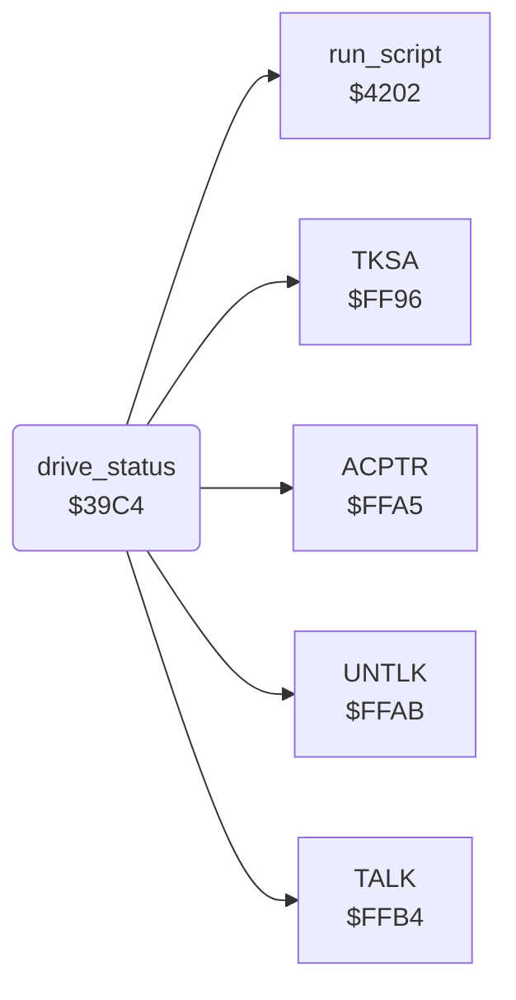

<!-- Generated by c64-docs from knowledge revision 20261025T214623.268-6ar633 and .c64-re-tools/local/generated/src/source-map.json. Do not edit: change the knowledge, generate the source again, then run docs.ts generate. -->
# storage/drive_status.asm: Drive status

Range `$39C4-$3A25`. Source: [storage/drive_status.asm](../../../../src/storage/drive_status.asm). Index: [the reference](../../index.md).

## Routines

| Routine | Address | Reached from | Summary |
|---|---|---|---|
| [`drive_status`](drive_status.md#drive_status) | `$39C4` | [`check_drive_status`](storage_screen.md#check_drive_status) | Reads the status of the current drive (FA) from channel 15 (TALK, TKSA $6f). |

## Call graph

A solid arrow is a call, a thick arrow a table entry. Rounded nodes are in this file.

## Details

### [`drive_status`](../../../../src/storage/drive_status.asm#L6) `$39C4`

*routine*

Reads the status of the current drive (FA) from channel 15 (TALK, TKSA $6f). The bytes up to the second comma go to drive_status_text: the error number, a space for the first comma, and the message. Then it skips the rest up to the CR. C is clear when the number is 00; then SA is restored. When no device answers (STATUS not 0 after TALK), the script at $2dcb writes DEVICE NOT PRESENT at $c7d1, and C is set.

- **Jumped to from:** [`check_drive_status`](storage_screen.md#check_drive_status)
- **Calls:** [`TALK`](../../memory-map.md#TALK), [`TKSA`](../../memory-map.md#TKSA), [`ACPTR`](../../memory-map.md#ACPTR), [`UNTLK`](../../memory-map.md#UNTLK), [`run_script`](../script/interpreter.md#run_script)
- **Reads:** [`SA`](../../memory-map.md#SA), [`FA`](../../memory-map.md#FA), [`STATUS`](../../memory-map.md#STATUS), [`script_condition`](../../memory-map.md#script_condition), [`drive_status_text`](../../memory-map.md#drive_status_text)
- **Writes:** [`STATUS`](../../memory-map.md#STATUS), [`SA`](../../memory-map.md#SA), [`script_condition`](../../memory-map.md#script_condition), [`drive_status_text`](../../memory-map.md#drive_status_text)

| Label | Address | Comment |
|---|---|---|
| [`drive_status_read`](../../../../src/storage/drive_status.asm#L32) | `$39E2` |  |
| [`drive_status_store`](../../../../src/storage/drive_status.asm#L40) | `$39F1` |  |
| [`drive_status_skip_rest`](../../../../src/storage/drive_status.asm#L50) | `$39FE` |  |
| [`drive_status_no_device`](../../../../src/storage/drive_status.asm#L67) | `$3A1C` | No device: the script at $2dcb writes DEVICE NOT PRESENT at $c7d1. Then C is set (drive_status_error). |
| [`drive_status_error`](../../../../src/storage/drive_status.asm#L72) | `$3A23` |  |
