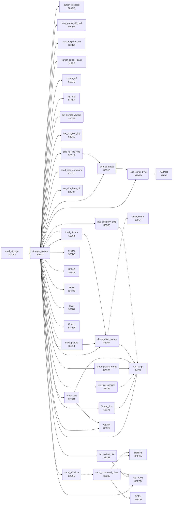

<!-- Generated by c64-docs from knowledge revision 20261024T063910.298-7zz1bw and .c64-re-tools/local/generated/src/source-map.json. Do not edit: change the knowledge, generate the source again, then run docs.ts generate. -->
# storage/storage_screen.asm: Storage Screen: Directory, Save, Get, Name and Disk Commands

Range `$29C7-$2D3B`. Source: [storage/storage_screen.asm](../../../../src/storage/storage_screen.asm). Index: [the reference](../../index.md).

## Call graph

A solid arrow is a call, a thick arrow a table entry, a dotted arrow a jump. Rounded nodes are in this file.

## Data

| Range | Type | Name | Read by | Written by |
|---|---|---|---|---|
| [`$2CA2`](../../../../src/storage/storage_screen.asm#L429)-`$2CA3` | dual-use | [`slot_right_column`](../../../../src/storage/storage_screen.asm#L428) |  |  |
| [`$2CE5`](../../../../src/storage/storage_screen.asm#L467)-`$2CE6` | dual-use | [`enter_text_test_return`](../../../../src/storage/storage_screen.asm#L466) |  |  |

## Names

### [`storage_screen`](../../../../src/storage/storage_screen.asm#L6) `$29C7`

*routine*

The Storage screen (command $0f, also Change Disk). Draws the screen (script $236a), sends "I" to the drive, reads the directory and shows each file whose name starts with $81 "PIC " in the next slot. Then it runs the Storage loop. Returns after a long press off the pad.

- **Called from:** [`cmd_storage`](../menu/menu.md#cmd_storage) [`$0C30`](../../../../src/menu/menu.asm#L165)
- **Calls:** [`run_script`](../script/interpreter.md#run_script), [`cursor_off`](../input/cursor.md#cursor_off), [`cursor_colour_black`](../input/cursor.md#cursor_colour_black), [`send_initialize`](storage_screen.md#send_initialize), [`check_drive_status`](storage_screen.md#check_drive_status), [`CLALL`](../../memory-map.md#CLALL), [`SETNAM`](../../memory-map.md#SETNAM), `$F3D5`, [`TALK`](../../memory-map.md#TALK), [`TKSA`](../../memory-map.md#TKSA), [`skip_to_quote`](storage_screen.md#skip_to_quote), [`read_serial_byte`](storage_screen.md#read_serial_byte), [`put_directory_byte`](storage_screen.md#put_directory_byte), [`skip_to_line_end`](storage_screen.md#skip_to_line_end), [`set_slot_position`](storage_screen.md#set_slot_position), `$F642`, [`cursor_sprites_on`](../input/cursor.md#cursor_sprites_on), [`set_program_irq`](storage_screen.md#set_program_irq), [`long_press_off_pad`](../input/buttons.md#long_press_off_pad), [`hit_test`](../input/hit_test_1c5a.md#hit_test), [`button_pressed`](../input/buttons.md#button_pressed), [`set_kernal_vectors`](storage_screen.md#set_kernal_vectors), [`GETIN`](../../memory-map.md#GETIN), [`enter_text`](storage_screen.md#enter_text), [`format_disk`](storage_screen.md#format_disk), [`send_disk_command`](storage_screen.md#send_disk_command), [`set_picture_file`](storage_screen.md#set_picture_file), [`save_picture`](picture_file.md#save_picture), [`load_picture`](picture_file.md#load_picture), [`enter_picture_name`](storage_screen.md#enter_picture_name), [`set_slot_from_hit`](storage_screen.md#set_slot_from_hit)
- **Reads:** [`FA`](../../memory-map.md#FA), [`SA`](../../memory-map.md#SA), [`FNLEN`](../../memory-map.md#FNLEN), [`FNADR`](../../memory-map.md#FNADR), [`pic_name_prefix`](storage_data.md#pic_name_prefix), [`FNADR+1`](../../memory-map.md#FNADR), [`storage_free_slot`](../data/workspace.md#storage_free_slot), [`hit_code`](../../memory-map.md#hit_code), [`storage_action`](../../memory-map.md#storage_action), [`storage_named_slot`](../data/workspace.md#storage_named_slot)
- **Writes:** [`hit_table_ptr`](../../memory-map.md#hit_table_ptr), [`hit_table_ptr+1`](../../memory-map.md#hit_table_ptr), [`storage_free_slot`](../data/workspace.md#storage_free_slot), [`SA`](../../memory-map.md#SA), [`STATUS`](../../memory-map.md#STATUS), [`script_dest_ptr`](../../memory-map.md#script_dest_ptr), [`script_dest_ptr+1`](../../memory-map.md#script_dest_ptr), [`FNLEN`](../../memory-map.md#FNLEN), [`FNADR+1`](../../memory-map.md#FNADR), [`FNADR`](../../memory-map.md#FNADR), [`storage_action`](../../memory-map.md#storage_action), [`hit_code`](../../memory-map.md#hit_code), [`NDX`](../../memory-map.md#NDX), [`entry_max_length`](../data/workspace.md#entry_max_length), [`storage_named_slot`](../data/workspace.md#storage_named_slot)

### [`storage_read_directory`](../../../../src/storage/storage_screen.asm#L22) `$29E7`

*label*

Opens the directory: file name "$", secondary address $60, $f3d5 sends the name. storage_free_slot starts at 1.

- **Jumped to from:** [`storage_screen`](storage_screen.md#storage_screen) [`$29E2`](../../../../src/storage/storage_screen.asm#L18)

### [`storage_directory_talk`](../../../../src/storage/storage_screen.asm#L37) `$2A05`

*label*

Makes the drive talk, then reads the disk name (the text between the first quotes, at most 12 characters) to row 1, column 22 of the screen.

- **Jumped to from:** [`storage_screen`](storage_screen.md#storage_screen) [`$2A00`](../../../../src/storage/storage_screen.asm#L33)

### [`storage_disk_name_loop`](../../../../src/storage/storage_screen.asm#L51) `$2A22`

*label*

FNLEN is a counter here.

- **Jumped to from:** [`storage_screen`](storage_screen.md#storage_screen) [`$2A33`](../../../../src/storage/storage_screen.asm#L60)

### [`storage_disk_name_done`](../../../../src/storage/storage_screen.asm#L61) `$2A35`

*label*

- **Jumped to from:** [`storage_screen`](storage_screen.md#storage_screen) [`$2A2B`](../../../../src/storage/storage_screen.asm#L56)

### [`storage_next_entry`](../../../../src/storage/storage_screen.asm#L65) `$2A3A`

*label*

Next directory line: skips to its quote, compares the first 5 bytes of the name with pic_name_prefix and puts the 15 bytes of the name in dir_entry_buffer.

- **Jumped to from:** [`storage_screen`](storage_screen.md#storage_screen) [`$2A89`](../../../../src/storage/storage_screen.asm#L103)

### [`storage_prefix_loop`](../../../../src/storage/storage_screen.asm#L76) `$2A4F`

*label*

- **Jumped to from:** [`storage_screen`](storage_screen.md#storage_screen) [`$2A62`](../../../../src/storage/storage_screen.asm#L85)

### [`storage_name_rest_loop`](../../../../src/storage/storage_screen.asm#L88) `$2A68`

*label*

- **Jumped to from:** [`storage_screen`](storage_screen.md#storage_screen) [`$2A72`](../../../../src/storage/storage_screen.asm#L93)

### [`storage_skip_entry`](../../../../src/storage/storage_screen.asm#L100) `$2A84`

*label*

- **Jumped to from:** [`storage_screen`](storage_screen.md#storage_screen) [`$2A59`](../../../../src/storage/storage_screen.asm#L81)

### [`storage_directory_close`](../../../../src/storage/storage_screen.asm#L105) `$2A8C`

*label*

End of the directory or a read error: $f642 closes the serial file.
KERNAL: closes the serial file.

- **Jumped to from:** [`storage_screen`](storage_screen.md#storage_screen) [`$2A16`](../../../../src/storage/storage_screen.asm#L45), [`storage_screen`](storage_screen.md#storage_screen) [`$2A27`](../../../../src/storage/storage_screen.asm#L54), [`storage_screen`](storage_screen.md#storage_screen) [`$2A38`](../../../../src/storage/storage_screen.asm#L63), [`storage_screen`](storage_screen.md#storage_screen) [`$2A3D`](../../../../src/storage/storage_screen.asm#L67), [`storage_screen`](storage_screen.md#storage_screen) [`$2A52`](../../../../src/storage/storage_screen.asm#L78), [`storage_screen`](storage_screen.md#storage_screen) [`$2A6B`](../../../../src/storage/storage_screen.asm#L90), [`storage_screen`](storage_screen.md#storage_screen) [`$2A87`](../../../../src/storage/storage_screen.asm#L102)

### [`storage_device_absent`](../../../../src/storage/storage_screen.asm#L109) `$2A92`

*label*

KERNAL error 5: writes "Device Not Present" to drive_message.

- **Jumped to from:** [`storage_screen`](storage_screen.md#storage_screen) [`$2AAC`](../../../../src/storage/storage_screen.asm#L126)

### [`storage_file_not_found`](../../../../src/storage/storage_screen.asm#L116) `$2A9C`

*label*

KERNAL error 4: shows "File not found".

- **Jumped to from:** [`storage_screen`](storage_screen.md#storage_screen) [`$2AA8`](../../../../src/storage/storage_screen.asm#L124)

### [`storage_kernal_error`](../../../../src/storage/storage_screen.asm#L122) `$2AA6`

*label*

A = the KERNAL error code of a failed load or save (carry set): 4 and 5 have their own texts, other codes show "error".

- **Jumped to from:** [`storage_screen`](storage_screen.md#storage_screen) [`$2BCC`](../../../../src/storage/storage_screen.asm#L282), [`storage_screen`](storage_screen.md#storage_screen) [`$2BE8`](../../../../src/storage/storage_screen.asm#L299)

### [`storage_idle`](../../../../src/storage/storage_screen.asm#L132) `$2AB8`

*label*

No action: clears storage_action and the label sprites of the cursor.

- **Jumped to from:** [`storage_screen`](storage_screen.md#storage_screen) [`$2A8F`](../../../../src/storage/storage_screen.asm#L107), [`storage_screen`](storage_screen.md#storage_screen) [`$2B0A`](../../../../src/storage/storage_screen.asm#L177), [`storage_screen`](storage_screen.md#storage_screen) [`$2B2A`](../../../../src/storage/storage_screen.asm#L194), [`storage_screen`](storage_screen.md#storage_screen) [`$2C03`](../../../../src/storage/storage_screen.asm#L319)

### [`storage_loop`](../../../../src/storage/storage_screen.asm#L139) `$2AC3`

*label*

Storage loop: sets the IRQ vector to irq_handler again (set_program_irq). A long press off the pad returns to the caller. A press on a cell runs the cell.

- **Jumped to from:** [`storage_screen`](storage_screen.md#storage_screen) [`$2A99`](../../../../src/storage/storage_screen.asm#L114), [`storage_screen`](storage_screen.md#storage_screen) [`$2AA3`](../../../../src/storage/storage_screen.asm#L120), [`storage_screen`](storage_screen.md#storage_screen) [`$2AB5`](../../../../src/storage/storage_screen.asm#L130), [`storage_screen`](storage_screen.md#storage_screen) [`$2AD5`](../../../../src/storage/storage_screen.asm#L149), [`storage_screen`](storage_screen.md#storage_screen) [`$2B7A`](../../../../src/storage/storage_screen.asm#L235), [`storage_screen`](storage_screen.md#storage_screen) [`$2B86`](../../../../src/storage/storage_screen.asm#L242), [`storage_screen`](storage_screen.md#storage_screen) [`$2B92`](../../../../src/storage/storage_screen.asm#L249), [`storage_screen`](storage_screen.md#storage_screen) [`$2BD6`](../../../../src/storage/storage_screen.asm#L289)

### [`storage_press`](../../../../src/storage/storage_screen.asm#L146) `$2ACF`

*label*

Hit test of the cursor. A press turns off the cursor and sets the KERNAL IRQ and NMI vectors (set_kernal_vectors), clears the marks and the message, then selects the action of the cell code.

- **Jumped to from:** [`storage_screen`](storage_screen.md#storage_screen) [`$2ACC`](../../../../src/storage/storage_screen.asm#L143)

### [`storage_test_get`](../../../../src/storage/storage_screen.asm#L161) `$2AEF`

*label*

- **Jumped to from:** [`storage_screen`](storage_screen.md#storage_screen) [`$2AEA`](../../../../src/storage/storage_screen.asm#L159)

### [`storage_test_name_save`](../../../../src/storage/storage_screen.asm#L165) `$2AF6`

*label*

- **Jumped to from:** [`storage_screen`](storage_screen.md#storage_screen) [`$2AF1`](../../../../src/storage/storage_screen.asm#L163)

### [`storage_test_change_disk`](../../../../src/storage/storage_screen.asm#L169) `$2AFD`

*label*

- **Jumped to from:** [`storage_screen`](storage_screen.md#storage_screen) [`$2AF8`](../../../../src/storage/storage_screen.asm#L167)

### [`storage_test_init_disk`](../../../../src/storage/storage_screen.asm#L173) `$2B04`

*label*

- **Jumped to from:** [`storage_screen`](storage_screen.md#storage_screen) [`$2AFF`](../../../../src/storage/storage_screen.asm#L171)

### [`storage_slot_chosen`](../../../../src/storage/storage_screen.asm#L183) `$2B16`

*label*

A slot: the slot number is at most storage_free_slot. Sets the destination to the slot field, then runs storage_action.

- **Jumped to from:** [`storage_screen`](storage_screen.md#storage_screen) [`$2B11`](../../../../src/storage/storage_screen.asm#L180)

### [`storage_test_name_action`](../../../../src/storage/storage_screen.asm#L192) `$2B28`

*label*

- **Jumped to from:** [`storage_screen`](storage_screen.md#storage_screen) [`$2B23`](../../../../src/storage/storage_screen.asm#L190)

### [`storage_init_disk`](../../../../src/storage/storage_screen.asm#L197) `$2B2F`

*label*

Init Disk: asks "Erase Disk?" and reads keys with GETIN until RETURN or a key $20-$5a; only "Y" continues. Then gets a disk name of at most 12 characters, sends "N0:name,id" and checks the drive status. An empty name does not stop the format.

- **Jumped to from:** [`storage_screen`](storage_screen.md#storage_screen) [`$2B06`](../../../../src/storage/storage_screen.asm#L175)

### [`storage_erase_key_loop`](../../../../src/storage/storage_screen.asm#L203) `$2B3A`

*label*

Keys below $20 and from $5b do not end the wait.

- **Jumped to from:** [`storage_screen`](storage_screen.md#storage_screen) [`$2B43`](../../../../src/storage/storage_screen.asm#L208), [`storage_screen`](storage_screen.md#storage_screen) [`$2B47`](../../../../src/storage/storage_screen.asm#L210)

### [`storage_init_disk_exit`](../../../../src/storage/storage_screen.asm#L227) `$2B6E`

*label*

- **Jumped to from:** [`storage_screen`](storage_screen.md#storage_screen) [`$2B3F`](../../../../src/storage/storage_screen.asm#L206), [`storage_screen`](storage_screen.md#storage_screen) [`$2B4B`](../../../../src/storage/storage_screen.asm#L212), [`storage_screen`](storage_screen.md#storage_screen) [`$2B69`](../../../../src/storage/storage_screen.asm#L224)

### [`storage_choose_save`](../../../../src/storage/storage_screen.asm#L230) `$2B71`

*label*

Save: storage_action = 1 and the cursor label "save".

- **Jumped to from:** [`storage_screen`](storage_screen.md#storage_screen) [`$2AEC`](../../../../src/storage/storage_screen.asm#L160)

### [`storage_choose_get`](../../../../src/storage/storage_screen.asm#L237) `$2B7D`

*label*

Get: storage_action = 2 and the cursor label "get".

- **Jumped to from:** [`storage_screen`](storage_screen.md#storage_screen) [`$2AF3`](../../../../src/storage/storage_screen.asm#L164)

### [`storage_choose_name_save`](../../../../src/storage/storage_screen.asm#L244) `$2B89`

*label*

Name & Save: storage_action = 3 and the cursor label "name".

- **Jumped to from:** [`storage_screen`](storage_screen.md#storage_screen) [`$2AFA`](../../../../src/storage/storage_screen.asm#L168)

### [`storage_save_slot`](../../../../src/storage/storage_screen.asm#L251) `$2B95`

*label*

Saves the picture to the slot. A slot that has a file: sends "S0:" and the old name first.

- **Jumped to from:** [`storage_screen`](storage_screen.md#storage_screen) [`$2B1F`](../../../../src/storage/storage_screen.asm#L188), [`storage_screen`](storage_screen.md#storage_screen) [`$2C30`](../../../../src/storage/storage_screen.asm#L340)

### [`storage_scratch_and_save`](../../../../src/storage/storage_screen.asm#L262) `$2BAA`

*label*

- **Jumped to from:** [`storage_screen`](storage_screen.md#storage_screen) [`$2C21`](../../../../src/storage/storage_screen.asm#L334)

### [`storage_save_new_slot`](../../../../src/storage/storage_screen.asm#L268) `$2BB5`

*label*

The first empty slot: clears the name (not after Name & Save) and adds the slot.

- **Jumped to from:** [`storage_screen`](storage_screen.md#storage_screen) [`$2BA1`](../../../../src/storage/storage_screen.asm#L257)

### [`storage_add_slot`](../../../../src/storage/storage_screen.asm#L274) `$2BC1`

*label*

- **Jumped to from:** [`storage_screen`](storage_screen.md#storage_screen) [`$2BB8`](../../../../src/storage/storage_screen.asm#L270)

### [`storage_write_file`](../../../../src/storage/storage_screen.asm#L277) `$2BC4`

*label*

Sets the file name from the slot field and saves the picture ($3313).

- **Jumped to from:** [`storage_screen`](storage_screen.md#storage_screen) [`$2BB2`](../../../../src/storage/storage_screen.asm#L266)

### [`storage_get_slot`](../../../../src/storage/storage_screen.asm#L284) `$2BCF`

*label*

Gets the picture of the slot. The first empty slot does nothing.

- **Jumped to from:** [`storage_screen`](storage_screen.md#storage_screen) [`$2B25`](../../../../src/storage/storage_screen.asm#L191)

### [`storage_read_file`](../../../../src/storage/storage_screen.asm#L291) `$2BD9`

*label*

Shows "Getting Picture", sets the file name from the slot field and loads the picture ($3368).

- **Jumped to from:** [`storage_screen`](storage_screen.md#storage_screen) [`$2BD4`](../../../../src/storage/storage_screen.asm#L287)

### [`storage_transfer_abort`](../../../../src/storage/storage_screen.asm#L301) `$2BEB`

*label*

The save and load routines jump here when the drive status is not 00 after the open: removes their return address and shows the error.

- **Jumped to from:** [`save_picture`](picture_file.md#save_picture) [`$3322`](../../../../src/storage/picture_file.asm#L36), [`load_picture`](picture_file.md#load_picture) [`$337B`](../../../../src/storage/picture_file.asm#L83)

### [`storage_check_result`](../../../../src/storage/storage_screen.asm#L305) `$2BF0`

*label*

- **Jumped to from:** [`storage_screen`](storage_screen.md#storage_screen) [`$2BCA`](../../../../src/storage/storage_screen.asm#L280), [`storage_screen`](storage_screen.md#storage_screen) [`$2BE6`](../../../../src/storage/storage_screen.asm#L297)

### [`storage_show_error`](../../../../src/storage/storage_screen.asm#L309) `$2BF5`

*label*

Shows drive_message on the message line.

- **Jumped to from:** [`storage_screen`](storage_screen.md#storage_screen) [`$29E4`](../../../../src/storage/storage_screen.asm#L20), [`storage_screen`](storage_screen.md#storage_screen) [`$2A02`](../../../../src/storage/storage_screen.asm#L35), [`storage_screen`](storage_screen.md#storage_screen) [`$2B6B`](../../../../src/storage/storage_screen.asm#L226), [`storage_screen`](storage_screen.md#storage_screen) [`$2BB0`](../../../../src/storage/storage_screen.asm#L265), [`storage_screen`](storage_screen.md#storage_screen) [`$2BED`](../../../../src/storage/storage_screen.asm#L304)

### [`storage_clear_message`](../../../../src/storage/storage_screen.asm#L314) `$2BFC`

*label*

- **Jumped to from:** [`storage_screen`](storage_screen.md#storage_screen) [`$2BF3`](../../../../src/storage/storage_screen.asm#L307)

### [`storage_message_done`](../../../../src/storage/storage_screen.asm#L317) `$2C00`

*label*

- **Jumped to from:** [`storage_screen`](storage_screen.md#storage_screen) [`$2BF9`](../../../../src/storage/storage_screen.asm#L313)

### [`storage_name_save_slot`](../../../../src/storage/storage_screen.asm#L321) `$2C06`

*label*

Name & Save to the slot: gets a name of at most 8 characters, then saves. An empty name does not stop the save. A slot that has a file: sends "S0:" and the old name first.

- **Jumped to from:** [`storage_screen`](storage_screen.md#storage_screen) [`$2B2C`](../../../../src/storage/storage_screen.asm#L195)

### [`storage_name_new_slot`](../../../../src/storage/storage_screen.asm#L335) `$2C24`

*label*

- **Jumped to from:** [`storage_screen`](storage_screen.md#storage_screen) [`$2C0B`](../../../../src/storage/storage_screen.asm#L324)

### [`set_picture_file`](../../../../src/storage/storage_screen.asm#L342) `$2C33`

*routine*

Sets the file of a picture: name = the 15 bytes at script_dst (the slot field: $81 "PIC ", the letter, a space and the name), logical file 5, device FA (not a constant 8), secondary address 0.
15 characters: the name in the slot field.

- **Called from:** [`storage_screen`](storage_screen.md#storage_screen) [`$2BC4`](../../../../src/storage/storage_screen.asm#L278), [`storage_screen`](storage_screen.md#storage_screen) [`$2BE0`](../../../../src/storage/storage_screen.asm#L295)
- **Calls:** [`SETNAM`](../../memory-map.md#SETNAM)
- **Jumps to:** [`SETLFS`](../../memory-map.md#SETLFS)
- **Reads:** [`script_dest_ptr`](../../memory-map.md#script_dest_ptr), [`script_dest_ptr+1`](../../memory-map.md#script_dest_ptr), [`FA`](../../memory-map.md#FA)

### [`set_kernal_vectors`](../../../../src/storage/storage_screen.asm#L362) `$2C45`

*routine*

Sets the IRQ vector (CINV) and the NMI vector (NMINV) to the KERNAL values of the table at $fd30 ($ea31 and $fe47). storage_press calls it before a disk command. The disk protection at $393d also calls it ($3953).

- **Called from:** [`storage_screen`](storage_screen.md#storage_screen) [`$2ADB`](../../../../src/storage/storage_screen.asm#L152)
- **Reads:** `$FD31`, `$FD30`, `$FD35`, `$FD34`
- **Writes:** [`CINV+1`](../../memory-map.md#CINV), [`CINV`](../../memory-map.md#CINV), [`NMINV+1`](../../memory-map.md#NMINV), [`NMINV`](../../memory-map.md#NMINV)

### [`set_program_irq`](../../../../src/storage/storage_screen.asm#L375) `$2C60`

*routine*

Sets the IRQ vector (CINV) to irq_handler ($0969). The Storage loop calls it on each pass. The disk protection at $393d jumps to it at its end ($3986).

- **Called from:** [`storage_screen`](storage_screen.md#storage_screen) [`$2AC6`](../../../../src/storage/storage_screen.asm#L141)
- **Writes:** [`CINV`](../../memory-map.md#CINV), [`CINV+1`](../../memory-map.md#CINV)

### [`send_initialize`](../../../../src/storage/storage_screen.asm#L384) `$2C6D`

*routine*

Sends the command "I" (init_command) to the drive on channel 15.

- **Called from:** [`storage_screen`](storage_screen.md#storage_screen) [`$29DC`](../../../../src/storage/storage_screen.asm#L16)
- **Jumps to:** [`send_command_close`](storage_screen.md#send_command_close)

### [`format_disk`](../../../../src/storage/storage_screen.asm#L390) `$2C76`

*routine*

Shows "Formatting Disk" and sends the 18 bytes of disk_command ("N0:name,id") to the drive.

- **Called from:** [`storage_screen`](storage_screen.md#storage_screen) [`$2B63`](../../../../src/storage/storage_screen.asm#L222)
- **Calls:** [`run_script`](../script/interpreter.md#run_script)

### [`send_disk_command`](../../../../src/storage/storage_screen.asm#L395) `$2C7D`

*routine*

Sends the 18 bytes of disk_command to the drive on channel 15.

- **Called from:** [`storage_screen`](storage_screen.md#storage_screen) [`$2BAA`](../../../../src/storage/storage_screen.asm#L263)

### [`send_command_close`](../../../../src/storage/storage_screen.asm#L400) `$2C83`

*routine*

Opens file 15 on device FA (not a constant 8), secondary address 15, with the name of length A at X/Y (SETNAM, SETLFS, OPEN), then closes file 15. The disk protection at $393d also uses it ($395f, $3977) to send its block read commands.

- **Jumped to from:** [`send_initialize`](storage_screen.md#send_initialize) [`$2C73`](../../../../src/storage/storage_screen.asm#L388)
- **Calls:** [`SETNAM`](../../memory-map.md#SETNAM), [`SETLFS`](../../memory-map.md#SETLFS), [`OPEN`](../../memory-map.md#OPEN)
- **Jumps to:** [`CLOSE`](../../memory-map.md#CLOSE)
- **Reads:** [`FA`](../../memory-map.md#FA)

### [`set_slot_from_hit`](../../../../src/storage/storage_screen.asm#L420) `$2C97`

*routine*

Sets the destination to the field of the slot in hit_code.

- **Called from:** [`storage_screen`](storage_screen.md#storage_screen) [`$2C17`](../../../../src/storage/storage_screen.asm#L330), [`storage_screen`](storage_screen.md#storage_screen) [`$2C2D`](../../../../src/storage/storage_screen.asm#L339)
- **Reads:** [`hit_code`](../../memory-map.md#hit_code)

### [`set_slot_position`](../../../../src/storage/storage_screen.asm#L423) `$2C99`

*routine*

Sets the destination (script_dst) to the field of slot A (1-16). Slots 1-8 are the left column, 9-16 the right column. Changes script_condition.
Slots 1-8: script_condition = slot (not zero) means the left column.

- **Called from:** [`storage_screen`](storage_screen.md#storage_screen) [`$2A7A`](../../../../src/storage/storage_screen.asm#L96), [`storage_screen`](storage_screen.md#storage_screen) [`$2B18`](../../../../src/storage/storage_screen.asm#L185)
- **Jumps to:** [`run_script`](../script/interpreter.md#run_script)
- **Writes:** [`script_condition`](../../memory-map.md#script_condition), [`script_arg_first`](../data/workspace.md#script_arg_first)

### [`slot_right_column`](../../../../src/storage/storage_screen.asm#L428) `$2CA2`

*label*

- **Jumped to from:** [`set_slot_position`](storage_screen.md#set_slot_position) [`$2C9B`](../../../../src/storage/storage_screen.asm#L425)

### [`slot_run_position`](../../../../src/storage/storage_screen.asm#L435) `$2CAB`

*label*

- **Jumped to from:** [`set_slot_position`](storage_screen.md#set_slot_position) [`$2C9F`](../../../../src/storage/storage_screen.asm#L427)

### [`enter_picture_name`](../../../../src/storage/storage_screen.asm#L441) `$2CB5`

*routine*

Clears the name of the slot field and gets a name of at most 8 characters.

- **Called from:** [`storage_screen`](storage_screen.md#storage_screen) [`$2C14`](../../../../src/storage/storage_screen.asm#L329), [`storage_screen`](storage_screen.md#storage_screen) [`$2C24`](../../../../src/storage/storage_screen.asm#L336)
- **Calls:** [`run_script`](../script/interpreter.md#run_script)
- **Writes:** [`entry_max_length`](../data/workspace.md#entry_max_length)

### [`enter_text`](../../../../src/storage/storage_screen.asm#L448) `$2CC1`

*routine*

Text entry at the destination: at most entry_max_length characters $20-$5a, DEL removes one, RETURN ends. It reads the keys with GETIN. The script code draws the characters and the caret. It gives no result for an empty entry.

- **Called from:** [`storage_screen`](storage_screen.md#storage_screen) [`$2B59`](../../../../src/storage/storage_screen.asm#L218)
- **Calls:** [`GETIN`](../../memory-map.md#GETIN), [`run_script`](../script/interpreter.md#run_script)
- **Jumps to:** [`run_script`](../script/interpreter.md#run_script)
- **Reads:** [`entry_length`](../data/workspace.md#entry_length), [`entry_max_length`](../data/workspace.md#entry_max_length)
- **Writes:** [`entry_length`](../data/workspace.md#entry_length), [`NDX`](../../memory-map.md#NDX), [`script_fill_byte`](../../memory-map.md#script_fill_byte)

### [`enter_text_loop`](../../../../src/storage/storage_screen.asm#L452) `$2CC8`

*label*

- **Jumped to from:** [`enter_text`](storage_screen.md#enter_text) [`$2CCD`](../../../../src/storage/storage_screen.asm#L455), [`enter_text`](storage_screen.md#enter_text) [`$2CD6`](../../../../src/storage/storage_screen.asm#L460), [`enter_text`](storage_screen.md#enter_text) [`$2CE2`](../../../../src/storage/storage_screen.asm#L465), [`enter_text`](storage_screen.md#enter_text) [`$2CEB`](../../../../src/storage/storage_screen.asm#L470), [`enter_text`](storage_screen.md#enter_text) [`$2CEF`](../../../../src/storage/storage_screen.asm#L472), [`enter_text`](storage_screen.md#enter_text) [`$2CF9`](../../../../src/storage/storage_screen.asm#L476), [`enter_text`](storage_screen.md#enter_text) [`$2D05`](../../../../src/storage/storage_screen.asm#L481)

### [`enter_text_test_return`](../../../../src/storage/storage_screen.asm#L466) `$2CE5`

*label*

RETURN.

- **Jumped to from:** [`enter_text`](storage_screen.md#enter_text) [`$2CD1`](../../../../src/storage/storage_screen.asm#L457)

### [`enter_text_done`](../../../../src/storage/storage_screen.asm#L483) `$2D08`

*label*

RETURN: removes the caret (entry_end) and returns.

- **Jumped to from:** [`enter_text`](storage_screen.md#enter_text) [`$2CE7`](../../../../src/storage/storage_screen.asm#L468)

### [`check_drive_status`](../../../../src/storage/storage_screen.asm#L488) `$2D0F`

*routine*

Reads the status of the drive on channel 15 ($39c4) into drive_message after the text "Error". Carry clear: status 00.

- **Called from:** [`storage_screen`](storage_screen.md#storage_screen) [`$29DF`](../../../../src/storage/storage_screen.asm#L17), [`storage_screen`](storage_screen.md#storage_screen) [`$29FD`](../../../../src/storage/storage_screen.asm#L32), [`storage_screen`](storage_screen.md#storage_screen) [`$2B66`](../../../../src/storage/storage_screen.asm#L223), [`storage_screen`](storage_screen.md#storage_screen) [`$2BAD`](../../../../src/storage/storage_screen.asm#L264), [`storage_screen`](storage_screen.md#storage_screen) [`$2BF0`](../../../../src/storage/storage_screen.asm#L306), [`save_picture`](picture_file.md#save_picture) [`$331D`](../../../../src/storage/picture_file.asm#L33), [`load_picture`](picture_file.md#load_picture) [`$3376`](../../../../src/storage/picture_file.asm#L80)
- **Calls:** [`run_script`](../script/interpreter.md#run_script)
- **Jumps to:** [`drive_status`](drive_status.md#drive_status)

### [`skip_to_line_end`](../../../../src/storage/storage_screen.asm#L495) `$2D1A`

*routine*

Reads bytes from the serial bus up to a zero byte. Z clear: the read ended with a status.

- **Called from:** [`storage_screen`](storage_screen.md#storage_screen) [`$2A35`](../../../../src/storage/storage_screen.asm#L62), [`storage_screen`](storage_screen.md#storage_screen) [`$2A84`](../../../../src/storage/storage_screen.asm#L101)
- **Jumps to:** [`skip_until_byte`](storage_screen.md#skip_until_byte)

### [`skip_to_quote`](../../../../src/storage/storage_screen.asm#L499) `$2D1F`

*routine*

Reads bytes from the serial bus up to a quote. Z clear: the read ended with a status.

- **Called from:** [`storage_screen`](storage_screen.md#storage_screen) [`$2A13`](../../../../src/storage/storage_screen.asm#L44), [`storage_screen`](storage_screen.md#storage_screen) [`$2A3A`](../../../../src/storage/storage_screen.asm#L66)
- **Calls:** [`read_serial_byte`](storage_screen.md#read_serial_byte)
- **Reads:** [`temp_word`](../../memory-map.md#temp_word)
- **Writes:** [`temp_word`](../../memory-map.md#temp_word)

### [`skip_until_byte`](../../../../src/storage/storage_screen.asm#L501) `$2D21`

*label*

- **Jumped to from:** [`skip_to_line_end`](storage_screen.md#skip_to_line_end) [`$2D1C`](../../../../src/storage/storage_screen.asm#L497)

### [`skip_until_loop`](../../../../src/storage/storage_screen.asm#L503) `$2D23`

*label*

- **Jumped to from:** [`skip_to_quote`](storage_screen.md#skip_to_quote) [`$2D2A`](../../../../src/storage/storage_screen.asm#L507)

### [`skip_until_exit`](../../../../src/storage/storage_screen.asm#L508) `$2D2C`

*label*

- **Jumped to from:** [`skip_to_quote`](storage_screen.md#skip_to_quote) [`$2D26`](../../../../src/storage/storage_screen.asm#L505)

### [`read_serial_byte`](../../../../src/storage/storage_screen.asm#L511) `$2D2D`

*routine*

Reads a byte from the serial bus (ACPTR) to A. Y = STATUS, Z set when STATUS is 0.

- **Called from:** [`storage_screen`](storage_screen.md#storage_screen) [`$2A24`](../../../../src/storage/storage_screen.asm#L53), [`storage_screen`](storage_screen.md#storage_screen) [`$2A4F`](../../../../src/storage/storage_screen.asm#L77), [`storage_screen`](storage_screen.md#storage_screen) [`$2A68`](../../../../src/storage/storage_screen.asm#L89), [`skip_to_quote`](storage_screen.md#skip_to_quote) [`$2D23`](../../../../src/storage/storage_screen.asm#L504)
- **Calls:** [`ACPTR`](../../memory-map.md#ACPTR)
- **Reads:** [`STATUS`](../../memory-map.md#STATUS)

### [`put_directory_byte`](../../../../src/storage/storage_screen.asm#L516) `$2D33`

*routine*

Writes A at the destination (script_put_fill_value) and increments the destination.

- **Called from:** [`storage_screen`](storage_screen.md#storage_screen) [`$2A2D`](../../../../src/storage/storage_screen.asm#L57), [`storage_screen`](storage_screen.md#storage_screen) [`$2A5B`](../../../../src/storage/storage_screen.asm#L82), [`storage_screen`](storage_screen.md#storage_screen) [`$2A6D`](../../../../src/storage/storage_screen.asm#L91)
- **Jumps to:** [`run_script`](../script/interpreter.md#run_script)
- **Writes:** [`script_fill_byte`](../../memory-map.md#script_fill_byte)
