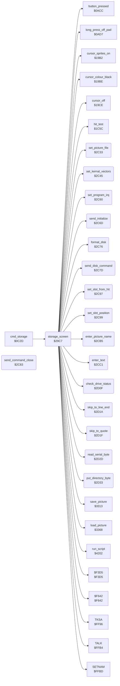

<!-- Generated by c64-docs from knowledge revision 20261025T214623.268-6ar633 and .c64-re-tools/local/generated/src/source-map.json. Do not edit: change the knowledge, generate the source again, then run docs.ts generate. -->
# storage/storage_screen.asm: Storage Screen: Directory, Save, Get, Name and Disk Commands

Range `$29C7-$2D3B`. Source: [storage/storage_screen.asm](../../../../src/storage/storage_screen.asm). Index: [the reference](../../index.md).

## Routines

| Routine | Address | Reached from | Summary |
|---|---|---|---|
| [`storage_screen`](storage_screen.md#storage_screen) | `$29C7` | [`cmd_storage`](../menu/menu.md#cmd_storage) | The Storage screen (command $0f, also Change Disk). |
| [`storage_transfer_abort`](storage_screen.md#storage_transfer_abort) | `$2BEB` | [`save_picture`](picture_file.md#save_picture), [`load_picture`](picture_file.md#load_picture) | The save and load routines jump here when the drive status is not 00 after the open: removes their return address and shows the error. |
| [`set_picture_file`](storage_screen.md#set_picture_file) | `$2C33` | [`storage_screen`](storage_screen.md#storage_screen) | Sets the file of a picture: name = the 15 bytes at script_dst (the slot field: $81 "PIC ", the letter, a space and the name), logical file 5, device FA (not a constant 8), secondary address 0. |
| [`set_kernal_vectors`](storage_screen.md#set_kernal_vectors) | `$2C45` | [`storage_screen`](storage_screen.md#storage_screen) | Sets the IRQ vector (CINV) and the NMI vector (NMINV) to the KERNAL values of the table at $fd30 ($ea31 and $fe47). |
| [`set_program_irq`](storage_screen.md#set_program_irq) | `$2C60` | [`storage_screen`](storage_screen.md#storage_screen) | Sets the IRQ vector (CINV) to irq_handler ($0969). |
| [`send_initialize`](storage_screen.md#send_initialize) | `$2C6D` | [`storage_screen`](storage_screen.md#storage_screen) | Sends the command "I" (init_command) to the drive on channel 15. |
| [`format_disk`](storage_screen.md#format_disk) | `$2C76` | [`storage_screen`](storage_screen.md#storage_screen) | Shows "Formatting Disk" and sends the 18 bytes of disk_command ("N0:name,id") to the drive. |
| [`send_disk_command`](storage_screen.md#send_disk_command) | `$2C7D` | [`storage_screen`](storage_screen.md#storage_screen) | Sends the 18 bytes of disk_command to the drive on channel 15. |
| [`send_command_close`](storage_screen.md#send_command_close) | `$2C83` |  | Opens file 15 on device FA (not a constant 8), secondary address 15, with the name of length A at X/Y (SETNAM, SETLFS, OPEN), then closes file 15. |
| [`set_slot_from_hit`](storage_screen.md#set_slot_from_hit) | `$2C97` | [`storage_screen`](storage_screen.md#storage_screen) | Sets the destination to the field of the slot in hit_code. |
| [`set_slot_position`](storage_screen.md#set_slot_position) | `$2C99` | [`storage_screen`](storage_screen.md#storage_screen) | Sets the destination (script_dst) to the field of slot A (1-16). |
| [`enter_picture_name`](storage_screen.md#enter_picture_name) | `$2CB5` | [`storage_screen`](storage_screen.md#storage_screen) | Clears the name of the slot field and gets a name of at most 8 characters. |
| [`enter_text`](storage_screen.md#enter_text) | `$2CC1` | [`storage_screen`](storage_screen.md#storage_screen) | Text entry at the destination: at most entry_max_length characters $20-$5a, DEL removes one, RETURN ends. |
| [`check_drive_status`](storage_screen.md#check_drive_status) | `$2D0F` | [`storage_screen`](storage_screen.md#storage_screen), [`save_picture`](picture_file.md#save_picture), [`load_picture`](picture_file.md#load_picture) | Reads the status of the drive on channel 15 ($39c4) into drive_message after the text "Error". |
| [`skip_to_line_end`](storage_screen.md#skip_to_line_end) | `$2D1A` | [`storage_screen`](storage_screen.md#storage_screen) | Reads bytes from the serial bus up to a zero byte. |
| [`skip_to_quote`](storage_screen.md#skip_to_quote) | `$2D1F` | [`storage_screen`](storage_screen.md#storage_screen) | Reads bytes from the serial bus up to a quote. |
| [`read_serial_byte`](storage_screen.md#read_serial_byte) | `$2D2D` | [`storage_screen`](storage_screen.md#storage_screen), [`skip_to_quote`](storage_screen.md#skip_to_quote) | Reads a byte from the serial bus (ACPTR) to A. |
| [`put_directory_byte`](storage_screen.md#put_directory_byte) | `$2D33` | [`storage_screen`](storage_screen.md#storage_screen) | Writes A at the destination (script_put_fill_value) and increments the destination. |

## Data

| Range | Type | Name | Read by | Written by |
|---|---|---|---|---|
| [`$2CA2`](../../../../src/storage/storage_screen.asm#L429)-`$2CA3` | dual-use | [`slot_right_column`](../../../../src/storage/storage_screen.asm#L428) |  |  |
| [`$2CE5`](../../../../src/storage/storage_screen.asm#L467)-`$2CE6` | dual-use | [`enter_text_test_return`](../../../../src/storage/storage_screen.asm#L466) |  |  |

## Call graph

A solid arrow is a call, a thick arrow a table entry. Rounded nodes are in this file.

The graph shows 30 of the 45 edges.

## Details

### [`storage_screen`](../../../../src/storage/storage_screen.asm#L6) `$29C7`

*routine*

The Storage screen (command $0f, also Change Disk). Draws the screen (script $236a), sends "I" to the drive, reads the directory and shows each file whose name starts with $81 "PIC " in the next slot. Then it runs the Storage loop. Returns after a long press off the pad.

- **Called from:** [`cmd_storage`](../menu/menu.md#cmd_storage)
- **Calls:** [`run_script`](../script/interpreter.md#run_script), [`cursor_off`](../input/cursor.md#cursor_off), [`cursor_colour_black`](../input/cursor.md#cursor_colour_black), [`send_initialize`](storage_screen.md#send_initialize), [`check_drive_status`](storage_screen.md#check_drive_status), [`CLALL`](../../memory-map.md#CLALL), [`SETNAM`](../../memory-map.md#SETNAM), `$F3D5`, [`TALK`](../../memory-map.md#TALK), [`TKSA`](../../memory-map.md#TKSA), [`skip_to_quote`](storage_screen.md#skip_to_quote), [`read_serial_byte`](storage_screen.md#read_serial_byte) and 19 more
- **Reads:** [`FA`](../../memory-map.md#FA), [`SA`](../../memory-map.md#SA), [`FNLEN`](../../memory-map.md#FNLEN), [`FNADR`](../../memory-map.md#FNADR), [`pic_name_prefix`](storage_data.md#pic_name_prefix), [`storage_free_slot`](../data/workspace.md#storage_free_slot), [`hit_code`](../../memory-map.md#hit_code), [`storage_action`](../../memory-map.md#storage_action), [`storage_named_slot`](../data/workspace.md#storage_named_slot)
- **Writes:** [`hit_table_ptr`](../../memory-map.md#hit_table_ptr), [`storage_free_slot`](../data/workspace.md#storage_free_slot), [`SA`](../../memory-map.md#SA), [`STATUS`](../../memory-map.md#STATUS), [`script_dest_ptr`](../../memory-map.md#script_dest_ptr), [`FNLEN`](../../memory-map.md#FNLEN), [`FNADR`](../../memory-map.md#FNADR), [`storage_action`](../../memory-map.md#storage_action), [`hit_code`](../../memory-map.md#hit_code), [`NDX`](../../memory-map.md#NDX), [`entry_max_length`](../data/workspace.md#entry_max_length), [`storage_named_slot`](../data/workspace.md#storage_named_slot)

| Label | Address | Comment |
|---|---|---|
| [`storage_read_directory`](../../../../src/storage/storage_screen.asm#L22) | `$29E7` | Opens the directory: file name "$", secondary address $60, $f3d5 sends the name. storage_free_slot starts at 1. |
| [`storage_directory_talk`](../../../../src/storage/storage_screen.asm#L37) | `$2A05` | Makes the drive talk, then reads the disk name (the text between the first quotes, at most 12 characters) to row 1, column 22 of the screen. |
| [`storage_disk_name_loop`](../../../../src/storage/storage_screen.asm#L51) | `$2A22` | FNLEN is a counter here. |
| [`storage_disk_name_done`](../../../../src/storage/storage_screen.asm#L61) | `$2A35` |  |
| [`storage_next_entry`](../../../../src/storage/storage_screen.asm#L65) | `$2A3A` | Next directory line: skips to its quote, compares the first 5 bytes of the name with pic_name_prefix and puts the 15 bytes of the name in dir_entry_buffer. |
| [`storage_prefix_loop`](../../../../src/storage/storage_screen.asm#L76) | `$2A4F` |  |
| [`storage_name_rest_loop`](../../../../src/storage/storage_screen.asm#L88) | `$2A68` |  |
| [`storage_skip_entry`](../../../../src/storage/storage_screen.asm#L100) | `$2A84` |  |
| [`storage_directory_close`](../../../../src/storage/storage_screen.asm#L105) | `$2A8C` | End of the directory or a read error: $f642 closes the serial file. KERNAL: closes the serial file. |
| [`storage_device_absent`](../../../../src/storage/storage_screen.asm#L109) | `$2A92` | KERNAL error 5: writes "Device Not Present" to drive_message. |
| [`storage_file_not_found`](../../../../src/storage/storage_screen.asm#L116) | `$2A9C` | KERNAL error 4: shows "File not found". |
| [`storage_kernal_error`](../../../../src/storage/storage_screen.asm#L122) | `$2AA6` | A = the KERNAL error code of a failed load or save (carry set): 4 and 5 have their own texts, other codes show "error". |
| [`storage_idle`](../../../../src/storage/storage_screen.asm#L132) | `$2AB8` | No action: clears storage_action and the label sprites of the cursor. |
| [`storage_loop`](../../../../src/storage/storage_screen.asm#L139) | `$2AC3` | Storage loop: sets the IRQ vector to irq_handler again (set_program_irq). A long press off the pad returns to the caller. A press on a cell runs the cell. |
| [`storage_press`](../../../../src/storage/storage_screen.asm#L146) | `$2ACF` | Hit test of the cursor. A press turns off the cursor and sets the KERNAL IRQ and NMI vectors (set_kernal_vectors), clears the marks and the message, then selects the action of the cell code. |
| [`storage_test_get`](../../../../src/storage/storage_screen.asm#L161) | `$2AEF` |  |
| [`storage_test_name_save`](../../../../src/storage/storage_screen.asm#L165) | `$2AF6` |  |
| [`storage_test_change_disk`](../../../../src/storage/storage_screen.asm#L169) | `$2AFD` |  |
| [`storage_test_init_disk`](../../../../src/storage/storage_screen.asm#L173) | `$2B04` |  |
| [`storage_slot_chosen`](../../../../src/storage/storage_screen.asm#L183) | `$2B16` | A slot: the slot number is at most storage_free_slot. Sets the destination to the slot field, then runs storage_action. |
| [`storage_test_name_action`](../../../../src/storage/storage_screen.asm#L192) | `$2B28` |  |
| [`storage_init_disk`](../../../../src/storage/storage_screen.asm#L197) | `$2B2F` | Init Disk: asks "Erase Disk?" and reads keys with GETIN until RETURN or a key $20-$5a; only "Y" continues. Then gets a disk name of at most 12 characters, sends "N0:name,id" and checks the drive status. An empty name does not stop the format. |
| [`storage_erase_key_loop`](../../../../src/storage/storage_screen.asm#L203) | `$2B3A` | Keys below $20 and from $5b do not end the wait. |
| [`storage_init_disk_exit`](../../../../src/storage/storage_screen.asm#L227) | `$2B6E` |  |
| [`storage_choose_save`](../../../../src/storage/storage_screen.asm#L230) | `$2B71` | Save: storage_action = 1 and the cursor label "save". |
| [`storage_choose_get`](../../../../src/storage/storage_screen.asm#L237) | `$2B7D` | Get: storage_action = 2 and the cursor label "get". |
| [`storage_choose_name_save`](../../../../src/storage/storage_screen.asm#L244) | `$2B89` | Name & Save: storage_action = 3 and the cursor label "name". |
| [`storage_save_slot`](../../../../src/storage/storage_screen.asm#L251) | `$2B95` | Saves the picture to the slot. A slot that has a file: sends "S0:" and the old name first. |
| [`storage_scratch_and_save`](../../../../src/storage/storage_screen.asm#L262) | `$2BAA` |  |
| [`storage_save_new_slot`](../../../../src/storage/storage_screen.asm#L268) | `$2BB5` | The first empty slot: clears the name (not after Name & Save) and adds the slot. |
| [`storage_add_slot`](../../../../src/storage/storage_screen.asm#L274) | `$2BC1` |  |
| [`storage_write_file`](../../../../src/storage/storage_screen.asm#L277) | `$2BC4` | Sets the file name from the slot field and saves the picture ($3313). |
| [`storage_get_slot`](../../../../src/storage/storage_screen.asm#L284) | `$2BCF` | Gets the picture of the slot. The first empty slot does nothing. |
| [`storage_read_file`](../../../../src/storage/storage_screen.asm#L291) | `$2BD9` | Shows "Getting Picture", sets the file name from the slot field and loads the picture ($3368). |
| [`storage_check_result`](../../../../src/storage/storage_screen.asm#L305) | `$2BF0` |  |
| [`storage_show_error`](../../../../src/storage/storage_screen.asm#L309) | `$2BF5` | Shows drive_message on the message line. |
| [`storage_clear_message`](../../../../src/storage/storage_screen.asm#L314) | `$2BFC` |  |
| [`storage_message_done`](../../../../src/storage/storage_screen.asm#L317) | `$2C00` |  |
| [`storage_name_save_slot`](../../../../src/storage/storage_screen.asm#L321) | `$2C06` | Name & Save to the slot: gets a name of at most 8 characters, then saves. An empty name does not stop the save. A slot that has a file: sends "S0:" and the old name first. |
| [`storage_name_new_slot`](../../../../src/storage/storage_screen.asm#L335) | `$2C24` |  |

### [`storage_transfer_abort`](../../../../src/storage/storage_screen.asm#L301) `$2BEB`

*label*

The save and load routines jump here when the drive status is not 00 after the open: removes their return address and shows the error.

- **Jumped to from:** [`save_picture`](picture_file.md#save_picture), [`load_picture`](picture_file.md#load_picture)

### [`set_picture_file`](../../../../src/storage/storage_screen.asm#L342) `$2C33`

*routine*

Sets the file of a picture: name = the 15 bytes at script_dst (the slot field: $81 "PIC ", the letter, a space and the name), logical file 5, device FA (not a constant 8), secondary address 0.
15 characters: the name in the slot field.

- **Called from:** [`storage_screen`](storage_screen.md#storage_screen)
- **Calls:** [`SETNAM`](../../memory-map.md#SETNAM)
- **Jumps to:** [`SETLFS`](../../memory-map.md#SETLFS)
- **Reads:** [`script_dest_ptr`](../../memory-map.md#script_dest_ptr), [`FA`](../../memory-map.md#FA)

### [`set_kernal_vectors`](../../../../src/storage/storage_screen.asm#L362) `$2C45`

*routine*

Sets the IRQ vector (CINV) and the NMI vector (NMINV) to the KERNAL values of the table at $fd30 ($ea31 and $fe47). storage_press calls it before a disk command. The disk protection at $393d also calls it ($3953).

- **Called from:** [`storage_screen`](storage_screen.md#storage_screen)
- **Reads:** `$FD31`, `$FD30`, `$FD35`, `$FD34`
- **Writes:** [`CINV`](../../memory-map.md#CINV), [`NMINV`](../../memory-map.md#NMINV)

### [`set_program_irq`](../../../../src/storage/storage_screen.asm#L375) `$2C60`

*routine*

Sets the IRQ vector (CINV) to irq_handler ($0969). The Storage loop calls it on each pass. The disk protection at $393d jumps to it at its end ($3986).

- **Called from:** [`storage_screen`](storage_screen.md#storage_screen)
- **Writes:** [`CINV`](../../memory-map.md#CINV)

### [`send_initialize`](../../../../src/storage/storage_screen.asm#L384) `$2C6D`

*routine*

Sends the command "I" (init_command) to the drive on channel 15.

- **Called from:** [`storage_screen`](storage_screen.md#storage_screen)
- **Jumps to:** [`send_command_close`](storage_screen.md#send_command_close)

### [`format_disk`](../../../../src/storage/storage_screen.asm#L390) `$2C76`

*routine*

Shows "Formatting Disk" and sends the 18 bytes of disk_command ("N0:name,id") to the drive.

- **Called from:** [`storage_screen`](storage_screen.md#storage_screen)
- **Calls:** [`run_script`](../script/interpreter.md#run_script)

### [`send_disk_command`](../../../../src/storage/storage_screen.asm#L395) `$2C7D`

*routine*

Sends the 18 bytes of disk_command to the drive on channel 15.

- **Called from:** [`storage_screen`](storage_screen.md#storage_screen)

### [`send_command_close`](../../../../src/storage/storage_screen.asm#L400) `$2C83`

*routine*

Opens file 15 on device FA (not a constant 8), secondary address 15, with the name of length A at X/Y (SETNAM, SETLFS, OPEN), then closes file 15. The disk protection at $393d also uses it ($395f, $3977) to send its block read commands.

- **Jumped to from:** [`send_initialize`](storage_screen.md#send_initialize)
- **Calls:** [`SETNAM`](../../memory-map.md#SETNAM), [`SETLFS`](../../memory-map.md#SETLFS), [`OPEN`](../../memory-map.md#OPEN)
- **Jumps to:** [`CLOSE`](../../memory-map.md#CLOSE)
- **Reads:** [`FA`](../../memory-map.md#FA)

### [`set_slot_from_hit`](../../../../src/storage/storage_screen.asm#L420) `$2C97`

*routine*

Sets the destination to the field of the slot in hit_code.

- **Called from:** [`storage_screen`](storage_screen.md#storage_screen)
- **Reads:** [`hit_code`](../../memory-map.md#hit_code)

### [`set_slot_position`](../../../../src/storage/storage_screen.asm#L423) `$2C99`

*routine*

Sets the destination (script_dst) to the field of slot A (1-16). Slots 1-8 are the left column, 9-16 the right column. Changes script_condition.
Slots 1-8: script_condition = slot (not zero) means the left column.

- **Called from:** [`storage_screen`](storage_screen.md#storage_screen)
- **Jumps to:** [`run_script`](../script/interpreter.md#run_script)
- **Writes:** [`script_condition`](../../memory-map.md#script_condition), [`script_arg_first`](../data/workspace.md#script_arg_first)

| Label | Address | Comment |
|---|---|---|
| [`slot_right_column`](../../../../src/storage/storage_screen.asm#L428) | `$2CA2` |  |
| [`slot_run_position`](../../../../src/storage/storage_screen.asm#L435) | `$2CAB` |  |

### [`enter_picture_name`](../../../../src/storage/storage_screen.asm#L441) `$2CB5`

*routine*

Clears the name of the slot field and gets a name of at most 8 characters.

- **Called from:** [`storage_screen`](storage_screen.md#storage_screen)
- **Calls:** [`run_script`](../script/interpreter.md#run_script)
- **Writes:** [`entry_max_length`](../data/workspace.md#entry_max_length)

### [`enter_text`](../../../../src/storage/storage_screen.asm#L448) `$2CC1`

*routine*

Text entry at the destination: at most entry_max_length characters $20-$5a, DEL removes one, RETURN ends. It reads the keys with GETIN. The script code draws the characters and the caret. It gives no result for an empty entry.

- **Called from:** [`storage_screen`](storage_screen.md#storage_screen)
- **Calls:** [`GETIN`](../../memory-map.md#GETIN), [`run_script`](../script/interpreter.md#run_script)
- **Jumps to:** [`run_script`](../script/interpreter.md#run_script)
- **Reads:** [`entry_length`](../data/workspace.md#entry_length), [`entry_max_length`](../data/workspace.md#entry_max_length)
- **Writes:** [`entry_length`](../data/workspace.md#entry_length), [`NDX`](../../memory-map.md#NDX), [`script_fill_byte`](../../memory-map.md#script_fill_byte)

| Label | Address | Comment |
|---|---|---|
| [`enter_text_loop`](../../../../src/storage/storage_screen.asm#L452) | `$2CC8` |  |
| [`enter_text_test_return`](../../../../src/storage/storage_screen.asm#L466) | `$2CE5` | RETURN. |
| [`enter_text_done`](../../../../src/storage/storage_screen.asm#L483) | `$2D08` | RETURN: removes the caret (entry_end) and returns. |

### [`check_drive_status`](../../../../src/storage/storage_screen.asm#L488) `$2D0F`

*routine*

Reads the status of the drive on channel 15 ($39c4) into drive_message after the text "Error". Carry clear: status 00.

- **Called from:** [`storage_screen`](storage_screen.md#storage_screen), [`save_picture`](picture_file.md#save_picture), [`load_picture`](picture_file.md#load_picture)
- **Calls:** [`run_script`](../script/interpreter.md#run_script)
- **Jumps to:** [`drive_status`](drive_status.md#drive_status)

### [`skip_to_line_end`](../../../../src/storage/storage_screen.asm#L495) `$2D1A`

*routine*

Reads bytes from the serial bus up to a zero byte. Z clear: the read ended with a status.

- **Called from:** [`storage_screen`](storage_screen.md#storage_screen)
- **Jumps to:** [`skip_until_byte`](storage_screen.md#skip_until_byte)

### [`skip_to_quote`](../../../../src/storage/storage_screen.asm#L499) `$2D1F`

*routine*

Reads bytes from the serial bus up to a quote. Z clear: the read ended with a status.

- **Called from:** [`storage_screen`](storage_screen.md#storage_screen)
- **Calls:** [`read_serial_byte`](storage_screen.md#read_serial_byte)
- **Reads:** [`temp_word`](../../memory-map.md#temp_word)
- **Writes:** [`temp_word`](../../memory-map.md#temp_word)

| Label | Address | Comment |
|---|---|---|
| [`skip_until_byte`](../../../../src/storage/storage_screen.asm#L501) | `$2D21` |  |
| [`skip_until_loop`](../../../../src/storage/storage_screen.asm#L503) | `$2D23` |  |
| [`skip_until_exit`](../../../../src/storage/storage_screen.asm#L508) | `$2D2C` |  |

### [`read_serial_byte`](../../../../src/storage/storage_screen.asm#L511) `$2D2D`

*routine*

Reads a byte from the serial bus (ACPTR) to A. Y = STATUS, Z set when STATUS is 0.

- **Called from:** [`storage_screen`](storage_screen.md#storage_screen), [`skip_to_quote`](storage_screen.md#skip_to_quote)
- **Calls:** [`ACPTR`](../../memory-map.md#ACPTR)
- **Reads:** [`STATUS`](../../memory-map.md#STATUS)

### [`put_directory_byte`](../../../../src/storage/storage_screen.asm#L516) `$2D33`

*routine*

Writes A at the destination (script_put_fill_value) and increments the destination.

- **Called from:** [`storage_screen`](storage_screen.md#storage_screen)
- **Jumps to:** [`run_script`](../script/interpreter.md#run_script)
- **Writes:** [`script_fill_byte`](../../memory-map.md#script_fill_byte)
