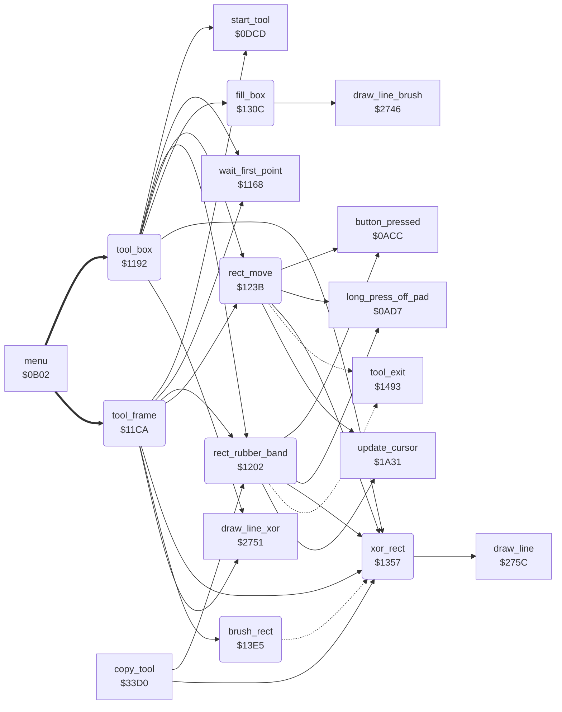

<!-- Generated by c64-docs from knowledge revision 20261024T063910.298-7zz1bw and .c64-re-tools/local/generated/src/source-map.json. Do not edit: change the knowledge, generate the source again, then run docs.ts generate. -->
# tools/box_frame_tool.asm: Box and Frame tools

Range `$1192-$13EF`. Source: [tools/box_frame_tool.asm](../../../../src/tools/box_frame_tool.asm). Index: [the reference](../../index.md).

## Call graph

A solid arrow is a call, a thick arrow a table entry, a dotted arrow a jump. Rounded nodes are in this file.

## Names

### [`tool_box`](../../../../src/tools/box_frame_tool.asm#L6) `$1192`

*routine*

Box command (code 7). Shows the label BOX (script $2f04). The first press sets a corner, the second press sets the other corner. Then the box moves with the cursor until the third press. Then fill_box fills the box in current_colour.

- **Entry of:** [`command_table`](../../tables.md#command_table)
- **Calls:** [`start_tool`](tool_start.md#start_tool), [`wait_first_point`](line_tool.md#wait_first_point), [`draw_line_xor`](../graphics/bresenham_line.md#draw_line_xor), [`xor_rect`](box_frame_tool.md#xor_rect), [`rect_rubber_band`](box_frame_tool.md#rect_rubber_band), [`rect_move`](box_frame_tool.md#rect_move), [`fill_box`](box_frame_tool.md#fill_box)
- **Reads:** [`current_colour`](../../memory-map.md#current_colour), [`background_colour`](../data/title_picture_5bff.md#background_colour), [`shape_x0`](../../memory-map.md#shape_x0), [`shape_y0`](../../memory-map.md#shape_y0), [`saved_colour`](../../memory-map.md#saved_colour)
- **Writes:** [`saved_colour`](../../memory-map.md#saved_colour), [`current_colour`](../../memory-map.md#current_colour), [`point_x0`](../../memory-map.md#point_x0), [`point_x1`](../../memory-map.md#point_x1), [`point_y0`](../../memory-map.md#point_y0), [`point_y1`](../../memory-map.md#point_y1)

### [`tool_box_loop`](../../../../src/tools/box_frame_tool.asm#L10) `$1199`

*label*

- **Jumped to from:** [`tool_box`](box_frame_tool.md#tool_box) [`$11C7`](../../../../src/tools/box_frame_tool.asm#L30)

### [`tool_frame`](../../../../src/tools/box_frame_tool.asm#L32) `$11CA`

*routine*

Frame command (code 4). Shows the label FRAME (script $2e9b). The first press sets a corner, the second press sets the other corner. Then the frame moves with the cursor until the third press. Then brush_rect draws the frame with the brush in current_colour.

- **Entry of:** [`command_table`](../../tables.md#command_table)
- **Calls:** [`start_tool`](tool_start.md#start_tool), [`wait_first_point`](line_tool.md#wait_first_point), [`draw_line_xor`](../graphics/bresenham_line.md#draw_line_xor), [`xor_rect`](box_frame_tool.md#xor_rect), [`rect_rubber_band`](box_frame_tool.md#rect_rubber_band), [`rect_move`](box_frame_tool.md#rect_move), [`brush_rect`](box_frame_tool.md#brush_rect)
- **Reads:** [`current_colour`](../../memory-map.md#current_colour), [`background_colour`](../data/title_picture_5bff.md#background_colour), [`shape_x0`](../../memory-map.md#shape_x0), [`shape_y0`](../../memory-map.md#shape_y0), [`saved_colour`](../../memory-map.md#saved_colour)
- **Writes:** [`saved_colour`](../../memory-map.md#saved_colour), [`current_colour`](../../memory-map.md#current_colour), [`point_x0`](../../memory-map.md#point_x0), [`point_x1`](../../memory-map.md#point_x1), [`point_y0`](../../memory-map.md#point_y0), [`point_y1`](../../memory-map.md#point_y1)

### [`tool_frame_loop`](../../../../src/tools/box_frame_tool.asm#L36) `$11D1`

*label*

- **Jumped to from:** [`tool_frame`](box_frame_tool.md#tool_frame) [`$11FF`](../../../../src/tools/box_frame_tool.asm#L56)

### [`rect_rubber_band`](../../../../src/tools/box_frame_tool.asm#L58) `$1202`

*routine*

Moves the corner (point_x1, point_y1) with the cursor and shows the rectangle with XOR (xor_rect) until a new button press. Then erases the rectangle. A long press off the pad erases it, restores current_colour from saved_colour and goes to tool_exit. Box, Frame and Copy use it.

- **Called from:** [`tool_box`](box_frame_tool.md#tool_box) [`$11B7`](../../../../src/tools/box_frame_tool.asm#L24), [`tool_frame`](box_frame_tool.md#tool_frame) [`$11EF`](../../../../src/tools/box_frame_tool.asm#L50), [`copy_tool`](copy.md#copy_tool) [`$33FF`](../../../../src/tools/copy.asm#L28)
- **Calls:** [`update_cursor`](../input/cursor.md#update_cursor), [`long_press_off_pad`](../input/buttons.md#long_press_off_pad), [`xor_rect`](box_frame_tool.md#xor_rect), [`button_pressed`](../input/buttons.md#button_pressed)
- **Jumps to:** [`tool_exit`](tool_exit.md#tool_exit)
- **Reads:** [`saved_colour`](../../memory-map.md#saved_colour), [`cursor_x`](../../memory-map.md#cursor_x), [`cursor_y`](../../memory-map.md#cursor_y)
- **Writes:** [`current_colour`](../../memory-map.md#current_colour), [`point_y1`](../../memory-map.md#point_y1), [`point_x1`](../../memory-map.md#point_x1)

### [`rect_band_check_press`](../../../../src/tools/box_frame_tool.asm#L68) `$1216`

*label*

- **Jumped to from:** [`rect_rubber_band`](box_frame_tool.md#rect_rubber_band) [`$1208`](../../../../src/tools/box_frame_tool.asm#L61)

### [`rect_band_read`](../../../../src/tools/box_frame_tool.asm#L73) `$121F`

*label*

- **Jumped to from:** [`rect_rubber_band`](box_frame_tool.md#rect_rubber_band) [`$1219`](../../../../src/tools/box_frame_tool.asm#L70)

### [`rect_move`](../../../../src/tools/box_frame_tool.asm#L89) `$123B`

*routine*

Moves the rectangle with the cursor until a new button press. The cursor sets the corner (point_x1, point_y1). The corner (point_x0, point_y0) keeps its distance delta_x/delta_y. A negative corner becomes 0. A corner above max_x or max_y becomes the limit, but the test uses only the low byte of the sum. Shows the rectangle with XOR and erases it at the end. A long press off the pad goes to tool_exit.
delta_x = point_x0 - point_x1 (16 bits).

- **Called from:** [`tool_box`](box_frame_tool.md#tool_box) [`$11BD`](../../../../src/tools/box_frame_tool.asm#L26), [`tool_frame`](box_frame_tool.md#tool_frame) [`$11F5`](../../../../src/tools/box_frame_tool.asm#L52)
- **Calls:** [`update_cursor`](../input/cursor.md#update_cursor), [`long_press_off_pad`](../input/buttons.md#long_press_off_pad), [`xor_rect`](box_frame_tool.md#xor_rect), [`button_pressed`](../input/buttons.md#button_pressed)
- **Jumps to:** [`tool_exit`](tool_exit.md#tool_exit)
- **Reads:** [`point_x1`](../../memory-map.md#point_x1), [`temp_word`](../../memory-map.md#temp_word), [`temp_word_hi`](../../memory-map.md#temp_word_hi), [`point_x0`](../../memory-map.md#point_x0), [`point_y1`](../../memory-map.md#point_y1), [`point_y0`](../../memory-map.md#point_y0), [`saved_colour`](../../memory-map.md#saved_colour), [`cursor_x`](../../memory-map.md#cursor_x), [`cursor_y`](../../memory-map.md#cursor_y), [`delta_x`](../../memory-map.md#delta_x), [`circle_left_x`](../../memory-map.md#circle_left_x), [`max_x`](../../memory-map.md#max_x), [`delta_y`](../../memory-map.md#delta_y), [`circle_upper_y`](../../memory-map.md#circle_upper_y), [`max_y`](../../memory-map.md#max_y)
- **Writes:** [`temp_word`](../../memory-map.md#temp_word), [`temp_word_hi`](../../memory-map.md#temp_word_hi), [`delta_x`](../../memory-map.md#delta_x), [`circle_left_x`](../../memory-map.md#circle_left_x), [`delta_y`](../../memory-map.md#delta_y), [`circle_upper_y`](../../memory-map.md#circle_upper_y), [`current_colour`](../../memory-map.md#current_colour), [`point_y1`](../../memory-map.md#point_y1), [`point_x1`](../../memory-map.md#point_x1), [`point_x0`](../../memory-map.md#point_x0), [`point_y0`](../../memory-map.md#point_y0)

### [`rect_move_loop`](../../../../src/tools/box_frame_tool.asm#L128) `$1283`

*label*

- **Jumped to from:** [`rect_move`](box_frame_tool.md#rect_move) [`$12A7`](../../../../src/tools/box_frame_tool.asm#L148), [`rect_move`](box_frame_tool.md#rect_move) [`$12B1`](../../../../src/tools/box_frame_tool.asm#L153), [`rect_move`](box_frame_tool.md#rect_move) [`$1309`](../../../../src/tools/box_frame_tool.asm#L207)

### [`rect_move_check_press`](../../../../src/tools/box_frame_tool.asm#L139) `$1297`

*label*

- **Jumped to from:** [`rect_move`](box_frame_tool.md#rect_move) [`$1289`](../../../../src/tools/box_frame_tool.asm#L131)

### [`rect_move_read`](../../../../src/tools/box_frame_tool.asm#L144) `$12A0`

*label*

- **Jumped to from:** [`rect_move`](box_frame_tool.md#rect_move) [`$129A`](../../../../src/tools/box_frame_tool.asm#L141)

### [`rect_move_moved`](../../../../src/tools/box_frame_tool.asm#L154) `$12B3`

*label*

- **Jumped to from:** [`rect_move`](box_frame_tool.md#rect_move) [`$12AB`](../../../../src/tools/box_frame_tool.asm#L150)

### [`rect_move_check_x_max`](../../../../src/tools/box_frame_tool.asm#L177) `$12DA`

*label*

Compares only the low byte with max_x.

- **Jumped to from:** [`rect_move`](box_frame_tool.md#rect_move) [`$12D1`](../../../../src/tools/box_frame_tool.asm#L172)

### [`rect_move_set_y`](../../../../src/tools/box_frame_tool.asm#L184) `$12E4`

*label*

- **Jumped to from:** [`rect_move`](box_frame_tool.md#rect_move) [`$12D7`](../../../../src/tools/box_frame_tool.asm#L176), [`rect_move`](box_frame_tool.md#rect_move) [`$12DE`](../../../../src/tools/box_frame_tool.asm#L180)

### [`rect_move_check_y_max`](../../../../src/tools/box_frame_tool.asm#L198) `$12FC`

*label*

Compares only the low byte with max_y.

- **Jumped to from:** [`rect_move`](box_frame_tool.md#rect_move) [`$12F3`](../../../../src/tools/box_frame_tool.asm#L193)

### [`rect_move_redraw`](../../../../src/tools/box_frame_tool.asm#L205) `$1306`

*label*

- **Jumped to from:** [`rect_move`](box_frame_tool.md#rect_move) [`$12F9`](../../../../src/tools/box_frame_tool.asm#L197), [`rect_move`](box_frame_tool.md#rect_move) [`$1300`](../../../../src/tools/box_frame_tool.asm#L201)

### [`fill_box`](../../../../src/tools/box_frame_tool.asm#L209) `$130C`

*routine*

Fills the rectangle with the corners (point_x0, point_y0) and (point_x1, point_y1) in current_colour: draws one horizontal line ($2746) for each row, with the one-pixel brush at $1845. Puts the smaller coordinates in point_x0/point_y0. Restores brush_ptr at the end.

- **Called from:** [`tool_box`](box_frame_tool.md#tool_box) [`$11C4`](../../../../src/tools/box_frame_tool.asm#L29)
- **Calls:** [`draw_line_brush`](../graphics/bresenham_line.md#draw_line_brush)
- **Reads:** [`brush_ptr`](../../memory-map.md#brush_ptr), [`RNDX`](../../memory-map.md#RNDX), [`point_x0`](../../memory-map.md#point_x0), [`point_x1`](../../memory-map.md#point_x1), [`point_y0`](../../memory-map.md#point_y0), [`point_y1`](../../memory-map.md#point_y1)
- **Writes:** [`brush_ptr`](../../memory-map.md#brush_ptr), [`RNDX`](../../memory-map.md#RNDX), [`point_x1`](../../memory-map.md#point_x1), [`point_x0`](../../memory-map.md#point_x0), [`point_y1`](../../memory-map.md#point_y1), [`point_y0`](../../memory-map.md#point_y0), [`shape_x0`](../../memory-map.md#shape_x0), [`shape_x1`](../../memory-map.md#shape_x1), [`shape_y0`](../../memory-map.md#shape_y0), [`shape_y1`](../../memory-map.md#shape_y1)

### [`fill_box_order_y`](../../../../src/tools/box_frame_tool.asm#L225) `$1326`

*label*

- **Jumped to from:** [`fill_box`](box_frame_tool.md#fill_box) [`$131E`](../../../../src/tools/box_frame_tool.asm#L220)

### [`fill_box_start`](../../../../src/tools/box_frame_tool.asm#L233) `$1332`

*label*

- **Jumped to from:** [`fill_box`](box_frame_tool.md#fill_box) [`$132A`](../../../../src/tools/box_frame_tool.asm#L228)

### [`fill_box_row`](../../../../src/tools/box_frame_tool.asm#L239) `$133C`

*label*

- **Jumped to from:** [`fill_box`](box_frame_tool.md#fill_box) [`$134B`](../../../../src/tools/box_frame_tool.asm#L247)

### [`fill_box_done`](../../../../src/tools/box_frame_tool.asm#L248) `$134E`

*label*

- **Jumped to from:** [`fill_box`](box_frame_tool.md#fill_box) [`$1340`](../../../../src/tools/box_frame_tool.asm#L242)

### [`xor_rect`](../../../../src/tools/box_frame_tool.asm#L256) `$1357`

*routine*

Draws the rectangle with the corners (point_x0, point_y0) and (point_x1, point_y1) with XOR: plot_vector = invert_pixel_mirrored ($189f), then draw_rect. A second call erases it.

- **Called from:** [`tool_box`](box_frame_tool.md#tool_box) [`$11B4`](../../../../src/tools/box_frame_tool.asm#L23), [`tool_box`](box_frame_tool.md#tool_box) [`$11BA`](../../../../src/tools/box_frame_tool.asm#L25), [`tool_frame`](box_frame_tool.md#tool_frame) [`$11EC`](../../../../src/tools/box_frame_tool.asm#L49), [`tool_frame`](box_frame_tool.md#tool_frame) [`$11F2`](../../../../src/tools/box_frame_tool.asm#L51), [`rect_rubber_band`](box_frame_tool.md#rect_rubber_band) [`$120A`](../../../../src/tools/box_frame_tool.asm#L62), [`rect_rubber_band`](box_frame_tool.md#rect_rubber_band) [`$121B`](../../../../src/tools/box_frame_tool.asm#L71), [`rect_rubber_band`](box_frame_tool.md#rect_rubber_band) [`$122C`](../../../../src/tools/box_frame_tool.asm#L81), [`rect_rubber_band`](box_frame_tool.md#rect_rubber_band) [`$1235`](../../../../src/tools/box_frame_tool.asm#L86), [`rect_move`](box_frame_tool.md#rect_move) [`$128B`](../../../../src/tools/box_frame_tool.asm#L133), [`rect_move`](box_frame_tool.md#rect_move) [`$129C`](../../../../src/tools/box_frame_tool.asm#L142), [`rect_move`](box_frame_tool.md#rect_move) [`$12B9`](../../../../src/tools/box_frame_tool.asm#L159), [`rect_move`](box_frame_tool.md#rect_move) [`$1306`](../../../../src/tools/box_frame_tool.asm#L206), [`copy_tool`](copy.md#copy_tool) [`$33FC`](../../../../src/tools/copy.asm#L27), [`copy_tool`](copy.md#copy_tool) [`$3445`](../../../../src/tools/copy.asm#L69), [`copy_tool`](copy.md#copy_tool) [`$3448`](../../../../src/tools/copy.asm#L70)
- **Calls:** [`draw_line`](../graphics/bresenham_line.md#draw_line)
- **Reads:** [`point_x0`](../../memory-map.md#point_x0), [`point_x1`](../../memory-map.md#point_x1), [`point_y0`](../../memory-map.md#point_y0), [`point_y1`](../../memory-map.md#point_y1), [`shape_y1`](../../memory-map.md#shape_y1), [`shape_x0`](../../memory-map.md#shape_x0), [`shape_y0`](../../memory-map.md#shape_y0)
- **Writes:** [`plot_vector`](../../memory-map.md#plot_vector), [`plot_vector+1`](../../memory-map.md#plot_vector), [`shape_x0`](../../memory-map.md#shape_x0), [`shape_x1`](../../memory-map.md#shape_x1), [`shape_y0`](../../memory-map.md#shape_y0), [`shape_y1`](../../memory-map.md#shape_y1)

### [`draw_rect`](../../../../src/tools/box_frame_tool.asm#L262) `$135F`

*label*

Draws the rectangle with the corners (point_x0, point_y0) and (point_x1, point_y1) through plot_vector (line routine $275c). When the corners are in one column or one row, draws one line. Else draws four lines: left side, bottom, right side, top. The 2nd, 3rd and 4th line start one pixel after their corner.

- **Jumped to from:** [`brush_rect`](box_frame_tool.md#brush_rect) [`$13ED`](../../../../src/tools/box_frame_tool.asm#L344)

### [`draw_rect_not_column`](../../../../src/tools/box_frame_tool.asm#L274) `$1375`

*label*

- **Jumped to from:** [`xor_rect`](box_frame_tool.md#xor_rect) [`$1363`](../../../../src/tools/box_frame_tool.asm#L265)

### [`draw_rect_four_lines`](../../../../src/tools/box_frame_tool.asm#L286) `$138B`

*label*

- **Jumped to from:** [`xor_rect`](box_frame_tool.md#xor_rect) [`$1379`](../../../../src/tools/box_frame_tool.asm#L277)

### [`draw_rect_inc_x`](../../../../src/tools/box_frame_tool.asm#L305) `$13AF`

*label*

- **Jumped to from:** [`xor_rect`](box_frame_tool.md#xor_rect) [`$13A8`](../../../../src/tools/box_frame_tool.asm#L301)

### [`draw_rect_bottom`](../../../../src/tools/box_frame_tool.asm#L307) `$13B1`

*label*

- **Jumped to from:** [`xor_rect`](box_frame_tool.md#xor_rect) [`$13AC`](../../../../src/tools/box_frame_tool.asm#L304)

### [`draw_rect_dec_y`](../../../../src/tools/box_frame_tool.asm#L319) `$13C7`

*label*

- **Jumped to from:** [`xor_rect`](box_frame_tool.md#xor_rect) [`$13C0`](../../../../src/tools/box_frame_tool.asm#L315)

### [`draw_rect_right`](../../../../src/tools/box_frame_tool.asm#L321) `$13C9`

*label*

- **Jumped to from:** [`xor_rect`](box_frame_tool.md#xor_rect) [`$13C4`](../../../../src/tools/box_frame_tool.asm#L318)

### [`draw_rect_dec_x`](../../../../src/tools/box_frame_tool.asm#L333) `$13DF`

*label*

- **Jumped to from:** [`xor_rect`](box_frame_tool.md#xor_rect) [`$13D8`](../../../../src/tools/box_frame_tool.asm#L329)

### [`draw_rect_top`](../../../../src/tools/box_frame_tool.asm#L335) `$13E1`

*label*

- **Jumped to from:** [`xor_rect`](box_frame_tool.md#xor_rect) [`$13DC`](../../../../src/tools/box_frame_tool.asm#L332)

### [`brush_rect`](../../../../src/tools/box_frame_tool.asm#L339) `$13E5`

*routine*

Draws the rectangle with the corners (point_x0, point_y0) and (point_x1, point_y1) with the brush: plot_vector = plot_brush, then draw_rect.

- **Called from:** [`tool_frame`](box_frame_tool.md#tool_frame) [`$11FC`](../../../../src/tools/box_frame_tool.asm#L55)
- **Jumps to:** [`draw_rect`](box_frame_tool.md#draw_rect)
- **Writes:** [`plot_vector`](../../memory-map.md#plot_vector), [`plot_vector+1`](../../memory-map.md#plot_vector)
