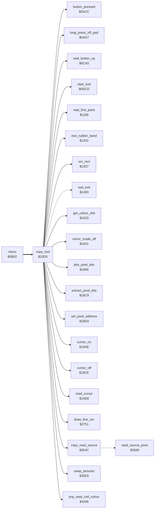

<!-- Generated by c64-docs from knowledge revision 20261024T063910.298-7zz1bw and .c64-re-tools/local/generated/src/source-map.json. Do not edit: change the knowledge, generate the source again, then run docs.ts generate. -->
# tools/copy.asm: Copy

Range `$33D0-$354E`. Source: [tools/copy.asm](../../../../src/tools/copy.asm). Index: [the reference](../../index.md).

## Call graph

A solid arrow is a call, a thick arrow a table entry, a dotted arrow a jump. Rounded nodes are in this file.

## Names

### [`copy_tool`](../../../../src/tools/copy.asm#L6) `$33D0`

*routine*

Copy (command $0b, from the command table at $0d71). The user marks a rectangle. Then a frame of the same size follows the cursor, and a press copies the rectangle there; this repeats. The source is the picture copy at $8000 (copy_mode 0) or the swap picture at $e000 (copy_mode 2). Source pixels with bit pair 0 are not copied. No touch and a long press ends the tool ($1493).

- **Entry of:** [`command_table`](../../tables.md#command_table)
- **Calls:** [`mirror_mode_off`](mirror_oops_tool.md#mirror_mode_off), [`wait_button_up`](../menu/menu.md#wait_button_up), [`start_tool`](tool_start.md#start_tool), [`wait_first_point`](line_tool.md#wait_first_point), [`draw_line_xor`](../graphics/bresenham_line.md#draw_line_xor), [`xor_rect`](box_frame_tool.md#xor_rect), [`rect_rubber_band`](box_frame_tool.md#rect_rubber_band), [`cursor_off`](../input/cursor.md#cursor_off), [`swap_pictures`](swap.md#swap_pictures), [`read_cursor`](../input/cursor.md#read_cursor), [`long_press_off_pad`](../input/buttons.md#long_press_off_pad), [`button_pressed`](../input/buttons.md#button_pressed), [`cursor_on`](../input/cursor.md#cursor_on), [`copy_read_source`](copy.md#copy_read_source), [`extract_pixel_bits`](../graphics/pixel.md#extract_pixel_bits), [`jmp_read_cell_colour`](../script/interpreter.md#jmp_read_cell_colour), [`set_pixel_address`](../graphics/pixel.md#set_pixel_address), [`get_colour_slot`](../graphics/colour_slots.md#get_colour_slot), [`plot_pixel_bits`](../graphics/pixel.md#plot_pixel_bits)
- **Jumps to:** [`tool_exit`](tool_exit.md#tool_exit)
- **Reads:** [`current_colour`](../../memory-map.md#current_colour), [`background_colour`](../data/title_picture_5bff.md#background_colour), [`shape_x0`](../../memory-map.md#shape_x0), [`shape_y0`](../../memory-map.md#shape_y0), [`point_x0`](../../memory-map.md#point_x0), [`point_x1`](../../memory-map.md#point_x1), [`point_y0`](../../memory-map.md#point_y0), [`point_y1`](../../memory-map.md#point_y1), [`copy_mode`](../data/workspace.md#copy_mode), [`cursor_x`](../../memory-map.md#cursor_x), [`copy_width`](../data/workspace.md#copy_width), [`cursor_y`](../../memory-map.md#cursor_y), [`copy_height`](../data/workspace.md#copy_height), [`zoom_pixel_x`](../../memory-map.md#zoom_pixel_x), [`copy_source_y0`](../../memory-map.md#copy_source_y0), [`copy_source_x0`](../../memory-map.md#copy_source_x0), [`copy_source_x`](../../memory-map.md#copy_source_x), [`copy_source_y`](../../memory-map.md#copy_source_y), [`source_row_addr`](../../memory-map.md#source_row_addr), [`source_row_addr+1`](../../memory-map.md#source_row_addr), [`source_screen_ptr`](../../memory-map.md#source_screen_ptr), [`source_x`](../../memory-map.md#source_x), [`source_screen_ptr+1`](../../memory-map.md#source_screen_ptr), [`copy_source_colour_bases`](copy_35de.md#copy_source_colour_bases), [`copy_source_colour_offsets`](copy_35de.md#copy_source_colour_offsets), [`pixel_value`](../../memory-map.md#pixel_value)
- **Writes:** [`zoom_pixel_x`](../../memory-map.md#zoom_pixel_x), [`saved_colour`](../../memory-map.md#saved_colour), [`current_colour`](../../memory-map.md#current_colour), [`point_x0`](../../memory-map.md#point_x0), [`point_x1`](../../memory-map.md#point_x1), [`point_y0`](../../memory-map.md#point_y0), [`point_y1`](../../memory-map.md#point_y1), [`copy_source_x0`](../../memory-map.md#copy_source_x0), [`copy_source_y0`](../../memory-map.md#copy_source_y0), [`copy_width`](../data/workspace.md#copy_width), [`copy_height`](../data/workspace.md#copy_height), [`cursor_y`](../../memory-map.md#cursor_y), [`copy_source_y`](../../memory-map.md#copy_source_y), [`cursor_x`](../../memory-map.md#cursor_x), [`copy_source_x`](../../memory-map.md#copy_source_x), [`pixel_value`](../../memory-map.md#pixel_value), [`source_screen_ptr`](../../memory-map.md#source_screen_ptr), [`source_screen_ptr+1`](../../memory-map.md#source_screen_ptr), [`source_colour_ptr`](../../memory-map.md#source_colour_ptr), [`source_colour_ptr+1`](../../memory-map.md#source_colour_ptr)

### [`copy_start`](../../../../src/tools/copy.asm#L10) `$33D7`

*label*

- **Jumped to from:** [`copy_tool`](copy.md#copy_tool) [`$349C`](../../../../src/tools/copy.asm#L119)

### [`copy_x_ordered`](../../../../src/tools/copy.asm#L39) `$3412`

*label*

copy_source_x0: the left edge of the source.

- **Jumped to from:** [`copy_tool`](copy.md#copy_tool) [`$3406`](../../../../src/tools/copy.asm#L31)

### [`copy_y_ordered`](../../../../src/tools/copy.asm#L51) `$3425`

*label*

- **Jumped to from:** [`copy_tool`](copy.md#copy_tool) [`$3419`](../../../../src/tools/copy.asm#L43)

### [`copy_show_frame`](../../../../src/tools/copy.asm#L68) `$3445`

*label*

Draws the frame point_x0/point_y0 - point_x1/point_y1 with xor_rect ($1357) and at once removes it with a second call. The frame shows only for the time between the two calls.

- **Jumped to from:** [`copy_tool`](copy.md#copy_tool) [`$3440`](../../../../src/tools/copy.asm#L64), [`copy_tool`](copy.md#copy_tool) [`$3483`](../../../../src/tools/copy.asm#L104), [`copy_tool`](copy.md#copy_tool) [`$348A`](../../../../src/tools/copy.asm#L109), [`copy_tool`](copy.md#copy_tool) [`$3549`](../../../../src/tools/copy.asm#L205)

### [`copy_wait`](../../../../src/tools/copy.asm#L72) `$344B`

*label*

Waits for the target: a touch moves the frame, a press copies, no touch and a long press ends the tool. While the pad is not touched, it reads the cursor again and does not draw the frame.

- **Jumped to from:** [`copy_tool`](copy.md#copy_tool) [`$3455`](../../../../src/tools/copy.asm#L77)

### [`copy_move_frame`](../../../../src/tools/copy.asm#L81) `$345C`

*label*

The frame starts at the cursor point. Its end is the start plus copy_width and copy_height, at most $9f and $c7.

### [`copy_clip_right`](../../../../src/tools/copy.asm#L91) `$346F`

*label*

- **Jumped to from:** [`copy_tool`](copy.md#copy_tool) [`$3464`](../../../../src/tools/copy.asm#L86), [`copy_tool`](copy.md#copy_tool) [`$3468`](../../../../src/tools/copy.asm#L88)

### [`copy_frame_y`](../../../../src/tools/copy.asm#L95) `$3473`

*label*

- **Jumped to from:** [`copy_tool`](copy.md#copy_tool) [`$346C`](../../../../src/tools/copy.asm#L90)

### [`copy_clip_bottom`](../../../../src/tools/copy.asm#L105) `$3486`

*label*

- **Jumped to from:** [`copy_tool`](copy.md#copy_tool) [`$347B`](../../../../src/tools/copy.asm#L100), [`copy_tool`](copy.md#copy_tool) [`$347F`](../../../../src/tools/copy.asm#L102)

### [`copy_end`](../../../../src/tools/copy.asm#L111) `$348D`

*label*

End of Copy: sets current_colour again. After a copy from the swap picture, it swaps the pictures back and starts the copy again.

- **Jumped to from:** [`copy_tool`](copy.md#copy_tool) [`$3451`](../../../../src/tools/copy.asm#L75)

### [`copy_exit`](../../../../src/tools/copy.asm#L120) `$349F`

*label*

- **Jumped to from:** [`copy_tool`](copy.md#copy_tool) [`$3494`](../../../../src/tools/copy.asm#L115)

### [`copy_pixels`](../../../../src/tools/copy.asm#L123) `$34A2`

*label*

Copies the rectangle: for each pixel of the target (point_x0-point_x1, point_y0-point_y1) the pixel of the source (copy_source_x, copy_source_y) with its colour. The target pixels of source bit pair 0 keep their colour.

- **Jumped to from:** [`copy_tool`](copy.md#copy_tool) [`$345A`](../../../../src/tools/copy.asm#L79)

### [`copy_row`](../../../../src/tools/copy.asm#L128) `$34AC`

*label*

- **Jumped to from:** [`copy_tool`](copy.md#copy_tool) [`$3546`](../../../../src/tools/copy.asm#L203)

### [`copy_pixel`](../../../../src/tools/copy.asm#L133) `$34B6`

*label*

- **Jumped to from:** [`copy_tool`](copy.md#copy_tool) [`$3538`](../../../../src/tools/copy.asm#L196)

### [`copy_colour_ptrs`](../../../../src/tools/copy.asm#L163) `$34F7`

*label*

Adds the base of the source colours: $d000/$d400 or $d800/$dc00.

- **Jumped to from:** [`copy_tool`](copy.md#copy_tool) [`$34F2`](../../../../src/tools/copy.asm#L161)

### [`copy_low_nybble`](../../../../src/tools/copy.asm#L181) `$351C`

*label*

- **Jumped to from:** [`copy_tool`](copy.md#copy_tool) [`$3513`](../../../../src/tools/copy.asm#L175)

### [`copy_plot`](../../../../src/tools/copy.asm#L183) `$351E`

*label*

- **Jumped to from:** [`copy_tool`](copy.md#copy_tool) [`$3519`](../../../../src/tools/copy.asm#L180)

### [`copy_next_pixel`](../../../../src/tools/copy.asm#L190) `$352D`

*label*

- **Jumped to from:** [`copy_tool`](copy.md#copy_tool) [`$34C4`](../../../../src/tools/copy.asm#L139)

### [`copy_next_row`](../../../../src/tools/copy.asm#L197) `$353B`

*label*

- **Jumped to from:** [`copy_tool`](copy.md#copy_tool) [`$3533`](../../../../src/tools/copy.asm#L194)

### [`copy_done`](../../../../src/tools/copy.asm#L204) `$3549`

*label*

- **Jumped to from:** [`copy_tool`](copy.md#copy_tool) [`$3541`](../../../../src/tools/copy.asm#L201)

### [`copy_read_source`](../../../../src/tools/copy.asm#L207) `$354C`

*routine*

Jumps to read_source_pixel.

- **Called from:** [`copy_tool`](copy.md#copy_tool) [`$34BC`](../../../../src/tools/copy.asm#L136)
- **Jumps to:** [`read_source_pixel`](copy_3568.md#read_source_pixel)
