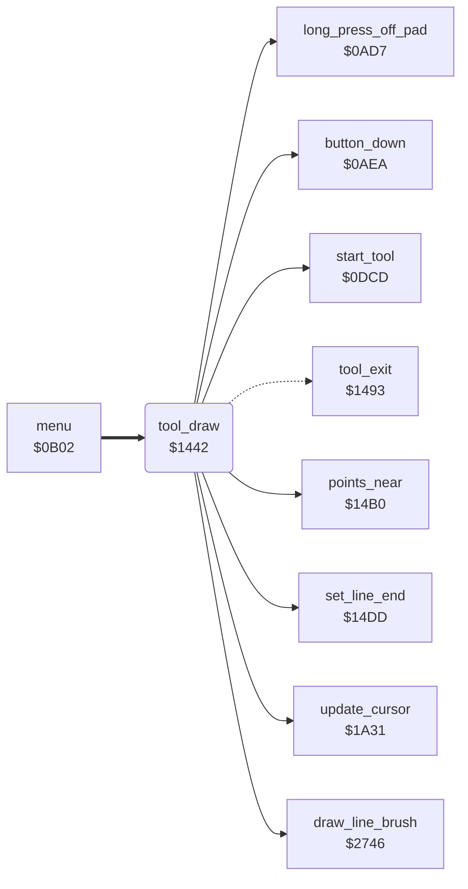

<!-- Generated by c64-docs from knowledge revision 20261024T063910.298-7zz1bw and .c64-re-tools/local/generated/src/source-map.json. Do not edit: change the knowledge, generate the source again, then run docs.ts generate. -->
# tools/draw_tool.asm: Draw tool

Range `$1442-$147A`. Source: [tools/draw_tool.asm](../../../../src/tools/draw_tool.asm). Index: [the reference](../../index.md).

## Call graph

A solid arrow is a call, a thick arrow a table entry, a dotted arrow a jump. Rounded nodes are in this file.

## Names

### [`tool_draw`](../../../../src/tools/draw_tool.asm#L6) `$1442`

*routine*

Draw command (code 1). Shows the label DRAW (script $2ee8) and waits for the button to go up. While the button is up, the start of the line follows the cursor. While the button is down, draws a line with the brush from the last point to the cursor ($2746), and the cursor becomes the last point. A move of 25 pixels or more on one axis changes the last point and draws nothing. A long press off the pad goes to tool_exit.

- **Entry of:** [`command_table`](../../tables.md#command_table)
- **Calls:** [`start_tool`](tool_start.md#start_tool), [`update_cursor`](../input/cursor.md#update_cursor), [`long_press_off_pad`](../input/buttons.md#long_press_off_pad), [`button_down`](../input/buttons.md#button_down), [`set_line_end`](tool_exit.md#set_line_end), [`points_near`](tool_exit.md#points_near), [`draw_line_brush`](../graphics/bresenham_line.md#draw_line_brush)
- **Jumps to:** [`tool_exit`](tool_exit.md#tool_exit)
- **Reads:** [`button_held`](../../memory-map.md#button_held), [`cursor_x`](../../memory-map.md#cursor_x), [`shape_x1`](../../memory-map.md#shape_x1), [`shape_y1`](../../memory-map.md#shape_y1)
- **Writes:** [`shape_x0`](../../memory-map.md#shape_x0), [`shape_y0`](../../memory-map.md#shape_y0), [`button_press_edge`](../../memory-map.md#button_press_edge)

### [`tool_draw_wait_up`](../../../../src/tools/draw_tool.asm#L13) `$144F`

*label*

- **Jumped to from:** [`tool_draw`](draw_tool.md#tool_draw) [`$1451`](../../../../src/tools/draw_tool.asm#L15)

### [`tool_draw_loop`](../../../../src/tools/draw_tool.asm#L16) `$1453`

*label*

button_press_edge = button_held.

- **Jumped to from:** [`tool_draw`](draw_tool.md#tool_draw) [`$146E`](../../../../src/tools/draw_tool.asm#L31), [`tool_draw`](draw_tool.md#tool_draw) [`$1490`](../../../../src/tools/draw_tool_147d.asm#L15)

### [`tool_draw_wait_touch`](../../../../src/tools/draw_tool.asm#L20) `$1459`

*label*

- **Jumped to from:** [`tool_draw`](draw_tool.md#tool_draw) [`$1465`](../../../../src/tools/draw_tool.asm#L26)

### [`tool_draw_read`](../../../../src/tools/draw_tool.asm#L27) `$1467`

*label*

- **Jumped to from:** [`tool_draw`](draw_tool.md#tool_draw) [`$1457`](../../../../src/tools/draw_tool.asm#L19)
