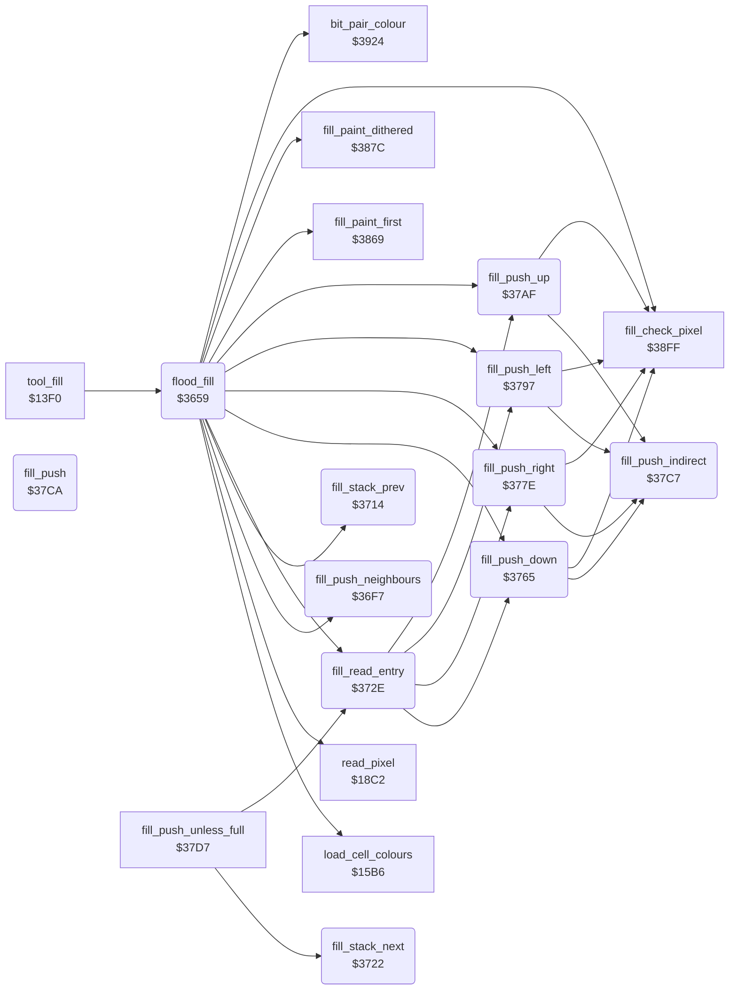

<!-- Generated by c64-docs from knowledge revision 20261025T214623.268-6ar633 and .c64-re-tools/local/generated/src/source-map.json. Do not edit: change the knowledge, generate the source again, then run docs.ts generate. -->
# tools/fill.asm: Fill

Range `$3659-$37D4`. Source: [tools/fill.asm](../../../../src/tools/fill.asm). Index: [the reference](../../index.md).

## Routines

| Routine | Address | Reached from | Summary |
|---|---|---|---|
| [`flood_fill`](fill.md#flood_fill) | `$3659` | [`tool_fill`](fill_tool.md#tool_fill) | Fill from the point (X, Y): changes all connected pixels of the colour of that point (target_colour) to current_colour, or to the dither colours. |
| [`fill_push_neighbours`](fill.md#fill_push_neighbours) | `$36F7` | [`flood_fill`](fill.md#flood_fill) | A = the direction of an entry (bits 4-7): 0 down, $10 right, $20 left, $40 up. |
| [`fill_stack_prev`](fill.md#fill_stack_prev) | `$3714` | [`flood_fill`](fill.md#flood_fill) | Moves the stack pointer (point_x1/point_y1) 3 bytes down: removes the last entry. |
| [`fill_stack_next`](fill.md#fill_stack_next) | `$3722` | [`fill_push_unless_full`](fill_37d7.md#fill_push_unless_full) | Moves the stack pointer (point_x1/point_y1) 3 bytes up. |
| [`fill_read_entry`](fill.md#fill_read_entry) | `$372E` | [`flood_fill`](fill.md#flood_fill), [`fill_push_unless_full`](fill_37d7.md#fill_push_unless_full) | Reads the entry at the stack pointer: cursor_y = byte 2, cursor_x = byte 1, A = byte 0 (the direction). |
| [`fill_push_down`](fill.md#fill_push_down) | `$3765` | [`flood_fill`](fill.md#flood_fill), [`fill_read_entry`](fill.md#fill_read_entry) | When the pixel under (cursor_x, cursor_y) is in the picture (Y less than max_y) and has target_colour, pushes it with direction 0 (fill_push_indirect). |
| [`fill_push_right`](fill.md#fill_push_right) | `$377E` | [`flood_fill`](fill.md#flood_fill), [`fill_read_entry`](fill.md#fill_read_entry) | When the pixel to the right is in the picture (X less than max_x) and has target_colour, pushes it with direction $10. |
| [`fill_push_left`](fill.md#fill_push_left) | `$3797` | [`flood_fill`](fill.md#flood_fill), [`fill_read_entry`](fill.md#fill_read_entry) | When the pixel to the left is in the picture and has target_colour, pushes it with direction $20. |
| [`fill_push_up`](fill.md#fill_push_up) | `$37AF` | [`flood_fill`](fill.md#flood_fill), [`fill_read_entry`](fill.md#fill_read_entry) | When the pixel above is in the picture and has target_colour, pushes it with direction $40. |
| [`fill_push_indirect`](fill.md#fill_push_indirect) | `$37C7` | [`fill_push_down`](fill.md#fill_push_down), [`fill_push_right`](fill.md#fill_push_right), [`fill_push_left`](fill.md#fill_push_left), [`fill_push_up`](fill.md#fill_push_up) | Jumps through the vector at $3b/$3c, which flood_fill sets to fill_push ($37ca). |
| [`fill_push`](fill.md#fill_push) | `$37CA` |  | Pushes the entry (A = direction, cursor_x, cursor_y) on the fill stack. |

## Call graph

A solid arrow is a call, a thick arrow a table entry. Rounded nodes are in this file.

## Details

### [`flood_fill`](../../../../src/tools/fill.asm#L6) `$3659`

*routine*

Fill from the point (X, Y): changes all connected pixels of the colour of that point (target_colour) to current_colour, or to the dither colours. Uses a stack of 3-byte entries (direction, X, Y) from $c100. A press of the button stops the fill. Keeps brush_ptr.

- **Called from:** [`tool_fill`](fill_tool.md#tool_fill)
- **Calls:** [`read_pixel`](../graphics/pixel.md#read_pixel), [`load_cell_colours`](../graphics/colour_slots.md#load_cell_colours), [`bit_pair_colour`](../graphics/bit_pair_colour.md#bit_pair_colour), [`fill_paint_first`](fill_37d7.md#fill_paint_first), [`fill_push_down`](fill.md#fill_push_down), [`fill_push_right`](fill.md#fill_push_right), [`fill_push_left`](fill.md#fill_push_left), [`fill_push_up`](fill.md#fill_push_up), [`fill_read_entry`](fill.md#fill_read_entry), [`fill_stack_prev`](fill.md#fill_stack_prev), [`fill_check_pixel`](fill_37d7.md#fill_check_pixel), [`fill_paint_dithered`](fill_37d7.md#fill_paint_dithered) and 1 more
- **Reads:** [`brush_ptr`](../../memory-map.md#brush_ptr), [`RNDX`](../../memory-map.md#RNDX), [`current_colour`](../../memory-map.md#current_colour), [`dither_colours`](../../memory-map.md#dither_colours), [`dither_colours_1`](../../memory-map.md#dither_colours_1), [`dither_colours_2`](../../memory-map.md#dither_colours_2), [`dither_colours_3`](../../memory-map.md#dither_colours_3), [`target_colour`](../../memory-map.md#target_colour), [`button_press_edge`](../../memory-map.md#button_press_edge), [`point_y1`](../../memory-map.md#point_y1)
- **Writes:** [`brush_ptr`](../../memory-map.md#brush_ptr), [`RNDX`](../../memory-map.md#RNDX), [`target_colour`](../../memory-map.md#target_colour), [`dither_colours_1`](../../memory-map.md#dither_colours_1), [`dither_colours`](../../memory-map.md#dither_colours), [`current_colour`](../../memory-map.md#current_colour), [`dither_colours_3`](../../memory-map.md#dither_colours_3), [`dither_colours_2`](../../memory-map.md#dither_colours_2), [`point_x1`](../../memory-map.md#point_x1), [`point_y1`](../../memory-map.md#point_y1), [`plot_vector`](../../memory-map.md#plot_vector), [`line_dx`](../../memory-map.md#line_dx) and 1 more

| Label | Address | Comment |
|---|---|---|
| [`fill_done`](../../../../src/tools/fill.asm#L39) | `$369D` |  |
| [`fill_init`](../../../../src/tools/fill.asm#L47) | `$36A9` | Stack pointer = $c0fd: the stack is empty. |
| [`fill_loop`](../../../../src/tools/fill.asm#L66) | `$36D0` | Takes the last entry from the stack (fill_read_entry, then fill_stack_prev). When the pixel still has target_colour, paints it (fill_paint_dithered) and pushes the neighbours with fill_push_neighbours, but not the neighbour that the entry came from. A press stops the fill. |
| [`fill_pop_entry`](../../../../src/tools/fill.asm#L74) | `$36DD` |  |
| [`fill_take_entry`](../../../../src/tools/fill.asm#L83) | `$36ED` |  |

### [`fill_push_neighbours`](../../../../src/tools/fill.asm#L89) `$36F7`

*routine*

A = the direction of an entry (bits 4-7): 0 down, $10 right, $20 left, $40 up. Jumps to fill_went_down, fill_went_right, fill_went_left or fill_went_up. An other value pushes nothing.

- **Called from:** [`flood_fill`](fill.md#flood_fill)
- **Jumps to:** [`fill_went_down`](fill.md#fill_went_down), [`fill_went_right`](fill.md#fill_went_right), [`fill_went_left`](fill.md#fill_went_left), [`fill_went_up`](fill.md#fill_went_up)

| Label | Address | Comment |
|---|---|---|
| [`fill_test_right`](../../../../src/tools/fill.asm#L93) | `$36FE` |  |
| [`fill_test_left`](../../../../src/tools/fill.asm#L97) | `$3705` |  |
| [`fill_test_up`](../../../../src/tools/fill.asm#L101) | `$370C` |  |
| [`fill_test_done`](../../../../src/tools/fill.asm#L105) | `$3713` |  |

### [`fill_stack_prev`](../../../../src/tools/fill.asm#L109) `$3714`

*routine*

Moves the stack pointer (point_x1/point_y1) 3 bytes down: removes the last entry.

- **Called from:** [`flood_fill`](fill.md#flood_fill)
- **Reads:** [`point_x1`](../../memory-map.md#point_x1), [`point_y1`](../../memory-map.md#point_y1)
- **Writes:** [`point_x1`](../../memory-map.md#point_x1), [`point_y1`](../../memory-map.md#point_y1)

### [`fill_stack_next`](../../../../src/tools/fill.asm#L119) `$3722`

*routine*

Moves the stack pointer (point_x1/point_y1) 3 bytes up.

- **Called from:** [`fill_push_unless_full`](fill_37d7.md#fill_push_unless_full)
- **Reads:** [`point_x1`](../../memory-map.md#point_x1), [`point_y1`](../../memory-map.md#point_y1)
- **Writes:** [`point_x1`](../../memory-map.md#point_x1), [`point_y1`](../../memory-map.md#point_y1)

| Label | Address | Comment |
|---|---|---|
| [`fill_stack_next_done`](../../../../src/tools/fill.asm#L126) | `$372D` |  |

### [`fill_read_entry`](../../../../src/tools/fill.asm#L129) `$372E`

*routine*

Reads the entry at the stack pointer: cursor_y = byte 2, cursor_x = byte 1, A = byte 0 (the direction).

- **Called from:** [`flood_fill`](fill.md#flood_fill), [`fill_push_unless_full`](fill_37d7.md#fill_push_unless_full)
- **Calls:** [`fill_push_down`](fill.md#fill_push_down), [`fill_push_right`](fill.md#fill_push_right), [`fill_push_left`](fill.md#fill_push_left), [`fill_push_up`](fill.md#fill_push_up)
- **Reads:** [`point_x1`](../../memory-map.md#point_x1)
- **Writes:** [`cursor_y`](../../memory-map.md#cursor_y), [`cursor_x`](../../memory-map.md#cursor_x)

| Label | Address | Comment |
|---|---|---|
| [`fill_went_down`](../../../../src/tools/fill.asm#L140) | `$373D` | Entry from the pixel above (direction 0): pushes down, right and left. |
| [`fill_went_right`](../../../../src/tools/fill.asm#L146) | `$3747` | Entry from the pixel to the left (direction $10): pushes down, right and up. |
| [`fill_went_left`](../../../../src/tools/fill.asm#L152) | `$3751` | Entry from the pixel to the right (direction $20): pushes down, left and up. |
| [`fill_went_up`](../../../../src/tools/fill.asm#L158) | `$375B` | Entry from the pixel below (direction $40): pushes right, left and up. |

### [`fill_push_down`](../../../../src/tools/fill.asm#L164) `$3765`

*routine*

When the pixel under (cursor_x, cursor_y) is in the picture (Y less than max_y) and has target_colour, pushes it with direction 0 (fill_push_indirect). Keeps cursor_y.

- **Called from:** [`flood_fill`](fill.md#flood_fill), [`fill_read_entry`](fill.md#fill_read_entry)
- **Calls:** [`fill_check_pixel`](fill_37d7.md#fill_check_pixel), [`fill_push_indirect`](fill.md#fill_push_indirect)
- **Reads:** [`cursor_y`](../../memory-map.md#cursor_y), [`max_y`](../../memory-map.md#max_y)
- **Writes:** [`cursor_y`](../../memory-map.md#cursor_y)

| Label | Address | Comment |
|---|---|---|
| [`fill_push_down_undo`](../../../../src/tools/fill.asm#L170) | `$376C` |  |
| [`fill_push_down_try`](../../../../src/tools/fill.asm#L173) | `$376F` |  |

### [`fill_push_right`](../../../../src/tools/fill.asm#L181) `$377E`

*routine*

When the pixel to the right is in the picture (X less than max_x) and has target_colour, pushes it with direction $10. Keeps cursor_x.

- **Called from:** [`flood_fill`](fill.md#flood_fill), [`fill_read_entry`](fill.md#fill_read_entry)
- **Calls:** [`fill_check_pixel`](fill_37d7.md#fill_check_pixel), [`fill_push_indirect`](fill.md#fill_push_indirect)
- **Reads:** [`cursor_x`](../../memory-map.md#cursor_x), [`max_x`](../../memory-map.md#max_x)
- **Writes:** [`cursor_x`](../../memory-map.md#cursor_x)

| Label | Address | Comment |
|---|---|---|
| [`fill_push_right_undo`](../../../../src/tools/fill.asm#L187) | `$3785` |  |
| [`fill_push_right_try`](../../../../src/tools/fill.asm#L190) | `$3788` |  |

### [`fill_push_left`](../../../../src/tools/fill.asm#L198) `$3797`

*routine*

When the pixel to the left is in the picture and has target_colour, pushes it with direction $20. Keeps cursor_x.

- **Called from:** [`flood_fill`](fill.md#flood_fill), [`fill_read_entry`](fill.md#fill_read_entry)
- **Calls:** [`fill_check_pixel`](fill_37d7.md#fill_check_pixel), [`fill_push_indirect`](fill.md#fill_push_indirect)
- **Reads:** [`cursor_x`](../../memory-map.md#cursor_x)
- **Writes:** [`cursor_x`](../../memory-map.md#cursor_x)

| Label | Address | Comment |
|---|---|---|
| [`fill_push_left_undo`](../../../../src/tools/fill.asm#L203) | `$379F` |  |
| [`fill_push_left_try`](../../../../src/tools/fill.asm#L206) | `$37A2` |  |

### [`fill_push_up`](../../../../src/tools/fill.asm#L213) `$37AF`

*routine*

When the pixel above is in the picture and has target_colour, pushes it with direction $40. Keeps cursor_y.

- **Called from:** [`flood_fill`](fill.md#flood_fill), [`fill_read_entry`](fill.md#fill_read_entry)
- **Calls:** [`fill_check_pixel`](fill_37d7.md#fill_check_pixel), [`fill_push_indirect`](fill.md#fill_push_indirect)
- **Reads:** [`cursor_y`](../../memory-map.md#cursor_y)
- **Writes:** [`cursor_y`](../../memory-map.md#cursor_y)

| Label | Address | Comment |
|---|---|---|
| [`fill_push_up_undo`](../../../../src/tools/fill.asm#L218) | `$37B7` |  |
| [`fill_push_up_try`](../../../../src/tools/fill.asm#L221) | `$37BA` |  |

### [`fill_push_indirect`](../../../../src/tools/fill.asm#L228) `$37C7`

*routine*

Jumps through the vector at $3b/$3c, which flood_fill sets to fill_push ($37ca).

- **Called from:** [`fill_push_down`](fill.md#fill_push_down), [`fill_push_right`](fill.md#fill_push_right), [`fill_push_left`](fill.md#fill_push_left), [`fill_push_up`](fill.md#fill_push_up)
- **Reads:** [`line_dx`](../../memory-map.md#line_dx)

### [`fill_push`](../../../../src/tools/fill.asm#L231) `$37CA`

*routine*

Pushes the entry (A = direction, cursor_x, cursor_y) on the fill stack. With the stack pointer in page $ce, it first removes the entries of filled pixels (fill_compact_stack). From $cff0 on, it does not push.

- **Jumps to:** [`fill_push_unless_full`](fill_37d7.md#fill_push_unless_full), [`fill_compact_stack`](fill_37d7.md#fill_compact_stack)
- **Reads:** [`point_y1`](../../memory-map.md#point_y1)
- **Writes:** [`temp_word`](../../memory-map.md#temp_word)
