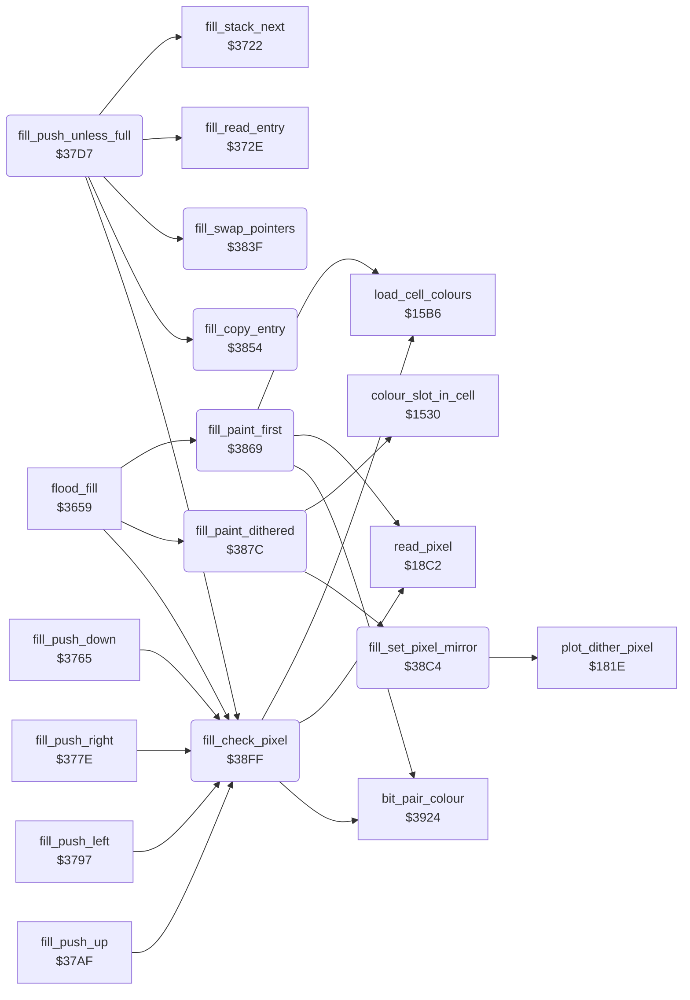

<!-- Generated by c64-docs from knowledge revision 20261025T214623.268-6ar633 and .c64-re-tools/local/generated/src/source-map.json. Do not edit: change the knowledge, generate the source again, then run docs.ts generate. -->
# tools/fill_37d7.asm

Range `$37D7-$3923`. Source: [tools/fill_37d7.asm](../../../../src/tools/fill_37d7.asm). Index: [the reference](../../index.md).

## Routines

| Routine | Address | Reached from | Summary |
|---|---|---|---|
| [`fill_push_unless_full`](fill_37d7.md#fill_push_unless_full) | `$37D7` | [`fill_push`](fill.md#fill_push) | Pushes one fill entry (direction temp_word, cursor_x, cursor_y) at point_x1/point_y1 + 3, and moves the fill stack pointer with fill_stack_next. |
| [`fill_compact_stack`](fill_37d7.md#fill_compact_stack) | `$37FC` | [`fill_push`](fill.md#fill_push) | Pushes the entry, then copies each stack entry whose pixel does not have current_colour to the bottom of the stack ($c100 on). |
| [`fill_swap_pointers`](fill_37d7.md#fill_swap_pointers) | `$383F` | [`fill_push_unless_full`](fill_37d7.md#fill_push_unless_full) | Exchanges the stack pointer (point_x1/point_y1) with circle_dx/$45. |
| [`fill_copy_entry`](fill_37d7.md#fill_copy_entry) | `$3854` | [`fill_push_unless_full`](fill_37d7.md#fill_push_unless_full) | Copies the 3 bytes of the entry at the stack pointer to point_x0/point_y0, and moves point_x0/point_y0 3 bytes up. |
| [`fill_paint_first`](fill_37d7.md#fill_paint_first) | `$3869` | [`flood_fill`](fill.md#flood_fill) | When the pixel (cursor_x, cursor_y) has target_colour, paints it with fill_paint_dithered. |
| [`fill_paint_dithered`](fill_37d7.md#fill_paint_dithered) | `$387C` | [`flood_fill`](fill.md#flood_fill) | current_colour = the dither colour of the selected pixel: dither_colours entry (pixel_y and 1) * 2 + (pixel_x and 1). |
| [`fill_set_pixel_mirror`](fill_37d7.md#fill_set_pixel_mirror) | `$38C4` | [`fill_paint_dithered`](fill_37d7.md#fill_paint_dithered) | Plots the pixel (X, Y) and its mirror images (159 - X, Y), (159 - X, 199 - Y) and (X, 199 - Y) with $181e. |
| [`fill_check_pixel`](fill_37d7.md#fill_check_pixel) | `$38FF` | [`flood_fill`](fill.md#flood_fill), [`fill_push_down`](fill.md#fill_push_down), [`fill_push_right`](fill.md#fill_push_right), [`fill_push_left`](fill.md#fill_push_left), [`fill_push_up`](fill.md#fill_push_up), [`fill_push_unless_full`](fill_37d7.md#fill_push_unless_full) | Reads the pixel (cursor_x, cursor_y) and gives its colour in A (bit_pair_colour). |

## Call graph

A solid arrow is a call, a thick arrow a table entry. Rounded nodes are in this file.

## Details

### [`fill_push_unless_full`](../../../../src/tools/fill_37d7.asm#L6) `$37D7`

*routine*

Pushes one fill entry (direction temp_word, cursor_x, cursor_y) at point_x1/point_y1 + 3, and moves the fill stack pointer with fill_stack_next. When the stack is full ($cff0 or higher), it pushes nothing. After a push, Z is clear.

- **Jumped to from:** [`fill_push`](fill.md#fill_push)
- **Calls:** [`fill_stack_next`](fill.md#fill_stack_next), [`fill_swap_pointers`](fill_37d7.md#fill_swap_pointers), [`fill_read_entry`](fill.md#fill_read_entry), [`fill_check_pixel`](fill_37d7.md#fill_check_pixel), [`fill_copy_entry`](fill_37d7.md#fill_copy_entry)
- **Reads:** [`point_y1`](../../memory-map.md#point_y1), [`point_x1`](../../memory-map.md#point_x1), [`temp_word`](../../memory-map.md#temp_word), [`cursor_x`](../../memory-map.md#cursor_x), [`cursor_y`](../../memory-map.md#cursor_y), [`current_colour`](../../memory-map.md#current_colour), [`line_y_negative`](../../memory-map.md#line_y_negative), [`line_x_negative`](../../memory-map.md#line_x_negative), [`point_x0`](../../memory-map.md#point_x0), [`point_y0`](../../memory-map.md#point_y0)
- **Writes:** [`line_y_negative`](../../memory-map.md#line_y_negative), [`point_y0`](../../memory-map.md#point_y0), [`line_x_negative`](../../memory-map.md#line_x_negative), [`point_x0`](../../memory-map.md#point_x0), [`point_x1`](../../memory-map.md#point_x1), [`point_y1`](../../memory-map.md#point_y1), [`cursor_y`](../../memory-map.md#cursor_y), [`cursor_x`](../../memory-map.md#cursor_x)

| Label | Address | Comment |
|---|---|---|
| [`fill_push_store`](../../../../src/tools/fill_37d7.asm#L15) | `$37E4` |  |
| [`fill_compact_loop`](../../../../src/tools/fill_37d7.asm#L44) | `$3814` |  |
| [`fill_compact_next`](../../../../src/tools/fill_37d7.asm#L50) | `$3821` |  |

### [`fill_compact_stack`](../../../../src/tools/fill_37d7.asm#L30) `$37FC`

*label*

Pushes the entry, then copies each stack entry whose pixel does not have current_colour to the bottom of the stack ($c100 on). The stack pointer becomes the end of the kept entries. Keeps cursor_x and cursor_y.

- **Jumped to from:** [`fill_push`](fill.md#fill_push)

### [`fill_swap_pointers`](../../../../src/tools/fill_37d7.asm#L68) `$383F`

*routine*

Exchanges the stack pointer (point_x1/point_y1) with circle_dx/$45.

- **Called from:** [`fill_push_unless_full`](fill_37d7.md#fill_push_unless_full)
- **Reads:** [`point_x1`](../../memory-map.md#point_x1), [`line_x_negative`](../../memory-map.md#line_x_negative), [`point_y1`](../../memory-map.md#point_y1), [`line_y_negative`](../../memory-map.md#line_y_negative)
- **Writes:** [`point_x1`](../../memory-map.md#point_x1), [`line_x_negative`](../../memory-map.md#line_x_negative), [`point_y1`](../../memory-map.md#point_y1), [`line_y_negative`](../../memory-map.md#line_y_negative)

### [`fill_copy_entry`](../../../../src/tools/fill_37d7.asm#L83) `$3854`

*routine*

Copies the 3 bytes of the entry at the stack pointer to point_x0/point_y0, and moves point_x0/point_y0 3 bytes up.

- **Called from:** [`fill_push_unless_full`](fill_37d7.md#fill_push_unless_full)
- **Reads:** [`point_x1`](../../memory-map.md#point_x1), [`point_x0`](../../memory-map.md#point_x0), [`point_y0`](../../memory-map.md#point_y0)
- **Writes:** [`point_x0`](../../memory-map.md#point_x0), [`point_y0`](../../memory-map.md#point_y0)

| Label | Address | Comment |
|---|---|---|
| [`fill_copy_entry_loop`](../../../../src/tools/fill_37d7.asm#L85) | `$3856` |  |
| [`fill_copy_entry_done`](../../../../src/tools/fill_37d7.asm#L96) | `$3868` |  |

### [`fill_paint_first`](../../../../src/tools/fill_37d7.asm#L99) `$3869`

*routine*

When the pixel (cursor_x, cursor_y) has target_colour, paints it with fill_paint_dithered. Z is clear when the pixel has an other colour.

- **Called from:** [`flood_fill`](fill.md#flood_fill)
- **Calls:** [`read_pixel`](../graphics/pixel.md#read_pixel), [`load_cell_colours`](../graphics/colour_slots.md#load_cell_colours), [`bit_pair_colour`](../graphics/bit_pair_colour.md#bit_pair_colour)
- **Jumps to:** [`fill_pixel_done`](fill_37d7.md#fill_pixel_done)
- **Reads:** [`cursor_x`](../../memory-map.md#cursor_x), [`cursor_y`](../../memory-map.md#cursor_y), [`target_colour`](../../memory-map.md#target_colour)

### [`fill_paint_dithered`](../../../../src/tools/fill_37d7.asm#L110) `$387C`

*routine*

current_colour = the dither colour of the selected pixel: dither_colours entry (pixel_y and 1) * 2 + (pixel_x and 1). Then fill_set_pixel paints the pixel.

- **Called from:** [`flood_fill`](fill.md#flood_fill)
- **Calls:** [`fill_set_pixel_mirror`](fill_37d7.md#fill_set_pixel_mirror), [`colour_slot_in_cell`](../graphics/colour_slots.md#colour_slot_in_cell)
- **Reads:** [`pixel_y`](../../memory-map.md#pixel_y), [`pixel_x`](../../memory-map.md#pixel_x), [`temp_word`](../../memory-map.md#temp_word), [`dither_colours`](../../memory-map.md#dither_colours), [`mirror_mode`](../data/workspace.md#mirror_mode), [`current_colour`](../../memory-map.md#current_colour), [`background_colour`](../data/title_picture_5bff.md#background_colour), [`pixel_pair_index`](../../memory-map.md#pixel_pair_index), [`pixel_ptr`](../../memory-map.md#pixel_ptr), [`pixel_mask`](../../memory-map.md#pixel_mask), [`temp_byte`](../../memory-map.md#temp_byte)
- **Writes:** [`temp_word`](../../memory-map.md#temp_word), [`current_colour`](../../memory-map.md#current_colour), [`temp_byte`](../../memory-map.md#temp_byte)

| Label | Address | Comment |
|---|---|---|
| [`fill_set_pixel`](../../../../src/tools/fill_37d7.asm#L122) | `$388F` | Paints the pixel at pixel_ptr with current_colour: bit pair 0 for the background colour ($5bff), else the bit pair that $1530 gives for the cell. With Mirror on, paints the 4 mirrored pixels with fill_set_pixel_mirror. Z is set at the end. |
| [`fill_plain_pixel`](../../../../src/tools/fill_37d7.asm#L128) | `$389A` |  |
| [`fill_colour_bits`](../../../../src/tools/fill_37d7.asm#L135) | `$38A6` |  |
| [`fill_shift_bits`](../../../../src/tools/fill_37d7.asm#L137) | `$38A9` |  |
| [`fill_shift_loop`](../../../../src/tools/fill_37d7.asm#L141) | `$38AE` |  |
| [`fill_write_bits`](../../../../src/tools/fill_37d7.asm#L146) | `$38B3` |  |
| [`fill_pixel_done`](../../../../src/tools/fill_37d7.asm#L155) | `$38C3` |  |

### [`fill_set_pixel_mirror`](../../../../src/tools/fill_37d7.asm#L158) `$38C4`

*routine*

Plots the pixel (X, Y) and its mirror images (159 - X, Y), (159 - X, 199 - Y) and (X, 199 - Y) with $181e. Keeps cursor_x and cursor_y.

- **Called from:** [`fill_paint_dithered`](fill_37d7.md#fill_paint_dithered)
- **Calls:** [`plot_dither_pixel`](../graphics/brush_plot.md#plot_dither_pixel)
- **Reads:** [`cursor_y`](../../memory-map.md#cursor_y), [`cursor_x`](../../memory-map.md#cursor_x)
- **Writes:** [`cursor_x`](../../memory-map.md#cursor_x), [`cursor_y`](../../memory-map.md#cursor_y)

### [`fill_check_pixel`](../../../../src/tools/fill_37d7.asm#L193) `$38FF`

*routine*

Reads the pixel (cursor_x, cursor_y) and gives its colour in A (bit_pair_colour). current_colour becomes the dither colour of that point. Z is set when the colour is target_colour.

- **Called from:** [`flood_fill`](fill.md#flood_fill), [`fill_push_down`](fill.md#fill_push_down), [`fill_push_right`](fill.md#fill_push_right), [`fill_push_left`](fill.md#fill_push_left), [`fill_push_up`](fill.md#fill_push_up), [`fill_push_unless_full`](fill_37d7.md#fill_push_unless_full)
- **Calls:** [`read_pixel`](../graphics/pixel.md#read_pixel), [`load_cell_colours`](../graphics/colour_slots.md#load_cell_colours), [`bit_pair_colour`](../graphics/bit_pair_colour.md#bit_pair_colour)
- **Reads:** [`cursor_x`](../../memory-map.md#cursor_x), [`cursor_y`](../../memory-map.md#cursor_y), [`pixel_y`](../../memory-map.md#pixel_y), [`pixel_x`](../../memory-map.md#pixel_x), [`temp_word`](../../memory-map.md#temp_word), [`dither_colours`](../../memory-map.md#dither_colours), [`target_colour`](../../memory-map.md#target_colour)
- **Writes:** [`temp_word`](../../memory-map.md#temp_word), [`current_colour`](../../memory-map.md#current_colour)
