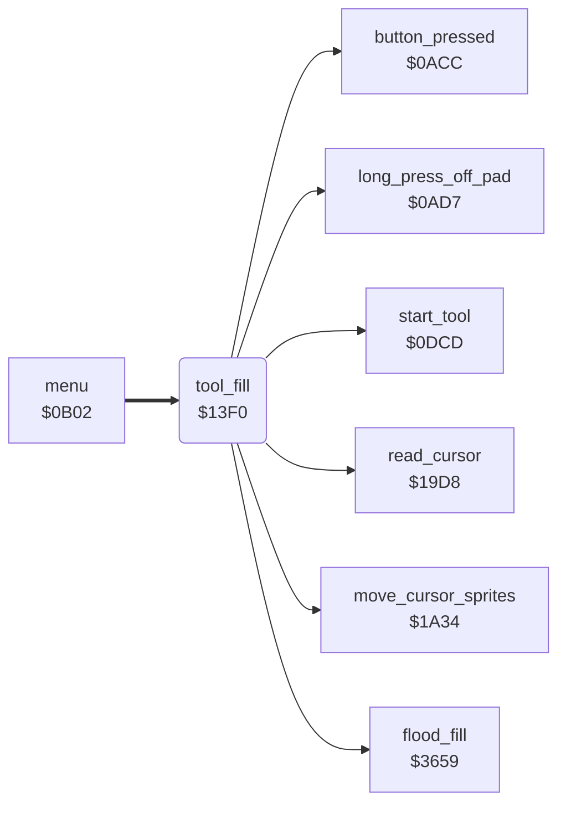

<!-- Generated by c64-docs from knowledge revision 20261025T214623.268-6ar633 and .c64-re-tools/local/generated/src/source-map.json. Do not edit: change the knowledge, generate the source again, then run docs.ts generate. -->
# tools/fill_tool.asm: Fill tool

Range `$13F0-$1441`. Source: [tools/fill_tool.asm](../../../../src/tools/fill_tool.asm). Index: [the reference](../../index.md).

## Routines

| Routine | Address | Reached from | Summary |
|---|---|---|---|
| [`tool_fill`](fill_tool.md#tool_fill) | `$13F0` | [`menu`](../menu/menu.md#menu) | Fill command (code 9). |

## Call graph

A solid arrow is a call, a thick arrow a table entry. Rounded nodes are in this file.

## Details

### [`tool_fill`](../../../../src/tools/fill_tool.asm#L6) `$13F0`

*routine*

Fill command (code 9). Shows the label FILL (script $2ef6). While the pen is on the pad, keeps the cursor position in point_x0/point_y0 and moves the cursor sprites there ($1a34). On a button press with the pen on the pad, fills from the kept point ($3659). A long press off the pad goes to tool_exit.

- **Entry of:** [`command_table`](../../tables.md#command_table)
- **Calls:** [`start_tool`](tool_start.md#start_tool), [`read_cursor`](../input/cursor.md#read_cursor), [`move_cursor_sprites`](../input/cursor.md#move_cursor_sprites), [`long_press_off_pad`](../input/buttons.md#long_press_off_pad), [`button_pressed`](../input/buttons.md#button_pressed), [`flood_fill`](fill.md#flood_fill)
- **Jumps to:** [`tool_exit`](tool_exit.md#tool_exit)
- **Reads:** [`cursor_x`](../../memory-map.md#cursor_x), [`mirror_mode`](../data/workspace.md#mirror_mode), [`cursor_y`](../../memory-map.md#cursor_y), [`point_x0`](../../memory-map.md#point_x0), [`point_y0`](../../memory-map.md#point_y0)
- **Writes:** [`point_x0`](../../memory-map.md#point_x0), [`cursor_y`](../../memory-map.md#cursor_y), [`cursor_x`](../../memory-map.md#cursor_x), [`point_y0`](../../memory-map.md#point_y0)

| Label | Address | Comment |
|---|---|---|
| [`tool_fill_loop`](../../../../src/tools/fill_tool.asm#L12) | `$13FB` |  |
| [`tool_fill_keep_point`](../../../../src/tools/fill_tool.asm#L26) | `$1413` |  |
| [`tool_fill_check_exit`](../../../../src/tools/fill_tool.asm#L32) | `$141E` |  |
| [`tool_fill_check_press`](../../../../src/tools/fill_tool.asm#L37) | `$1429` |  |
