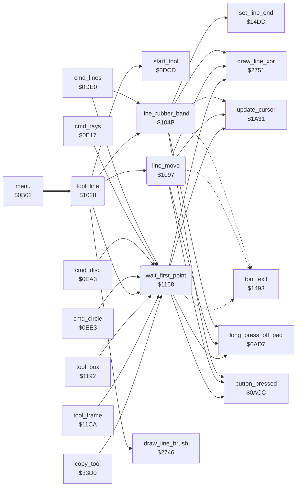

<!-- Generated by c64-docs from knowledge revision 20261024T063910.298-7zz1bw and .c64-re-tools/local/generated/src/source-map.json. Do not edit: change the knowledge, generate the source again, then run docs.ts generate. -->
# tools/line_tool.asm: Line tool

Range `$1028-$1191`. Source: [tools/line_tool.asm](../../../../src/tools/line_tool.asm). Index: [the reference](../../index.md).

## Call graph

A solid arrow is a call, a thick arrow a table entry, a dotted arrow a jump. Rounded nodes are in this file.

## Names

### [`tool_line`](../../../../src/tools/line_tool.asm#L6) `$1028`

*routine*

Line command (code 2). Shows the label LINE (script $2e72) and the picture. The first press sets the start point, the second press sets the end point. Then the line moves with the cursor until the third press. Then the line is drawn with the brush in current_colour ($2746).

- **Entry of:** [`command_table`](../../tables.md#command_table)
- **Calls:** [`start_tool`](tool_start.md#start_tool), [`wait_first_point`](line_tool.md#wait_first_point), [`line_rubber_band`](line_tool.md#line_rubber_band), [`line_move`](line_tool.md#line_move), [`draw_line_brush`](../graphics/bresenham_line.md#draw_line_brush)
- **Reads:** [`current_colour`](../../memory-map.md#current_colour), [`background_colour`](../data/title_picture_5bff.md#background_colour), [`saved_colour`](../../memory-map.md#saved_colour)
- **Writes:** [`saved_colour`](../../memory-map.md#saved_colour), [`current_colour`](../../memory-map.md#current_colour)

### [`tool_line_loop`](../../../../src/tools/line_tool.asm#L10) `$102F`

*label*

- **Jumped to from:** [`tool_line`](line_tool.md#tool_line) [`$1048`](../../../../src/tools/line_tool.asm#L21)

### [`line_rubber_band`](../../../../src/tools/line_tool.asm#L23) `$104B`

*routine*

Moves the end of the line (shape_x1, shape_y1) with the cursor and shows the line with XOR ($2751) until a new button press. Keeps the last cursor position in point_x0/point_y0. A long press off the pad erases the line, restores current_colour from saved_colour and goes to tool_exit.

- **Called from:** [`cmd_lines`](lines.md#cmd_lines) [`$0DF3`](../../../../src/tools/lines.asm#L16), [`tool_line`](line_tool.md#tool_line) [`$103B`](../../../../src/tools/line_tool.asm#L16)
- **Calls:** [`update_cursor`](../input/cursor.md#update_cursor), [`long_press_off_pad`](../input/buttons.md#long_press_off_pad), [`draw_line_xor`](../graphics/bresenham_line.md#draw_line_xor), [`button_pressed`](../input/buttons.md#button_pressed), [`set_line_end`](tool_exit.md#set_line_end)
- **Jumps to:** [`tool_exit`](tool_exit.md#tool_exit)
- **Reads:** [`saved_colour`](../../memory-map.md#saved_colour), [`cursor_x`](../../memory-map.md#cursor_x), [`point_x0`](../../memory-map.md#point_x0), [`cursor_y`](../../memory-map.md#cursor_y), [`point_y0`](../../memory-map.md#point_y0)
- **Writes:** [`current_colour`](../../memory-map.md#current_colour), [`point_x0`](../../memory-map.md#point_x0), [`point_y0`](../../memory-map.md#point_y0), [`cursor_x`](../../memory-map.md#cursor_x), [`cursor_y`](../../memory-map.md#cursor_y)

### [`line_band_check_press`](../../../../src/tools/line_tool.asm#L33) `$105F`

*label*

- **Jumped to from:** [`line_rubber_band`](line_tool.md#line_rubber_band) [`$1051`](../../../../src/tools/line_tool.asm#L26)

### [`line_band_read`](../../../../src/tools/line_tool.asm#L37) `$1065`

*label*

- **Jumped to from:** [`line_rubber_band`](line_tool.md#line_rubber_band) [`$1062`](../../../../src/tools/line_tool.asm#L35)

### [`line_band_moved`](../../../../src/tools/line_tool.asm#L49) `$107D`

*label*

- **Jumped to from:** [`line_rubber_band`](line_tool.md#line_rubber_band) [`$1072`](../../../../src/tools/line_tool.asm#L44), [`line_rubber_band`](line_tool.md#line_rubber_band) [`$1078`](../../../../src/tools/line_tool.asm#L47)

### [`line_move`](../../../../src/tools/line_tool.asm#L62) `$1097`

*routine*

Moves the line with the cursor until a new button press. The cursor sets the end (shape_x1, shape_y1). The start (shape_x0, shape_y0) keeps its distance delta_x/delta_y from the end. A negative start becomes 0. A start above max_x or max_y becomes the limit, but the test uses only the low byte of the sum. Shows the line with XOR and erases it at the end. A long press off the pad goes to tool_exit.
delta_x = shape_x0 - shape_x1 (16 bits).

- **Called from:** [`tool_line`](line_tool.md#tool_line) [`$103E`](../../../../src/tools/line_tool.asm#L17)
- **Calls:** [`update_cursor`](../input/cursor.md#update_cursor), [`long_press_off_pad`](../input/buttons.md#long_press_off_pad), [`draw_line_xor`](../graphics/bresenham_line.md#draw_line_xor), [`button_pressed`](../input/buttons.md#button_pressed)
- **Jumps to:** [`tool_exit`](tool_exit.md#tool_exit)
- **Reads:** [`shape_x1`](../../memory-map.md#shape_x1), [`temp_word`](../../memory-map.md#temp_word), [`temp_word_hi`](../../memory-map.md#temp_word_hi), [`shape_x0`](../../memory-map.md#shape_x0), [`shape_y1`](../../memory-map.md#shape_y1), [`shape_y0`](../../memory-map.md#shape_y0), [`saved_colour`](../../memory-map.md#saved_colour), [`cursor_x`](../../memory-map.md#cursor_x), [`cursor_y`](../../memory-map.md#cursor_y), [`delta_x`](../../memory-map.md#delta_x), [`circle_left_x`](../../memory-map.md#circle_left_x), [`max_x`](../../memory-map.md#max_x), [`delta_y`](../../memory-map.md#delta_y), [`circle_upper_y`](../../memory-map.md#circle_upper_y), [`max_y`](../../memory-map.md#max_y)
- **Writes:** [`temp_word`](../../memory-map.md#temp_word), [`temp_word_hi`](../../memory-map.md#temp_word_hi), [`delta_x`](../../memory-map.md#delta_x), [`circle_left_x`](../../memory-map.md#circle_left_x), [`delta_y`](../../memory-map.md#delta_y), [`circle_upper_y`](../../memory-map.md#circle_upper_y), [`current_colour`](../../memory-map.md#current_colour), [`shape_y1`](../../memory-map.md#shape_y1), [`shape_x1`](../../memory-map.md#shape_x1), [`shape_x0`](../../memory-map.md#shape_x0), [`shape_y0`](../../memory-map.md#shape_y0)

### [`line_move_loop`](../../../../src/tools/line_tool.asm#L101) `$10DF`

*label*

- **Jumped to from:** [`line_move`](line_tool.md#line_move) [`$1103`](../../../../src/tools/line_tool.asm#L121), [`line_move`](line_tool.md#line_move) [`$110D`](../../../../src/tools/line_tool.asm#L126), [`line_move`](line_tool.md#line_move) [`$1165`](../../../../src/tools/line_tool.asm#L180)

### [`line_move_check_press`](../../../../src/tools/line_tool.asm#L112) `$10F3`

*label*

- **Jumped to from:** [`line_move`](line_tool.md#line_move) [`$10E5`](../../../../src/tools/line_tool.asm#L104)

### [`line_move_read`](../../../../src/tools/line_tool.asm#L117) `$10FC`

*label*

- **Jumped to from:** [`line_move`](line_tool.md#line_move) [`$10F6`](../../../../src/tools/line_tool.asm#L114)

### [`line_move_moved`](../../../../src/tools/line_tool.asm#L127) `$110F`

*label*

- **Jumped to from:** [`line_move`](line_tool.md#line_move) [`$1107`](../../../../src/tools/line_tool.asm#L123)

### [`line_move_check_x_max`](../../../../src/tools/line_tool.asm#L150) `$1136`

*label*

Compares only the low byte with max_x. A sum of 256 or more keeps its low byte when that byte is below max_x.

- **Jumped to from:** [`line_move`](line_tool.md#line_move) [`$112D`](../../../../src/tools/line_tool.asm#L145)

### [`line_move_set_y`](../../../../src/tools/line_tool.asm#L157) `$1140`

*label*

- **Jumped to from:** [`line_move`](line_tool.md#line_move) [`$1133`](../../../../src/tools/line_tool.asm#L149), [`line_move`](line_tool.md#line_move) [`$113A`](../../../../src/tools/line_tool.asm#L153)

### [`line_move_check_y_max`](../../../../src/tools/line_tool.asm#L171) `$1158`

*label*

Compares only the low byte with max_y.

- **Jumped to from:** [`line_move`](line_tool.md#line_move) [`$114F`](../../../../src/tools/line_tool.asm#L166)

### [`line_move_redraw`](../../../../src/tools/line_tool.asm#L178) `$1162`

*label*

- **Jumped to from:** [`line_move`](line_tool.md#line_move) [`$1155`](../../../../src/tools/line_tool.asm#L170), [`line_move`](line_tool.md#line_move) [`$115C`](../../../../src/tools/line_tool.asm#L174)

### [`wait_first_point`](../../../../src/tools/line_tool.asm#L182) `$1168`

*routine*

Waits for a button press while the pen is on the pad. Then sets both ends of the line (shape_x0/y0, shape_x1/y1) to the cursor and draws this point with XOR ($2751). A long press off the pad restores current_colour from saved_colour and goes to tool_exit. Line, Lines, Rays, Circle, Disc, Box, Frame and Copy use it.

- **Called from:** [`cmd_lines`](lines.md#cmd_lines) [`$0DF0`](../../../../src/tools/lines.asm#L14), [`cmd_rays`](rays.md#cmd_rays) [`$0E2E`](../../../../src/tools/rays.asm#L18), [`cmd_disc`](circle.md#cmd_disc) [`$0EB3`](../../../../src/tools/circle.asm#L15), [`cmd_circle`](circle.md#cmd_circle) [`$0EF3`](../../../../src/tools/circle.asm#L47), [`tool_line`](line_tool.md#tool_line) [`$1038`](../../../../src/tools/line_tool.asm#L15), [`tool_box`](box_frame_tool.md#tool_box) [`$11A2`](../../../../src/tools/box_frame_tool.asm#L15), [`tool_frame`](box_frame_tool.md#tool_frame) [`$11DA`](../../../../src/tools/box_frame_tool.asm#L41), [`copy_tool`](copy.md#copy_tool) [`$33EA`](../../../../src/tools/copy.asm#L19)
- **Calls:** [`update_cursor`](../input/cursor.md#update_cursor), [`long_press_off_pad`](../input/buttons.md#long_press_off_pad), [`button_pressed`](../input/buttons.md#button_pressed), [`draw_line_xor`](../graphics/bresenham_line.md#draw_line_xor)
- **Jumps to:** [`tool_exit`](tool_exit.md#tool_exit)
- **Reads:** [`saved_colour`](../../memory-map.md#saved_colour)
- **Writes:** [`current_colour`](../../memory-map.md#current_colour), [`shape_x0`](../../memory-map.md#shape_x0), [`shape_x1`](../../memory-map.md#shape_x1), [`shape_y0`](../../memory-map.md#shape_y0), [`shape_y1`](../../memory-map.md#shape_y1)

### [`wait_first_point_read`](../../../../src/tools/line_tool.asm#L191) `$1179`

*label*

- **Jumped to from:** [`wait_first_point`](line_tool.md#wait_first_point) [`$116E`](../../../../src/tools/line_tool.asm#L185)
