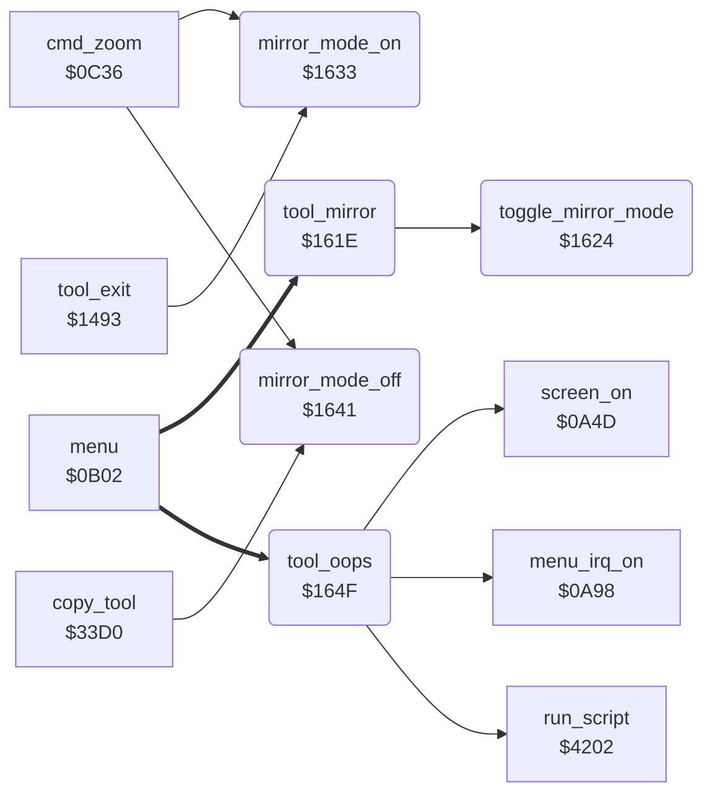

<!-- Generated by c64-docs from knowledge revision 20261025T214623.268-6ar633 and .c64-re-tools/local/generated/src/source-map.json. Do not edit: change the knowledge, generate the source again, then run docs.ts generate. -->
# tools/mirror_oops_tool.asm: Mirror and Oops commands

Range `$161E-$165E`. Source: [tools/mirror_oops_tool.asm](../../../../src/tools/mirror_oops_tool.asm). Index: [the reference](../../index.md).

## Routines

| Routine | Address | Reached from | Summary |
|---|---|---|---|
| [`tool_mirror`](mirror_oops_tool.md#tool_mirror) | `$161E` | [`menu`](../menu/menu.md#menu) | Mirror command (code $0d). |
| [`toggle_mirror_mode`](mirror_oops_tool.md#toggle_mirror_mode) | `$1624` | [`tool_mirror`](mirror_oops_tool.md#tool_mirror) | Inverts bit 0 of mirror_mode and copies it to mirror_choice. |
| [`mirror_mode_on`](mirror_oops_tool.md#mirror_mode_on) | `$1633` | [`cmd_zoom`](../menu/menu.md#cmd_zoom), [`tool_exit`](tool_exit.md#tool_exit) | Sets mirror_mode to 1 and the drawing limits to the upper left quarter of the picture: max_x = 79, max_y = 99. |
| [`mirror_mode_off`](mirror_oops_tool.md#mirror_mode_off) | `$1641` | [`cmd_zoom`](../menu/menu.md#cmd_zoom), [`copy_tool`](copy.md#copy_tool) | Sets mirror_mode to 0 and the drawing limits to all of the picture: max_x = 159, max_y = 199. |
| [`tool_oops`](mirror_oops_tool.md#tool_oops) | `$164F` | [`menu`](../menu/menu.md#menu) | Oops command (code $10). |

## Call graph

A solid arrow is a call, a thick arrow a table entry. Rounded nodes are in this file.

## Details

### [`tool_mirror`](../../../../src/tools/mirror_oops_tool.asm#L6) `$161E`

*routine*

Mirror command (code $0d). Changes mirror mode on or off (toggle_mirror_mode), then goes back to the menu (return_to_menu).

- **Entry of:** [`command_table`](../../tables.md#command_table)
- **Calls:** [`toggle_mirror_mode`](mirror_oops_tool.md#toggle_mirror_mode)
- **Jumps to:** [`return_to_menu`](mirror_oops_tool.md#return_to_menu)

### [`toggle_mirror_mode`](../../../../src/tools/mirror_oops_tool.asm#L10) `$1624`

*routine*

Inverts bit 0 of mirror_mode and copies it to mirror_choice. Then sets the drawing limits of the new mode (mirror_mode_on or mirror_mode_off).

- **Called from:** [`tool_mirror`](mirror_oops_tool.md#tool_mirror)
- **Jumps to:** [`mirror_mode_off`](mirror_oops_tool.md#mirror_mode_off)
- **Reads:** [`mirror_mode`](../data/workspace.md#mirror_mode)
- **Writes:** [`mirror_mode`](../data/workspace.md#mirror_mode), [`mirror_choice`](../data/workspace.md#mirror_choice)

### [`mirror_mode_on`](../../../../src/tools/mirror_oops_tool.asm#L18) `$1633`

*routine*

Sets mirror_mode to 1 and the drawing limits to the upper left quarter of the picture: max_x = 79, max_y = 99.

- **Called from:** [`cmd_zoom`](../menu/menu.md#cmd_zoom), [`tool_exit`](tool_exit.md#tool_exit)
- **Writes:** [`mirror_mode`](../data/workspace.md#mirror_mode), [`max_x`](../../memory-map.md#max_x), [`max_y`](../../memory-map.md#max_y)

### [`mirror_mode_off`](../../../../src/tools/mirror_oops_tool.asm#L27) `$1641`

*routine*

Sets mirror_mode to 0 and the drawing limits to all of the picture: max_x = 159, max_y = 199. mirror_choice does not change. Zoom and Copy call it.

- **Called from:** [`cmd_zoom`](../menu/menu.md#cmd_zoom), [`copy_tool`](copy.md#copy_tool)
- **Jumped to from:** [`toggle_mirror_mode`](mirror_oops_tool.md#toggle_mirror_mode)
- **Writes:** [`mirror_mode`](../data/workspace.md#mirror_mode), [`max_y`](../../memory-map.md#max_y), [`max_x`](../../memory-map.md#max_x)

### [`tool_oops`](../../../../src/tools/mirror_oops_tool.asm#L36) `$164F`

*routine*

Oops command (code $10). Runs the script at $1e73, then goes back to the menu (return_to_menu).

- **Entry of:** [`command_table`](../../tables.md#command_table)
- **Calls:** [`run_script`](../script/interpreter.md#run_script), [`menu_irq_on`](../irq/menu_irq.md#menu_irq_on), [`screen_on`](../init/screen.md#screen_on)
- **Jumps to:** [`menu_refresh`](../menu/menu.md#menu_refresh)

| Label | Address | Comment |
|---|---|---|
| [`return_to_menu`](../../../../src/tools/mirror_oops_tool.asm#L41) | `$1656` | Starts the raster interrupt (menu_irq_on), sets the screen on ($0a4d) and goes to the menu ($0b60). |
