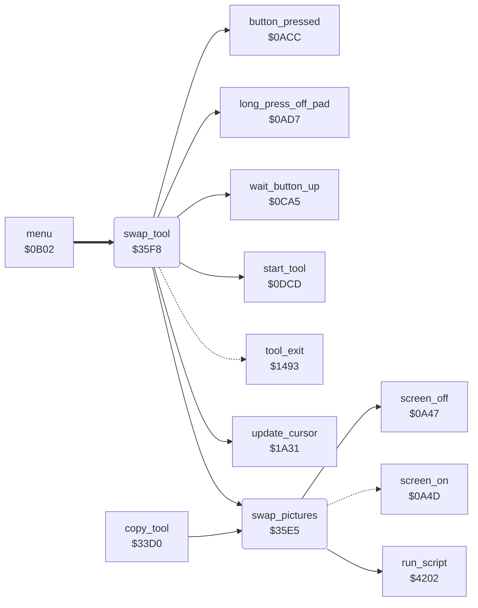

<!-- Generated by c64-docs from knowledge revision 20261024T063910.298-7zz1bw and .c64-re-tools/local/generated/src/source-map.json. Do not edit: change the knowledge, generate the source again, then run docs.ts generate. -->
# tools/swap.asm: Swap

Range `$35E5-$3658`. Source: [tools/swap.asm](../../../../src/tools/swap.asm). Index: [the reference](../../index.md).

## Call graph

A solid arrow is a call, a thick arrow a table entry, a dotted arrow a jump. Rounded nodes are in this file.

## Data

| Range | Type | Name | Read by | Written by |
|---|---|---|---|---|
| [`$3622`](../../../../src/tools/swap.asm#L37)-`$3658` | bytes | [`swap_script`](../../../../src/tools/swap.asm#L36) |  |  |

## Names

### [`swap_pictures`](../../../../src/tools/swap.asm#L6) `$35E5`

*routine*

Exchanges the picture with the second picture: blanks the screen, runs swap_script, sets the background colour from $5bff, and shows the screen again.

- **Called from:** [`copy_tool`](copy.md#copy_tool) [`$3442`](../../../../src/tools/copy.asm#L66), [`copy_tool`](copy.md#copy_tool) [`$3496`](../../../../src/tools/copy.asm#L117), [`swap_tool`](swap.md#swap_tool) [`$3619`](../../../../src/tools/swap.asm#L31)
- **Calls:** [`screen_off`](../init/screen.md#screen_off), [`run_script`](../script/interpreter.md#run_script)
- **Jumps to:** [`screen_on`](../init/screen.md#screen_on)
- **Reads:** [`background_colour`](../data/title_picture_5bff.md#background_colour)
- **Writes:** [`BGCOL0`](../../memory-map.md#BGCOL0)

### [`swap_tool`](../../../../src/tools/swap.asm#L15) `$35F8`

*routine*

Swap (command $0e, from the command table at $0d71). Shows the picture with the tool label (script $2f2e). Each press exchanges the picture with the second picture. No touch and a long press ends the tool ($1493).

- **Entry of:** [`command_table`](../../tables.md#command_table)
- **Calls:** [`start_tool`](tool_start.md#start_tool), [`wait_button_up`](../menu/menu.md#wait_button_up), [`update_cursor`](../input/cursor.md#update_cursor), [`long_press_off_pad`](../input/buttons.md#long_press_off_pad), [`button_pressed`](../input/buttons.md#button_pressed), [`swap_pictures`](swap.md#swap_pictures)
- **Jumps to:** [`tool_exit`](tool_exit.md#tool_exit)
- **Reads:** [`cursor_x`](../../memory-map.md#cursor_x)
- **Writes:** [`cursor_sprite_mask`](../../memory-map.md#cursor_sprite_mask)

### [`swap_loop`](../../../../src/tools/swap.asm#L21) `$3603`

*label*

- **Jumped to from:** [`swap_tool`](swap.md#swap_tool) [`$3612`](../../../../src/tools/swap.asm#L28), [`swap_tool`](swap.md#swap_tool) [`$3617`](../../../../src/tools/swap.asm#L30), [`swap_tool`](swap.md#swap_tool) [`$361C`](../../../../src/tools/swap.asm#L32)

### [`swap_exit`](../../../../src/tools/swap.asm#L33) `$361F`

*label*

- **Jumped to from:** [`swap_tool`](swap.md#swap_tool) [`$360C`](../../../../src/tools/swap.asm#L25)

### [`swap_script`](../../../../src/tools/swap.asm#L36) `$3622-$3658`

*data*

Script: calls $1da8, then exchanges $6000-$7f3f with $e000, $c000-$c3e7 with $d800, $c3e8-$c7cf with $dc00 and $c7d0 with $dfe8 (op 4 swaps with I/O and ROM off), then calls $1dd3.
