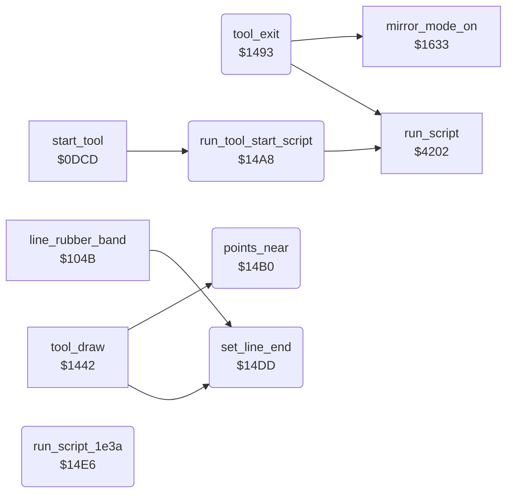

<!-- Generated by c64-docs from knowledge revision 20261025T214623.268-6ar633 and .c64-re-tools/local/generated/src/source-map.json. Do not edit: change the knowledge, generate the source again, then run docs.ts generate. -->
# tools/tool_exit.asm: Tool exit and shared tool helpers

Range `$1493-$14EC`. Source: [tools/tool_exit.asm](../../../../src/tools/tool_exit.asm). Index: [the reference](../../index.md).

## Routines

| Routine | Address | Reached from | Summary |
|---|---|---|---|
| [`tool_exit`](tool_exit.md#tool_exit) | `$1493` | [`cmd_rays`](rays.md#cmd_rays), [`shape_drag_size`](circle.md#shape_drag_size), [`shape_drag_move`](circle.md#shape_drag_move), [`line_rubber_band`](line_tool.md#line_rubber_band), [`line_move`](line_tool.md#line_move), [`wait_first_point`](line_tool.md#wait_first_point), [`rect_rubber_band`](box_frame_tool.md#rect_rubber_band), [`rect_move`](box_frame_tool.md#rect_move), [`tool_fill`](fill_tool.md#tool_fill), [`tool_draw`](draw_tool.md#tool_draw), [`tool_xcolor`](xcolor_tool.md#tool_xcolor), [`copy_tool`](copy.md#copy_tool) and 1 more | Leaves a drawing tool. |
| [`run_tool_start_script`](tool_exit.md#run_tool_start_script) | `$14A8` | [`start_tool`](tool_start.md#start_tool) | Runs the script at $1dd3. |
| [`points_near`](tool_exit.md#points_near) | `$14B0` | [`tool_draw`](draw_tool.md#tool_draw) | Compares the ends of the line (shape_x0, shape_y0) and (shape_x1, shape_y1). |
| [`set_line_end`](tool_exit.md#set_line_end) | `$14DD` | [`line_rubber_band`](line_tool.md#line_rubber_band), [`tool_draw`](draw_tool.md#tool_draw) | Sets the end of the line (shape_x1, shape_y1) to the cursor (cursor_x, cursor_y). |
| [`run_script_1e3a`](tool_exit.md#run_script_1e3a) | `$14E6` |  | Runs the script at $1e3a. |

## Call graph

A solid arrow is a call, a thick arrow a table entry. Rounded nodes are in this file.

## Details

### [`tool_exit`](../../../../src/tools/tool_exit.asm#L6) `$1493`

*routine*

Leaves a drawing tool. The callers jump here and remove their return address first. When mirror_choice is not 0, sets mirror mode again (mirror_mode_on). Runs the script at $1da8, then goes to the menu ($0b47).

- **Jumped to from:** [`cmd_rays`](rays.md#cmd_rays), [`shape_drag_size`](circle.md#shape_drag_size), [`shape_drag_move`](circle.md#shape_drag_move), [`line_rubber_band`](line_tool.md#line_rubber_band), [`line_move`](line_tool.md#line_move), [`wait_first_point`](line_tool.md#wait_first_point), [`rect_rubber_band`](box_frame_tool.md#rect_rubber_band), [`rect_move`](box_frame_tool.md#rect_move), [`tool_fill`](fill_tool.md#tool_fill), [`tool_draw`](draw_tool.md#tool_draw), [`tool_xcolor`](xcolor_tool.md#tool_xcolor), [`copy_tool`](copy.md#copy_tool) and 1 more
- **Calls:** [`mirror_mode_on`](mirror_oops_tool.md#mirror_mode_on), [`run_script`](../script/interpreter.md#run_script)
- **Jumps to:** [`menu_redraw`](../menu/menu.md#menu_redraw)
- **Reads:** [`mirror_choice`](../data/workspace.md#mirror_choice)
- **Writes:** [`mirror_mode`](../data/workspace.md#mirror_mode)

| Label | Address | Comment |
|---|---|---|
| [`tool_exit_script`](../../../../src/tools/tool_exit.asm#L11) | `$149E` |  |

### [`run_tool_start_script`](../../../../src/tools/tool_exit.asm#L17) `$14A8`

*routine*

Runs the script at $1dd3. The script starts with op 9 to bitmap_mode_on. The tool start code at $0dcd calls it.

- **Called from:** [`start_tool`](tool_start.md#start_tool)
- **Calls:** [`run_script`](../script/interpreter.md#run_script)

### [`points_near`](../../../../src/tools/tool_exit.asm#L23) `$14B0`

*routine*

Compares the ends of the line (shape_x0, shape_y0) and (shape_x1, shape_y1). C = 0 when they differ by less than 25 on both axes, else C = 1.

- **Called from:** [`tool_draw`](draw_tool.md#tool_draw)
- **Reads:** [`shape_x0`](../../memory-map.md#shape_x0), [`shape_x1`](../../memory-map.md#shape_x1), [`shape_y0`](../../memory-map.md#shape_y0), [`shape_y1`](../../memory-map.md#shape_y1)

| Label | Address | Comment |
|---|---|---|
| [`points_near_check_x`](../../../../src/tools/tool_exit.asm#L29) | `$14B9` | 25 pixels. |
| [`points_near_x_reverse`](../../../../src/tools/tool_exit.asm#L34) | `$14BE` |  |
| [`points_near_y`](../../../../src/tools/tool_exit.asm#L39) | `$14C6` |  |
| [`points_near_check_y`](../../../../src/tools/tool_exit.asm#L45) | `$14CF` |  |
| [`points_near_yes`](../../../../src/tools/tool_exit.asm#L50) | `$14D4` |  |
| [`points_near_y_reverse`](../../../../src/tools/tool_exit.asm#L52) | `$14D5` |  |

### [`set_line_end`](../../../../src/tools/tool_exit.asm#L58) `$14DD`

*routine*

Sets the end of the line (shape_x1, shape_y1) to the cursor (cursor_x, cursor_y).

- **Called from:** [`line_rubber_band`](line_tool.md#line_rubber_band), [`tool_draw`](draw_tool.md#tool_draw)
- **Reads:** [`cursor_x`](../../memory-map.md#cursor_x), [`cursor_y`](../../memory-map.md#cursor_y)
- **Writes:** [`shape_x1`](../../memory-map.md#shape_x1), [`shape_y1`](../../memory-map.md#shape_y1)

### [`run_script_1e3a`](../../../../src/tools/tool_exit.asm#L65) `$14E6`

*routine*

Runs the script at $1e3a. The code of the Erase command ($0c21, entry $11 of the command table at $0d71) calls it at $0c24.
