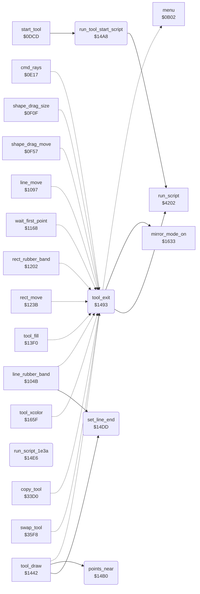

<!-- Generated by c64-docs from knowledge revision 20261024T063910.298-7zz1bw and .c64-re-tools/local/generated/src/source-map.json. Do not edit: change the knowledge, generate the source again, then run docs.ts generate. -->
# tools/tool_exit.asm: Tool exit and shared tool helpers

Range `$1493-$14EC`. Source: [tools/tool_exit.asm](../../../../src/tools/tool_exit.asm). Index: [the reference](../../index.md).

## Call graph

A solid arrow is a call, a thick arrow a table entry, a dotted arrow a jump. Rounded nodes are in this file.

## Names

### [`tool_exit`](../../../../src/tools/tool_exit.asm#L6) `$1493`

*routine*

Leaves a drawing tool. The callers jump here and remove their return address first. When mirror_choice is not 0, sets mirror mode again (mirror_mode_on). Runs the script at $1da8, then goes to the menu ($0b47).

- **Jumped to from:** [`cmd_rays`](rays.md#cmd_rays) [`$0E49`](../../../../src/tools/rays.asm#L32), [`shape_drag_size`](circle.md#shape_drag_size) [`$0F20`](../../../../src/tools/circle.asm#L67), [`shape_drag_move`](circle.md#shape_drag_move) [`$0FB0`](../../../../src/tools/circle.asm#L146), [`line_rubber_band`](line_tool.md#line_rubber_band) [`$105C`](../../../../src/tools/line_tool.asm#L32), [`line_move`](line_tool.md#line_move) [`$10F0`](../../../../src/tools/line_tool.asm#L111), [`wait_first_point`](line_tool.md#wait_first_point) [`$1176`](../../../../src/tools/line_tool.asm#L190), [`rect_rubber_band`](box_frame_tool.md#rect_rubber_band) [`$1213`](../../../../src/tools/box_frame_tool.asm#L67), [`rect_move`](box_frame_tool.md#rect_move) [`$1294`](../../../../src/tools/box_frame_tool.asm#L138), [`tool_fill`](fill_tool.md#tool_fill) [`$1426`](../../../../src/tools/fill_tool.asm#L36), [`tool_draw`](draw_tool.md#tool_draw) [`$145F`](../../../../src/tools/draw_tool.asm#L23), [`tool_xcolor`](xcolor_tool.md#tool_xcolor) [`$167C`](../../../../src/tools/xcolor_tool.asm#L22), [`copy_tool`](copy.md#copy_tool) [`$349F`](../../../../src/tools/copy.asm#L121), [`swap_tool`](swap.md#swap_tool) [`$361F`](../../../../src/tools/swap.asm#L34)
- **Calls:** [`mirror_mode_on`](mirror_oops_tool.md#mirror_mode_on), [`run_script`](../script/interpreter.md#run_script)
- **Jumps to:** [`menu_redraw`](../menu/menu.md#menu_redraw)
- **Reads:** [`mirror_choice`](../data/workspace.md#mirror_choice)
- **Writes:** [`mirror_mode`](../data/workspace.md#mirror_mode)

### [`tool_exit_script`](../../../../src/tools/tool_exit.asm#L11) `$149E`

*label*

- **Jumped to from:** [`tool_exit`](tool_exit.md#tool_exit) [`$1496`](../../../../src/tools/tool_exit.asm#L8)

### [`run_tool_start_script`](../../../../src/tools/tool_exit.asm#L17) `$14A8`

*routine*

Runs the script at $1dd3. The script starts with op 9 to bitmap_mode_on. The tool start code at $0dcd calls it.

- **Called from:** [`start_tool`](tool_start.md#start_tool) [`$0DD3`](../../../../src/tools/tool_start.asm#L9)
- **Calls:** [`run_script`](../script/interpreter.md#run_script)

### [`points_near`](../../../../src/tools/tool_exit.asm#L23) `$14B0`

*routine*

Compares the ends of the line (shape_x0, shape_y0) and (shape_x1, shape_y1). C = 0 when they differ by less than 25 on both axes, else C = 1.

- **Called from:** [`tool_draw`](draw_tool.md#tool_draw) [`$1480`](../../../../src/tools/draw_tool_147d.asm#L7)
- **Reads:** [`shape_x0`](../../memory-map.md#shape_x0), [`shape_x1`](../../memory-map.md#shape_x1), [`shape_y0`](../../memory-map.md#shape_y0), [`shape_y1`](../../memory-map.md#shape_y1)

### [`points_near_check_x`](../../../../src/tools/tool_exit.asm#L29) `$14B9`

*label*

25 pixels.

- **Jumped to from:** [`points_near`](tool_exit.md#points_near) [`$14C3`](../../../../src/tools/tool_exit.asm#L38)

### [`points_near_x_reverse`](../../../../src/tools/tool_exit.asm#L34) `$14BE`

*label*

- **Jumped to from:** [`points_near`](tool_exit.md#points_near) [`$14B4`](../../../../src/tools/tool_exit.asm#L26)

### [`points_near_y`](../../../../src/tools/tool_exit.asm#L39) `$14C6`

*label*

- **Jumped to from:** [`points_near`](tool_exit.md#points_near) [`$14BB`](../../../../src/tools/tool_exit.asm#L31)

### [`points_near_check_y`](../../../../src/tools/tool_exit.asm#L45) `$14CF`

*label*

- **Jumped to from:** [`points_near`](tool_exit.md#points_near) [`$14DA`](../../../../src/tools/tool_exit.asm#L56)

### [`points_near_yes`](../../../../src/tools/tool_exit.asm#L50) `$14D4`

*label*

- **Jumped to from:** [`points_near`](tool_exit.md#points_near) [`$14D1`](../../../../src/tools/tool_exit.asm#L47)

### [`points_near_y_reverse`](../../../../src/tools/tool_exit.asm#L52) `$14D5`

*label*

- **Jumped to from:** [`points_near`](tool_exit.md#points_near) [`$14CA`](../../../../src/tools/tool_exit.asm#L42)

### [`set_line_end`](../../../../src/tools/tool_exit.asm#L58) `$14DD`

*routine*

Sets the end of the line (shape_x1, shape_y1) to the cursor (cursor_x, cursor_y).

- **Called from:** [`line_rubber_band`](line_tool.md#line_rubber_band) [`$108E`](../../../../src/tools/line_tool.asm#L58), [`tool_draw`](draw_tool.md#tool_draw) [`$1475`](../../../../src/tools/draw_tool.asm#L34), [`tool_draw`](draw_tool.md#tool_draw) [`$147D`](../../../../src/tools/draw_tool_147d.asm#L6)
- **Reads:** [`cursor_x`](../../memory-map.md#cursor_x), [`cursor_y`](../../memory-map.md#cursor_y)
- **Writes:** [`shape_x1`](../../memory-map.md#shape_x1), [`shape_y1`](../../memory-map.md#shape_y1)

### [`run_script_1e3a`](../../../../src/tools/tool_exit.asm#L65) `$14E6`

*routine*

Runs the script at $1e3a. The code of the Erase command ($0c21, entry $11 of the command table at $0d71) calls it at $0c24.
