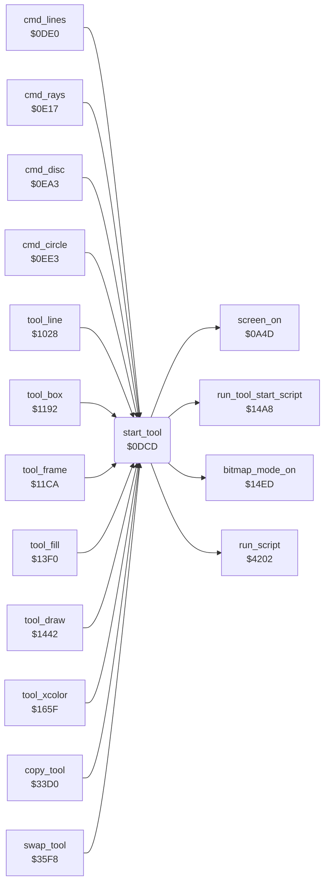

<!-- Generated by c64-docs from knowledge revision 20261025T214623.268-6ar633 and .c64-re-tools/local/generated/src/source-map.json. Do not edit: change the knowledge, generate the source again, then run docs.ts generate. -->
# tools/tool_start.asm: Tool Start

Range `$0DCD-$0DDF`. Source: [tools/tool_start.asm](../../../../src/tools/tool_start.asm). Index: [the reference](../../index.md).

## Routines

| Routine | Address | Reached from | Summary |
|---|---|---|---|
| [`start_tool`](tool_start.md#start_tool) | `$0DCD` | [`cmd_lines`](lines.md#cmd_lines), [`cmd_rays`](rays.md#cmd_rays), [`cmd_disc`](circle.md#cmd_disc), [`cmd_circle`](circle.md#cmd_circle), [`tool_line`](line_tool.md#tool_line), [`tool_box`](box_frame_tool.md#tool_box), [`tool_frame`](box_frame_tool.md#tool_frame), [`tool_fill`](fill_tool.md#tool_fill), [`tool_draw`](draw_tool.md#tool_draw), [`tool_xcolor`](xcolor_tool.md#tool_xcolor), [`copy_tool`](copy.md#copy_tool), [`swap_tool`](swap.md#swap_tool) | Starts a tool: runs the script at A/Y (the tool label), screen on, the script at $1dd3 ($14a8), background = picture_background ($5bff), then the bitmap screen ($14ed). |

## Call graph

A solid arrow is a call, a thick arrow a table entry. Rounded nodes are in this file.

## Details

### [`start_tool`](../../../../src/tools/tool_start.asm#L6) `$0DCD`

*routine*

Starts a tool: runs the script at A/Y (the tool label), screen on, the script at $1dd3 ($14a8), background = picture_background ($5bff), then the bitmap screen ($14ed).

- **Called from:** [`cmd_lines`](lines.md#cmd_lines), [`cmd_rays`](rays.md#cmd_rays), [`cmd_disc`](circle.md#cmd_disc), [`cmd_circle`](circle.md#cmd_circle), [`tool_line`](line_tool.md#tool_line), [`tool_box`](box_frame_tool.md#tool_box), [`tool_frame`](box_frame_tool.md#tool_frame), [`tool_fill`](fill_tool.md#tool_fill), [`tool_draw`](draw_tool.md#tool_draw), [`tool_xcolor`](xcolor_tool.md#tool_xcolor), [`copy_tool`](copy.md#copy_tool), [`swap_tool`](swap.md#swap_tool)
- **Calls:** [`run_script`](../script/interpreter.md#run_script), [`screen_on`](../init/screen.md#screen_on), [`run_tool_start_script`](tool_exit.md#run_tool_start_script), [`bitmap_mode_on`](../graphics/display_mode.md#bitmap_mode_on)
- **Reads:** [`background_colour`](../data/title_picture_5bff.md#background_colour)
- **Writes:** [`BGCOL0`](../../memory-map.md#BGCOL0)
