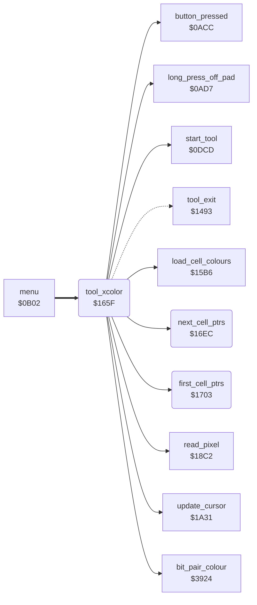

<!-- Generated by c64-docs from knowledge revision 20261024T063910.298-7zz1bw and .c64-re-tools/local/generated/src/source-map.json. Do not edit: change the knowledge, generate the source again, then run docs.ts generate. -->
# tools/xcolor_tool.asm: Xcolor tool

Range `$165F-$1713`. Source: [tools/xcolor_tool.asm](../../../../src/tools/xcolor_tool.asm). Index: [the reference](../../index.md).

## Call graph

A solid arrow is a call, a thick arrow a table entry, a dotted arrow a jump. Rounded nodes are in this file.

## Names

### [`tool_xcolor`](../../../../src/tools/xcolor_tool.asm#L6) `$165F`

*routine*

Xcolor command (code $0a). Shows the label XCOLOR (script $2ec5). On a button press, reads the colour of the pixel under the cursor into target_colour and replaces it with current_colour in all of the picture. When target_colour is the background colour, only the background colour ($d021 and background_colour) becomes current_colour, and the bitmap does not change. Else each screen nybble and colour RAM value that is target_colour becomes current_colour, also when current_colour is the background colour. A long press off the pad goes to tool_exit.

- **Entry of:** [`command_table`](../../tables.md#command_table)
- **Calls:** [`start_tool`](tool_start.md#start_tool), [`update_cursor`](../input/cursor.md#update_cursor), [`long_press_off_pad`](../input/buttons.md#long_press_off_pad), [`button_pressed`](../input/buttons.md#button_pressed), [`read_pixel`](../graphics/pixel.md#read_pixel), [`load_cell_colours`](../graphics/colour_slots.md#load_cell_colours), [`bit_pair_colour`](../graphics/bit_pair_colour.md#bit_pair_colour), [`first_cell_ptrs`](xcolor_tool.md#first_cell_ptrs), [`next_cell_ptrs`](xcolor_tool.md#next_cell_ptrs)
- **Jumps to:** [`tool_exit`](tool_exit.md#tool_exit)
- **Reads:** [`cursor_x`](../../memory-map.md#cursor_x), [`cursor_y`](../../memory-map.md#cursor_y), [`point_x0`](../../memory-map.md#point_x0), [`point_y0`](../../memory-map.md#point_y0), [`background_colour`](../data/title_picture_5bff.md#background_colour), [`current_colour`](../../memory-map.md#current_colour), [`cell_screen_ptr`](../../memory-map.md#cell_screen_ptr), [`target_colour`](../../memory-map.md#target_colour), [`temp_word`](../../memory-map.md#temp_word), [`cell_colour_ptr`](../../memory-map.md#cell_colour_ptr)
- **Writes:** [`point_x0`](../../memory-map.md#point_x0), [`point_y0`](../../memory-map.md#point_y0), [`cursor_x`](../../memory-map.md#cursor_x), [`cursor_y`](../../memory-map.md#cursor_y), [`target_colour`](../../memory-map.md#target_colour), [`BGCOL0`](../../memory-map.md#BGCOL0), [`background_colour`](../data/title_picture_5bff.md#background_colour), [`temp_word`](../../memory-map.md#temp_word)

### [`tool_xcolor_loop`](../../../../src/tools/xcolor_tool.asm#L10) `$1666`

*label*

- **Jumped to from:** [`tool_xcolor`](xcolor_tool.md#tool_xcolor) [`$1682`](../../../../src/tools/xcolor_tool.asm#L25), [`tool_xcolor`](xcolor_tool.md#tool_xcolor) [`$16A6`](../../../../src/tools/xcolor_tool.asm#L41), [`tool_xcolor`](xcolor_tool.md#tool_xcolor) [`$16E9`](../../../../src/tools/xcolor_tool.asm#L82)

### [`tool_xcolor_check_exit`](../../../../src/tools/xcolor_tool.asm#L19) `$1677`

*label*

- **Jumped to from:** [`tool_xcolor`](xcolor_tool.md#tool_xcolor) [`$166D`](../../../../src/tools/xcolor_tool.asm#L14)

### [`tool_xcolor_check_press`](../../../../src/tools/xcolor_tool.asm#L23) `$167F`

*label*

- **Jumped to from:** [`tool_xcolor`](xcolor_tool.md#tool_xcolor) [`$167A`](../../../../src/tools/xcolor_tool.asm#L21)

### [`tool_xcolor_replace_all`](../../../../src/tools/xcolor_tool.asm#L42) `$16A9`

*label*

- **Jumped to from:** [`tool_xcolor`](xcolor_tool.md#tool_xcolor) [`$169C`](../../../../src/tools/xcolor_tool.asm#L37)

### [`xcolor_replace_cell`](../../../../src/tools/xcolor_tool.asm#L45) `$16AE`

*label*

- **Jumped to from:** [`tool_xcolor`](xcolor_tool.md#tool_xcolor) [`$16E7`](../../../../src/tools/xcolor_tool.asm#L81)

### [`xcolor_check_high`](../../../../src/tools/xcolor_tool.asm#L54) `$16BE`

*label*

- **Jumped to from:** [`tool_xcolor`](xcolor_tool.md#tool_xcolor) [`$16B4`](../../../../src/tools/xcolor_tool.asm#L49)

### [`xcolor_check_colour_ram`](../../../../src/tools/xcolor_tool.asm#L72) `$16D8`

*label*

- **Jumped to from:** [`tool_xcolor`](xcolor_tool.md#tool_xcolor) [`$16C6`](../../../../src/tools/xcolor_tool.asm#L61)

### [`xcolor_next_cell`](../../../../src/tools/xcolor_tool.asm#L79) `$16E4`

*label*

- **Jumped to from:** [`tool_xcolor`](xcolor_tool.md#tool_xcolor) [`$16DE`](../../../../src/tools/xcolor_tool.asm#L76)

### [`next_cell_ptrs`](../../../../src/tools/xcolor_tool.asm#L84) `$16EC`

*routine*

Increments cell_screen_ptr and cell_colour_ptr. Z = 1 when cell_colour_ptr is $dbe8, after the last of the 1000 cells.

- **Called from:** [`tool_xcolor`](xcolor_tool.md#tool_xcolor) [`$16E4`](../../../../src/tools/xcolor_tool.asm#L80)
- **Reads:** [`cell_colour_ptr`](../../memory-map.md#cell_colour_ptr), [`cell_screen_ptr`](../../memory-map.md#cell_screen_ptr), [`cell_colour_ptr+1`](../../memory-map.md#cell_colour_ptr), [`cell_screen_ptr+1`](../../memory-map.md#cell_screen_ptr)
- **Writes:** [`cell_colour_ptr`](../../memory-map.md#cell_colour_ptr), [`cell_screen_ptr`](../../memory-map.md#cell_screen_ptr), [`cell_colour_ptr+1`](../../memory-map.md#cell_colour_ptr), [`cell_screen_ptr+1`](../../memory-map.md#cell_screen_ptr)

### [`next_cell_ptrs_check_end`](../../../../src/tools/xcolor_tool.asm#L90) `$16F6`

*label*

- **Jumped to from:** [`next_cell_ptrs`](xcolor_tool.md#next_cell_ptrs) [`$16F0`](../../../../src/tools/xcolor_tool.asm#L87)

### [`next_cell_ptrs_done`](../../../../src/tools/xcolor_tool.asm#L97) `$1702`

*label*

- **Jumped to from:** [`next_cell_ptrs`](xcolor_tool.md#next_cell_ptrs) [`$16FC`](../../../../src/tools/xcolor_tool.asm#L94)

### [`first_cell_ptrs`](../../../../src/tools/xcolor_tool.asm#L100) `$1703`

*routine*

Sets cell_screen_ptr to $5c00 and cell_colour_ptr to $d800, the first cell.

- **Called from:** [`tool_xcolor`](xcolor_tool.md#tool_xcolor) [`$16A9`](../../../../src/tools/xcolor_tool.asm#L43)
- **Writes:** [`cell_screen_ptr`](../../memory-map.md#cell_screen_ptr), [`cell_screen_ptr+1`](../../memory-map.md#cell_screen_ptr), [`cell_colour_ptr`](../../memory-map.md#cell_colour_ptr), [`cell_colour_ptr+1`](../../memory-map.md#cell_colour_ptr)
