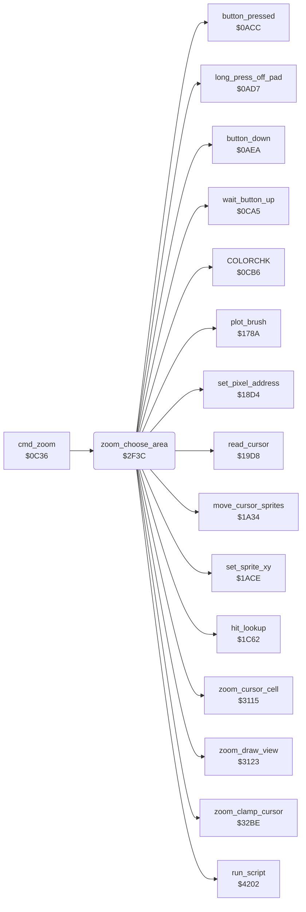

<!-- Generated by c64-docs from knowledge revision 20261024T063910.298-7zz1bw and .c64-re-tools/local/generated/src/source-map.json. Do not edit: change the knowledge, generate the source again, then run docs.ts generate. -->
# zoom/zoom_choose_area.asm: Zoom: Choose the Area

Range `$2F3C-$3114`. Source: [zoom/zoom_choose_area.asm](../../../../src/zoom/zoom_choose_area.asm). Index: [the reference](../../index.md).

## Call graph

A solid arrow is a call, a thick arrow a table entry, a dotted arrow a jump. Rounded nodes are in this file.

## Names

### [`zoom_choose_area`](../../../../src/zoom/zoom_choose_area.asm#L6) `$2F3C`

*routine*

Zoom: shows the picture with the zoom cursor (all 8 sprites) and waits for a press on the pad. The press selects the top row of the zoom window (the cursor row - 3, at most 16) and the addresses of the window in the bitmap, the screen colours and the colour RAM. A long press off the pad returns. The code continues at $3001.

- **Called from:** [`cmd_zoom`](../menu/menu.md#cmd_zoom) [`$0C39`](../../../../src/menu/menu.asm#L170)
- **Calls:** [`run_script`](../script/interpreter.md#run_script), [`wait_button_up`](../menu/menu.md#wait_button_up), [`read_cursor`](../input/cursor.md#read_cursor), [`long_press_off_pad`](../input/buttons.md#long_press_off_pad), [`zoom_clamp_cursor`](zoom_clamp.md#zoom_clamp_cursor), [`move_cursor_sprites`](../input/cursor.md#move_cursor_sprites), [`button_pressed`](../input/buttons.md#button_pressed), [`zoom_cursor_cell`](zoom_view.md#zoom_cursor_cell), [`zoom_draw_view`](zoom_view.md#zoom_draw_view), [`hit_lookup`](../input/hit_test_1c5a.md#hit_lookup), [`button_down`](../input/buttons.md#button_down), [`set_sprite_xy`](../input/cursor.md#set_sprite_xy), [`set_pixel_address`](../graphics/pixel.md#set_pixel_address), [`plot_brush`](../graphics/plot_brush.md#plot_brush), [`COLORCHK`](../menu/menu_0cb6.md#COLORCHK)
- **Reads:** [`background_colour`](../data/title_picture_5bff.md#background_colour), [`cursor_x`](../../memory-map.md#cursor_x), [`zoom_row`](../../memory-map.md#zoom_row), [`bitmap_row_addr_hi`](../graphics/pixel.md#bitmap_row_addr_hi), [`bitmap_row_addr`](../graphics/pixel.md#bitmap_row_addr), [`temp_word`](../../memory-map.md#temp_word), [`temp_byte`](../../memory-map.md#temp_byte), [`cursor_y`](../../memory-map.md#cursor_y), [`hit_code`](../../memory-map.md#hit_code), [`zoom_top`](../../memory-map.md#zoom_top), [`zoom_left`](../../memory-map.md#zoom_left)
- **Writes:** [`cursor_offset_x`](../../memory-map.md#cursor_offset_x), [`cursor_offset_y`](../../memory-map.md#cursor_offset_y), [`BGCOL0`](../../memory-map.md#BGCOL0), [`SPENA`](../../memory-map.md#SPENA), [`cursor_sprite_mask`](../../memory-map.md#cursor_sprite_mask), [`script_condition`](../../memory-map.md#script_condition), [`zoom_row`](../../memory-map.md#zoom_row), [`script_arg_stack_m1`](../data/workspace.md#script_arg_stack_m1), [`script_arg_stack`](../data/workspace.md#script_arg_stack), [`temp_word`](../../memory-map.md#temp_word), [`temp_byte`](../../memory-map.md#temp_byte), [`script_arg_stack_m2`](../data/workspace.md#script_arg_stack_m2), [`script_arg_stack_m3`](../data/workspace.md#script_arg_stack_m3), [`script_arg_stack_m4`](../data/workspace.md#script_arg_stack_m4), [`script_arg_stack_m5`](../data/workspace.md#script_arg_stack_m5), [`cursor_y`](../../memory-map.md#cursor_y), [`zoom_left`](../../memory-map.md#zoom_left), [`zoom_top`](../../memory-map.md#zoom_top), [`YXPAND`](../../memory-map.md#YXPAND), [`XXPAND`](../../memory-map.md#XXPAND), [`hit_table_ptr`](../../memory-map.md#hit_table_ptr), [`hit_table_ptr+1`](../../memory-map.md#hit_table_ptr), [`button_press_edge`](../../memory-map.md#button_press_edge), [`cursor_x`](../../memory-map.md#cursor_x)

### [`zoom_choose_loop`](../../../../src/zoom/zoom_choose_area.asm#L19) `$2F58`

*label*

- **Jumped to from:** [`zoom_choose_area`](zoom_choose_area.md#zoom_choose_area) [`$2F71`](../../../../src/zoom/zoom_choose_area.asm#L32), [`zoom_choose_area`](zoom_choose_area.md#zoom_choose_area) [`$2F76`](../../../../src/zoom/zoom_choose_area.asm#L34)

### [`zoom_choose_exit`](../../../../src/zoom/zoom_choose_area.asm#L27) `$2F6C`

*label*

- **Jumped to from:** [`zoom_choose_area`](zoom_choose_area.md#zoom_choose_area) [`$2F61`](../../../../src/zoom/zoom_choose_area.asm#L23)

### [`zoom_test_press`](../../../../src/zoom/zoom_choose_area.asm#L29) `$2F6D`

*label*

- **Jumped to from:** [`zoom_choose_area`](zoom_choose_area.md#zoom_choose_area) [`$2F69`](../../../../src/zoom/zoom_choose_area.asm#L26)

### [`zoom_limit_row`](../../../../src/zoom/zoom_choose_area.asm#L48) `$2F8E`

*label*

- **Jumped to from:** [`zoom_choose_area`](zoom_choose_area.md#zoom_choose_area) [`$2F7F`](../../../../src/zoom/zoom_choose_area.asm#L38)

### [`zoom_row_above_cursor`](../../../../src/zoom/zoom_choose_area.asm#L55) `$2F99`

*label*

- **Jumped to from:** [`zoom_choose_area`](zoom_choose_area.md#zoom_choose_area) [`$2F90`](../../../../src/zoom/zoom_choose_area.asm#L50)

### [`zoom_set_window`](../../../../src/zoom/zoom_choose_area.asm#L60) `$2F9E`

*label*

Puts the addresses of the window row on the argument stack ($4f47-$4f4c: colour RAM, screen, bitmap, high byte first) and the bitmap and screen offsets on the CPU stack. Moves the cursor Y into the window.

- **Jumped to from:** [`zoom_choose_area`](zoom_choose_area.md#zoom_choose_area) [`$2F96`](../../../../src/zoom/zoom_choose_area.asm#L54)

### [`zoom_open_view`](../../../../src/zoom/zoom_choose_area.asm#L115) `$3001`

*label*

Zoom: the place is chosen. zoom_left and zoom_top get the cursor point in the preview. The script zoom_view_script builds the zoom screen, zoom_draw_view draws the magnified view, and the hit table at $26e6 becomes active.

- **Jumped to from:** [`zoom_choose_area`](zoom_choose_area.md#zoom_choose_area) [`$2F8B`](../../../../src/zoom/zoom_choose_area.asm#L47)

### [`zoom_loop`](../../../../src/zoom/zoom_choose_area.asm#L134) `$3028`

*label*

Zoom main loop. No touch and a long press closes the zoom.

- **Jumped to from:** [`zoom_choose_area`](zoom_choose_area.md#zoom_choose_area) [`$303D`](../../../../src/zoom/zoom_choose_area.asm#L146), [`zoom_choose_area`](zoom_choose_area.md#zoom_choose_area) [`$306B`](../../../../src/zoom/zoom_choose_area.asm#L172), [`zoom_choose_area`](zoom_choose_area.md#zoom_choose_area) [`$30B5`](../../../../src/zoom/zoom_choose_area.asm#L213), [`zoom_choose_area`](zoom_choose_area.md#zoom_choose_area) [`$30D0`](../../../../src/zoom/zoom_choose_area.asm#L228)

### [`zoom_hit`](../../../../src/zoom/zoom_choose_area.asm#L139) `$3030`

*label*

Hit test of the cursor on the zoom screen. Code 1: the magnified view, code 2: the preview, code 3: the rows under the preview, $40-$4f: the colour cells.

- **Jumped to from:** [`zoom_choose_area`](zoom_choose_area.md#zoom_choose_area) [`$302B`](../../../../src/zoom/zoom_choose_area.asm#L136)

### [`zoom_to_other_cell`](../../../../src/zoom/zoom_choose_area.asm#L155) `$304D`

*label*

- **Jumped to from:** [`zoom_choose_area`](zoom_choose_area.md#zoom_choose_area) [`$3057`](../../../../src/zoom/zoom_choose_area.asm#L164)

### [`zoom_below_preview`](../../../../src/zoom/zoom_choose_area.asm#L158) `$3050`

*label*

Code 3: the cursor is under the preview. cursor_y becomes $2f, the last row that the view can start at. Then as code 2.

- **Jumped to from:** [`zoom_choose_area`](zoom_choose_area.md#zoom_choose_area) [`$304B`](../../../../src/zoom/zoom_choose_area.asm#L154)

### [`zoom_move_view`](../../../../src/zoom/zoom_choose_area.asm#L162) `$3054`

*label*

Code 2: while the button is down, the view starts at the cursor point in the preview (zoom_left, zoom_top), and zoom_draw_view draws it again.

- **Jumped to from:** [`zoom_choose_area`](zoom_choose_area.md#zoom_choose_area) [`$3047`](../../../../src/zoom/zoom_choose_area.asm#L152)

### [`zoom_paint`](../../../../src/zoom/zoom_choose_area.asm#L174) `$306E`

*label*

Code 1: sprite 6 frames the 4x4 block under the cursor. The cursor point becomes the picture point X = (cursor_x - 12) / 4 + zoom_left, Y = (cursor_y - 76) / 4 + zoom_top, and sprite 7 marks it in the preview. While the button is down, the brush plots that point and zoom_draw_view draws the view again.

- **Jumped to from:** [`zoom_choose_area`](zoom_choose_area.md#zoom_choose_area) [`$3043`](../../../../src/zoom/zoom_choose_area.asm#L149)

### [`zoom_paint_done`](../../../../src/zoom/zoom_choose_area.asm#L212) `$30B5`

*label*

- **Jumped to from:** [`zoom_choose_area`](zoom_choose_area.md#zoom_choose_area) [`$30A6`](../../../../src/zoom/zoom_choose_area.asm#L206)

### [`zoom_other_cell`](../../../../src/zoom/zoom_choose_area.asm#L215) `$30B8`

*label*

Other cells: sprite 6 follows the cursor X. A press gives hit_code to COLORCHK, which selects the colour of the cell.

- **Jumped to from:** [`zoom_choose_area`](zoom_choose_area.md#zoom_choose_area) [`$304D`](../../../../src/zoom/zoom_choose_area.asm#L156)

### [`zoom_other_done`](../../../../src/zoom/zoom_choose_area.asm#L227) `$30D0`

*label*

- **Jumped to from:** [`zoom_choose_area`](zoom_choose_area.md#zoom_choose_area) [`$30C9`](../../../../src/zoom/zoom_choose_area.asm#L224)

### [`zoom_close`](../../../../src/zoom/zoom_choose_area.asm#L230) `$30D3`

*label*

Closes the zoom. Pops the offsets that the choice pushed and gives the script zoom_close_script the addresses $a000 + offset, $c000 + offset and $c3e8 + offset of the zoomed rows. Then it clears the sprite expansion and runs the script at $1ea2, which copies the picture back from $a000 to $6000.

- **Jumped to from:** [`zoom_choose_area`](zoom_choose_area.md#zoom_choose_area) [`$302D`](../../../../src/zoom/zoom_choose_area.asm#L137)
