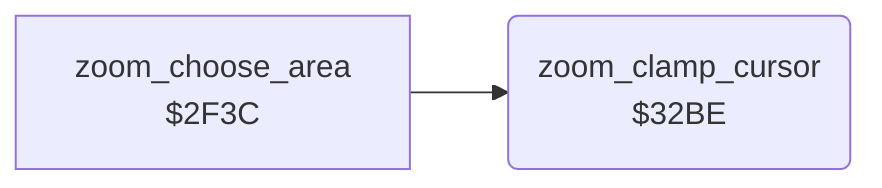

<!-- Generated by c64-docs from knowledge revision 20261024T063910.298-7zz1bw and .c64-re-tools/local/generated/src/source-map.json. Do not edit: change the knowledge, generate the source again, then run docs.ts generate. -->
# zoom/zoom_clamp.asm: Zoom: cursor limits

Range `$32BE-$32D6`. Source: [zoom/zoom_clamp.asm](../../../../src/zoom/zoom_clamp.asm). Index: [the reference](../../index.md).

## Call graph

A solid arrow is a call, a thick arrow a table entry, a dotted arrow a jump. Rounded nodes are in this file.

## Names

### [`zoom_clamp_cursor`](../../../../src/zoom/zoom_clamp.asm#L6) `$32BE`

*routine*

Keeps the cursor in the zoom limits: cursor_x at most $7e (when the pad is touched), cursor_y at most $af. X and Y are the cursor point.

- **Called from:** [`zoom_choose_area`](zoom_choose_area.md#zoom_choose_area) [`$2F63`](../../../../src/zoom/zoom_choose_area.asm#L24), [`zoom_choose_area`](zoom_choose_area.md#zoom_choose_area) [`$305E`](../../../../src/zoom/zoom_choose_area.asm#L167)
- **Reads:** [`cursor_x`](../../memory-map.md#cursor_x), [`cursor_y`](../../memory-map.md#cursor_y)
- **Writes:** [`cursor_x`](../../memory-map.md#cursor_x), [`cursor_y`](../../memory-map.md#cursor_y)

### [`zoom_clamp_y`](../../../../src/zoom/zoom_clamp.asm#L14) `$32CC`

*label*

- **Jumped to from:** [`zoom_clamp_cursor`](zoom_clamp.md#zoom_clamp_cursor) [`$32C2`](../../../../src/zoom/zoom_clamp.asm#L9), [`zoom_clamp_cursor`](zoom_clamp.md#zoom_clamp_cursor) [`$32C6`](../../../../src/zoom/zoom_clamp.asm#L11)

### [`zoom_clamp_done`](../../../../src/zoom/zoom_clamp.asm#L20) `$32D6`

*label*

- **Jumped to from:** [`zoom_clamp_cursor`](zoom_clamp.md#zoom_clamp_cursor) [`$32D0`](../../../../src/zoom/zoom_clamp.asm#L17)
