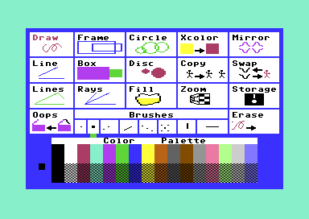
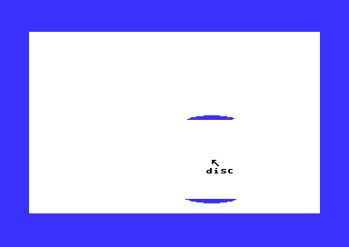

# The KoalaPad input

Koala Painter v2 has one input device, the KoalaPad. The pad is a touch tablet with two buttons, and it connects to control port 1. The player moves the stylus on the pad, and a cursor of sprites follows it on the menu and on the picture. A button press selects a menu cell, or it draws on the picture. The pad gives noisy analogue values, so the program smooths them and ignores a reading that still changes. When the stylus is not on the pad, a button press changes between the menu and the picture. A short tick sounds about two times each second until the stylus touches the pad again.

**Conventions.**
- Addresses are C64 addresses. Names are the names of the knowledge.
- An *interrupt* is one CIA 1 timer interrupt. The timer counts 17034 cycles (latch `$4289`): about 58 interrupts each second on a PAL C64, 60 on an NTSC C64.
- A *read* is one call of `read_cursor`. The main code makes the reads, not the interrupt.
- *Pad units* are the values of POT X (`$D419`) and POT Y (`$D41A`), 0-255. *Screen units* are the multicolour pixels of the picture: X 0-`$9F`, Y 0-`$C7`.
- A *sample* is one pad value in a buffer of 5 samples. Each axis has one buffer.
- *No touch* is a read that gives `cursor_x` = `$FF`. *Off the pad* is the case of no touch where the smoothed pad Y is `$E6` or more.
- The *long press* is the gesture that `long_press_off_pad` tests: 16 reads off the pad, then a button down. The button does not need a long hold.
- **Observed** marks a fact that a run showed. **Code** marks a fact from the code only. **Conclusion** marks an interpretation.

The emulator of the project gives no paddle values. The runs write the pad position into memory through a test hook on the joystick routine. Thus no run tested the real POT registers or the smoothing of real noise (**Observed**).

## How it works

The work has two halves. The interrupt reads the hardware into buffers and flags. The main code calls `read_cursor` when it needs a position, and that read changes the buffers into a cursor position.

~~~mermaid
flowchart TB
  T["CIA 1 timer interrupt (irq_handler)"] --> P["Read POT X and POT Y, shift the samples (read_pad_registers)"]
  T --> B["Read the 2 buttons: button_held, button_press_edge"]
  T --> S["Tick sound while off the pad (play_beep)"]
  R["A read (read_cursor)"] --> M["Smooth the samples, test the spread (sample_pad)"]
  P -. "5 samples of each axis" .-> M
  M --> N{"Touch?"}
  N -- no --> O["cursor_x = $FF, sprites off, count off_pad_count"]
  N -- yes --> C["Pad units to screen units (pad_to_screen)"]
  C --> D["Move the cursor sprites (move_cursor_sprites)"]
~~~

[`read_cursor` `$19FB`](../src/input/cursor.asm#L58) does these steps, in the order of the code:

1. **It smooths the samples.** It calls `sample_pad` through the JMP table entry `$0906`. The result is a position in pad units, or one of the two marks 1/1 and 0/0 (see below). (**Code**)
2. **It tests for off the pad.** When pad Y is `$E6` or more, it sets `off_pad_beep_on` and increments `off_pad_count` up to 16. Then it gives no touch. (**Code**)
3. **It stops the tick.** Each other read calls `stop_beep`, which clears `off_pad_beep_on` and stops SID voice 1. (**Code**)
4. **It tests the low corner.** When X and Y are both below 10, it gives no touch. This test also catches the marks 1/1 and 0/0. `off_pad_count` keeps its value. (**Code**)
5. **It accepts the touch.** It clears `off_pad_count` and calls `pad_to_screen`. In Mirror mode it also keeps the position folded into the upper left quarter. It writes `cursor_x` and `cursor_y`, and it copies `cursor_sprite_mask` to `$D015`. (**Code**)

### The interrupt reads the pad

[`irq_handler` `$0943`](../src/irq/irq.asm#L6) has two paths. In the menu, the raster path splits the screen and reads no input. The timer path calls UDTIM and [`read_pad_registers` `$09F8`](../src/irq/irq.asm#L108). Then it reads the buttons, flashes the menu, plays the tick and flashes the cursor colour. At the end it calls `read_pad_registers` a second time. Thus each interrupt adds two samples to each buffer. (**Code**)

`read_pad_registers` writes POT X into `pad_x_raw` and POT Y into `pad_y_raw`. Then it moves each buffer one byte down. The raw byte follows the buffer in memory, so the new value becomes the newest sample. `pad_read_enable` must be set: `sample_pad` sets it, and `SETFLASH` clears it after a menu choice. (**Code**) The SID makes a new POT value each 512 cycles. **Conclusion**: the two reads of one interrupt often give the same value, so the 5 samples cover about 3 different values.

The raster path also reads `$DC0D`, the interrupt flags of CIA 1. **Conclusion**: when the timer ends during a raster interrupt, this read clears the timer interrupt. Then the program loses the timer part of that interrupt: the pad, the buttons and the clock. This can occur only while the menu shows, because only the menu starts the raster interrupt.

### The smoothing filter

[`smooth_samples` `$1D64`](../src/input/pad_smoothing.asm#L73) works on a copy of the 5 samples in `smooth_buffer`. Each step puts (s[i] + 2 × s[i+1] + s[i+2]) / 4 into s[i]. The first pass makes 3 steps and the second pass makes 1 step. The result in s[0] is the 5 samples with the weights 1, 4, 6, 4, 1, divided by 16. Each step drops the remainder. (**Code**)

[`sample_pad` `$1CF7`](../src/input/pad_smoothing.asm#L6) then compares the result with the raw value, which is the newest sample:

- A difference of 5 or more on X or on Y is a *spread*. Then `cursor_x` and `cursor_y` become 1. When X has the spread, the routine does not smooth Y. (**Code**)
- When both results are below 5, both become 0. (**Code**)

An example with the samples 100, 100, 100, 100, 140, oldest first. The first pass gives 100, 100, 110. The second pass gives (100 + 200 + 110) / 4 = 102. The difference from 140 is 38, so this read gives the mark 1/1 (**Code**).

The newest sample has the weight 1/16, and the centre sample has the weight 6/16. For a steady move of d units in each sample, the result is the centre sample and the difference is 2 × d. **Conclusion**: a move of 3 or more units in each sample gives a spread. Thus the filter ignores the readings while the stylus lands, lifts or moves fast. The cursor then stays where it was.

### The calibration to screen units

[`pad_to_screen` `$1BCE`](../src/input/pad_to_screen.asm#L6) changes pad units into screen units. X = (pad X - 20) × 4 / 5, and Y = pad Y - 20. A value out of range becomes the limit. (**Code**)

| Pad value | Screen X | Screen Y |
|---|---|---|
| 0-20 | 0 | 0 |
| 120 | 80 | 100 |
| 219 | 159 (`$9F`) | 199 (`$C7`) |
| 220-255 | `$9F` | `$C7` (only up to 229, because `$E6` is off the pad) |

The runs never executed the limit branches (**Observed**). **Conclusion**: the active area of the pad is a square of 200 × 200 pad units. The factor 4/5 fits 200 units on the 160 wide pixels of the picture.

### No touch

Three cases give no touch. In each case `read_cursor` writes `$FF` into `cursor_x` and 0 into `$D015`, so the cursor disappears. The runs show `cursor_x` = `$FF` while the hook gives no touch (**Observed**).

| Case | Test | `off_pad_count` | Tick |
|---|---|---|---|
| Off the pad | Smoothed pad Y is `$E6` or more | +1, up to 16 | On |
| Spread | `sample_pad` gives the mark 1/1 | No change | Off |
| Low corner | X and Y below 10, also the mark 0/0 | No change | Off |

[`move_cursor_sprites` `$1A5F`](../src/input/cursor.asm#L116) does nothing when `cursor_x` is `$FF`. The tools also test `cursor_x` = `$FF` and skip the drawing. Only the case "off the pad" counts towards the long press. (**Code**)

## The two buttons

The KoalaPad buttons use the joystick lines left and right of port 1. The timer path reads `$DC01` bits 2 and 3, and a bit at 0 is a button down. Both buttons give the same flags: the program has no different function for the left and the right button. (**Code**)

- `button_held` is 1 while a button is down.
- `button_press_edge` becomes 1 at the first interrupt with a button down. [`button_pressed` `$0ACF`](../src/input/buttons.asm#L6) gives it and clears it.

Draw does not use the edge. It copies `button_held` into `button_press_edge` and draws while the button is down. The switch `CRACK_MAM` changes the button test at `$0998`: the MAM release reads fire on port 1 and on port 2. (**Code**)

### A press during the release wait

The menu loop calls [`wait_button_up` `$0CA8`](../src/menu/menu.asm#L228) at its start and after each hit test that finds no cell:

~~~text
wait_button_up:
    while button_held <> 0: repeat      ; no read: the cursor stops
    button_press_edge = 0
~~~

This wait loses a press in two ways (**Code**):

1. **The press starts in a pass where the hit test finds no cell.** An example is a press just before the cursor reaches the cell. The wait holds the program until the release, and then it clears the edge. During the wait, the cursor sprites do not move.
2. **The press starts during the last instructions of the wait.** The interrupt sets `button_held` and `button_press_edge` after the load of `button_held`. Then the store of 0 clears the edge. The button is down, but `button_pressed` gives no press until a new press.

The recordings of the runs must press the button after the program leaves the release wait. An earlier press has no effect (**Observed**). The Storage screen has no release wait in its loop, so it does not have this problem (**Code**).

## The change between the menu and the picture

[`long_press_off_pad` `$0ADA`](../src/input/buttons.asm#L15) gives 1 when a button is down and `off_pad_count` is 16. Then it clears `off_pad_count`. The same gesture works in both directions. A run showed the change between the menu and the picture with this gesture (**Observed**).

A press on the cell of a drawing tool (codes 1-`$0A`) only selects the tool. `SETFLASH` writes `current_command`, and the cell flashes. The picture shows only after a long press. A press on Copy, Zoom, Mirror, Swap, Storage or Oops starts the command at once. The Erase command needs two presses. (**Code**)

[`menu_loop` `$0B85`](../src/menu/menu.asm#L67) tests the long press only when the read gave no touch. With a button down and fewer than 16 reads, the loop goes into the release wait. Thus the player must lift the stylus first and then press. (**Code**)

Each tool loop calls `update_cursor` and `long_press_off_pad`. On the long press, a tool with a band line first erases the line. Then it jumps to [`tool_exit` `$1495`](../src/tools/tool_exit.asm#L6), which draws the menu again. (**Code**)

~~~mermaid
stateDiagram-v2
  state "Release wait" as Wait
  state "Menu hit test" as Hit
  state "A tool or a command screen" as Cmd
  [*] --> Wait
  Wait --> Hit: no button down
  Hit --> Hit: on a cell, no press
  Hit --> Wait: touch, no cell
  Hit --> Wait: no touch, no long press
  Hit --> Cmd: long press
  Hit --> Cmd: press on a command cell
  Cmd --> Wait: long press, or end of the command
~~~

| State | Condition | Next state | Code |
|---|---|---|---|
| Release wait | `button_held` = 0 | Menu hit test | `wait_button_up` |
| Menu hit test | Cell under the cursor, no edge | Menu hit test | `menu_item_hit` |
| Menu hit test | Touch, no cell | Release wait | `menu_hit_loop` |
| Menu hit test | No touch, no long press | Release wait | `menu_hit_loop` |
| Menu hit test | Long press | The tool of `current_command` on the picture | `menu_to_picture` |
| Menu hit test | Press on a cell of the codes `$0B-$10`, or a second press on Erase | The command | `SETFLASH` |
| A tool | Long press | Release wait, after the menu shows again | `tool_exit` |

`run_command` also waits for the release before it starts the tool. Thus the press that made the change does not draw. (**Code**)

## The cursor sprites and the tool label

The cursor is a block of 6 sprites plus 2 sprites for the tool label. [`init_cursor` `$19AB`](../src/input/cursor.asm#L6) sets the sprite pointers `$60-$67` at `$5FF8`. It clears the data and draws the arrow into sprite 1. `move_cursor_sprites` puts the sprites at X0 = 2 × `cursor_x` + 18 and Y0 = `cursor_y` + 25. (**Code**)

| Sprite | Data | X | Y | Content |
|---|---|---|---|---|
| 0 | `$5800` | X0 | Y0 | Clear |
| 1 | `$5840` | X0 | Y0 + 21 | The arrow, or the mark of the brush |
| 2, 3 | `$5880`, `$58C0` | X0 + 24 | Y0, Y0 + 21 | Clear |
| 4, 5 | `$5900`, `$5940` | X0 + 48 | Y0, Y0 + 21 | Off, except in Zoom |
| 6 | `$5980` | X0 | Y0 + 33 | Letters 1-3 of the label |
| 7 | `$59C0` | X0 + 24 | Y0 + 33 | Letters 4-6 of the label |

`cursor_sprite_mask` is `$CF`, so the cursor shows sprites 0-3, 6 and 7. Swap shows only the label (`$C0`). Zoom shows all 8 sprites with other offsets. (**Code**)

Each tool starts with A/Y = the address of its label script, and [`start_tool` `$0DD0`](../src/tools/tool_start.asm#L6) runs that script. The menu clears the label, so the menu cursor has no label. For Draw, Line, Lines, Frame, Circle and Rays, `run_command` replaces the arrow with the mark of the brush. It uses the table [`brush_cursor_scripts` `$1BBE`](../src/script/cursor_scripts.asm#L50) with 8 scripts. The other tools keep the arrow. (**Code**)

Every 2 interrupts, `irq_cursor_colour` calls `flash_cursor`. That routine changes all 8 sprites between black and light grey. **Conclusion**: the cursor stays visible on each colour of the picture.

## The idle tick

While the stylus is off the pad, the program plays a short tick. `read_cursor` sets `off_pad_beep_on` at `$4F6A`. The timer path then counts `idle_tick_timer` at `$4F6B` down from 32. At 0 it calls [`play_beep` `$431D`](../src/sound/beep.asm#L6) and loads 32 again. Thus a tick comes each 33 interrupts: 0.57 seconds on PAL, 0.55 on NTSC. (**Code**)

`play_beep` starts a triangle wave on SID voice 1 at frequency `$2EF0`. It sets volume 14, attack 0, decay 3 and sustain 0. The first read with a touch calls `stop_beep`, which stops the gate. Version 1 has no SID code at all. (**Code**) **Conclusion**: the tone is about 706 Hz on PAL. It fades in about 72 ms.

The program reads some of its variables at `$4F00-$4F7F` before it writes them. `off_pad_beep_on` is one of them. A replay is the same as the original only with the power-on pattern of the C64 in this RAM (**Observed**). **Conclusion**: with this pattern, `$4F6A` is `$FF`, so the tick countdown runs from the first interrupt.

## The data

The sample buffers are in zero page. The raw byte of each axis follows its buffer, and the shift copies it into the buffer as the newest sample. (**Code**)

| Address | Name | Content |
|---|---|---|
| `$22-$26` | `pad_y_samples` | 5 POT Y samples, oldest first |
| `$27` | `pad_y_raw` | The last POT Y value, also the newest Y sample |
| `$56-$5A` | `smooth_buffer` | The work copy of one buffer. The result is in `$56`. |
| `$5B-$5F` | `pad_x_samples` | 5 POT X samples, oldest first |
| `$60` | `pad_x_raw` | The last POT X value, also the newest X sample |

The reference gives each variable of the input: [cursor](reference/modules/input/cursor.md), [buttons](reference/modules/input/buttons.md), [smoothing](reference/modules/input/pad_smoothing.md) and [interrupt](reference/modules/irq/irq.md).

## The worked example: the label "disc"

[`label_disc` `$2F19`](../src/text/cursor_labels.asm#L63) is the label script of the Disc tool. It has 14 bytes: `0E 08 20 50 48 50 98 50 18 50 08 79 2E FF`. Each glyph address is `$5000` + 8 × the screen code of the letter.

| Bytes | Meaning |
|---|---|
| `0E 08` | Op 14: push the next 8 bytes on the argument stack. |
| `20 50` | `$5020`: screen code 4, "d". |
| `48 50` | `$5048`: screen code 9, "i". |
| `98 50` | `$5098`: screen code 19, "s". |
| `18 50` | `$5018`: screen code 3, "c". |
| `08 79 2E` | Op 8: call the script `label_put_four` at `$2E79`. |
| `FF` | End of the script. |

`label_put_four` sets the destination to `$5983`, `$5984`, `$5985` and `$59C3`. For each one, it copies 8 bytes of a glyph, one byte in each sprite row. `$5983` is row 1, byte 0 of sprite 6. Thus "d", "i" and "s" fill the 3 columns of sprite 6, and "c" fills column 1 of sprite 7. (**Code**) The screen of the Disc tool shows "disc" under the arrow (**Observed**).

## Still open

- The program does not write the paddle select bits 6-7 of `$DC00`. It uses the value that the KERNAL leaves. A run with paddle values in the emulator can show which port the SID reads.
- The effect of real pad noise on the filter is not known. A run with a real KoalaPad, or with recorded POT values, can show how often a read gives the spread.
- No run showed the lost timer interrupt in the raster path. A run with a breakpoint at the raster path and a test of the CIA 1 flags can show how often it occurs.
