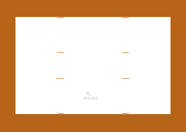

# Koala Painter v2: pixels, colours and buffers

Each tool of Koala Painter paints into one multicolour bitmap of 160 x 200 pixels. The program does not keep a colour for each pixel. It keeps a 2-bit value for each pixel and 3 colours for each block of 4 x 8 pixels. Thus a new colour in a full block must take the place of an old colour. The user sees this as the colour clash: some pixels that the brush did not touch change their colour. This page tells how the program finds the bitmap byte of a pixel and how it chooses the colour slot. It tells how the brushes, the lines, the circles and Mirror send their points to one plot routine. It also gives the memory map of the picture and of its copies for the menu, for Oops, for Swap and for Zoom.

**Conventions.**
- Addresses are C64 addresses. Names are the names of the knowledge.
- A *pixel* is one multicolour pixel: 2 bits of the bitmap, two hires pixels wide on the screen. X is 0-159, Y is 0-199.
- A *cell* is one block of 4 x 8 pixels, the size of one character of the screen. The picture has 40 x 25 cells.
- A *pixel value* is the 2-bit value of a pixel: 0 is the background, 1-3 select a *colour slot* of the cell.
- A *point* is one position that a tool gives to the plot code. A brush paints one or more pixels around a point.
- A *band line* is the line, frame or circle that follows the pen before the last press. The program draws it with XOR.
- **Observed** marks a fact that a run showed. **Code** marks a fact from the code only. **Conclusion** marks an interpretation.

## How it works

~~~mermaid
flowchart TB
  T["A tool: Draw, Line, Frame, Circle, Disc"] --> L["Walk the line or the circle (draw_line, circle_run)"]
  L --> P["Select the pixel of the point (set_pixel_address)"]
  P --> V["Jump through plot_vector"]
  V --> B["Brush: each (dx,dy) of the list (plot_brush)"]
  V --> X["Band: invert the pixel (invert_pixel_mirrored)"]
  B --> D["Colour of the dither pattern (plot_dither_pixel)"]
  D --> S["Find or take a colour slot (get_colour_slot)"]
  S --> W["Write the 2 bits (plot_pixel_bits)"]
~~~

1. **A tool gives points.** The line routine and the circle walk call [`line_plot_point` `$2811`](../src/graphics/bresenham_line.asm#L94) for each point. It selects the pixel and jumps through `plot_vector` at `$52/$53` (**Code**).
2. **The vector selects the plot.** The vector holds `$17AD`, the brush plot, or `$18C2`, the XOR plot of the band lines (**Code**).
3. **The brush plot paints in colour.** For each pixel of the brush, it gets the colour of the dither pattern and the colour slot of that colour in the cell. It writes the slot as the pixel value (**Code**).
4. **The XOR plot changes no colour.** It inverts the 2 bits of the pixel. A second draw of the same band puts back the pixels (**Code**).

### The pixel grid and the pixel address

The bitmap is at `$6000-$7F3F`, in VIC bank 1. The screen of the picture is at `$5C00`, and it holds slots 1 and 2 of each cell. The colour RAM at `$D800` holds slot 3 (**Code**).

[`set_pixel_address` `$18F7`](../src/graphics/pixel.asm#L57) takes X = x and Y = y in the registers. It sets `pixel_ptr` (high byte at `$83`), `pixel_mask` and `pixel_pair_index`. The address has three parts:

1. The character row. `(y >> 2) AND $FE` is the offset of a word in [`bitmap_row_addr` `$1979`](../src/graphics/pixel.asm#L136). The 25 words are `$6000 + row * $140`.
2. The line in the cell. The routine adds `y AND 7`.
3. The column. The routine adds `(x AND $FC) * 2`, because a column of 4 pixels has 8 bytes.

The pixel `x AND 3` selects the AND mask in [`pixel_clear_masks` `$1975`](../src/graphics/pixel.asm#L133): `$3F`, `$CF`, `$F3`, `$FC`. Pixel 0 of a byte is the left pixel, in bits 7-6. `pixel_pair_index` is `4 - (x AND 3)`. `plot_pixel_bits` shifts the new value left by 2 bits `pixel_pair_index - 1` times (**Code**).

The routine keeps the row address when Y does not change. When X and Y both stay the same, it returns at once (**Code**). [`read_pixel` `$18E5`](../src/graphics/pixel.asm#L40) uses the same address to read a pixel value back.

### Cells and colour slots

A cell can show 4 colours: the background and its 3 slots. Slot 1 is the high nybble of the screen byte, slot 2 the low nybble, and slot 3 the colour RAM byte. The background is `background_colour` at `$E1`. Xcolor changes it. Get, Oops and Swap load it with the rest of a picture (**Code**).

[`get_colour_slot` `$1525`](../src/graphics/colour_slots.asm#L6) gives the pixel value for `current_colour` in the cell of `pixel_ptr`. It does these steps:

1. When `current_colour` is the background colour, it gives 0. The cell colours do not change. No recording reached this step (**Observed** in the coverage of the runs).
2. It reads the 3 slots of the cell into `cell_colour_1-3` (`$E2-$E4`) with `load_cell_colours`.
3. When a slot has `current_colour`, it gives the number of that slot.
4. Else it counts the pixels of the values 1, 2 and 3 in the 8 bytes of the cell. The slot with the fewest pixels gets `current_colour`. When two counts are equal, the higher slot wins.
5. `write_cell_colours` writes the 3 slots back to the screen byte and the colour RAM. The routine gives the number of the new slot (**Code**).

~~~text
if colour = background: return 0
if colour = slot1: return 1 ... slot3: return 3
count n1, n2, n3 in the 32 pixels of the cell
if n1 < n2: s = (n1 < n3) ? 1 : 3
else:       s = (n2 < n3) ? 2 : 3
slot[s] = colour, write the cell colours, return s
~~~

Step 4 is the colour clash. A slot with pixels in it can lose its colour, and all of its pixels in the cell then show the new colour. A slot with 0 pixels is free, so the clash starts only with a fourth colour in a cell (**Code**).

`load_cell_colours` keeps the cell of its last read in `cell_cache_addr` (`$0800/$0801`). It reads the screen and the colour RAM only for a new cell. Only [`menu` `$0B05`](../src/menu/menu.asm#L6) clears this cache, one time after the start, with the value `$0606` (**Code**). Oops, Swap and Get change the cell colours without this code. **Conclusion**: after such a command, the cache can hold the old colours of the last cell. A new slot in that cell then writes the old colours back.

[`plot_brush` `$17AD`](../src/graphics/plot_brush.asm#L6) ends with `get_colour_slot` for the centre point. No caller uses the result. Brush 2 has no pixel at its centre. **Conclusion**: this call can give `current_colour` a slot in a cell where the brush painted nothing. In a full cell, the pixels of the smallest slot then change colour.

### Dithered colours

The menu has 16 plain colours (codes `$40-$4F`) and 16 dithered colours (`$50-$5F`). `select_colour` writes the colour to the border, to `current_colour` and to the 4 bytes of [`dither_colours` `$03FC`](../src/constants.asm#L128). A dithered colour puts `mix_colour`, the last plain colour, into bytes 1 and 2 (**Code**).

[`plot_dither_pixel` `$1841`](../src/graphics/brush_plot.asm#L41) paints a pixel in `dither_colours[(y AND 1) * 2 + (x AND 1)]`. Thus a dithered colour is a 2 x 2 checker pattern of the new colour and `mix_colour`. The pixel position selects the colour, not the brush. A dithered stroke needs 2 slots in each cell that it touches. Thus it causes the colour clash sooner than a plain colour (**Conclusion**).

### Brushes

A brush is a list of signed (dx, dy) byte pairs from the centre. The byte `$80` ends the list. [`brush_table` `$0DC0`](../src/data/menu_tables.asm#L26) points to the 8 lists at `$1868-$18B7`. `select_brush` puts the address of the list into `brush_ptr` `$8A/$8B` (**Code**).

| Brush | Points | Shape |
|---|---|---|
| 0 | 1 | One pixel |
| 1 | 6 | A block of 2 x 3 pixels |
| 2 | 2 | Two pixels on a diagonal, (-1,1) and (2,-2) |
| 3 | 5 | A diagonal line |
| 4 | 3 | Three pixels on a diagonal, 3 pixels apart |
| 5 | 6 | Two pixels at the centre, four at the corners |
| 6 | 6 | A vertical line |
| 7 | 7 | A horizontal line |

`plot_brush` takes the centre from `pixel_x` and `pixel_y`, so the caller selects the pixel first. It adds each pair to the centre. It does not plot a pixel above `max_x` or `max_y`. A negative result wraps to a value above 159, so the same test removes it (**Code**). Fill and Disc use brush 0 for their pixels.

### The plot routines and the plot vector

All the painting goes through a few routines in `$17AD-$1974`. The tools select one through `plot_vector`:

| Routine | Address | What it does |
|---|---|---|
| `plot_brush` | `$17AD` | The brush in the dither colours, 1 or 4 times for each pixel |
| `plot_dither_mirrored` | `$1808` | `plot_dither_pixel` at the 4 Mirror points |
| `plot_dither_pixel` | `$1841` | One pixel: dither colour, colour slot, `plot_pixel_bits` |
| `plot_pixel_bits` | `$18B8` | Writes a 2-bit value with `pixel_mask` |
| `invert_pixel_mirrored` | `$18C2` | The XOR plot: `invert_pixel` at 1 or 4 points |
| `invert_pixel` | `$18CA` | `EOR` of the 2 bits of the pixel with `%11` |

`draw_line_brush`, `brush_rect`, `circle_brush` and `flood_fill` put `$17AD` into the vector. `draw_line_xor`, `xor_rect` and `circle_xor` put `$18C2` there (**Code**). The copy code uses `$52/$53` as a temporary pointer too.

### Lines

[`draw_line` `$279E`](../src/graphics/bresenham_line.asm#L20) draws from (`shape_x0`, `shape_y0`) to (`shape_x1`, `shape_y1`). A vertical or horizontal line plots each point, both ends too. Another line uses Bresenham with a 16-bit error in `line_error`. The routine starts the error at `2 * dy - dx` for an X-major line, and at `2 * dx - dy` for a Y-major line. It plots `dx` or `dy` points, so a slanted line does not plot its end point (**Code**). The Draw tool starts each segment at the end of the last one, so the end gets its pixel from the next segment (**Conclusion**).

When `line_fill_corners` is not 0, each diagonal step first plots the corner point. The line then has no diagonal gaps. The brush choice sets the flag for brushes 2, 3, 4, 6 and 7, and clears it for brushes 0, 1 and 5 (**Code**).

A band line is an XOR line. The XOR changes pixel value v to 3 - v, so the band shows in the colours that the cells already have. A second draw at the same place puts back the pixels. Thus Line, Frame, Rays and Circle remove the old band before they draw the new one (**Code**). While a band shows, the tools keep the selected colour in `saved_colour` and put the background colour into `current_colour` (**Code**).

`draw_rect` starts its 2nd, 3rd and 4th side one pixel after the corner, so that two sides do not invert the same pixel. The 4th side ends on the first corner, and the 1st side also plots that pixel. **Conclusion**: the band frame does not show its first corner pixel.

### The circle walk

[`circle_run` `$3BF6`](../src/graphics/circle.asm#L124) walks one quarter of a circle with the midpoint method. `circle_radius` takes the second shape point as the centre. The radius is the X distance plus the Y distance of the two points, at most `max_y`. The Y offset starts at the radius, the X offset at 0 and the error at `2 - 2 * radius` (**Code**). The knowledge names the bytes of the walk after their use in the line routine: `line_dx/line_dy` hold the Y offset and `line_x_negative/line_y_negative` the X offset.

The walk calls a second vector, `line_error` at `$42/$43`, for each step. [`circle_plot_points` `$3D49`](../src/graphics/circle_plot_3d3c.asm#L18) plots the 4 points of an outline. [`circle_plot_spans` `$3CDE`](../src/graphics/circle_plot.asm#L6) draws two horizontal spans for a disc. When the Y offset is 0, the routine removes the return address, and the walk stops (**Code**).

`circle_coordinates` scales the X offset by 3/4: the points are `x0 +- (3 * dx) / 4` and `y0 +- dy`. A point below 0 becomes `$FE`, a point above the limit `$FF`, and the plot routines skip or clip it (**Code**). A pixel is two hires pixels wide on the screen. **Conclusion**: the half width of a circle on the screen is 1.5 times its half height.

### Mirror

Mirror mode sets [`mirror_mode` `$4F60`](../src/constants.asm#L160) to 1 and the limits to the upper left quarter: `max_x` = 79 and `max_y` = 99. `update_cursor` moves the cursor sprites to the pen. Then it folds `cursor_x` and `cursor_y` into that quarter (**Code**). For each pixel, `plot_dither_mirrored` and `plot_xor_mirrored` plot 4 points: (x, y), (159 - x, y), (159 - x, 199 - y) and (x, 199 - y). The limits cut a brush at the centre lines of the picture (**Code**).

The dither index comes from each mirror point. 159 - x has the other parity of x, and 199 - y the other parity of y. Thus the mirror points in X and in Y get the other colour of a dithered pair (**Code**).

The Mirror recording with the Disc label: each stroke shows four times, mirrored on the two centre lines (**Observed**).

## The data

### The cell colours in zero page

The four colours of the current cell are in order in zero page: [`background_colour` `$E1`](../src/constants.asm#L110), then slots 1-3 at `$E2-$E4`. Thus `LDA background_colour,X` gives the colour of pixel value X. Fill uses this access (**Code**). `count_pixels_1-3` at `$E5-$E7` hold the counts of step 4.

### The memory map of the picture buffers

The picture has the layout of the Koala file, described on [../../docs/koala_format.md](../../docs/koala_format.md). The menu uses the screen at `$5C00` and the colour RAM for its own text. Thus `save_colours_script` copies the colours to `$C000` before the menu shows, and `show_picture_script` puts them back (**Code**).

| Buffer | Bitmap | Screen colours | Colour RAM | Background | Memory |
|---|---|---|---|---|---|
| Picture, while a tool runs | `$6000-$7F3F` | `$5C00-$5FE7` | `$D800-$DBE7` | `$E1`, `$D021` | RAM, colour RAM |
| Picture, while the menu shows | `$6000-$7F3F` | `$C000-$C3E7` | `$C3E8-$C7CF` | `$C7D0` | RAM |
| Undo (Oops) | `$8000-$9F3F` | `$D000-$D3E7` | `$D400-$D7E7` | `$D7E8` | colours under the I/O |
| Second picture (Swap) | `$E000-$FF3F` | `$D800-$DBE7` | `$DC00-$DFE7` | `$DFE8` | under the KERNAL and the I/O |
| Zoom copy | `$A000-$BF3F` | the menu copy | the menu copy | the menu copy | under the BASIC ROM |
| Fill stack | `$C100-$CFEF`, 3 bytes for each entry | | | | RAM |

Before each command except Oops, `run_command` runs [`save_undo_script` `$1E93`](../src/script/picture_buffers.asm#L76). It does not save when the last command was `cmd_erase`. Oops runs `restore_undo_script` (**Code**). Swap exchanges the two pictures with script op 4, which turns off the ROMs and the I/O. Zoom copies the bitmap to `$A000` with [`save_picture_a000_script` `$1ED7`](../src/script/picture_buffers.asm#L90) and back with `restore_picture_a000_script` (**Code**).

The fill stack uses the same RAM as the menu copy. While a tool runs, the colours are at `$5C00` and `$D800`, and `tool_exit` copies them to `$C000` again. Thus the two uses do not collide (**Conclusion**). The fill stack starts empty at `$C0FD`. In page `$CE` it removes the entries of filled pixels, and from `$CFF0` it pushes nothing (**Code**).

A new picture has a clear bitmap. `clear_colours_script` fills the screen colours with `$E8`: slot 1 light blue, slot 2 orange. It fills the colour RAM copy with the pair `$00`, `$0B`. Thus slot 3 is black in the even cells and dark grey in the odd cells. `startup_script` sets the background to 1, white (**Code**).

## The worked example

The user starts the program, selects red (code `$42`) and brush 0, and paints the point (83, 101) = (`$53`, `$65`). All the bytes come from the code and the new picture above.

1. **Row.** `($65 >> 2) AND $FE` = `$18`. Word 12 of `bitmap_row_addr` is `$6F00`.
2. **Line.** `$65 AND 7` = 5, so `pixel_line_ptr` = `$6F05`.
3. **Column.** `($53 AND $FC) * 2` = `$A0`, so `pixel_ptr` = `$6FA5`.
4. **Mask.** `$53 AND 3` = 3: `pixel_mask` = `$FC` and `pixel_pair_index` = 1. The pixel is in bits 1-0.
5. **Dither.** `(101 AND 1) * 2 + (83 AND 1)` = 3. Red is a plain colour, so `dither_colours_3` = 2.
6. **Cell.** `($6F00 - $6000) / 8 + 83 / 4` = `$1E0 + $14` = `$1F4`, cell 500. The screen byte at `$5DF4` is `$E8`. The colour RAM at `$D9F4` is `$00`, because 500 is even. Thus slot 1 = `$E`, slot 2 = 8, slot 3 = 0.
7. **Slot.** No slot has 2. All the counts are 0, so slot 3 wins. `$D9F4` becomes 2, and `get_colour_slot` gives 3.
8. **Write.** Pixel value 3 needs no shift. `($00 AND $FC) OR $03` = `$03` goes to `$6FA5`.

Four pixels in four colours, at four places of the same empty cell, show the clash:

| Colour | Counts n1, n2, n3 | Slot | Screen `$5DF4` | Colour RAM `$D9F4` | What the user sees |
|---|---|---|---|---|---|
| Red, 2 | 0, 0, 0 | 3 | `$E8` | 2 | A red pixel |
| Green, 5 | 0, 0, 1 | 2 | `$E5` | 2 | A green pixel |
| Blue, 6 | 0, 1, 1 | 1 | `$65` | 2 | A blue pixel |
| Yellow, 7 | 1, 1, 1 | 3 | `$65` | 7 | A yellow pixel, and the red pixel becomes yellow |

Light blue or orange take their slot at once, with no change: they are the colours of the new picture (**Code**).

## Still open

- Does a stale `cell_cache_addr` after Oops, Swap or Get write old colours into one cell? A run can paint a cell, use Oops, and paint the same cell with a new colour.
- What do `$D800-$DFE7`, the colours of the second picture, hold at the first Swap? `init_picture_script` clears only its bitmap at `$E000`. A run can read the RAM under the I/O at the first Swap.
- Why does a tool put the background colour into `current_colour` while its band shows? The XOR plot does not read it. A trace of the reads of `$4A` during a band can tell.
- The shape of a circle on the screen. A run can draw a circle and measure its width and height on a screen capture.
