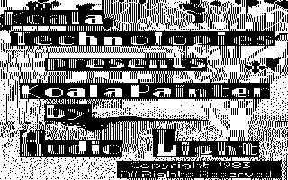
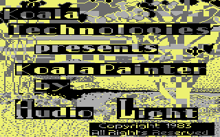

<!-- Generated by c64-docs from knowledge revision 20261025T214624.065-e5whe4 and .c64-re-tools/local/generated/src/source-map.json. Do not edit: change the knowledge, generate the source again, then run docs.ts generate. -->
# Graphics

Each sprite, bitmap, charset and screen region of the knowledge. The knowledge gives no display mode and no colours, so a sprite, bitmap or charset shows in hires and in multicolour, in pattern colours: black is pixel value 0, white is 1 in hires; in multicolour light grey is 1, grey is 2 and yellow is 3. Index: [the reference](index.md).

<a id="charset_1f27"></a>
## [`$1F27`](../../src/script/menu_charset.asm#L15) `$1F27-$1F6E`

*charset*

Characters $62-$6a.


<a id="charset_1f73"></a>
## [`$1F73`](../../src/script/menu_charset.asm#L25) `$1F73-$1F82`

*charset*

Characters $6c-$6d.


<a id="charset_1f9e"></a>
## [`$1F9E`](../../src/script/menu_charset.asm#L31) `$1F9E-$1FDD`

*charset*

Characters $79-$80.


<a id="charset_1fe4"></a>
## [`$1FE4`](../../src/script/menu_charset.asm#L40) `$1FE4-$2063`

*charset*

Characters $82-$91.


<a id="charset_2066"></a>
## [`$2066`](../../src/script/menu_charset.asm#L57) `$2066-$215D`

*charset*

Characters $92-$b0.


<a id="charset_2160"></a>
## [`$2160`](../../src/script/menu_charset.asm#L89) `$2160-$2257`

*charset*

Characters $b1-$cf.


<a id="charset_225a"></a>
## [`$225A`](../../src/script/menu_charset.asm#L121) `$225A-$22F1`

*charset*

Characters $d0-$e2.


<a id="charset_22f4"></a>
## [`$22F4`](../../src/script/menu_charset.asm#L141) `$22F4-$236B`

*charset*

Characters $e3-$f1.


<a id="screen_2400"></a>
## [`$2400`](../../src/script/storage_screen.asm#L19) `$2400`

*screen*

End of the Storage screen script that starts at $23ac: the last letter of "Save", the button texts, the slot texts "PIC   Empty" and the slot letters A-H (left) and I-P (right).

```text
E
```

<a id="screen_2405"></a>
## [`$2405`](../../src/script/storage_screen.asm#L21) `$2405-$2407`

*screen*

```text
.ET
```

<a id="screen_240c"></a>
## [`$240C`](../../src/script/storage_screen.asm#L23) `$240C-$2411`

*screen*

```text
.AME &
```

<a id="screen_2417"></a>
## [`$2417`](../../src/script/storage_screen.asm#L25) `$2417-$2421`

*screen*

```text
.HANGE .ISK
```

<a id="screen_2426"></a>
## [`$2426`](../../src/script/storage_screen.asm#L27) `$2426-$2429`

*screen*

```text
.AVE
```

<a id="screen_242e"></a>
## [`$242E`](../../src/script/storage_screen.asm#L29) `$242E-$2438`

*screen*

```text
.NIT .ISK  
```

<a id="screen_2440"></a>
## [`$2440`](../../src/script/storage_screen.asm#L31) `$2440-$244A`

*screen*

```text
...   EMPTY
```

<a id="screen_24bd"></a>
## [`$24BD`](../../src/storage/storage_scripts.asm#L26) `$24BD-$24D8`

*screen*

```text
.RASE .ISK? .YPE "." .OR .ES
```

<a id="screen_24df"></a>
## [`$24DF`](../../src/storage/storage_scripts.asm#L35) `$24DF-$24EE`

*screen*

```text
.NTER .ISK .AME:
```

<a id="screen_255b"></a>
## [`$255B`](../../src/storage/storage_scripts_251c.asm#L31) `$255B-$2569`

*screen*

```text
.ORMATTING .ISK
```

<a id="screen_2576"></a>
## [`$2576`](../../src/storage/storage_scripts_251c.asm#L36) `$2576-$257A`

*screen*

```text
.RROR
```

<a id="screen_25b0"></a>
## [`$25B0`](../../src/storage/storage_scripts_251c.asm#L52) `$25B0-$25BD`

*screen*

```text
.AVING .ICTURE
```

<a id="screen_25cd"></a>
## [`$25CD`](../../src/storage/storage_scripts_251c.asm#L58) `$25CD-$25DB`

*screen*

```text
.ETTING .ICTURE
```

<a id="screen_2df1"></a>
## [`$2DF1`](../../src/storage/storage_data_2df1.asm#L5) `$2DF1-$2E04`

*screen*

```text
.ISK .OT .NITIALIZED
```

<a id="screen_2e0f"></a>
## [`$2E0F`](../../src/storage/storage_data_2df1.asm#L10) `$2E0F-$2E20`

*screen*

```text
.EVICE .OT .RESENT
```

<a id="screen_2e2b"></a>
## [`$2E2B`](../../src/storage/storage_data_2df1.asm#L15) `$2E2B-$2E38`

*screen*

```text
.ILE NOT FOUND
```

<a id="screen_2e43"></a>
## [`$2E43`](../../src/storage/storage_data_2df1.asm#L20) `$2E43-$2E47`

*screen*

```text
ERROR
```

<a id="title_bitmap"></a>
## [`title_bitmap` `$6000`](../../src/data/title_picture_5c00.asm#L134) `$6000-$7F3F`

*bitmap*

Title picture: the multicolour bitmap. The program uses $6000-$7f3f as the bitmap of the picture that the user paints.




