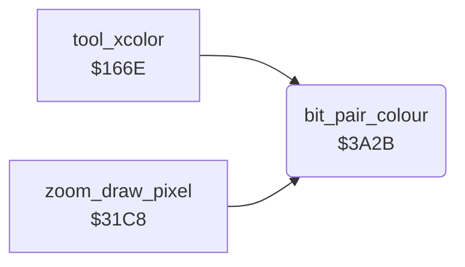

<!-- Generated by c64-docs from knowledge revision 20261025T214624.065-e5whe4 and .c64-re-tools/local/generated/src/source-map.json. Do not edit: change the knowledge, generate the source again, then run docs.ts generate. -->
# graphics/bit_pair_colour.asm: Colour of a bit pair

Range `$3A2B-$3A42`. Source: [graphics/bit_pair_colour.asm](../../../../src/graphics/bit_pair_colour.asm). Index: [the reference](../../index.md).

## Routines

| Routine | Address | Reached from | Summary |
|---|---|---|---|
| [`bit_pair_colour`](bit_pair_colour.md#bit_pair_colour) | `$3A2B` | [`tool_xcolor`](../tools/xcolor_tool.md#tool_xcolor), [`zoom_draw_pixel`](../zoom/zoom_view.md#zoom_draw_pixel) | A = a bit pair 0-3 of a multicolour pixel. |

## Call graph

A solid arrow is a call, a thick arrow a table entry. Rounded nodes are in this file.

## Details

### [`bit_pair_colour`](../../../../src/graphics/bit_pair_colour.asm#L6) `$3A2B`

*routine*

A = a bit pair 0-3 of a multicolour pixel. Gives its colour in A: background_colour, cell_colour1, cell_colour2 or cell_colour3 (the colours of the cell that $15b7 read).

- **Called from:** [`tool_xcolor`](../tools/xcolor_tool.md#tool_xcolor), [`zoom_draw_pixel`](../zoom/zoom_view.md#zoom_draw_pixel)
- **Reads:** [`background_colour`](../../memory-map.md#background_colour), [`cell_colour_1`](../../memory-map.md#cell_colour_1), [`cell_colour_2`](../../memory-map.md#cell_colour_2), [`cell_colour_3`](../../memory-map.md#cell_colour_3)

| Label | Address | Comment |
|---|---|---|
| [`bit_pair_colour_1`](../../../../src/graphics/bit_pair_colour.asm#L11) | `$3A32` |  |
| [`bit_pair_colour_2`](../../../../src/graphics/bit_pair_colour.asm#L16) | `$3A39` |  |
| [`bit_pair_colour_3`](../../../../src/graphics/bit_pair_colour.asm#L21) | `$3A40` |  |
