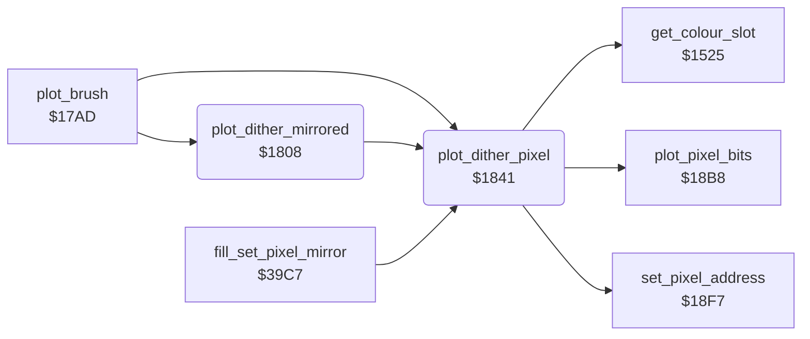

<!-- Generated by c64-docs from knowledge revision 20261024T063946.176-sfrhxb and .c64-re-tools/local/generated/src/source-map.json. Do not edit: change the knowledge, generate the source again, then run docs.ts generate. -->
# graphics/brush_plot.asm: Dither and Mirror Point Plot

Range `$1808-$1867`. Source: [graphics/brush_plot.asm](../../../../src/graphics/brush_plot.asm). Index: [the reference](../../index.md).

## Call graph

A solid arrow is a call, a thick arrow a table entry, a dotted arrow a jump. Rounded nodes are in this file.

## Names

### [`plot_dither_mirrored`](../../../../src/graphics/brush_plot.asm#L6) `$1808`

*routine*

Plots the dither pixel (plot_dither_pixel) at 4 points: (X, Y), (159 - X, Y), (159 - X, 199 - Y) and (X, 199 - Y). Input: X = x (0-159), Y = y (0-199). Keeps cursor_x and cursor_y.

- **Called from:** [`plot_brush`](plot_brush.md#plot_brush) [`$17E9`](../../../../src/graphics/plot_brush.asm#L41)
- **Calls:** [`plot_dither_pixel`](brush_plot.md#plot_dither_pixel)
- **Reads:** [`cursor_y`](../../memory-map.md#cursor_y), [`cursor_x`](../../memory-map.md#cursor_x)
- **Writes:** [`cursor_y`](../../memory-map.md#cursor_y), [`cursor_x`](../../memory-map.md#cursor_x)

### [`plot_dither_pixel`](../../../../src/graphics/brush_plot.asm#L41) `$1841`

*routine*

Plots one pixel at X = x (0-159), Y = y (0-199) in the colour of the dither pattern: dither_colours[(y and 1) * 2 + (x and 1)]. $1525 gives the 2-bit value of that colour in the cell, plot_pixel_bits writes it. current_colour does not change.

- **Called from:** [`plot_brush`](plot_brush.md#plot_brush) [`$17E3`](../../../../src/graphics/plot_brush.asm#L38), [`plot_dither_mirrored`](brush_plot.md#plot_dither_mirrored) [`$1814`](../../../../src/graphics/brush_plot.asm#L15), [`plot_dither_mirrored`](brush_plot.md#plot_dither_mirrored) [`$1821`](../../../../src/graphics/brush_plot.asm#L22), [`plot_dither_mirrored`](brush_plot.md#plot_dither_mirrored) [`$182E`](../../../../src/graphics/brush_plot.asm#L29), [`plot_dither_mirrored`](brush_plot.md#plot_dither_mirrored) [`$1837`](../../../../src/graphics/brush_plot.asm#L34), [`fill_set_pixel_mirror`](../tools/fill_3833.md#fill_set_pixel_mirror) [`$39D1`](../../../../src/tools/fill_3833.asm#L276), [`fill_set_pixel_mirror`](../tools/fill_3833.md#fill_set_pixel_mirror) [`$39DF`](../../../../src/tools/fill_3833.asm#L283), [`fill_set_pixel_mirror`](../tools/fill_3833.md#fill_set_pixel_mirror) [`$39ED`](../../../../src/tools/fill_3833.asm#L290), [`fill_set_pixel_mirror`](../tools/fill_3833.md#fill_set_pixel_mirror) [`$39F8`](../../../../src/tools/fill_3833.asm#L296)
- **Calls:** [`set_pixel_address`](pixel.md#set_pixel_address), [`get_colour_slot`](colour_slots.md#get_colour_slot), [`plot_pixel_bits`](pixel.md#plot_pixel_bits)
- **Reads:** [`pixel_y`](../../memory-map.md#pixel_y), [`pixel_x`](../../memory-map.md#pixel_x), [`temp_word`](../../memory-map.md#temp_word), [`current_colour`](../../memory-map.md#current_colour), [`dither_colours`](../../memory-map.md#dither_colours)
- **Writes:** [`temp_word`](../../memory-map.md#temp_word), [`current_colour`](../../memory-map.md#current_colour)
