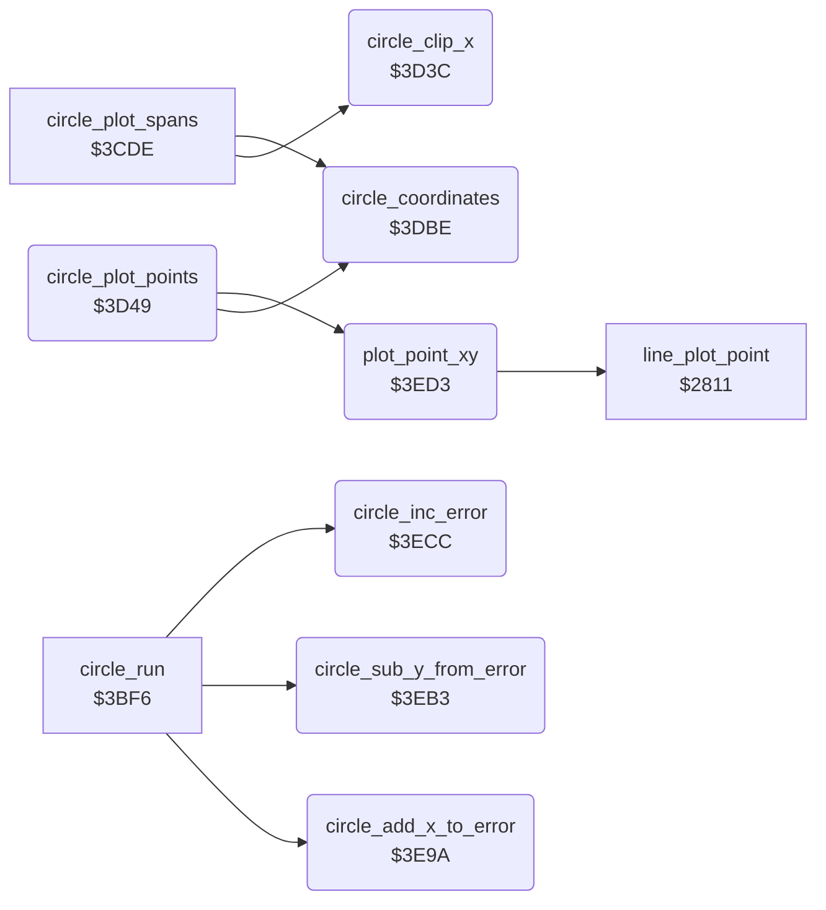

<!-- Generated by c64-docs from knowledge revision 20261024T063946.176-sfrhxb and .c64-re-tools/local/generated/src/source-map.json. Do not edit: change the knowledge, generate the source again, then run docs.ts generate. -->
# graphics/circle_plot_3d3c.asm

Range `$3D3C-$3EE6`. Source: [graphics/circle_plot_3d3c.asm](../../../../src/graphics/circle_plot_3d3c.asm). Index: [the reference](../../index.md).

## Call graph

A solid arrow is a call, a thick arrow a table entry, a dotted arrow a jump. Rounded nodes are in this file.

## Names

### [`circle_clip_x`](../../../../src/graphics/circle_plot_3d3c.asm#L6) `$3D3C`

*routine*

Clips a circle X coordinate. Input A: X, $fe (below 0) or $ff (above draw_max_x). Output A: 0 for $fe, draw_max_x for $ff, else X.

- **Called from:** [`circle_plot_spans`](circle_plot.md#circle_plot_spans) [`$3CEC`](../../../../src/graphics/circle_plot.asm#L15), [`circle_plot_spans`](circle_plot.md#circle_plot_spans) [`$3CFF`](../../../../src/graphics/circle_plot.asm#L24), [`circle_plot_spans`](circle_plot.md#circle_plot_spans) [`$3D15`](../../../../src/graphics/circle_plot.asm#L35), [`circle_plot_spans`](circle_plot.md#circle_plot_spans) [`$3D1C`](../../../../src/graphics/circle_plot.asm#L38)
- **Reads:** [`max_x`](../../memory-map.md#max_x)

### [`circle_clip_x_high`](../../../../src/graphics/circle_plot_3d3c.asm#L10) `$3D42`

*label*

- **Jumped to from:** [`circle_clip_x`](circle_plot_3d3c.md#circle_clip_x) [`$3D3E`](../../../../src/graphics/circle_plot_3d3c.asm#L8)

### [`circle_clip_x_done`](../../../../src/graphics/circle_plot_3d3c.asm#L15) `$3D48`

*label*

- **Jumped to from:** [`circle_clip_x`](circle_plot_3d3c.md#circle_clip_x) [`$3D44`](../../../../src/graphics/circle_plot_3d3c.asm#L12)

### [`circle_plot_points`](../../../../src/graphics/circle_plot_3d3c.asm#L18) `$3D49`

*routine*

Plot routine of the circle outline: plots the four points (circle_x_right, circle_y_down), (circle_x_right, circle_y_up), (circle_x_left, circle_y_down) and (circle_x_left, circle_y_up) with plot_point_xy. It skips a point outside the drawing area. When circle_y_offset is 0, it returns from the caller of circle_plot.

- **Calls:** [`circle_coordinates`](circle_plot_3d3c.md#circle_coordinates), [`plot_point_xy`](circle_plot_3d3c.md#plot_point_xy)
- **Reads:** [`delta_x`](../../memory-map.md#delta_x), [`max_x`](../../memory-map.md#max_x), [`delta_y`](../../memory-map.md#delta_y), [`max_y`](../../memory-map.md#max_y), [`circle_upper_y`](../../memory-map.md#circle_upper_y), [`circle_left_x`](../../memory-map.md#circle_left_x), [`line_dy`](../../memory-map.md#line_dy), [`line_dx`](../../memory-map.md#line_dx)
- **Writes:** [`max_x`](../../memory-map.md#max_x), [`max_y`](../../memory-map.md#max_y)

### [`circle_point_right_up`](../../../../src/graphics/circle_plot_3d3c.asm#L33) `$3D65`

*label*

- **Jumped to from:** [`circle_plot_points`](circle_plot_3d3c.md#circle_plot_points) [`$3D54`](../../../../src/graphics/circle_plot_3d3c.asm#L24), [`circle_plot_points`](circle_plot_3d3c.md#circle_plot_points) [`$3D5F`](../../../../src/graphics/circle_plot_3d3c.asm#L30)

### [`circle_point_left_down`](../../../../src/graphics/circle_plot_3d3c.asm#L47) `$3D7E`

*label*

- **Jumped to from:** [`circle_plot_points`](circle_plot_3d3c.md#circle_plot_points) [`$3D6D`](../../../../src/graphics/circle_plot_3d3c.asm#L38), [`circle_plot_points`](circle_plot_3d3c.md#circle_plot_points) [`$3D78`](../../../../src/graphics/circle_plot_3d3c.asm#L44)

### [`circle_point_left_up`](../../../../src/graphics/circle_plot_3d3c.asm#L61) `$3D97`

*label*

- **Jumped to from:** [`circle_plot_points`](circle_plot_3d3c.md#circle_plot_points) [`$3D86`](../../../../src/graphics/circle_plot_3d3c.asm#L52), [`circle_plot_points`](circle_plot_3d3c.md#circle_plot_points) [`$3D91`](../../../../src/graphics/circle_plot_3d3c.asm#L58)

### [`circle_points_test_end`](../../../../src/graphics/circle_plot_3d3c.asm#L75) `$3DB0`

*label*

- **Jumped to from:** [`circle_plot_points`](circle_plot_3d3c.md#circle_plot_points) [`$3D9F`](../../../../src/graphics/circle_plot_3d3c.asm#L66), [`circle_plot_points`](circle_plot_3d3c.md#circle_plot_points) [`$3DAA`](../../../../src/graphics/circle_plot_3d3c.asm#L72)

### [`circle_points_return`](../../../../src/graphics/circle_plot_3d3c.asm#L81) `$3DBA`

*label*

- **Jumped to from:** [`circle_plot_points`](circle_plot_3d3c.md#circle_plot_points) [`$3DB2`](../../../../src/graphics/circle_plot_3d3c.asm#L77)

### [`circle_points_end`](../../../../src/graphics/circle_plot_3d3c.asm#L83) `$3DBB`

*label*

Drop the return address of circle_plot: the circle is complete.

- **Jumped to from:** [`circle_plot_points`](circle_plot_3d3c.md#circle_plot_points) [`$3DB8`](../../../../src/graphics/circle_plot_3d3c.asm#L80)

### [`circle_coordinates`](../../../../src/graphics/circle_plot_3d3c.asm#L88) `$3DBE`

*routine*

Calculates the four circle coordinates from the centre (shape_x0, shape_y0), circle_x_offset and circle_y_offset: circle_x_right/left = shape_x0 +/- 3/4 * circle_x_offset, circle_y_down/up = shape_y0 +/- circle_y_offset. A coordinate below 0 becomes $fe, a coordinate above draw_max_x or draw_max_y becomes $ff.
temp_word = 3 * circle_x_offset.

- **Called from:** [`circle_plot_spans`](circle_plot.md#circle_plot_spans) [`$3CE7`](../../../../src/graphics/circle_plot.asm#L13), [`circle_plot_points`](circle_plot_3d3c.md#circle_plot_points) [`$3D49`](../../../../src/graphics/circle_plot_3d3c.asm#L19)
- **Reads:** [`line_x_negative`](../../memory-map.md#line_x_negative), [`line_y_negative`](../../memory-map.md#line_y_negative), [`temp_word`](../../memory-map.md#temp_word), [`temp_word_hi`](../../memory-map.md#temp_word_hi), [`shape_x0`](../../memory-map.md#shape_x0), [`max_x`](../../memory-map.md#max_x), [`circle_left_x`](../../memory-map.md#circle_left_x), [`shape_y0`](../../memory-map.md#shape_y0), [`line_dx`](../../memory-map.md#line_dx), [`line_dy`](../../memory-map.md#line_dy), [`max_y`](../../memory-map.md#max_y), [`circle_upper_y`](../../memory-map.md#circle_upper_y)
- **Writes:** [`temp_word`](../../memory-map.md#temp_word), [`temp_word_hi`](../../memory-map.md#temp_word_hi), [`delta_x`](../../memory-map.md#delta_x), [`max_x`](../../memory-map.md#max_x), [`circle_left_x`](../../memory-map.md#circle_left_x), [`delta_y`](../../memory-map.md#delta_y), [`max_y`](../../memory-map.md#max_y), [`circle_upper_y`](../../memory-map.md#circle_upper_y)

### [`circle_coord_right_neg`](../../../../src/graphics/circle_plot_3d3c.asm#L122) `$3DF5`

*label*

- **Jumped to from:** [`circle_coordinates`](circle_plot_3d3c.md#circle_coordinates) [`$3DEF`](../../../../src/graphics/circle_plot_3d3c.asm#L118)

### [`circle_coord_right_max`](../../../../src/graphics/circle_plot_3d3c.asm#L130) `$3E02`

*label*

- **Jumped to from:** [`circle_coordinates`](circle_plot_3d3c.md#circle_coordinates) [`$3DF9`](../../../../src/graphics/circle_plot_3d3c.asm#L125)

### [`circle_coord_left`](../../../../src/graphics/circle_plot_3d3c.asm#L138) `$3E0E`

*label*

- **Jumped to from:** [`circle_coordinates`](circle_plot_3d3c.md#circle_coordinates) [`$3DFF`](../../../../src/graphics/circle_plot_3d3c.asm#L129), [`circle_coordinates`](circle_plot_3d3c.md#circle_coordinates) [`$3E08`](../../../../src/graphics/circle_plot_3d3c.asm#L134)

### [`circle_coord_left_hi`](../../../../src/graphics/circle_plot_3d3c.asm#L149) `$3E22`

*label*

- **Jumped to from:** [`circle_coordinates`](circle_plot_3d3c.md#circle_coordinates) [`$3E19`](../../../../src/graphics/circle_plot_3d3c.asm#L145)

### [`circle_coord_left_max`](../../../../src/graphics/circle_plot_3d3c.asm#L155) `$3E2B`

*label*

- **Jumped to from:** [`circle_coordinates`](circle_plot_3d3c.md#circle_coordinates) [`$3E22`](../../../../src/graphics/circle_plot_3d3c.asm#L150)

### [`circle_coord_down`](../../../../src/graphics/circle_plot_3d3c.asm#L164) `$3E39`

*label*

- **Jumped to from:** [`circle_coordinates`](circle_plot_3d3c.md#circle_coordinates) [`$3E1F`](../../../../src/graphics/circle_plot_3d3c.asm#L148), [`circle_coordinates`](circle_plot_3d3c.md#circle_coordinates) [`$3E28`](../../../../src/graphics/circle_plot_3d3c.asm#L154), [`circle_coordinates`](circle_plot_3d3c.md#circle_coordinates) [`$3E33`](../../../../src/graphics/circle_plot_3d3c.asm#L160)

### [`circle_coord_down_hi`](../../../../src/graphics/circle_plot_3d3c.asm#L177) `$3E4F`

*label*

- **Jumped to from:** [`circle_coordinates`](circle_plot_3d3c.md#circle_coordinates) [`$3E46`](../../../../src/graphics/circle_plot_3d3c.asm#L172)

### [`circle_coord_down_max`](../../../../src/graphics/circle_plot_3d3c.asm#L183) `$3E58`

*label*

- **Jumped to from:** [`circle_coordinates`](circle_plot_3d3c.md#circle_coordinates) [`$3E4F`](../../../../src/graphics/circle_plot_3d3c.asm#L178)

### [`circle_coord_down_store`](../../../../src/graphics/circle_plot_3d3c.asm#L192) `$3E69`

*label*

- **Jumped to from:** [`circle_coordinates`](circle_plot_3d3c.md#circle_coordinates) [`$3E60`](../../../../src/graphics/circle_plot_3d3c.asm#L188)

### [`circle_coord_up`](../../../../src/graphics/circle_plot_3d3c.asm#L194) `$3E6B`

*label*

- **Jumped to from:** [`circle_coordinates`](circle_plot_3d3c.md#circle_coordinates) [`$3E4C`](../../../../src/graphics/circle_plot_3d3c.asm#L176), [`circle_coordinates`](circle_plot_3d3c.md#circle_coordinates) [`$3E55`](../../../../src/graphics/circle_plot_3d3c.asm#L182), [`circle_coordinates`](circle_plot_3d3c.md#circle_coordinates) [`$3E66`](../../../../src/graphics/circle_plot_3d3c.asm#L191)

### [`circle_coord_up_hi`](../../../../src/graphics/circle_plot_3d3c.asm#L205) `$3E7F`

*label*

- **Jumped to from:** [`circle_coordinates`](circle_plot_3d3c.md#circle_coordinates) [`$3E76`](../../../../src/graphics/circle_plot_3d3c.asm#L201)

### [`circle_coord_up_max`](../../../../src/graphics/circle_plot_3d3c.asm#L211) `$3E88`

*label*

- **Jumped to from:** [`circle_coordinates`](circle_plot_3d3c.md#circle_coordinates) [`$3E7F`](../../../../src/graphics/circle_plot_3d3c.asm#L206)

### [`circle_coord_done`](../../../../src/graphics/circle_plot_3d3c.asm#L221) `$3E99`

*label*

- **Jumped to from:** [`circle_coordinates`](circle_plot_3d3c.md#circle_coordinates) [`$3E7C`](../../../../src/graphics/circle_plot_3d3c.asm#L204), [`circle_coordinates`](circle_plot_3d3c.md#circle_coordinates) [`$3E85`](../../../../src/graphics/circle_plot_3d3c.asm#L210), [`circle_coordinates`](circle_plot_3d3c.md#circle_coordinates) [`$3E90`](../../../../src/graphics/circle_plot_3d3c.asm#L216), [`circle_coordinates`](circle_plot_3d3c.md#circle_coordinates) [`$3E96`](../../../../src/graphics/circle_plot_3d3c.asm#L220)

### [`circle_add_x_to_error`](../../../../src/graphics/circle_plot_3d3c.asm#L224) `$3E9A`

*routine*

circle_error = circle_error + 2 * circle_x_offset.

- **Called from:** [`circle_run`](circle.md#circle_run) [`$3C5B`](../../../../src/graphics/circle.asm#L186), [`circle_run`](circle.md#circle_run) [`$3C75`](../../../../src/graphics/circle.asm#L203)
- **Reads:** [`line_x_negative`](../../memory-map.md#line_x_negative), [`line_y_negative`](../../memory-map.md#line_y_negative), [`point_x1`](../../memory-map.md#point_x1), [`temp_word`](../../memory-map.md#temp_word), [`point_y1`](../../memory-map.md#point_y1), [`temp_word_hi`](../../memory-map.md#temp_word_hi)
- **Writes:** [`temp_word`](../../memory-map.md#temp_word), [`temp_word_hi`](../../memory-map.md#temp_word_hi), [`point_x1`](../../memory-map.md#point_x1), [`point_y1`](../../memory-map.md#point_y1)

### [`circle_sub_y_from_error`](../../../../src/graphics/circle_plot_3d3c.asm#L241) `$3EB3`

*routine*

circle_error = circle_error - 2 * circle_y_offset.

- **Called from:** [`circle_run`](circle.md#circle_run) [`$3C78`](../../../../src/graphics/circle.asm#L204), [`circle_run`](circle.md#circle_run) [`$3C8F`](../../../../src/graphics/circle.asm#L217)
- **Reads:** [`line_dx`](../../memory-map.md#line_dx), [`line_dy`](../../memory-map.md#line_dy), [`point_x1`](../../memory-map.md#point_x1), [`temp_word`](../../memory-map.md#temp_word), [`point_y1`](../../memory-map.md#point_y1), [`temp_word_hi`](../../memory-map.md#temp_word_hi)
- **Writes:** [`temp_word`](../../memory-map.md#temp_word), [`temp_word_hi`](../../memory-map.md#temp_word_hi), [`point_x1`](../../memory-map.md#point_x1), [`point_y1`](../../memory-map.md#point_y1)

### [`circle_inc_error`](../../../../src/graphics/circle_plot_3d3c.asm#L258) `$3ECC`

*routine*

circle_error = circle_error + 1.

- **Called from:** [`circle_run`](circle.md#circle_run) [`$3C5E`](../../../../src/graphics/circle.asm#L187), [`circle_run`](circle.md#circle_run) [`$3C7B`](../../../../src/graphics/circle.asm#L205), [`circle_run`](circle.md#circle_run) [`$3C7E`](../../../../src/graphics/circle.asm#L206), [`circle_run`](circle.md#circle_run) [`$3C92`](../../../../src/graphics/circle.asm#L218)
- **Reads:** [`point_x1`](../../memory-map.md#point_x1), [`point_y1`](../../memory-map.md#point_y1)
- **Writes:** [`point_x1`](../../memory-map.md#point_x1), [`point_y1`](../../memory-map.md#point_y1)

### [`circle_inc_error_done`](../../../../src/graphics/circle_plot_3d3c.asm#L262) `$3ED2`

*label*

- **Jumped to from:** [`circle_inc_error`](circle_plot_3d3c.md#circle_inc_error) [`$3ECE`](../../../../src/graphics/circle_plot_3d3c.asm#L260)

### [`plot_point_xy`](../../../../src/graphics/circle_plot_3d3c.asm#L265) `$3ED3`

*routine*

Plots the current brush at X = X register, Y = Y register with the plot routine at $2811. cursor_x and cursor_y do not change.

- **Called from:** [`circle_plot_points`](circle_plot_3d3c.md#circle_plot_points) [`$3D62`](../../../../src/graphics/circle_plot_3d3c.asm#L32), [`circle_plot_points`](circle_plot_3d3c.md#circle_plot_points) [`$3D7B`](../../../../src/graphics/circle_plot_3d3c.asm#L46), [`circle_plot_points`](circle_plot_3d3c.md#circle_plot_points) [`$3D94`](../../../../src/graphics/circle_plot_3d3c.asm#L60), [`circle_plot_points`](circle_plot_3d3c.md#circle_plot_points) [`$3DAD`](../../../../src/graphics/circle_plot_3d3c.asm#L74)
- **Calls:** [`line_plot_point`](bresenham_line.md#line_plot_point)
- **Reads:** [`cursor_x`](../../memory-map.md#cursor_x), [`cursor_y`](../../memory-map.md#cursor_y)
- **Writes:** [`cursor_x`](../../memory-map.md#cursor_x), [`cursor_y`](../../memory-map.md#cursor_y)
