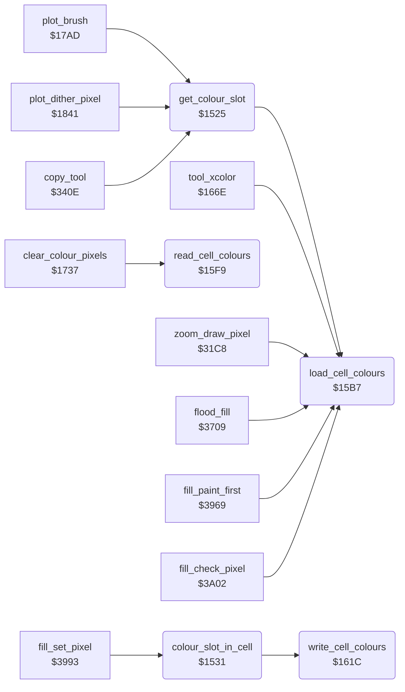

<!-- Generated by c64-docs from knowledge revision 20261025T214624.065-e5whe4 and .c64-re-tools/local/generated/src/source-map.json. Do not edit: change the knowledge, generate the source again, then run docs.ts generate. -->
# graphics/colour_slots.asm: Colours of a picture cell

Range `$1525-$162C`. Source: [graphics/colour_slots.asm](../../../../src/graphics/colour_slots.asm). Index: [the reference](../../index.md).

## Routines

| Routine | Address | Reached from | Summary |
|---|---|---|---|
| [`get_colour_slot`](colour_slots.md#get_colour_slot) | `$1525` | [`plot_brush`](plot_brush.md#plot_brush), [`plot_dither_pixel`](brush_plot.md#plot_dither_pixel), [`copy_tool`](../tools/copy.md#copy_tool), [`jt_sample_pad`](../init/entry.md#jt_sample_pad) | Gives in A the pixel value (0-3) for current_colour in the cell of pixel_ptr. |
| [`colour_slot_in_cell`](colour_slots.md#colour_slot_in_cell) | `$1531` | [`fill_set_pixel`](../tools/fill_3833.md#fill_set_pixel) | Gives in A the pixel value (1-3) of the cell colour (cell_colour_1-3) that is current_colour. |
| [`load_cell_colours`](colour_slots.md#load_cell_colours) | `$15B7` | [`get_colour_slot`](colour_slots.md#get_colour_slot), [`tool_xcolor`](../tools/xcolor_tool.md#tool_xcolor), [`zoom_draw_pixel`](../zoom/zoom_view.md#zoom_draw_pixel), [`flood_fill`](../tools/fill.md#flood_fill), [`fill_paint_first`](../tools/fill_3833.md#fill_paint_first), [`fill_check_pixel`](../tools/fill_3833.md#fill_check_pixel) | Sets cell_screen_ptr and cell_colour_ptr for the cell of the selected pixel (bitmap_row_base, pixel_x) and reads the cell colours into cell_colour_1-3 (read_cell_colours). |
| [`read_cell_colours`](colour_slots.md#read_cell_colours) | `$15F9` | [`clear_colour_pixels`](../tools/xcolor_tool.md#clear_colour_pixels) | Reads the colours of the cell at cell_screen_ptr and cell_colour_ptr: cell_colour_1 = high nybble of the screen byte, cell_colour_2 = low nybble, cell_colour_3 = colour RAM. |
| [`write_cell_colours`](colour_slots.md#write_cell_colours) | `$161C` | [`colour_slot_in_cell`](colour_slots.md#colour_slot_in_cell) | Writes cell_colour_1 (high nybble) and cell_colour_2 (low nybble) to the screen byte at cell_screen_ptr, and cell_colour_3 to the colour RAM at cell_colour_ptr. |

## Call graph

A solid arrow is a call, a thick arrow a table entry. Rounded nodes are in this file.

## Details

### [`get_colour_slot`](../../../../src/graphics/colour_slots.asm#L6) `$1525`

*routine*

Gives in A the pixel value (0-3) for current_colour in the cell of pixel_ptr. 0 = the background colour. Loads the cell colours (load_cell_colours), then continues at colour_slot_in_cell. Also an entry of the JMP table at $0900.

- **Called from:** [`plot_brush`](plot_brush.md#plot_brush), [`plot_dither_pixel`](brush_plot.md#plot_dither_pixel), [`copy_tool`](../tools/copy.md#copy_tool)
- **Jumped to from:** [`jt_sample_pad`](../init/entry.md#jt_sample_pad)
- **Entry of:** [`entry_jump_table`](../../tables.md#entry_jump_table)
- **Calls:** [`load_cell_colours`](colour_slots.md#load_cell_colours)
- **Reads:** [`current_colour`](../../memory-map.md#current_colour), [`background_colour`](../../memory-map.md#background_colour)

| Label | Address | Comment |
|---|---|---|
| [`colour_slot_load_cell`](../../../../src/graphics/colour_slots.asm#L13) | `$152E` |  |

### [`colour_slot_in_cell`](../../../../src/graphics/colour_slots.asm#L16) `$1531`

*routine*

Gives in A the pixel value (1-3) of the cell colour (cell_colour_1-3) that is current_colour. When no cell colour is current_colour, counts the pixels of each value in the 8 bytes of the cell. The value with the fewest pixels (the higher value when equal) gets current_colour in the screen or colour RAM (write_cell_colours), and A gives this value.

- **Called from:** [`fill_set_pixel`](../tools/fill_3833.md#fill_set_pixel)
- **Calls:** [`write_cell_colours`](colour_slots.md#write_cell_colours)
- **Reads:** [`current_colour`](../../memory-map.md#current_colour), [`cell_colour_1`](../../memory-map.md#cell_colour_1), [`cell_colour_2`](../../memory-map.md#cell_colour_2), [`cell_colour_3`](../../memory-map.md#cell_colour_3), [`pixel_ptr`](../../memory-map.md#pixel_ptr), [`temp_word`](../../memory-map.md#temp_word), [`count_pixels_1`](../../memory-map.md#count_pixels_1), [`count_pixels_2`](../../memory-map.md#count_pixels_2), [`count_pixels_3`](../../memory-map.md#count_pixels_3)
- **Writes:** [`count_pixels_1`](../../memory-map.md#count_pixels_1), [`count_pixels_2`](../../memory-map.md#count_pixels_2), [`count_pixels_3`](../../memory-map.md#count_pixels_3), [`temp_word`](../../memory-map.md#temp_word), [`temp_word_hi`](../../memory-map.md#temp_word_hi), [`cell_colour_3`](../../memory-map.md#cell_colour_3), [`cell_colour_1`](../../memory-map.md#cell_colour_1), [`cell_colour_2`](../../memory-map.md#cell_colour_2)

| Label | Address | Comment |
|---|---|---|
| [`colour_slot_check_2`](../../../../src/graphics/colour_slots.asm#L22) | `$153A` |  |
| [`colour_slot_check_3`](../../../../src/graphics/colour_slots.asm#L27) | `$1541` |  |
| [`colour_slot_new`](../../../../src/graphics/colour_slots.asm#L32) | `$1548` |  |
| [`colour_slot_count_byte`](../../../../src/graphics/colour_slots.asm#L43) | `$155C` |  |
| [`colour_slot_count_pixel`](../../../../src/graphics/colour_slots.asm#L47) | `$1561` |  |
| [`colour_slot_not_1`](../../../../src/graphics/colour_slots.asm#L55) | `$1570` |  |
| [`colour_slot_count_3`](../../../../src/graphics/colour_slots.asm#L60) | `$1579` |  |
| [`colour_slot_next_pixel`](../../../../src/graphics/colour_slots.asm#L62) | `$157B` |  |
| [`colour_slot_use_3`](../../../../src/graphics/colour_slots.asm#L78) | `$1592` |  |
| [`colour_slot_cmp_1_3`](../../../../src/graphics/colour_slots.asm#L84) | `$159C` |  |
| [`colour_slot_use_1`](../../../../src/graphics/colour_slots.asm#L88) | `$15A3` |  |
| [`colour_slot_use_2`](../../../../src/graphics/colour_slots.asm#L94) | `$15AD` |  |

### [`load_cell_colours`](../../../../src/graphics/colour_slots.asm#L101) `$15B7`

*routine*

Sets cell_screen_ptr and cell_colour_ptr for the cell of the selected pixel (bitmap_row_base, pixel_x) and reads the cell colours into cell_colour_1-3 (read_cell_colours). Does nothing when the cell is the cell of the last load (cached_cell_ptr).

- **Called from:** [`get_colour_slot`](colour_slots.md#get_colour_slot), [`tool_xcolor`](../tools/xcolor_tool.md#tool_xcolor), [`zoom_draw_pixel`](../zoom/zoom_view.md#zoom_draw_pixel), [`flood_fill`](../tools/fill.md#flood_fill), [`fill_paint_first`](../tools/fill_3833.md#fill_paint_first), [`fill_check_pixel`](../tools/fill_3833.md#fill_check_pixel)
- **Reads:** [`pixel_ptr`](../../memory-map.md#pixel_ptr), [`cell_cache_addr`](../../memory-map.md#cell_cache_addr), [`bitmap_row_base`](../../memory-map.md#bitmap_row_base), [`cell_screen_ptr`](../../memory-map.md#cell_screen_ptr), [`pixel_x`](../../memory-map.md#pixel_x)
- **Writes:** [`cell_screen_ptr`](../../memory-map.md#cell_screen_ptr), [`cell_colour_ptr`](../../memory-map.md#cell_colour_ptr)

| Label | Address | Comment |
|---|---|---|
| [`load_cell_colours_new`](../../../../src/graphics/colour_slots.asm#L110) | `$15C8` | (bitmap_row_base - $6000) / 8 = row * 40. |
| [`load_cell_colours_page`](../../../../src/graphics/colour_slots.asm#L132) | `$15ED` | Screen at $5c00. |

### [`read_cell_colours`](../../../../src/graphics/colour_slots.asm#L141) `$15F9`

*routine*

Reads the colours of the cell at cell_screen_ptr and cell_colour_ptr: cell_colour_1 = high nybble of the screen byte, cell_colour_2 = low nybble, cell_colour_3 = colour RAM. Then stores pixel_ptr AND $f8 in cached_cell_ptr.

- **Called from:** [`clear_colour_pixels`](../tools/xcolor_tool.md#clear_colour_pixels)
- **Reads:** [`cell_screen_ptr`](../../memory-map.md#cell_screen_ptr), [`cell_colour_ptr`](../../memory-map.md#cell_colour_ptr), [`pixel_ptr`](../../memory-map.md#pixel_ptr)
- **Writes:** [`cell_colour_2`](../../memory-map.md#cell_colour_2), [`cell_colour_1`](../../memory-map.md#cell_colour_1), [`cell_colour_3`](../../memory-map.md#cell_colour_3), [`cell_cache_addr`](../../memory-map.md#cell_cache_addr)

### [`write_cell_colours`](../../../../src/graphics/colour_slots.asm#L162) `$161C`

*routine*

Writes cell_colour_1 (high nybble) and cell_colour_2 (low nybble) to the screen byte at cell_screen_ptr, and cell_colour_3 to the colour RAM at cell_colour_ptr.

- **Called from:** [`colour_slot_in_cell`](colour_slots.md#colour_slot_in_cell)
- **Reads:** [`cell_colour_1`](../../memory-map.md#cell_colour_1), [`cell_colour_2`](../../memory-map.md#cell_colour_2), [`cell_screen_ptr`](../../memory-map.md#cell_screen_ptr), [`cell_colour_3`](../../memory-map.md#cell_colour_3), [`cell_colour_ptr`](../../memory-map.md#cell_colour_ptr)
