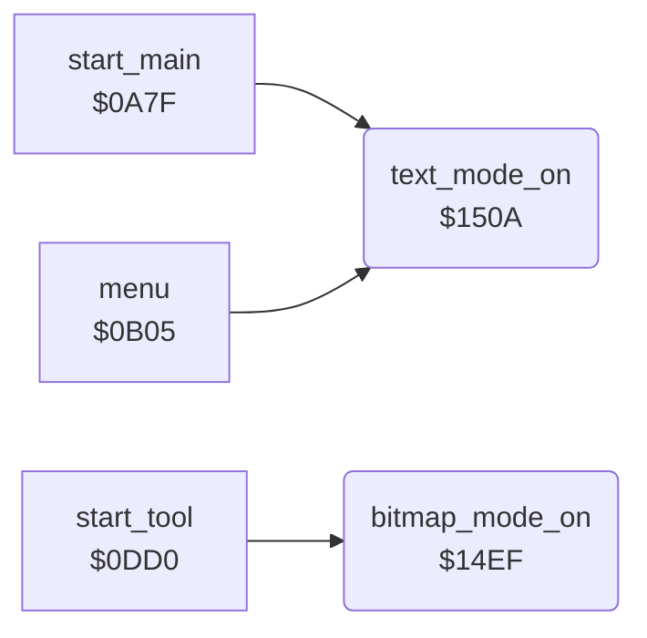

<!-- Generated by c64-docs from knowledge revision 20261025T214624.065-e5whe4 and .c64-re-tools/local/generated/src/source-map.json. Do not edit: change the knowledge, generate the source again, then run docs.ts generate. -->
# graphics/display_mode.asm: Bitmap and text display mode

Range `$14EF-$1524`. Source: [graphics/display_mode.asm](../../../../src/graphics/display_mode.asm). Index: [the reference](../../index.md).

## Routines

| Routine | Address | Reached from | Summary |
|---|---|---|---|
| [`bitmap_mode_on`](display_mode.md#bitmap_mode_on) | `$14EF` | [`start_tool`](../tools/tool_start.md#start_tool) | Shows the picture: sets bitmap mode ($d011 bit 5), multicolour mode ($d016 bit 4) and the bitmap at offset $2000 of the VIC bank ($d018 bit 3). |
| [`text_mode_on`](display_mode.md#text_mode_on) | `$150A` | [`start_main`](../init/start.md#start_main), [`menu`](../menu/menu.md#menu) | Shows the text screen: clears bitmap mode ($d011 bit 5), multicolour mode ($d016 bit 4) and $d018 bit 3. |

## Call graph

A solid arrow is a call, a thick arrow a table entry. Rounded nodes are in this file.

## Details

### [`bitmap_mode_on`](../../../../src/graphics/display_mode.asm#L6) `$14EF`

*routine*

Shows the picture: sets bitmap mode ($d011 bit 5), multicolour mode ($d016 bit 4) and the bitmap at offset $2000 of the VIC bank ($d018 bit 3). Then sets the screen on ($0a42).

- **Called from:** [`start_tool`](../tools/tool_start.md#start_tool)
- **Jumps to:** [`screen_on`](../init/screen.md#screen_on)
- **Reads:** [`SCROLY`](../../memory-map.md#SCROLY), [`SCROLX`](../../memory-map.md#SCROLX), [`VMCSB`](../../memory-map.md#VMCSB)
- **Writes:** [`SCROLY`](../../memory-map.md#SCROLY), [`SCROLX`](../../memory-map.md#SCROLX), [`VMCSB`](../../memory-map.md#VMCSB)

### [`text_mode_on`](../../../../src/graphics/display_mode.asm#L18) `$150A`

*routine*

Shows the text screen: clears bitmap mode ($d011 bit 5), multicolour mode ($d016 bit 4) and $d018 bit 3. Then sets the screen on ($0a42).

- **Called from:** [`start_main`](../init/start.md#start_main), [`menu`](../menu/menu.md#menu)
- **Jumps to:** [`screen_on`](../init/screen.md#screen_on)
- **Reads:** [`SCROLY`](../../memory-map.md#SCROLY), [`SCROLX`](../../memory-map.md#SCROLX), [`VMCSB`](../../memory-map.md#VMCSB)
- **Writes:** [`SCROLY`](../../memory-map.md#SCROLY), [`SCROLX`](../../memory-map.md#SCROLX), [`VMCSB`](../../memory-map.md#VMCSB)
