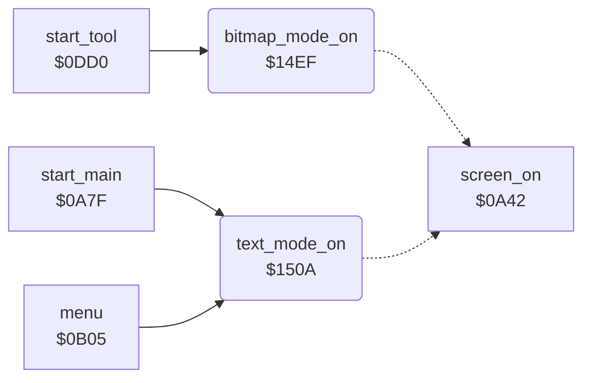

<!-- Generated by c64-docs from knowledge revision 20261024T063946.176-sfrhxb and .c64-re-tools/local/generated/src/source-map.json. Do not edit: change the knowledge, generate the source again, then run docs.ts generate. -->
# graphics/display_mode.asm: Bitmap and text display mode

Range `$14EF-$1524`. Source: [graphics/display_mode.asm](../../../../src/graphics/display_mode.asm). Index: [the reference](../../index.md).

## Call graph

A solid arrow is a call, a thick arrow a table entry, a dotted arrow a jump. Rounded nodes are in this file.

## Names

### [`bitmap_mode_on`](../../../../src/graphics/display_mode.asm#L6) `$14EF`

*routine*

Shows the picture: sets bitmap mode ($d011 bit 5), multicolour mode ($d016 bit 4) and the bitmap at offset $2000 of the VIC bank ($d018 bit 3). Then sets the screen on ($0a42).

- **Called from:** [`start_tool`](../tools/tool_start.md#start_tool) [`$0DDE`](../../../../src/tools/tool_start.asm#L12)
- **Jumps to:** [`screen_on`](../init/screen.md#screen_on)
- **Reads:** [`SCROLY`](../../memory-map.md#SCROLY), [`SCROLX`](../../memory-map.md#SCROLX), [`VMCSB`](../../memory-map.md#VMCSB)
- **Writes:** [`SCROLY`](../../memory-map.md#SCROLY), [`SCROLX`](../../memory-map.md#SCROLX), [`VMCSB`](../../memory-map.md#VMCSB)

### [`text_mode_on`](../../../../src/graphics/display_mode.asm#L18) `$150A`

*routine*

Shows the text screen: clears bitmap mode ($d011 bit 5), multicolour mode ($d016 bit 4) and $d018 bit 3. Then sets the screen on ($0a42).

- **Called from:** [`start_main`](../init/start.md#start_main) [`$0A8E`](../../../../src/init/start.asm#L21), [`menu`](../menu/menu.md#menu) [`$0B4D`](../../../../src/menu/menu.asm#L38)
- **Jumps to:** [`screen_on`](../init/screen.md#screen_on)
- **Reads:** [`SCROLY`](../../memory-map.md#SCROLY), [`SCROLX`](../../memory-map.md#SCROLX), [`VMCSB`](../../memory-map.md#VMCSB)
- **Writes:** [`SCROLY`](../../memory-map.md#SCROLY), [`SCROLX`](../../memory-map.md#SCROLX), [`VMCSB`](../../memory-map.md#VMCSB)
