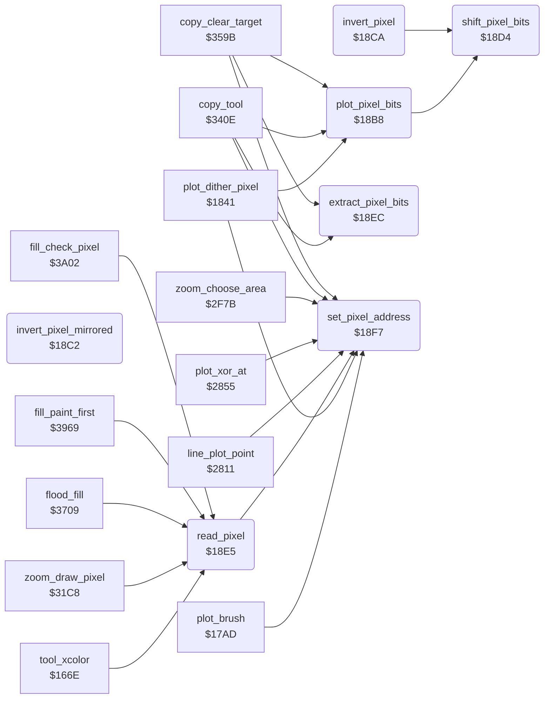

<!-- Generated by c64-docs from knowledge revision 20261025T214624.065-e5whe4 and .c64-re-tools/local/generated/src/source-map.json. Do not edit: change the knowledge, generate the source again, then run docs.ts generate. -->
# graphics/pixel.asm: Pixel Address, Plot, Invert and Read

Range `$18B8-$19AA`. Source: [graphics/pixel.asm](../../../../src/graphics/pixel.asm). Index: [the reference](../../index.md).

## Routines

| Routine | Address | Reached from | Summary |
|---|---|---|---|
| [`plot_pixel_bits`](pixel.md#plot_pixel_bits) | `$18B8` | [`plot_dither_pixel`](brush_plot.md#plot_dither_pixel), [`copy_tool`](../tools/copy.md#copy_tool), [`copy_clear_target`](../tools/copy.md#copy_clear_target), [`jt_sample_pad`](../init/entry.md#jt_sample_pad) | Writes the 2-bit value in A into the pixel at pixel_ptr. |
| [`invert_pixel_mirrored`](pixel.md#invert_pixel_mirrored) | `$18C2` |  | Plot vector of the line routine $279e ($2793 puts it in $52/$53). |
| [`invert_pixel`](pixel.md#invert_pixel) | `$18CA` | [`plot_xor_at`](bresenham_line.md#plot_xor_at) | Inverts both bits of the pixel at pixel_ptr (EOR %11). |
| [`shift_pixel_bits`](pixel.md#shift_pixel_bits) | `$18D4` | [`plot_pixel_bits`](pixel.md#plot_pixel_bits), [`invert_pixel`](pixel.md#invert_pixel) | Shifts the 2-bit value in A to the position of the pixel (pixel_shift) and puts it in pixel_bits. |
| [`read_pixel`](pixel.md#read_pixel) | `$18E5` | [`tool_xcolor`](../tools/xcolor_tool.md#tool_xcolor), [`zoom_draw_pixel`](../zoom/zoom_view.md#zoom_draw_pixel), [`flood_fill`](../tools/fill.md#flood_fill), [`fill_paint_first`](../tools/fill_3833.md#fill_paint_first), [`fill_check_pixel`](../tools/fill_3833.md#fill_check_pixel) | Reads the pixel at X = x (0-159), Y = y (0-199). |
| [`extract_pixel_bits`](pixel.md#extract_pixel_bits) | `$18EC` | [`copy_tool`](../tools/copy.md#copy_tool), [`copy_clear_target`](../tools/copy.md#copy_clear_target) | Returns A = the 2 bits of the pixel at position X (4 = left, 1 = right) of the byte in A. |
| [`set_pixel_address`](pixel.md#set_pixel_address) | `$18F7` | [`plot_brush`](plot_brush.md#plot_brush), [`plot_dither_pixel`](brush_plot.md#plot_dither_pixel), [`read_pixel`](pixel.md#read_pixel), [`line_plot_point`](bresenham_line.md#line_plot_point), [`plot_xor_at`](bresenham_line.md#plot_xor_at), [`zoom_choose_area`](../zoom/zoom_choose_area.md#zoom_choose_area), [`copy_tool`](../tools/copy.md#copy_tool), [`copy_clear_target`](../tools/copy.md#copy_clear_target) | Sets pixel_ptr, pixel_mask and pixel_shift for the pixel at X = x (0-159), Y = y (0-199) of the bitmap at $6000. |

## Data

| Range | Type | Name | Read by | Written by |
|---|---|---|---|---|
| [`$1975`](../../../../src/graphics/pixel.asm#L134)-`$1978` | bytes | [`pixel_clear_masks`](../../../../src/graphics/pixel.asm#L133) | [`set_pixel_address`](pixel.md#set_pixel_address) |  |
| [`$1979`](../../../../src/graphics/pixel.asm#L137)-`$19AA` | words | [`bitmap_row_addr`](../../../../src/graphics/pixel.asm#L136) | [`set_pixel_address`](pixel.md#set_pixel_address), [`zoom_choose_area`](../zoom/zoom_choose_area.md#zoom_choose_area), [`read_source_pixel`](../tools/copy_3619.md#read_source_pixel) |  |

## Call graph

A solid arrow is a call, a thick arrow a table entry. Rounded nodes are in this file.

## Details

### [`plot_pixel_bits`](../../../../src/graphics/pixel.asm#L6) `$18B8`

*routine*

Writes the 2-bit value in A into the pixel at pixel_ptr. Call set_pixel_address first. Jump table entry $0915.

- **Called from:** [`plot_dither_pixel`](brush_plot.md#plot_dither_pixel), [`copy_tool`](../tools/copy.md#copy_tool), [`copy_clear_target`](../tools/copy.md#copy_clear_target)
- **Jumped to from:** [`jt_sample_pad`](../init/entry.md#jt_sample_pad)
- **Entry of:** [`entry_jump_table`](../../tables.md#entry_jump_table)
- **Calls:** [`shift_pixel_bits`](pixel.md#shift_pixel_bits)
- **Reads:** [`pixel_mask`](../../memory-map.md#pixel_mask), [`temp_byte_3`](../../memory-map.md#temp_byte_3), [`pixel_ptr`](../../memory-map.md#pixel_ptr)

### [`invert_pixel_mirrored`](../../../../src/graphics/pixel.asm#L13) `$18C2`

*routine*

Plot vector of the line routine $279e ($2793 puts it in $52/$53). In Mirror mode it inverts the pixel at 4 mirrored points ($281a), else at one point (invert_pixel).

- **Jumps to:** [`invert_pixel`](pixel.md#invert_pixel), [`plot_xor_mirrored`](bresenham_line.md#plot_xor_mirrored)
- **Reads:** [`mirror_mode`](../../memory-map.md#mirror_mode)

### [`invert_pixel`](../../../../src/graphics/pixel.asm#L18) `$18CA`

*routine*

Inverts both bits of the pixel at pixel_ptr (EOR %11). Call set_pixel_address first.

- **Jumped to from:** [`invert_pixel_mirrored`](pixel.md#invert_pixel_mirrored), [`plot_xor_at`](bresenham_line.md#plot_xor_at)
- **Calls:** [`shift_pixel_bits`](pixel.md#shift_pixel_bits)
- **Reads:** [`temp_byte_3`](../../memory-map.md#temp_byte_3), [`pixel_ptr`](../../memory-map.md#pixel_ptr)

### [`shift_pixel_bits`](../../../../src/graphics/pixel.asm#L25) `$18D4`

*routine*

Shifts the 2-bit value in A to the position of the pixel (pixel_shift) and puts it in pixel_bits. Returns A = the byte at pixel_ptr, Y = 0.

- **Called from:** [`plot_pixel_bits`](pixel.md#plot_pixel_bits), [`invert_pixel`](pixel.md#invert_pixel)
- **Reads:** [`pixel_pair_index`](../../memory-map.md#pixel_pair_index), [`pixel_ptr`](../../memory-map.md#pixel_ptr)
- **Writes:** [`temp_byte_3`](../../memory-map.md#temp_byte_3)

| Label | Address | Comment |
|---|---|---|
| [`shift_pixel_bits_loop`](../../../../src/graphics/pixel.asm#L29) | `$18D9` |  |
| [`shift_pixel_bits_done`](../../../../src/graphics/pixel.asm#L34) | `$18DE` |  |

### [`read_pixel`](../../../../src/graphics/pixel.asm#L40) `$18E5`

*routine*

Reads the pixel at X = x (0-159), Y = y (0-199). Returns A = its 2-bit value (0-3).

- **Called from:** [`tool_xcolor`](../tools/xcolor_tool.md#tool_xcolor), [`zoom_draw_pixel`](../zoom/zoom_view.md#zoom_draw_pixel), [`flood_fill`](../tools/fill.md#flood_fill), [`fill_paint_first`](../tools/fill_3833.md#fill_paint_first), [`fill_check_pixel`](../tools/fill_3833.md#fill_check_pixel)
- **Calls:** [`set_pixel_address`](pixel.md#set_pixel_address)
- **Reads:** [`pixel_ptr`](../../memory-map.md#pixel_ptr)

### [`extract_pixel_bits`](../../../../src/graphics/pixel.asm#L45) `$18EC`

*routine*

Returns A = the 2 bits of the pixel at position X (4 = left, 1 = right) of the byte in A.

- **Called from:** [`copy_tool`](../tools/copy.md#copy_tool), [`copy_clear_target`](../tools/copy.md#copy_clear_target)

| Label | Address | Comment |
|---|---|---|
| [`extract_pixel_bits_loop`](../../../../src/graphics/pixel.asm#L48) | `$18EF` |  |
| [`extract_pixel_bits_done`](../../../../src/graphics/pixel.asm#L53) | `$18F4` |  |

### [`set_pixel_address`](../../../../src/graphics/pixel.asm#L57) `$18F7`

*routine*

Sets pixel_ptr, pixel_mask and pixel_shift for the pixel at X = x (0-159), Y = y (0-199) of the bitmap at $6000. It keeps the line address when Y is the same as before, and does nothing when X and Y are both the same. Returns X = pixel_shift.

- **Called from:** [`plot_brush`](plot_brush.md#plot_brush), [`plot_dither_pixel`](brush_plot.md#plot_dither_pixel), [`read_pixel`](pixel.md#read_pixel), [`line_plot_point`](bresenham_line.md#line_plot_point), [`plot_xor_at`](bresenham_line.md#plot_xor_at), [`zoom_choose_area`](../zoom/zoom_choose_area.md#zoom_choose_area), [`copy_tool`](../tools/copy.md#copy_tool), [`copy_clear_target`](../tools/copy.md#copy_clear_target)
- **Reads:** [`pixel_y`](../../memory-map.md#pixel_y), [`pixel_x`](../../memory-map.md#pixel_x), [`pixel_pair_index`](../../memory-map.md#pixel_pair_index), [`pixel_ptr`](../../memory-map.md#pixel_ptr), [`temp_byte_2`](../../memory-map.md#temp_byte_2), [`pixel_line_ptr`](../../memory-map.md#pixel_line_ptr), [`temp_byte_3`](../../memory-map.md#temp_byte_3)
- **Writes:** [`pixel_x`](../../memory-map.md#pixel_x), [`last_cell_ptr`](../../memory-map.md#last_cell_ptr), [`pixel_y`](../../memory-map.md#pixel_y), [`bitmap_row_base`](../../memory-map.md#bitmap_row_base), [`pixel_line_ptr`](../../memory-map.md#pixel_line_ptr), [`temp_byte_2`](../../memory-map.md#temp_byte_2), [`pixel_ptr`](../../memory-map.md#pixel_ptr), [`temp_byte_3`](../../memory-map.md#temp_byte_3), [`pixel_mask`](../../memory-map.md#pixel_mask), [`pixel_pair_index`](../../memory-map.md#pixel_pair_index)

| Label | Address | Comment |
|---|---|---|
| [`set_pixel_address_new_x`](../../../../src/graphics/pixel.asm#L66) | `$1904` |  |
| [`set_pixel_address_new_y`](../../../../src/graphics/pixel.asm#L74) | `$1913` |  |
| [`set_pixel_address_column`](../../../../src/graphics/pixel.asm#L105) | `$194B` |  |
| [`set_pixel_address_add_column`](../../../../src/graphics/pixel.asm#L113) | `$1957` |  |
| [`set_pixel_address_mask`](../../../../src/graphics/pixel.asm#L119) | `$1960` |  |

### [`pixel_clear_masks`](../../../../src/graphics/pixel.asm#L133) `$1975-$1978`

*data*

AND masks that clear pixel 0-3 of a multicolour byte.

- **Read by:** [`set_pixel_address`](pixel.md#set_pixel_address)

### [`bitmap_row_addr`](../../../../src/graphics/pixel.asm#L136) `$1979`

*data*

Start address of each of the 25 character rows of the bitmap at $6000 ($140 bytes for each row).

- **Read by:** [`set_pixel_address`](pixel.md#set_pixel_address), [`zoom_choose_area`](../zoom/zoom_choose_area.md#zoom_choose_area), [`read_source_pixel`](../tools/copy_3619.md#read_source_pixel)

### [`bitmap_row_addr_hi`](../../../../src/graphics/pixel.asm#L138) `$197A-$19AA`

*data*

- **Read by:** [`set_pixel_address`](pixel.md#set_pixel_address), [`zoom_choose_area`](../zoom/zoom_choose_area.md#zoom_choose_area), [`read_source_pixel`](../tools/copy_3619.md#read_source_pixel)
