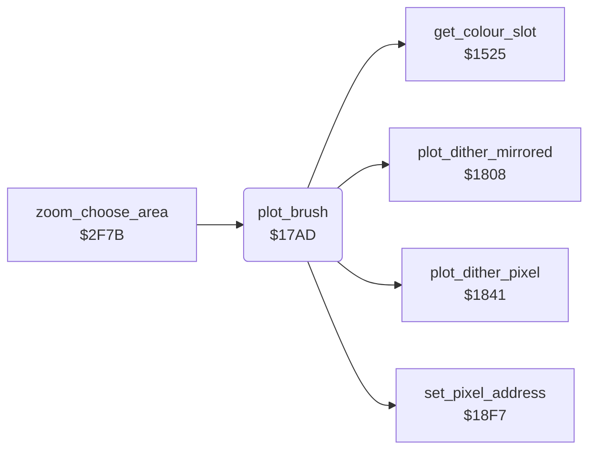

<!-- Generated by c64-docs from knowledge revision 20261025T214624.065-e5whe4 and .c64-re-tools/local/generated/src/source-map.json. Do not edit: change the knowledge, generate the source again, then run docs.ts generate. -->
# graphics/plot_brush.asm: Brush plot

Range `$17AD-$1807`. Source: [graphics/plot_brush.asm](../../../../src/graphics/plot_brush.asm). Index: [the reference](../../index.md).

## Routines

| Routine | Address | Reached from | Summary |
|---|---|---|---|
| [`plot_brush`](plot_brush.md#plot_brush) | `$17AD` | [`zoom_choose_area`](../zoom/zoom_choose_area.md#zoom_choose_area) | Plots the brush (brush_ptr) in current_colour around the selected pixel (pixel_x, pixel_y). |

## Call graph

A solid arrow is a call, a thick arrow a table entry. Rounded nodes are in this file.

## Details

### [`plot_brush`](../../../../src/graphics/plot_brush.asm#L6) `$17AD`

*routine*

Plots the brush (brush_ptr) in current_colour around the selected pixel (pixel_x, pixel_y). The brush is a list of (dx, dy) byte pairs; $80 ends it. A point outside 0-max_x or 0-max_y is not plotted. In mirror mode each point is plotted 4 times ($1808), else one time ($1841). At the end selects the centre pixel again ($18f7) and gets its pixel value (get_colour_slot). It is a plot_vector routine of the line routines.

- **Called from:** [`zoom_choose_area`](../zoom/zoom_choose_area.md#zoom_choose_area)
- **Calls:** [`plot_dither_pixel`](brush_plot.md#plot_dither_pixel), [`plot_dither_mirrored`](brush_plot.md#plot_dither_mirrored), [`set_pixel_address`](pixel.md#set_pixel_address), [`get_colour_slot`](colour_slots.md#get_colour_slot)
- **Reads:** [`pixel_x`](../../memory-map.md#pixel_x), [`pixel_y`](../../memory-map.md#pixel_y), [`brush_ptr`](../../memory-map.md#brush_ptr), [`brush_centre_x`](../../memory-map.md#brush_centre_x), [`max_x`](../../memory-map.md#max_x), [`brush_centre_y`](../../memory-map.md#brush_centre_y), [`max_y`](../../memory-map.md#max_y), [`mirror_mode`](../../memory-map.md#mirror_mode), [`brush_point_index`](../../memory-map.md#brush_point_index)
- **Writes:** [`brush_centre_x`](../../memory-map.md#brush_centre_x), [`brush_centre_y`](../../memory-map.md#brush_centre_y), [`brush_point_index`](../../memory-map.md#brush_point_index), [`max_x`](../../memory-map.md#max_x), [`max_y`](../../memory-map.md#max_y)

| Label | Address | Comment |
|---|---|---|
| [`plot_brush_loop`](../../../../src/graphics/plot_brush.asm#L15) | `$17BB` |  |
| [`plot_brush_mirror`](../../../../src/graphics/plot_brush.asm#L40) | `$17E9` |  |
| [`plot_brush_next`](../../../../src/graphics/plot_brush.asm#L42) | `$17EC` |  |
| [`plot_brush_skip`](../../../../src/graphics/plot_brush.asm#L47) | `$17F4` | Skips dy of a point that is not plotted. |
| [`plot_brush_done`](../../../../src/graphics/plot_brush.asm#L53) | `$17FD` |  |
